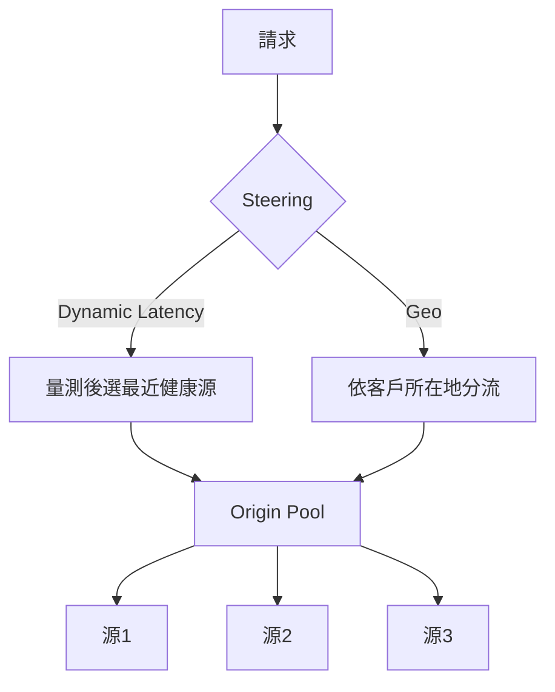

# 9.4 Load Balancing 與多線路出海：從健康檢查到地理路由

## 本節目標

- 區分**主動**與**被動**健康檢查（Health Check），理解兩者為何要並用
- 學會多源（origin）權重、地理路由（Geographic Routing）與 traffic steering policy
- 認識家庭多寬頻「多線路出海」的初步設計，並釐清 Load Balancing 與 DNS Failover 的差異

## 理論：可用性的乘法模型

> 分布式系統的第一課：**單一節點必然失敗（single point of failure, SPOF）**。上一章的架構雖然把「入口高可用」交給了邊緣，但只要 origin 只有**一台**，你還是把「單點死亡」留給了自己伺服器。Load Balancing 的理論目標是：

$$P(\text{服務不可用}) = \prod_{i=1}^{n} P_i(\text{origin } i \text{ 失敗})$$

n 台獨立失敗的機器放在一起，不可用機率呈**乘法下降**（80%、三台 → 0.8³ ≈ 51% 的不可用機率，即 99.49% 可用）。這正是 DNS 負載平衡自 1990 年代 round-robin DNS 以來的核心動機，但 DNS RR 有兩個死穴：**不知道源是否活著**，以及**不能控制「哪個客人被送到哪裡」**。Cloudflare Load Balancing（2016 收購 CoreDNS-related 技術後蓬勃）正是要補齊這兩件事。

## 主動 vs 被動健康檢查

| 面向 | 被動 Passive | 主動 Active |
|------|-------------|-------------|
| 原理 | 從真實請求的失敗/超時反推 | 定期對 origin 發送探針（HTTP GET、TCP 三次呼叫） |
| 反應速度 | 第一個受害者經歷後才知道 | 在 **探針間隔（~60s）內偵測** |
| 源站負擔 | 無 | 每個 pop 一場，量大時不是免費 |
| 可調參 | 失敗閾值、冷卻 | HTTP method、path、預期 status / body 檢查 |

被動偵測的本質是「第一個真實受害者」的證詞，主動則像全天候輪哨。兩者並用：

$$\text{源標記為不健康} \iff \text{主動探針失敗} \vee \text{被動失敗率} > \text{閾值}$$

**實作（Dashboard / API）**：Load Balancing → Health Checks → New：

- Path: `/health`（你應該在每個 origin 上準備一個**極輕量、無外部依賴**的端點）
- Type: HTTP，Interval 60s，Timeout 5s，Retries 2
- Regions: 選你客戶密集的 pop 集群即可（量測點離客戶近，判定才代表客戶真實體感）

## 多源與權重（weights）

一個 Load Balancer Pool 可掛多個 origin，並設定權重：

```json
{
  "name": "home-pool",
  "origins": [
    { "name": "a-server", "address": "203.0.113.10", "weight": 0.8 },
    { "name": "b-nas",    "address": "203.0.113.20", "weight": 0.2 }
  ]
}
```

加權輪詢的機率就是：客戶 A 被送往 a-server 的機率為 `0.8 / (0.8+0.2)`。典型用途：**漸進式流量遷移**（gradual traffic shift）、大機與小機並存。隨著權重由 0.05 → 1.0，你的流量即無縫搬遷，這正是藍綠部署的機械化實踐

## 地理路由（Geographic Routing）與 Steering Policy

Cloudflare 的 steering 策略有三種心智模型：

1. **Dynamic Latency**（預設）：每個 pop 自己量測、選最近的健康源 —— 客製化活地圖
2. **Geo**：**手動指定**某某地域的流量去某某 pool（例如台灣客戶 → 台北的 N1 pool；美國客戶 → Ashburn 的 pool），適合「法規要求資料在地」或「客群與源站對位」
3. **Random**：純隨機，用於 demo 或 A/B 測試



地理路由是「資料在地化」的關鍵工具：**德國使用者的閱讀記錄只能落在德國機房**（GDPR 意涵），Geo + health check 的組合能夠既合規又高可用。

## 家庭多線路出海：初步

許多家庭辦公者有多一條 ISP（例如中華 + 台固），能不能用 Cloudflare Load Balancing 做「**多 WAN 出海**」？

**對外服務情境**（別人連進來你家）：可以簡化為兩個公網 IP、兩條 Tunnel endpoint、一個 pool 兩個 origin，配合 health check 就能讓其中一線斷線時流量自動轉到另一線 —— 這是「**主動健康檢查 + 權重**」的家庭版。

**內部出海情境**（你家連出去外面）：Load Balancing **幫不上忙**，因為它在你達不到的邊緣。這時要做的是**本地路由器側的多 WAN 撥接 + policy routing**（OpenWrt 的 mwan3、MikroTik 的 per-connection classifier），把 HTTP（低延遲需求）與下載（高頻寬）分到不同線路。這是本書的**答案之外**：Cloudflare 不能替代你家路由器的路由表。

> 判準：**Load Balancing 處理「使用者 → 你家」的入口**；「你家 → 網際網路」的出口，是路由器的問題。

## Load Balancing vs DNS Failover

最容易混淆的兩件事：

| 面向 | DNS Failover | Load Balancing |
|------|-------------|----------------|
| 發生層 | DNS 記錄（A/AAAA/CNAME）的返回值 | 邊緣的反向代理（HTTP/TCP 層，內部轉發） |
| 判斷資料 | 健康檢查，失敗即**移除 or 切換記錄** | 健康檢查 + 權重，能**單請求粒度定向** |
| 細膩度 | 只能整個 hostname 切 | 每個請求各選一次源（Anycast 網絡優勢） |
| DNS 快取黏滯 | **TTL 未到期前客戶端仍在用舊 IP** | 因為是邊緣轉發，即時生效，不受 TTL 拖累 |
| 額外運作 | 全靠 DNS | 需要 `*example.tk` 指向 Load Balancer 的 CNAME |

$$\text{DNS Failover 失效時間} \approx \text{TTL} + \text{健康檢查間隔}$$

$$\text{Load Balancing 失效時間} \approx \text{健康檢查間隔}$$

當你對可用性指標挑剔時，**Load Balancing 是唯一能真正消除 TTL 黏滯衝擊的解**；DNS Failover 是最便宜的第一代工具。

## 小結與練習

- 健康檢查的主動/被動是兩個互補的偵測器：一個像守衛（探針），一個像案發現場（真實流量）
- 權重給你「漸進式部署」的控制棒；Geo 給你「法規與客群對位」的**合規指揮棒**
- 多 WAN 兩個方向：**入口可用 LB**、**出口回家做策略路由**；兩者別混淆
- 相比 DNS Failover，LB 的殺手鐧是「邊緣即時判定，不受 TTL 黏滯影響」

練習：

1. 為你的自架服務加上 `/health` 端點，並在 LB dashboard 上模擬關閉服務，觀察探針幾次後它被剝離 pool。
2. 設計一條藍綠部署：新 origin 從 weight 0.05 起步、每天倍增，試畫流量切換時間表與 rollback 檢查點。
3. 比較 TTL 300s 的 DNS Failover 與健康檢查 60s 的 Load Balancing 在「30 秒內完成 failover」機率上的差別，並畫出每一個等待時間對客戶體感的影響。
