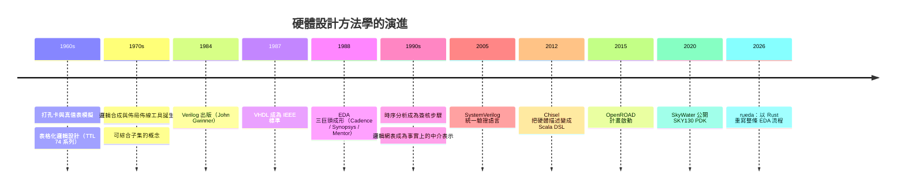
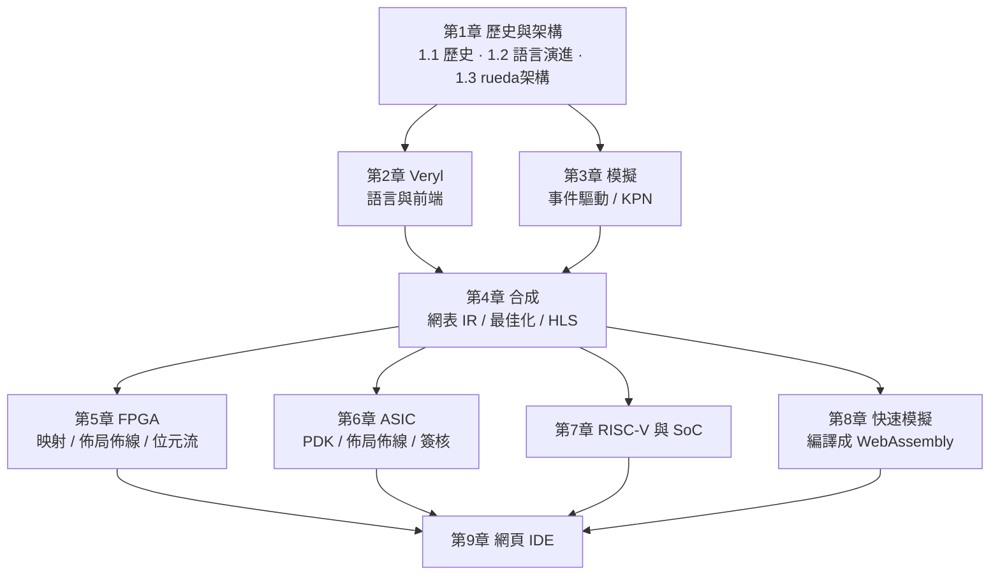

# 1.1 從繼電器到 EDA：電子設計自動化四十年

> 對應原始碼：`/Users/Shared/ccc/project/rueda/`（整個工作區）
> 下一節：[1.2 硬體描述語言的演進](01.2-硬體描述語言的演進.md)

---

## 1.1.1 一切的起點：把圖變成機器

1970 年代中期，一顆晶片裡有幾千顆電晶體。把這樣的電路畫出來、再讓別人照著畫出正確的晶片，是一門手藝。設計流程大致是：

1. 用邏輯設計語言（布林方程、狀態機圖）描述功能；
2. 人工做邏輯分割與閘級化；
3. 人工排零件（placement）——在格線上找位置；
4. 人工繞線（routing）——在格線上拉線，且不能短路、不能太近、不能斷線；
5. 交給光罩廠。

第 3、4 步是人類心智的最大瓶頸。一顆 74 系列的晶片只有幾十顆閘，可以手繪；但一顆微處理器有幾萬顆閘，只能用電腦。

於是「用電腦幫忙設計」這個想法出現了。

| 時期 | 工具 | 輸入 | 輸出 |
|---|---|---|---|
| 1960s | 邏輯模擬器 | 邏輯方程 | 打孔卡上的真值表測試向量 |
| 1970s | 邏輯合成（Synthesis） | 邏輯方程 / 有限狀態機 | 邏輯網表（gate-level netlist） |
| 1970s | 佈局佈線（Place & Route） | 邏輯網表 | 圖形（artwork）→ 光罩 |
| 1980s | 時序分析（STA） | 網表 + 庫延遲 | 時序報告 |

**關鍵的第一步**：把「邏輯描述」和「實體製造」之間插入一個**與技術無關的中間表示**。今天我們叫它 netlist。rueda 專案最核心的設計決定，正是把這件事做得更徹底——見 [1.3](01.3-rueda的架構-一個指令串起所有工具.md)。

## 1.1.2 1984：Verilog 與事件驅動模擬

1984 年，Prentice Hall 出版 John Gwinner 的 *Verilog HDL*。Verilog 原本只是關於語法的檔案與 Verilog-XL 模擬器，1987 年 IEEE 把它變成標準（IEEE 1364）。

Verilog 的三個設計選擇決定了後來三十年的硬體工程：

**(a) 事件驅動（event-driven）**。模擬器維護一個「待處理事件」佇列；只有輸出改變的閘才會被重新求值。這讓一個有十萬顆閘的設計可以在幾秒內跑完一個測試平台，而不是像早期那樣每次都掃全部。

**(b) 四態邏輯（four-state logic）**。Verilog 的值不只是 0/1，還有 `x`（未知）與 `z`（高阻）。這不是裝飾：`reg [7:0] r;` 未賦值時的 `x` 恰好描述了「開機時 RAM 的內容未知」這個真實事實，也讓模擬器能抓到初始化順序的 bug。

**(c) 模組（module）與連接（port）**。硬體設計的本質是階層式的、可重複使用的。「把 design 拆成 module」從此不只是檔案組織方式，而是語言的第一級概念。

```verilog
module counter #(parameter W = 8) (
    input  wire clk,
    input  wire rst_n,
    output reg  [W-1:0] q
);
    always @(posedge clk or negedge rst_n)
        if (!rst_n) q <= 0;
        else        q <= q + 1;
endmodule
```

這段碼到今天仍然是硬體設計的通用語。rueda 的 Veryl 語言（第 2 章）刻意保留它的形狀。

## 1.1.3 1987：VHDL 與「可綜合子集」的出現

1987 年，美國國防部提出 VHDL（VHSIC Hardware Description Language），1988 年成為 IEEE 標準。它的動機是**可驗證性**：軍事與航空電子需要語言的嚴格性，需要能從語言中抽出「這個設計是硬體」的形式化子集。

於是「設計描述語言」分裂成兩種用法：

- **可模擬語言**：可以有迴圈、可以呼叫系統函式、可以有 `$display`——因為模擬器是軟體。
- **可綜合子集（synthesizable subset）**：語法受限，才能對應到硬體。

這個分裂是所有 EDA 工具設計中最張力的一條線。Verilog 與 VHDL 都無法在語言層面強制它，於是工具鏈只能「撞牆時報錯」：綜合器遇到不支援的結構就說 "cannot synthesize"。

## 1.1.4 1990s-2000s：EDA 產業的成熟與壟斷

1990 年代，EDA 產業形成三巨頭：Synopsys（1986 成立）、Cadence（1988）、Mentor Graphics（1981）。三家的核心產品線至今仍是產業的事實標準：

| 階段 | 代表工具 | 說明 |
|---|---|---|
| 前端 | VCS / NC-Sim | 事件驅動模擬器（Verilog/VHDL） |
| 前端 | Design Compiler / Fusion Compiler | 邏輯綜合與連線（technology mapping） |
| 實體 | Innovus / Encounter / PrimeTime | 佈局佈線、時序分析 |
| 驗證 | Formality / Conformal | 形式等價性檢查 |
| 簽核 | Calibre | DRC / LVS |

同時，「**實體驗證（signoff）**」的概念出現：晶片要拿去流片前，必須通過一系列檢查——DRC（設計規則檢查）、LVS（版圖對比原理圖）、STA（靜態時序分析）、天線規則——每一項都要用獨立於設計工具的檢查工具跑一次。理由很直白：設計工具與檢查工具如果共用同一份資料結構，錯誤就會一起錯。

> **這是本書反覆出現的主題**：*用兩種獨立實作交叉驗證*。rueda 的 ASIC 後端自己實作 DRC/LVS，又另外用 KLayout 寫了三支 Python 腳本做交叉檢查（第 6 章）。

## 1.1.5 2005：SystemVerilog 與「驗證語言化」

2005 年的 IEEE 1800 標準把 Verilog 與 VHDL 的優點合併，並加入了大量「驗證專用」語言特性：類別（class）、約束隨機（constrained random）、斷言（assertion）、涵蓋率（coverage）、UVM 函式庫。

推動力來自一個明確的工業問題：**驗證的瓶頸不再是模擬速度，而是「寫測試平台」的速度**。設計一顆晶片要寫 Verilog，驗證它要寫另一種東西，兩邊的工程師要互相等。

SystemVerilog 的答案是把驗證變成同一種語言。

## 1.1.6 2010s：從 RTL 到高階合成

2010 年前後，兩個方向的壓力同時出現：

**壓力一：設計複雜度爆炸。** GPU 與 SoC 的 RTL 規模到了「人寫不完」的程度。

**壓力二：客製化需求。** 從 Google 開始，越來越多公司需要針對自己工作負載客製化的加速器，但買不起或等不及 ASIC 的完整流程。

兩者共同催生了 **High-Level Synthesis（HLS）**：用 C/C++/SystemC 描述演算法，工具把它變成 RTL。

HLS 的核心挑戰在於語義落差。C 是**順序執行的**語言，硬體是**並行的**。工具必須猜測：這段迴圈能不能展開？這個陣列索引是不是可以做成 port？迴圈能不能流水化（pipelining）？每一個「能」都要一個代價模型（cost model）來支撐。

主流 HLS 工具（Vivado HLS、Catapult、Intel 的 HLS）因此都發展出類似的語言擴充：`#pragma HLS PIPELINE`、`#pragma HLS ARRAY_PARTITION`——把硬體參數藏進 C 的註解裡。這是一種實用但彆扭的折衷。

**Fluxa**（第 3.3 節、第 4.3 節）試圖用另一種方式解決同一個問題：把「通道」提升為語言的第一級概念，用 Kahn 程序網路（Kahn process network）取代「猜測」。

## 1.1.7 開源硬體的轉折點

2015 年前後，兩件事讓「自己寫 EDA」從瘋狂變成可能：

**硬體描述語言的開源化。** Chisel（2012，Berkeley）用 Scala 嵌合式 DSL 描述硬體，前端全部是 Scala，編譯產生 FIRRTL，再由開源工具鏈轉成 Verilog。關鍵在於：DSL 可以用現成的語言（編譯器、型別系統、測試框架）建構，不必自己發明。

**開源 PDK 的成熟。** SkyWater 在 2020 年公開了 SKY130 製程的完整 Liberty/LEF/GDS/cdl 資料（Apache-2.0 授權），讓沒有錢買 PDK 的人也能做真正的 ASIC。

> 這一段歷史在 rueda 裡有直接對應：`eda/tools/sky130.sh` 就是從 OpenROAD-flow-scripts 下載 SKY130；`docs/manual` 裡的 ASIC 教學，就是用這套公開資料走完 DRC/LVS/GDS。

## 1.1.8 一條時間軸



## 1.1.9 為什麼現在還值得再寫一套 EDA

讀到這裡，一個合理的疑問是：既然有成熟的商業 EDA，為什麼還要自己做？

理由不是「取代商業工具」，而是**教學與可及性**：

1. **商用工具的授權成本與學習曲線。** 一套完整的 ASIC 流程授權費是六位數美元起，且抽象層次極高，學生看不到「佈局」到底怎麼算。
2. **抽象層次的一致性。** 商業流程中，FPGA 與 ASIC 是兩套世界；但從「同一份網表出發」這個想法，兩者其實共享了 90% 的前端。rueda 的 `eda::netlist::Netlist` 就是這個共享點。
3. **可讀性。** 全部用 Rust 寫、一個 Cargo workspace、沒有 Python 膠水程式，意味著「從網表到 GDS」的全部細節可以在幾千行裡讀完。
4. **教育價值。** 讀懂 PathFinder 的協商繞線、讀懂 LUT 覆蓋的面積流（area flow）指標、讀懂 Elmore 延遲計算——這些知識在別的地方只能從論文裡學。

> **本書的立場**：把 rueda 當成一份「可執行的教科書」。每一章都對應原始碼的一個子系統，說明它為什麼長成那樣，而不是只說它長成那樣。

## 1.1.10 本書的閱讀路線



建議的閱讀順序有兩條：

- **語言到硬體**：第 1 → 2 → 4 → 5 → 6 章。適合想理解「RTL 如何變成晶片」的人。
- **軟體到系統**：第 1 → 3 → 7 → 8 → 9 章。適合想理解「一個程式如何在瀏覽器裡開 Linux」的人。

兩條路線在第 4 章（網表 IR）會合流，因為**網表是唯一的匯流點**。

---

## 1.1.11 演算法索引

本書中會出現的核心演算法，按「何時被需要」排列：

| 演算法 | 問題 | 章節 |
|---|---|---|
| 事件驅動 + delta cycle | 模擬零延遲並列邏輯 | 3.1 |
| Kahn 程序網路 | HLS 的時間模型 | 3.3 |
| 結構雜湊（hash-consing） | 消除重複閘 | 4.1 |
| 區間算術 | 推導硬體位寬 | 4.3 |
| 常數證明（隨機 + 列舉） | 找出恆定節點 | 4.2 |
| 樹覆蓋（tree covering） | 標準單元技術映射 | 6.1 |
| 面積流（area flow） | LUT 覆蓋的品質指標 | 5.1 |
| 模擬退火 | 佈局 | 5.2、6.2 |
| PathFinder 協商繞線 | FPGA 與 ASIC 繞線 | 5.2、6.2 |
| Elmore 延遲 | RC 樹的延遲 | 6.3 |
| 虛擬指令 | 快速模擬的編譯目標 | 8.1、8.2 |
| TCG 式 JIT | 指令集模擬器的加速 | 8.3 |

---

**下一節**：[1.2 硬體描述語言的演進](01.2-硬體描述語言的演進.md) — 從 Verilog 到 Veryl：語言設計裡那些永遠的取捨。
