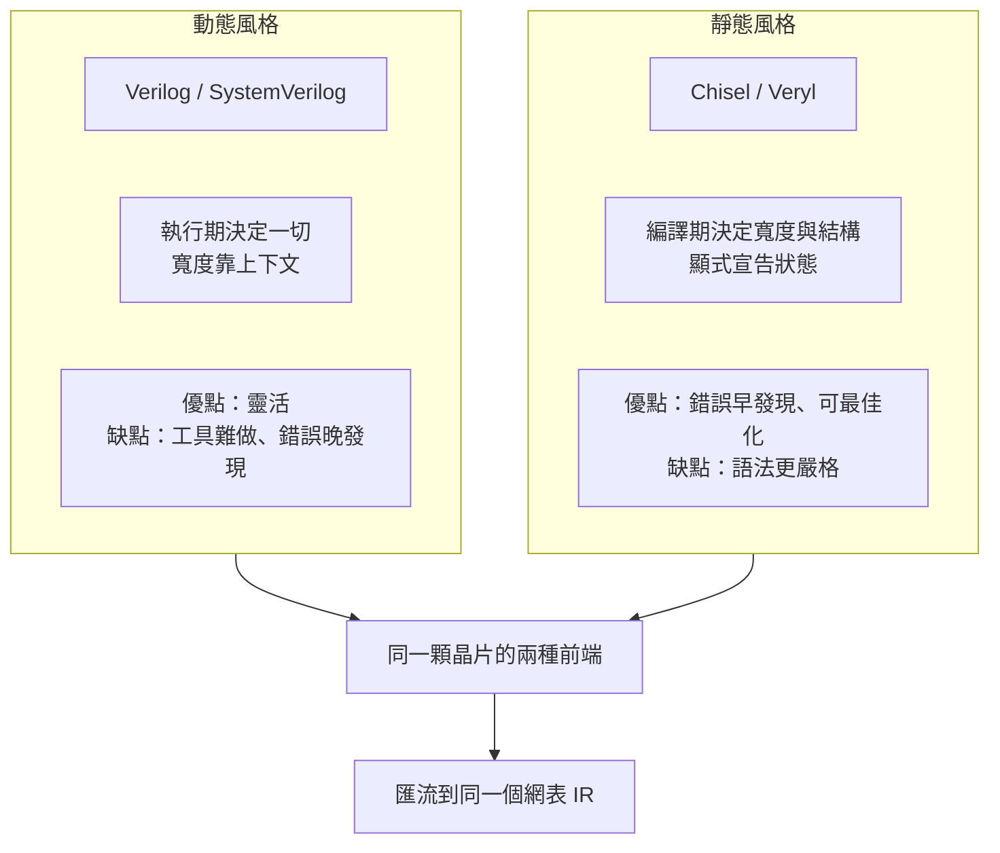

# 1.2 硬體描述語言的演進

> 對應原始碼：`veryl/sim/src/elab.rs`（型別與展開）、`veryl/emu/src/ir.rs`（編譯期 IR）
> 上一節：[1.1 從繼電器到 EDA](01.1-從繼電器到EDA-電子設計自動化四十年.md)　下一節：[1.3 rueda 的架構](01.3-rueda的架構-一個指令串起所有工具.md)

---

## 1.2.1 Verilog 的兩個致命缺陷

Verilog 是 1984 年的產物，它的兩個缺陷在 1990 年代變得無法忍受：

**(a) 沒有型別系統。** 所有值都是一串 bit。寬度靠「上下文決定」（context-determined）：一個運算式的結果寬度，是它左右兩邊較寬的那個。這條規則讓 Verilog 極度靈活，也讓 Verilog 極度容易出錯——多寫一位、少寫一位，編譯器都不會提醒你。

```verilog
reg [7:0] a, b;
reg [15:0] c;
c = a + b;      // 正確：結果寬度 8，被截斷成 8 位後再零延伸到 16 位
```

**(b) 沒有介面概念。** 一個模組的連接埠只有「方向 + 寬度」。要表達「這組連接埠是一組有協定的訊號（valid/ready/data）」，開發者只能：

- 手工把三條線拉出來（容易接錯線）；
- 或者定義一個奇怪的 wrapper module。

前一種做法在大型設計裡是災難來源。

## 1.2.2 SystemVerilog（2005）：把型別與介面補回來

SystemVerilog 補上了兩件事：

**型別**：`logic`、`bit`、`int`、`short`、`longint`、`enum`、`struct`、`interface`、`package`。而且有明確的寬度語意，不再是上下文決定。

**介面**：

```systemverilog
interface Bus #(parameter W = 8);
    logic       valid;
    logic       ready;
    logic [W-1:0] data;
    modport master (output valid, output data, input ready);
    modport slave  (input valid,  input data,  output ready);
endinterface
```

`modport` 的關鍵在於**方向是相對於角色**的：同一個 `interface` 實例接到 master 與 slave 兩端時，兩端的 `valid` 方向是相反的。用單一介面實例 + 兩個 modport 表達，比拉三條線安全得多。

**代價**：SystemVerilog 是一個龐大的語言（LRM 一千多頁），可綜合子集又只是其中一小塊。學習曲線極陡。

## 1.2.3 Chisel（2012）：把硬體描述變成程式語言的程式

Berkeley 的 Chisel 走的是完全不同的路：**不發明新語言，而是把硬體描述做成 Scala 的嵌入式 DSL**。

```scala
class Counter extends Module {
  val io = IO(new Bundle {
    val enable = Input(Bool())
    val out    = Output(UInt(8.W))
  })
  val reg = RegInit(0.U(8.W))
  when(io.enable) { reg := reg + 1.U }
  io.out := reg
}
```

優點非常直接：

- **型別是 Scala 的型別**。`UInt(8.W)` 是真的 Scala 型別，編譯器會幫你檢查。
- **組合與暫存器是 DSL 的邊界**。`RegInit` 產生正反器，`Wire` 產生連線，`when` 產生 mux——使用者必須明確宣告「這裡是狀態」，而不是靠語法慣例。
- **免費得到整個 Scala 生態**：測試框架、產生器、隱式類別。

代價是：**生成的是 FIRRTL，再轉成 Verilog**，多了一層轉譯；且 Scala 編譯慢。

## 1.2.4 Veryl（2021）：Rust 風格的 HDL

Veryl 是 Veryl-lang 專案（2021 年起）的語言，設計目標是「SystemVerilog 的一半複雜度，加上 Rust 的所有權語意」。

本專案使用的 Veryl 語言特性：

```veryl
module SyncRam #(
    param ADDR_W: u32 = 9,
    param DATA_W: u32 = 8,
) (
    i_clk  : input  clock,
    i_we   : input  logic,
    i_waddr: input  logic<ADDR_W>,
    i_wdata: input  logic<DATA_W>,
    i_re   : input  logic,
    i_raddr: input  logic<ADDR_W>,
    o_rdata: output logic<DATA_W>,
) {
    var mem: logic<DATA_W> [1 << ADDR_W];

    always_ff (i_clk) {
        if i_we {
            mem[i_waddr] = i_wdata;
        }
        if i_re {
            o_rdata = mem[i_raddr];
        }
    }
}
```

值得注意的設計點：

**(a) 參數是型別化的。** `param ADDR_W: u32 = 9` —— 參數有型別、有單位，不像 Verilog 那樣只是一個整數常數。

**(b) 連接埠宣告把「名稱 : 方向 型別」寫在一起。** 比 Verilog 的 `input wire [7:0] x` 更像 Rust 的 struct 欄位宣告。

**(c) 陣列長度是運算式。** `logic<DATA_W> [1 << ADDR_W]` —— 這讓「記憶體大小隨參數變化」自然成立。

**(d) `always_ff` 沒有敏感度列表。** Verilog 的 `always @(posedge clk)` 要求你重複寫出時脈；Veryl 讓型別系統負責：

```veryl
always_ff {
    if_reset { q = 0; } else { q = q + 1; }
}
```

展開器（elaborator）會在作用域裡「按宣告順序」找第一個 `clock` 類型的訊號。也可以顯式指定：`always_ff (i_clk, i_rst)`。

**(e) `if_reset` 是一級語法。** 它把「重置時做什麼」與「正常時做什麼」強制分成兩塊：

```veryl
always_ff (i_clk, i_rst) {
    if_reset {
        q = 0;
    } else {
        q = d;
    }
}
```

在合成端，`if_reset` **必須是 `always_ff` 的唯一頂層陳述句**，否則報錯。這是一個「用語言規則強制風格」的典型例子——因為 Verilog 裡 `if (rst) ... else ...` 寫錯成嵌套的 `if`，是硬體 bug 最常見的來源之一。

## 1.2.5 語言設計裡那些永遠的取捨

把上面幾個語言並排，可以提煉出一組永恆的張力：



**取捨一：寬度是靜態決定還是執行期決定？**

- Verilog：執行期（上下文決定）。工具必須在每個運算點推導寬度，並且保證模擬器與綜合器推導一致——這是模擬器和綜合器「不一致」bug 的根源。
- Veryl：編譯期。`veryl/emu/src/ir.rs` 的每個 IR 節點都帶著已決定的寬度與符號性：

```rust
pub struct E { pub k: K, pub w: u32, pub s: bool }
```

  `emu/src/ir.rs` 的註解甚至直接警告：**「寬度規則必須與 `veryl_sim::sim::Sim::eval` 保持一致」**——因為一個是模擬器、一個是編譯器，兩處規則若不同步，模擬結果與編譯結果就會分歧。這是靜態型別語言的真實成本。

**取捨二：模組是「連接埠集合」還是「物件」？**

Verilog 的模組是連接埠集合加上行為；連接子模組時是「以名字為準」的連接。Chisel 把模組變成 Scala 類別，實例化成物件。Veryl 走中間路線：`inst u: SubModule;` 明確宣告實例，但連接仍是平面的。

**取捨三：語言要不要提供「時間」的概念？**

Verilog 沒有時間概念（`#10` 只是模擬延遲）。HLS 語言（C/C++）有，但那是「順序執行的時間」，與硬體的時間無關。

Fluxa（第 3.3 節）在這裡做了一個非常不同的選擇：**語言裡的時間就是硬體的時間**。一個 `task` 的 `recv()` 阻塞，就是一個硬體的握手；一個通道就是一個 FIFO。這消除了 HLS 最難的部分——「猜測」。

## 1.2.6 三種語言的並排比較

| 面向 | Verilog | SystemVerilog | Chisel | Veryl | Fluxa |
|---|---|---|---|---|---|
| 年份 | 1984 | 2005 | 2012 | 2021 | 2026 |
| 類型 | 位元向量 | 強型別 | Scala 型別 | 強型別 | 區間型別 |
| 寬度決定 | 執行期 | 編譯期 | 編譯期 | 編譯期 | 編譯期 |
| 介面 | 無 | `interface`/`modport` | `Bundle` | `interface`/`modport` | `chan` |
| 時間模型 | 無 | 無 | 無 | 無 | **Kahn 程序網路** |
| 陣列語意 | 記憶體 | 記憶體 | `Vec`/`Reg(Vec)` | 記憶體 | `mem`（可指定放置） |
| 產生目標 | — | SV / Verilog | FIRRTL→Verilog | SystemVerilog | 網表 |
| 對應回圈 | 顯式 | 顯式 | Scala | 顯式 | `pipeline(ii=n)` / `unroll` |

## 1.2.7 靜態型別 + 位元精確：一個矛盾的組合

硬體本質上是位元精確的：你不能用「抽象整數」來描述一個 8 位暫存器加法器會不會溢位。而傳統的靜態型別語言（Rust、Haskell）恰好相反——它們的整數型別是「數學上的整數」，溢位是執行期錯誤。

於是就有了這個設計問題：

> 如何讓語言既能在**編譯期**判定位寬，又能在**執行期**（模擬時）精確模擬溢位與 `x`？

rueda 的答案是**兩套值模型**：

| | 語言前端（模擬用） | 合成 / emu |
|---|---|---|
| 值的種類 | 四態（0/1/x/z） | 二態 |
| 寬度 | 執行期由上下文決定 | 編譯期決定 |
| 實作 | `veryl/sim/src/value.rs` | `veryl/emu/src/ir.rs` |

```rust
// veryl/sim/src/value.rs
pub struct Val { pub w: u32, pub v: Bits, pub x: Bits, pub s: bool }
```

`v` 與 `x` 是兩個平行的位元平面；不變式是「`x` 為 1 的位置，`v` 必為 0」。這樣 `x & 0` 自然是 0，`x | 1` 自然是 1，不需要每次運算都寫真值表。

**「雙重模型」的成本**：必須維護一致性。rueda 的做法是寫差異測試——`veryl/emu/tests/check.sh` 讓同一個測試平台分別跑在直譯模擬器與編譯模擬器上，結果必須完全一致。這種「同一語意、兩種實作、交叉驗證」的模式，在第 4 章（合成後閘級模擬 vs RTL 模擬）、第 6 章（內部 DRC vs KLayout DRC）會不斷出現。

> 這是本书要傳達的一個方法論：**任何一個語意，只寫一次會有兩份實作，就一定要有自動化的交叉驗證，否則两份實作一定會漂移。**

---

**下一節**：[1.3 rueda 的架構](01.3-rueda的架構-一個指令串起所有工具.md) — 一個 Cargo workspace、一個指令、一個網表 IR。
