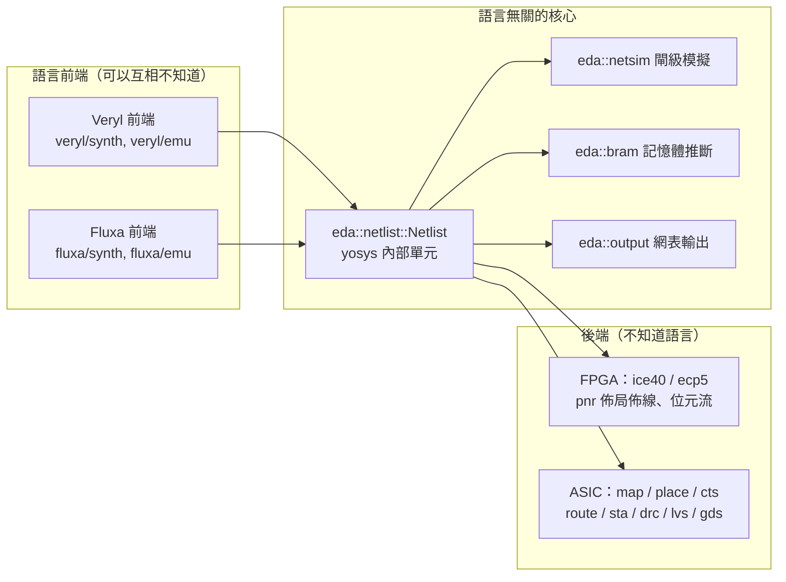
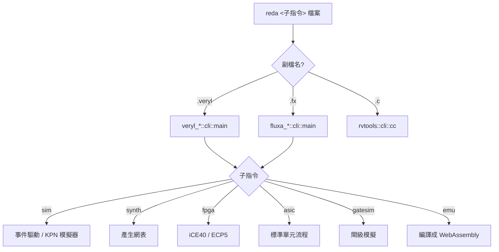

# 1.3 rueda 的架構：一個指令串起所有工具

> 對應原始碼：`AGENTS.md`、`reda/src/main.rs`、`Cargo.toml`、`eda/src/netlist.rs`
> 上一節：[1.2 硬體描述語言的演進](01.2-硬體描述語言的演進.md)

---

## 1.3.1 一個 Cargo workspace 的地圖

rueda 不是「很多工具的集合」，而是**一個 Cargo workspace**。所有 crate 都在同一個 `Cargo.lock` 裡、同一次 `cargo build` 裡編譯。

```
rueda/
├── reda/            CLI：每個工具一個子指令
├── eda/             與語言無關的後端
│   ├── src/           網表、block RAM、輸出格式、閘級模擬、時序約束、功耗
│   ├── src/fpga/      iCE40 / ECP5 映射、自己的佈局佈線與位元流、虛擬 iCEBreaker
│   ├── src/asic/      標準單元流程：佈局、時脈樹、繞線、時序、DRC/LVS、GDS
│   ├── src/pdk/       Liberty / LEF / DEF 解析、SKY130 綁定
│   ├── bits/          與前端共用的位元向量
│   └── tools/         SKY130 下載、KLayout 的 GDS / LVS / 天線檢查
├── veryl/           Veryl 語言
│   ├── sim/           事件驅動模擬器
│   ├── synth/         Veryl → 網表、閘級模擬
│   ├── emu/           Veryl → WebAssembly（週期式）
│   ├── examples/      設計範例、RISC-V SoC、RV64 開發板
│   └── tutorial/      教學與虛擬實驗課
├── fluxa/           Fluxa 語言（高階合成：任務與通道）
│   ├── sim/           模擬器（多執行緒或協作式排程）
│   ├── synth/         Fluxa → 網表
│   ├── emu/           fluxa-emu
│   └── docs/          語言規格與版本紀錄
├── riscv/           RISC-V 軟體
│   ├── rvtools/       C 編譯器、組譯器、RV32 指令集模擬器
│   └── rvemu/         RV64 開發板模擬機（含 WebAssembly JIT）
└── web/             網頁 IDE（TypeScript）；wasm/：它的 WebAssembly 核心
```

## 1.3.2 唯一的一條架構規則

`AGENTS.md` 的第一段就寫著這條規則：

> The gate netlist `eda::netlist::Netlist` (yosys internal cells: `$_AND_`, `$_DFF_P_`, …) is the boundary between the languages and the back end. **`eda/` must not depend on any language front end** (no `veryl-parser`, no `veryl_*`, no `fluxa`); front ends depend on `eda`, never the reverse.

這條規則的實際含義：



**為什麼這條規則值得這麼強調？**

因為「後端不小心用到語言的前端資訊」是最常見的 EDA 架構腐化。一個具體的例子：**記憶體推斷**。

如果 `eda` 知道語言是 Veryl，它就可以直接看 Veryl 的 AST 找出陣列。但這樣一來：

1. 每個新的語言前端都要重新實作一次記憶體推斷；
2. 語言的語意變化（例如 `@reg` 的語意）會直接影響後端，後端就無法獨立驗證。

rueda 的解法是：**語言前端在展開時把記憶體「記錄」成具名網路線**，用一套約定的命名把介面傳遞給後端：

```
$mem:NAME          儲存位元
$mem:NAME:clk      寫入時脈
$mem:NAME:we       寫入使能
$mem:NAME:wa       寫入位址
$mem:NAME:wd       寫入資料
$mem:NAME:ra0      讀取位址（port 0）
$mem:NAME:rd0      讀取資料（port 0）
$mem:NAME:init     初始內容
```

後端的 `eda::bram::find_mems` 只看網表的**結構**（找 flip-flop、找位址解碼），去「證明」這看起來像記憶體的東西。證明失敗就退回 flip-flop 實作。

這個設計還帶來一個額外好處：**你可以手寫網表餵給後端**。任何能產生 yosys JSON 的工具（商用的、合開的）都可以和 rueda 的後端對接。

## 1.3.3 網表 IR：位元層級的最小公分母

`eda/src/netlist.rs` 的核心型別：

```rust
/// 一個位元：編譯期常數，或一條網線（net id >= 2，如 yosys JSON）
#[derive(Clone, Copy, PartialEq, Eq, Hash, Debug, PartialOrd, Ord)]
pub enum Bit {
    C0,
    C1,
    W(u32),
}

#[derive(Clone, Debug)]
pub struct Cell {
    pub typ: String,
    /// (連接埠名稱, 位元)；輸出埠是 "Y"（閘）、"O"（LUT）或 "Q"（正反器）
    pub conns: Vec<(&'static str, Bit)>,
    /// 單元參數（如 LUT_INIT，msb 優先）
    pub params: Vec<(&'static str, String)>,
}

#[derive(Clone)]
pub struct Port { pub name: String, pub dir: Dir, pub bits: Vec<Bit> }

#[derive(Clone)]
pub struct Netlist {
    pub name: String,
    pub ports: Vec<Port>,
    /// 具名網線（階層式名稱）
    pub nets: Vec<(String, Vec<Bit>)>,
    /// 組合單元依拓樸順序，接著是正反器
    pub cells: Vec<Cell>,
}
```

四個設計決定，每個都有理由：

**(a) 位元層級，不是「匯流排層級」。** 向量是 `Vec<Bit>`。這聽起來很低效，但換來的是：**整個工具鏈只有一種資料結構**。加法器是 32 顆全加器、一個 32 位元匯流排還是 32 個 1 位元閘，在 IR 層沒有差別，差別只出現在「產生器」裡。

**(b) 單元名稱用 yosys 內部命名**（`$_AND_`、`$_DFF_P_`）。這意味著 `output.rs` 寫出的 JSON 可以直接餵給 yosys 與 nextpnr。rueda 不需要自己的網表格式——**它複用整個開源生態的格式**。

**(c) 匯流排埠用「索引化的純量接腳」表示**：`conns` 裡出現 `"RADDR[0]"`、`"RADDR[1]"`，而不是一個陣列。輸出時再依 `[i]` 後綴重新群組：

```rust
// 接腳 "NAME[i]" 是埠 NAME 的第 i 位
let mut groups: Vec<(&str, Vec<(usize, &Bit)>)> = vec![];
for (p, b) in &c.conns {
    let (base, i) = match p.split_once('[') {
        Some((n, r)) => (n, r.trim_end_matches(']').parse().unwrap_or(0)),
        None => (*p, 0),
    };
    // ...
}
```

這是刻意的：單元的接腳數量在編譯期就固定（`&'static str`），所以不可能存一個 `Vec<Vec<Bit>>` 而還要支援「動態接腳數」。扁平表示配合事後群組，是最省事又最有效率的方案。

**(d) `cells` 保證「組合邏輯在前、正反器在後」的拓樸順序。** 這個不變式被多處依賴：

- 閘級模擬器（`netsim::settle`）走一遍 cells 就能得到正確的組合邏輯值，不需要反覆迭代；
- 時序分析（`asic::sta`）用「一次前向傳播算到達時間、一次後向傳播算緊要度」，完全不需要拓樸排序；
- `rebuild` 的 DFS 遇到重複節點就報「組合迴路」。

> **網線編號從 2 開始**：`Bit::W(u32)` 的 `u32 >= 2`。因為 yosys JSON 裡 net 0 與 net 1 保留給常數 `"0"` 與 `"1"`。這個約定讓 JSON 輸出器可以直接把 `Bit::W(w)` 印成數字、`C0/C1` 印成字串。

## 1.3.4 輸出埠的單一判準

整個工具鏈需要知道「單元的哪個接腳是驅動端」。rueda 用**一個函式**回答：

```rust
/// 輸出接腳（通用、iCE40、vlib 單元；SKY130 的 X / LO / HI；ECP5 的 Z, S0, S1, COUT, DOA*, DOB*）
pub fn is_out(p: &str) -> bool {
    matches!(p, "Y" | "Q" | "O" | "CO" | "X" | "LO" | "HI" | "Z" | "S0" | "S1" | "COUT")
        || p.starts_with("RDATA") || p.starts_with("DOA") || p.starts_with("DOB")
}
```

這個函式被用在：

- JSON 輸出的方向推斷（`port_dir`）；
- Verilog 輸出的 `wire` / `reg` 宣告區分；
- 閘級模擬器決定「誰驅動這個位元」；
- 死邏輯掃描時決定哪些接腳要沿著反向追蹤。

**沒有 if-else 鏈**。這是一個小例子，但說明了這個專案的風格：把技術相關的差異**壓縮到最少的地點**，讓其他所有邏輯保持技術無關。

## 1.3.5 `reda`：一個指令，像 git 一樣

```
$ reda sim counter.veryl                 # 跑測試平台；語言由副檔名決定
$ reda synth -o adder.json adder.veryl   # 合成成閘級網表
$ reda fpga --pnr veryl --pcf pins.pcf --bin top.bin top.veryl
$ reda asic --pdk sky130 --gds alu.gds alu.veryl
$ reda gatesim ice40 fifo.veryl          # 在合成後的網表上跑測試平台
$ reda emu --top Rv64Soc -o soc.wasm *.veryl
$ reda emu fir.fx                        # Fluxa 的測試
$ reda cc --run hello.c                  # 給 RISC-V SoC 的 C 程式
$ reda rvemu fw_payload.bin              # RV64 開發板模擬機
$ reda help [子指令]
```

設計上值得說明的幾點：

**(a) 語言由副檔名決定。** `.veryl` 走 Veryl 前端，`.fx` 走 Fluxa 前端。`reda/src/main.rs` 依副檔名分派到各 crate 的 `cli::main`。

**(b) 每個工具 crate 暴露 `cli::main(args)`（不含程式名）。** 沒有第二個二進位檔。新增一個工具 = 一個 crate 裡的 `cli` 模組 + `reda/src/main.rs` 裡的 `COMMANDS` 表與 `match` 分支 + `reda/tests/cli.rs` 裡的一個案例。

**(c) 前端與後端的分派是「先判語言，再判工具」。**



## 1.3.6 支援矩陣

| 語言 | 模擬 | 合成 / FPGA / ASIC | 閘級模擬 | 網頁 IDE |
|---|---|---|---|---|
| Veryl（`.veryl`） | `reda sim` | `reda synth / fpga / asic / gatesim` | 有 | 有 |
| Fluxa（`.fx`） | `reda sim` | `reda synth / fpga / asic / gatesim` | 有 | 有 |

兩種語言寫的硬體都能開 Linux：Veryl 的 `Rv64Soc` 與用 Fluxa 寫的同一塊板子（`fluxa/rv64/linux/soc.fx`）開的是**同一個 OpenSBI + Linux + busybox 映像**。

> 這是這個架構最好的驗證：**兩個完全獨立的前端，最後產生的系統行為一致**。如果網表 IR 真的做到了技術無關，這件事就必然成立。

## 1.3.7 建置與測試

```sh
./build.sh             # target/release/reda 與 web/dist（--no-web：只建 reda）
./test.sh              # 整個 workspace 的 cargo test、教學流程、模擬機、Fluxa 處理器、npm test
./test.sh --full       # 再加上 yosys 形式等價、nextpnr 流程（需要 OSS CAD Suite）
./run.sh serve         # 用本機伺服器開 web/dist 的 IDE
```

`./test.sh --full` 特別值得一提：它跑的是**用官方 `veryl build` 產生的 SystemVerilog 與 rueda 產生的網表之間的形式等價性檢查**（yosys + slang）。這是「不信任自己的前端」的驗證策略，細節見第 4 章。

## 1.3.8 這個架構帶來的三個教訓

**教訓一：中介表示的選擇決定了一切。**
網表 IR 選成「位元層級 + yosys 內部單元命名 + 扁平接腳」，就同時換來了：與開源生態的相容性、跨語言共用後端、以及技術無關的所有保證。若網表 IR 選成「Verilog AST」，以上全部會失去。

**教訓二：架構規則必須能被工具強制檢查。**
「`eda/` 不得依賴語言前端」不是靠紀律維持的——Cargo 的 crate 依賴圖本身就會強制它。`eda/Cargo.toml` 裡沒有 `veryl-parser`，就沒有辦法（即使有人想）讓 `eda` 用到它。

**教訓三：把所有工具塞進一個命令，降低了整體成本。**
使用者要記住的不是「模擬器叫什麼、布線器叫什麼」，而是「`reda` 底下有什麼子指令」。對於教學用途，這個差別是決定性的。

---

**下一章**：[第 2 章 Veryl](02.1-Veryl的型別系統與宣告語法.md) — 從語言到網表的第一步。
