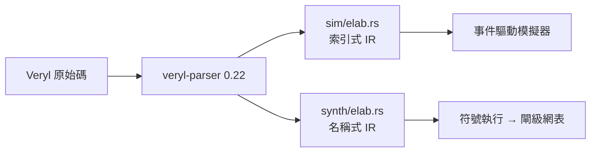
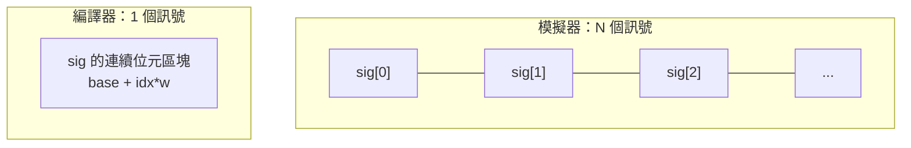

# 2.1 Veryl 的型別系統與宣告語法

> 對應原始碼：`veryl/sim/src/elab.rs`（展開、型別解析）、`veryl/synth/src/elab.rs`（合成端展開）
> 下一節：[2.2 介面、時脈與重置領域](02.2-介面時脈與重置領域.md)

---

## 2.1.1 兩套展開器，兩套目的

rueda 的 Veryl 前端有**兩個獨立的展開器**：

| | 位置 | 目的 | IR 風格 |
|---|---|---|---|
| 模擬用 | `veryl/sim/src/elab.rs` | 產生可執行的程序 | 索引式（`Stmt` 指向 `Signal` 索引） |
| 合成用 | `veryl/synth/src/elab.rs` | 產生閘級網表 | 名稱式（`Stmt` 指向名稱） |

`veryl/synth/src/elab.rs` 的檔頭把理由講得很清楚：

> Deliberately separate from veryl-sim's elaborator: synthesis needs a name-based statement IR that is *symbolically executed* (if/case become muxes, loops are unrolled, functions are inlined), not a simulator IR.

**為什麼不能用同一個？**

模擬器需要的是「執行程式的抽象語意」：變數用索引存取快，陣列用連續的訊號陣列實作。

合成器需要的是「把語意攤平成資料流」：`if` 要變成 mux 鏈、`case` 要變成一熱編碼、`for` 要被展開、`function` 要被內嵌。這需要一個**以名字為主鍵**的 IR——因為「這個名字的值」在資料流裡是跨越多個陳述句流動的東西。



兩者的**共同來源**是 `veryl-parser`——這是官方 Veryl 語言的 parser crate（0.22 版）。工具本身重新實作了展開、求值與合成，只有 parser 是外部依賴。

> 官方 `veryl build` 編譯器被當作**形式等價性檢查的黃金參考**（見第 4 章），而不是被依賴。

## 2.1.2 型別表

`veryl/sim/src/elab.rs` 的 `parse_type` 從 token 串流解析出以下型別：

| 型別 | 意義 |
|---|---|
| `logic` / `logic<N>` | 四態，寬度 N（預設 1） |
| `bit` | 二態 |
| `bool` | 二態，1 位元 |
| `u8 u16 u32 u64`、`i8 i16 i32 i64` | 定寬整數；`i*` 為有號 |
| `logic<N>[M]` | 長度 M 的 1 維陣列，每元素寬度 N |
| `clock`、`clock_posedge`、`clock_negedge` | 時脈領域型別 |
| `reset`、`reset_async_low`、`reset_async_high`、`reset_sync_low`、`reset_sync_high` | 重置領域型別 |
| `Pkg::Enum` | 列舉（寬度來自 enum 的 `logic<W>` 或 `ceil(log2(n))`） |
| `Pkg::Struct` | 打包結構；**第一個欄位是 MSB**（SystemVerilog 慣例） |

### 2.1.2.1 上下文決定寬度

Veryl 保留了 Verilog 的寬度規則，但把它集中在**一個函式**裡：

```rust
// 二元運算：寬度取兩者較寬者
let w = ctx.max(va.w).max(vb.w);
// 比較：同樣取較寬者
// 位移：取左操作數的寬度
```

這是 Verilog 語意的直接延續。而 `veryl/emu/src/ir.rs` 的註解明確警告：

> 寬度規則必須與 `veryl_sim::sim::Sim::eval` 在執行期套用的規則一致

因為編譯期（emu）與執行期（sim）各有兩份實作。`veryl/emu/tests/check.sh` 就是為了保證兩者不漂移而存在的差異測試。

### 2.1.2.2 有號性是遞迴推導的

```rust
// veryl/synth/src/elab.rs
fn signed(&self, e: &Expr) -> bool {
    // + - * & | ^ 要求兩個操作元都是有號
}
```

Verilog 的規則是：有號運算的結果只有在**兩個操作元都是有號**時才是有號。這個規則在語言裡沒有好的表達方式，Veryl 用型別系統（`i32` vs `u32`）把它變得自然。

### 2.1.3 四態值的表示

```rust
// veryl/sim/src/value.rs
pub struct Val { pub w: u32, pub v: Bits, pub x: Bits, pub s: bool }
```

`v` 與 `x` 是兩個平行的位元平面，不變式是「`x` 為 1 的位置，`v` 必為 0」。

`Bits` 是一個定寬的多段（multi-limb）整數，`MAXW = 256` 位（4 個 64 位 limb）。這裡有個重要的取捨：

> **上限 256 位**。這足以涵蓋幾乎所有真實設計，但不是無限的。Flxua 的語言層則承諾 120 位（第 3.3 節）。

`x` 平面的好處是運算子可以自然處理未知：

| 運算 | 結果 |
|---|---|
| `x & 0` | 0 |
| `x \| 1` | 1 |
| `x & 1` | x |
| 三元運算，條件為 x | 兩個分支的「差異遮罩」 |

不需要為每個運算子寫完整真值表。

## 2.1.4 陣列的兩種實作

這是模擬器與編譯器之間一個非常具體的差異：

**模擬器（`veryl/sim/src/elab.rs`）**：一個長度 N 的陣列被宣告成 **N 個連續的訊號**：

```rust
pub struct Signal {
    pub name: String, pub w: u32, pub signed: bool, pub kind: Kind,
    pub val: Val,
    pub arr: Option<u32>,                  // 陣列：元素 0，其餘元素緊接著
    pub fields: Vec<(String, u32, u32)>,   // 結構：(名字, 位元偏移, 寬度)
}
```

`Expr::Elem(base, idx)` 索引成 `sigs[base + idx]`。理由很實際：**這個設計下 `mem[i] = x` 只改一個訊號**，非常適合模擬器的「比較前後狀態」邏輯。

**編譯器（`veryl/emu/src/elab.rs`）**：一個陣列是**單一訊號**，帶 `arr = Some(n)`。理由是相反的：編譯後的程式把整個陣列放在線性記憶體裡，這樣 256 MB 的 RAM 才是一塊連續記憶體，而不是 256M 個物件。



**這就是「同一語意、兩種實作」的第一個實例。** 兩者的行為必須一致，否則同一個設計在 `reda sim` 與 `reda emu` 下會有不同結果。

## 2.1.5 展開：兩趟處理

展開器對每個模組做**兩趟**處理：

- **pass1**：宣告變數、常數、`let` 綁定、import、測試平台元件。
- **pass2**：降級行為陳述句。

這麼做是為了讓**後宣告的東西可以被前面的東西引用**。這不是可有可無的便利——它讓模組內的陳述句順序不重要：

```veryl
module M (
    i_clk : input clock,
    o_q   : output logic<8>,
) {
    var r: logic<8>;        // 宣告在後
    assign o_q = r;         // 但可以在前面被使用
    always_ff (i_clk) { r <= r + 1; }
}
```

在 Verilog 裡這本來就可以（Verilog 允許前向引用），但在合成端就麻煩了——因為合成器要建立「宣告 → 佔位線」的對應。rueda 的解法是**佔位線 + 別名**（第 4.1 節會詳述）。

## 2.1.6 連接埠連接不是結構性的

在模擬器裡，父模組與子模組的連接被展開成**程序**：

```rust
// veryl/sim/src/elab.rs
Dir::In  => self.procs.push(Proc::Comb(vec![Stmt::Assign(LValue{sig: *psig, ..}, e)])),
Dir::Out => self.procs.push(Proc::Comb(vec![Stmt::Assign(lv, Expr::Sig(*psig))])),
```

也就是說，模組連接在模擬器裡是**組合邏輯程序**，不是結構性的網線對應。

在合成端則完全相反：**連接子模組的埠，就是建立一條別名**（alias）。

```rust
// veryl/synth/src/elab.rs
fn drive(&mut self, p: Bit, d: Bit, what: &str) -> R<()> {
    if p == d { return Ok(()); }
    let Bit::W(w) = p else { return Err(format!("'{}' cannot be driven", what)); };
    if !self.driven.insert(w) {
        return Err(format!("'{}' has multiple drivers", what));
    }
    self.alias.insert(w, d);
    Ok(())
}
```

這三行做了四件事：

1. **佔位線與驅動線相同** → 什麼都不做（自我賦值）。
2. **佔位線是常數** → 報錯「不可被驅動」。
3. **已被驅動過** → 報錯「多重驅動」。這是硬體設計最嚴重的 bug 類別，而這裡只需要一個 `HashSet`。
4. 記錄別名 `佔位線 → 驅動線`。

**「多重驅動」檢查幾乎免費**——這是佔位線設計最大的回報。

## 2.1.7 套件、列舉與結構

```veryl
package AluPkg {
    enum Op: logic<2> {
        ADD = 2'd0,
        SUB = 2'd1,
        AND = 2'd2,
        OR  = 2'd3,
    }
}
```

列舉成員在 AST 裡是 `Pkg::Enum::Member`——三個部分。這是 Veryl 0.22 的一個 quirks（官方語言的 AST 設計）。

`import Pkg::*;` 把列舉名、結構名與套件常數帶進作用域，存成別名 `"Pkg::Name"`。

**結構是打包的，第一個欄位在 MSB**：

```veryl
struct Pair {
    hi: logic<8>,
    lo: logic<8>,
}
```

`Pair` 佔 16 位，`hi` 是 [15:8]。欄位存取編譯成位元切片。

## 2.1.8 泛型：刻意不支援

兩個前端都**明確拒絕**泛型介面埠：

> generic interface ports are not supported (name the modport)

而且 `function` 的參數只能是 `input`，函式也不能遞迴（模擬器會偵測遞迴並警告，合成器直接不支援）。

這是「範圍控制」的典型例子。`fluxa/AGENTS.md` 裡有一整節叫「Deliberate scope boundaries (do not "fix")」，列舉了刻意不實作的東西：

> `stage` 層與 `;;`（週期精確語意是另一個模擬器的事）。
> 模擬器中的靜態檢查：II 可達性、bank 衝突、SDF 速率平衡。
> `pipeline(ii = n)` 與 `schedule`：被解析，但在模擬器中沒有行為效果。
> 非阻塞通道操作（`try_recv`/`empty`）被禁止——它們會破壞 KPN 的決定性。

**把「不做什麼」寫下來，與寫「做什麼」同等重要。** 這是大型專案能維持一致性的方法。

## 2.1.9 一個完整的例子

`veryl/examples/src/fifo.veryl`——一個 256×8 的同步 FIFO，會被推斷成 **1 顆 iCE40 block RAM**：

```veryl
module Fifo #(
    param ADDR_W: u32 = 8,
    param DATA_W: u32 = 8,
) (
    i_clk  : input  clock        ,
    i_rst  : input  reset        ,
    i_push : input  logic        ,
    i_data : input  logic<DATA_W>,
    i_pop  : input  logic        ,
    o_data : output logic<DATA_W>,
    o_empty: output logic        ,
    o_full : output logic        ,
    o_count: output logic<ADDR_W + 1>,
) {
    var mem  : logic<DATA_W> [1 << ADDR_W];
    var wp   : logic<ADDR_W>    ;
    var rp   : logic<ADDR_W]    ;
    var count: logic<ADDR_W + 1>;
    var rdata: logic<DATA_W>    ;

    let do_push: logic = i_push && (count != (1 << ADDR_W));
    let do_pop : logic = i_pop && (count != 0);

    always_ff (i_clk) {
        if do_push { mem[wp] = i_data; }
        if do_pop  { rdata = mem[rp]; }
    }

    always_ff {
        if_reset { wp = 0; rp = 0; count = 0; }
        else {
            if do_push { wp = wp + 1; }
            if do_pop  { rp = rp + 1; }
            if do_push && !do_pop { count = count + 1; }
            else if do_pop && !do_push { count = count - 1; }
        }
    }

    assign o_data  = rdata;
    assign o_count = count;
    assign o_empty = count == 0;
    assign o_full  = count == (1 << ADDR_W);
}
```

這個例子把本章講過的每一件事都示範了一遍：

| 特徵 | 位置 |
|---|---|
| 型別化參數 | `param ADDR_W: u32 = 8` |
| 陣列長度是運算式 | `logic<DATA_W> [1 << ADDR_W]` |
| `let` 綁定組合邏輯 | `let do_push: logic = ...` |
| 記憶體寫入獨立於指標更新 | 兩個 `always_ff` |
| `if_reset` 慣例 | 第二個 `always_ff` |
| 時脈自動推導 | `always_ff (i_clk)` 與 `always_ff`（自動找時脈） |

**為什麼記憶體寫入與指標更新要分開？** 因為這是 **block RAM 推斷的必要條件**：一個 block RAM 只有一組寫入埠（位址、資料、使能、時脈）與讀取埠。寫入的時機必須與其他邏輯解耦，才能被後端的推斷器辨識。這個慣例在第 4 章會展開講。

## 2.1.10 測試平台的形狀

```veryl
#[test(fifo_test)]
module TestFifo {
    inst clk: $tb::clock_gen;
    inst rst: $tb::reset_gen(clk);

    // ...
    initial {
        rst.assert();
        $assert(empty == 1'b1, "empty after reset");
        push = 1; din = 8'h11; clk.next();
        // ...
        $finish();
    }
}
```

三個特點：

**(a) `$tb::clock_gen` 是特殊的元件。** 沒有自由運轉的振盪器——**時脈訊號就是這個元件的實例**。測試平台把它接到 DUT 的 `i_clk`，DUT 的 `always_ff` 靠型別（`clock`）找到它。

**(b) `$tb::reset_gen(clk)` 建立重置訊號並記住它的時脈。** 這樣 `rst.assert()` 不帶參數也知道要等哪個時脈。

**(c) `initial` 區塊可以有等待。** 這讓 `initial` 不能只是「一串陳述句」，必須被編譯成一個小程式（第 3.2 節詳述）。

---

**下一節**：[2.2 介面、時脈與重置領域](02.2-介面時脈與重置領域.md)
