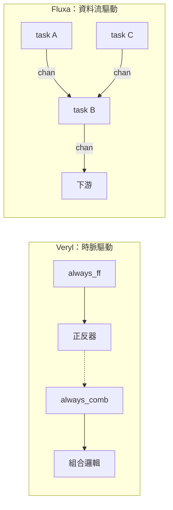

# 2.2 介面、時脈與重置領域

> 對應原始碼：`veryl/sim/src/iface.rs`（modport 解析）、`veryl/sim/src/elab.rs`（時脈/重置推導）、`veryl/synth/src/elab.rs`
> 上一節：[2.1 Veryl 的型別系統與宣告語法](02.1-Veryl的型別系統與宣告語法.md)　下一節：[2.3 從 RTL 到閘級](02.3-從RTL到閘級-符號執行與結構雜湊.md)

---

## 2.2.1 為什麼需要介面

考慮一個 AXI-Stream 風格的匯流排介面。每個介面有三條線：`valid`、`ready`、`data`。

如果沒有介面概念，父模組要用子模組，就得寫：

```veryl
inst u: Producer;
assign u.i_valid = v_valid;
assign u.i_ready = v_ready;
assign u.i_data  = v_data;
assign v_valid = u.o_valid;
assign v_ready = u.o_ready;
assign v_data  = u.o_data;
```

六行，而且**方向寫錯了編譯器不會提醒**（名字是任意的）。介面把這三條線綁成一個群組：

```veryl
interface Stream #(
    param W: u32 = 8,
) {
    var valid: logic;
    var ready: logic;
    var data : logic<W>;

    let fire : logic = valid && ready;

    modport source { valid: output, data: output, ready: input, fire: input }
    modport sink   { valid: input,  data: input,  ready: output, fire: input }
    modport monitor { ..input }
}
```

現在：

```veryl
inst src: Producer;      // 內部宣告 i_s: modport Stream::source
inst dst: Consumer;      // 內部宣告 i_d: modport Stream::sink
```

`modport` 的核心意義是：**方向是相對於角色的**。同一個 `interface` 實例接到 source 與 sink 兩端時，兩端的 `valid` 方向相反。

## 2.2.2 modport 的展開規則

`veryl/sim/src/iface.rs` 實作了 modport 解析，包含預設指定：

| 指定 | 意義 |
|---|---|
| `..input` | 全部成員為輸入 |
| `..output` | 全部成員為輸出 |
| `..same(other)` | 與另一個 modport 同方向 |
| `..converse(other)` | 與另一個 modport 相反方向 |

`..converse` 是最有價值的一個：它表達了「這一端是另一端的對手」這個語意，不需要逐一列舉方向。

**遞迴深度限制為 8**，用來抓出自我指涉的預設指定：

```text
modport A { ..converse(B) }
modport B { ..converse(A) }
```

這會無限展開，所以解析器設了一個上限並報錯。

## 2.2.3 展平規則

介面的實例與連接埠在展開後變成**平面訊號**：

| 原始 | 展開後 |
|---|---|
| 介面實例 `inst b: Bus;` | 訊號 `b.member` |
| modport 埠 `hs: modport Handshake::source` | 每個成員一個埠 `hs.member`，方向取自 modport |

**泛型介面埠被明確拒絕**（兩個前端都拒絕）：必須指名 modport。理由很實際——泛型介面埠的方向在沒有 modport 的情況下是未定義的，與其給一個模糊的規則，不如直接要求使用者說清楚。

## 2.2.4 `let` 與介面成員

```veryl
interface Stream {
    var valid: logic;
    var ready: logic;
    let fire: logic = valid && ready;
    // ...
}
```

`let` 宣告的是一個**組合邏輯的別名**，不是變數。它可以在介面裡宣告，也可以在模組裡：

```veryl
let do_push: logic = i_push && (count != (1 << ADDR_W));
```

`let` 展開成一個 `Proc::Comb` 程序（模擬器）或一組別名（合成器）。它的價值是**讓條件式邏輯有名字**，進而在 `always_ff` 裡讀起來接近硬體規格書：

```veryl
always_ff {
    if_reset { count = 0; }
    else {
        if do_push && !do_pop { count = count + 1; }
        else if do_pop && !do_push { count = count - 1; }
    }
}
```

## 2.2.5 時脈與重置：型別即語意

Veryl 0.22 支援**每個訊號的時脈領域標註**：

```veryl
module TwoClk (
    i_clka: input  'a clock    ,
    i_rsta: input  'a reset    ,
    i_clkb: input  'b clock    ,
    o_a   : output 'a logic<8> ,
) {
    var ca: 'a logic<8>;

    always_ff (i_clka, i_rsta) {
        if_reset { ca = 0; } else { ca = ca + 8'd1; }
    }
}
```

領域標籤（`'a`、`'b`、`'c`）限定型別。但在這個工具鏈裡，**語意是由基礎型別承載的**（`clock` / `clock_posedge` / `clock_negedge` / `reset*`），領域標籤被解析成型別 token 的一部分。

模擬器用一個 `Kind` 列舉來表達：

```rust
// veryl/sim/src/elab.rs
pub enum Kind { Normal, Clock(bool), Reset { low: bool, asynch: bool } }
```

- `clock_negedge` → `Clock(false)` → 正反器在**下降沿**觸發。
- `reset_async_low` → `Reset { low: true, asynch: true }`。
- `reset_sync_high` → `Reset { low: false, asynch: false }`。

**把「非阻塞 / 同步 / 非同步」編進型別，是語言設計的重要取向**。Verilog 裡這些是 `always @(posedge clk or negedge rst)` 這串字串裡的關鍵字，寫錯了編譯器不會知道，直到模擬或 STA 才會發現。

## 2.2.6 時脈的自動推導

`always_ff` **不需要**指明時脈：

```veryl
always_ff {
    if_reset { q = 0; } else { q = d; }
}
```

展開器會在作用域裡找 `clock` 類型的訊號，**依宣告順序**取第一個：

```rust
// 展開器的邏輯（veryl/sim/src/elab.rs）
Scope::order        // 依宣告順序的訊號清單
Scope::find_kind    // 尋找指定 Kind 的第一個訊號
```

也可以顯式指定：

```veryl
always_ff (i_clk) { ... }        // 只指時脈
always_ff (i_clk, i_rst) { ... } // 時脈 + 重置
```

**這個設計的取捨**：自動推導讓簡單設計的程式碼乾淨，但當模組裡有多個時脈時會隱藏真正的意圖。因此 Veryl 也提供顯式形式，兩者共存。

> 這與 Fluxa 的取捨正好相反。Fluxa **完全沒有時脈語意**——它用「通道」表達資料流，時脈是硬體映射階段的事（見第 4.3 節）。兩種語言面對的是同一個問題的兩端。

## 2.2.7 `if_reset`：把重置強制成兩段

```veryl
always_ff (i_clk, i_rst) {
    if_reset {
        q = 0;
    } else {
        q = d;
    }
}
```

模擬端的展開把它改寫成對重置**有效位準**的判斷：

```rust
// veryl/sim/src/elab.rs  Statement::IfResetStatement
let active = Expr::Bin("==".into(), Box::new(Expr::Sig(r)),
                        Box::new(Expr::Num(Val::new(1, if low { 0 } else { 1 }))));
```

也就是說，`reset_async_low` 展開成 `rst == 0`。

**合成端的要求更嚴格**：

> `if_reset` must be the only top-level statement of `always_ff`

這不是隨意的限制。理由是硬體的：

- **非同步重置**在硬體上是接在正反器的 reset 接腳，不是一個在 D 端的 mux。
- **同步重置**則是 `D = rst ? reset_value : normal_d` 的一個 mux，或者一個帶 reset 接腳的專用正反器單元。

要產生正確的硬體，展開器必須知道「重置時的值」是**常數**（0 或 1）還是**某個運算式**。如果 `if_reset` 裡寫的是 `q = some_expression;`，那硬體上就是 mux。如果要求 `if_reset` 是唯一頂層陳述句，展開器就能明確地分派到：

| 情況 | 產生的單元 |
|---|---|
| 非同步重置，值為常數 | `$_DFF_PN0_` / `$_DFF_PN1_`（iCE40 對應 `SB_DFFN`） |
| 同步重置，值為常數 | `$_SDFF_PP0_` / `$_SDFF_PP1_` |
| 重置值不是常數 | D 端前面加一個 mux，正規 `$_DFF_P_` |
| 沒有重置 | `$_DFF_P_` |

第 4 章會看到完整的對應表。

## 2.2.8 硬體語意 vs 軟體語意：`always_ff` 內的讀取

在 Verilog 裡，`always_ff` 內讀取一個模組訊號，讀到的是**它的正反器輸出**（非阻塞語意）。這是硬體語意，不是軟體語意。

在合成端，rueda 把這件事**顯式化**：

```rust
// veryl/synth/src/elab.rs
/// 在 always_ff 內，模組訊號讀到的是它的正反器輸出（指派是非阻塞的），
/// 而不是目前被指派的值
fn registered(&self, sc: &Scope, n: &str) -> bool {
    self.ff.is_some() && sc.sigs.get(n).map(|s| !s.bits.is_empty()).unwrap_or(false)
}
```

以及在求值時：

```rust
Expr::Sym(n) => {
    if let Some(v) = env.get(n) {
        if !self.registered(sc, n) { return Ok(v.clone()); }
    }
    // ...
    Ok(si.bits.clone())   // 正反器自己的位元
}
```

**為什麼必須顯式化？** 因為合成器是「符號執行」語意陳述句的：它把 `q = q + 1` 的右邊求值成一個位元向量，記在環境裡。如果同一個 `always_ff` 內後面又讀 `q`，模擬器（NBA 佇列）會讀到**舊值**，而符號執行器如果直接用環境裡的新值，就會算出「每個時脈加 2」的錯誤結果。

這是「直譯執行」與「符號執行」之間最容易被忽略的語意差異。

## 2.2.9 兩種語言的時序觀點對照

| | Veryl | Fluxa |
|---|---|---|
| 時間 | 隱含在 `always_ff` 的時脈上 | **語言的第一級概念**（通道） |
| 資料流 | 共享變數 | 通道（FIFO） |
| 同步 | 時脈邊緣 | 通道握手（阻塞式 recv/send） |
| 陣列 | 記憶體（可推斷成 BRAM） | `mem`（可指定 `reg`/`lutram`/`bram`/`uram`/`dram`） |
| 誰決定「幾個 cycle」 | 使用者（寫 always_ff） | 工具（通道深度 + pipeline ii） |
| 決定性 | 單一時脈域內決定 | **排程無關**（KPN） |



**Veryl 的模型是「同步資料流」**：每個 cycle everyone 更新一次。
**Fluxa 的模型是「非同步資料流」**：資料在通道上流動，握手決定節奏。

兩者都能描述同一顆硬體。差別在於哪一種更自然：

- 一個狀態機、算術管線 → Veryl 自然。
- 一個濾波器陣列、矩陣乘法器 → Fluxa 自然（第 3.3 節）。

## 2.2.10 一個用介面的完整例子

```veryl
interface Handshake #(
    param W: u32 = 8,
) {
    var valid: logic;
    var ready: logic;
    var data : logic<W>;
    let fire : logic = valid && ready;

    modport source { valid: output, data: output, ready: input, fire: input }
    modport sink   { valid: input,  data: input,  ready: output, fire: input }
    modport monitor { ..input }
}

module Producer #(
    param W: u32 = 8,
) (
    i_clk  : input  clock,
    o_data : output logic<W>,
    o_valid: output logic,
    i_ready: input  logic,
) {
    var r: logic<W>;
    always_ff (i_clk) {
        r <= r + 1;
    }
    assign o_data  = r;
    assign o_valid = 1'b1;
    assign i_ready = 1'b1;
}
```

這個模組可以透過介面連接：

```veryl
module Top (
    i_clk: input clock,
) {
    inst p: Producer;
    inst hs: Handshake;

    connect p.o_data  => hs.data;
    connect p.o_valid => hs.valid;
    connect hs.ready  => p.i_ready;
}
```

`connect` 語法（Veryl 0.22 的一部分）讓連接的方向一目了然。**這是 modport 價值的最佳展示**：如果 `p` 的埠宣告成 `o_data: modport Handshake::source`，那麼連接的方向就由 modport 決定，而不是由 port 名稱決定。

## 2.2.11 領域（domain）與多位元組訊號

把領域標註與型別結合，讓「跨時脈域的訊號」在型別上就看得見：

```veryl
module Cdc (
    i_clk_a: input  'a clock,
    i_clk_b: input  'b clock,
    i_data  : input  'a logic<8>,
    o_data  : output 'b logic<8>,
) {
    var s0: 'a logic<8>;
    var s1: 'b logic<8>;

    always_ff (i_clk_a) { s0 <= i_data; }
    always_ff (i_clk_b) { s1 <= s0; }
}
```

在這個工具鏈裡，領域標籤是被解析的，但跨域的實際處理（同步器插入、MTBF 分析）**不在工具的責任範圍內**。這是誠實的：CDC 是系統層級的問題，需要知道實體實作（FPGA 的 PLL、ASIC 的時脈樹），不是語言能解決的。

> 語言工具應該把問題暴露出來，而不是假裝解決它。`Clock(bool)` 讓「下降沿」是顯式的；`Reset { low, asynch }` 讓「非同步低有效重置」是顯式的。這些資訊後來都被帶進閘級網表（`$_DFF_PN0_` 的名字裡就編碼了邊緣與重置極性），一路流到 STA。

---

**下一節**：[2.3 從 RTL 到閘級：符號執行與結構雜湊](02.3-從RTL到閘級-符號執行與結構雜湊.md)
