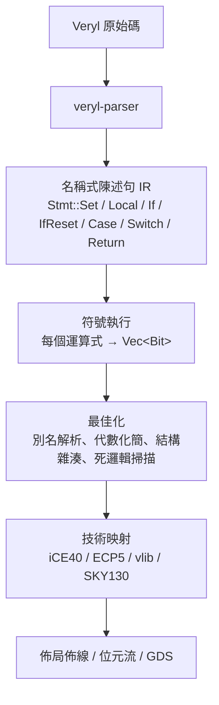

# 2.3 從 RTL 到閘級：符號執行與結構雜湊

> 對應原始碼：`veryl/synth/src/elab.rs`（展開 + 符號執行）、`eda/src/netlist.rs`（Builder、rebuild、optimize）
> 上一節：[2.2 介面、時脈與重置領域](02.2-介面時脈與重置領域.md)

---

## 2.3.1 這是合成還是轉譯？

先回答一個容易混淆的問題：rueda 的 Veryl → 網表是「真正的合成器」還是「結構轉譯器」？

`veryl/synth/src/elab.rs` 的檔頭寫著：

> synthesis needs a name-based statement IR that is *symbolically executed* (if/case become muxes, loops are unrolled, functions are inlined)

**是真正的合成器**，因為：

1. `if` / `case` 會被轉成**硬體結構**（mux 鏈、一熱編碼），不是「保留條件」；
2. `for` 迴圈被**展開**；
3. `function` 被**內嵌**；
4. 之後有一整個**最佳化階段**：代數化簡、結構雜湊、死邏輯消除、常數證明、stuck-at 消除。

完整流程：



## 2.3.2 位元層級的 Builder

合成器的心跳是 `eda::netlist::Builder`：

```rust
// eda/src/netlist.rs
pub struct Builder {
    pub cells: Vec<Cell>,
    pub next_wire: u32,
    cache: HashMap<(&'static str, [Bit; 3]), Bit>,
    /// x <-> !x，因此雙重否定與 x & !x 會被折疊掉
    inv: HashMap<Bit, Bit>,
    /// 把多工器折疊進它選擇的兩個相同值之間
    /// （`s ? (t ? v : a) : a` = `(s & t) ? v : a`）：
    /// 巢狀條件下寫入陣列，每位元只花一個多工器，而不是每個條件一個
    pub fold_mux: bool,
    muxes: HashMap<Bit, [Bit; 3]>,
}
```

三個機制：

**(a) 結構雜湊（hash-consing）。** 所有單元的建立都走同一個 choke point：

```rust
fn gate(&mut self, typ: &'static str, ins: &[(&'static str, Bit)]) -> Bit {
    let mut key = [Bit::C0; 3];
    for (k, (_, b)) in ins.iter().enumerate() { key[k] = *b; }
    if let Some(&y) = self.cache.get(&(typ, key)) { return y; }
    let y = self.wire();
    // ...
    self.cache.insert((typ, key), y);
    y
}
```

鍵是 `(型別, [arg0, arg1, arg2])`——一個三輸入簽章，統一涵蓋 `$_NOT_`（1 個）、`$_AND_`/`$_OR_`/`$_XOR_`（2 個）、`$_MUX_`（3 個）。**相同的閘只會被產生一次**。

**(b) 常數折疊與恆等式。** 每個布林運算在進 `gate()` 之前先做折疊：

```rust
pub fn and(&mut self, a: Bit, b: Bit) -> Bit {
    match (a, b) {
        (Bit::C0, _) | (_, Bit::C0) => Bit::C0,
        (Bit::C1, x) | (x, Bit::C1) => x,
        _ if a == b => a,
        _ if self.is_inv(a, b) => Bit::C0,      // x & !x = 0
        _ => {
            let (x, y) = (a.min(b), a.max(b));   // 交換律正規化
            self.gate("$_AND_", &[("A", x), ("B", y)])
        }
    }
}
```

**交換律正規化是關鍵**。如果不快取排序，`a & b` 與 `b & a` 會是兩個不同的 cell，結構雜湊就失效了。`a.min(b), a.max(b)` 讓 `Bit` 需要 `PartialOrd + Ord`——這就是 `Bit` 為什麼 derives 那麼多 trait。

**(c) 互補追蹤。** `inv: HashMap<Bit, Bit>` 記錄 `x ↔ !x` 雙向關係，讓：

- `!!x → x`（雙重否定消除）
- `x & !x → 0`
- `x | !x → 1`
- `x ^ !x → 1`

都能在**建構時**折疊掉，不需要事後的邏輯化簡 pass。

## 2.3.3 算術元件庫

`Builder` 提供一整套以閘實作的算術：

| 方法 | 演算法 | 深度 |
|---|---|---|
| `reduce(a, unit, f)` | **平衡歸約樹** | $`O(\log n)`$ |
| `add_c(a, b, cin)` | 漣波進位 | $`O(n)`$ |
| `sub` | `add(a, ~b, 1)` | |
| `neg` | `sub(0, a)` | |
| `udivmod` | **回復式除法**（restoring division） | $`O(n)`$ 級，每位元一次減法比較 |
| `sdivmod` | 二補數，向零截斷 | |
| `mul` | 移位-add 陣列乘法器 | $`O(n)`$ |
| `ult` | 無進位比較（`a < b` ⟺ `a + ~b + 1` 無進位） | |
| `slt` | 翻轉符號位後無號比較 | |
| `shift` | **對數桶形移位器** | $`O(\log n)`$ |
| `select` | 一熱選擇 mux 樹 | $`O(\log n)`$ |
| `decode(idx, k)` | 一熱解碼 | |

**平衡歸約樹而不是線性鏈**是一個重要的深度考量。線性 AND 鏈的深度是 $`O(n)`$ ，32 位元的 AND 會有 32 級延遲；平衡樹只有 $`\lceil \log_2 32 \rceil = 5`$ 級。這個差異在 ASIC 流程裡直接影響 Fmax。

**回復式除法**的細節值得一提：除以零時商是全 1、餘數是被除數。這**匹配硬體**——真實的除法器電路在除數為零時就是這個行為。模擬器與硬體在這個邊界情況上一致，是硬體模擬器的基本要求。

## 2.3.4 佔位線與別名：讓「宣告順序」不重要

這是合成端最重要的設計。

**第一步：宣告時立刻配發佔位線。**

```rust
fn declare(&mut self, sc: &mut Scope, name: &str, ty: TypeInfo) -> Vec<Bit> {
    let total = ty.w * ty.arr.unwrap_or(1);
    let bits = self.b.wires(total);
    self.nets.push((sc.qual(name), bits.clone()));
    sc.sigs.insert(name.to_string(), SigInfo { bits: bits.clone(), ty });
    sc.order.push(name.to_string());
    bits
}
```

**第二步：驅動記錄為別名。**（見 2.1.6 節）

**第三步：結束時解析別名並重建。**

```rust
pub fn optimize(b: Builder, alias: &HashMap<u32, Bit>, ports: Vec<Port>,
                nets: Vec<(String, Vec<Bit>)], name: &str) -> R<Netlist>
```

三個直接的好處：

| 好處 | 機制 |
|---|---|
| 宣告順序不重要 | 佔位線先配發，驅動可以之後再說 |
| 連接子模組埠 = 建立別名 | 不需要結構性的 port map，網表裡沒有階層 |
| 多重驅動偵測 | `driven: HashSet` |

> **這是「扁平化網表」最乾淨的實作方式**。Verilog 的 module/port 結構在網表裡必須被「展開」成一個層級，這個過程是很多工具出錯的地方（尤其參數化模組的遞迴展開）。rueda 直接讓連接變成別名，從根本上避開了階層。

## 2.3.5 `rebuild`：重跑整個折疊

```rust
// eda/src/netlist.rs
/// 重建網表：在拓樸順序上重跑常數折疊與結構雜湊，並偵測組合迴路
```

實作是一個**迭代式 DFS**：

```rust
let mut stack: Vec<(u32, bool)> = vec![(rw, false)];
let mut onstack: HashSet<u32> = HashSet::new();
while let Some((w, expanded)) = stack.pop() {
    // ...
    if !onstack.insert(w) {
        return Err(format!("combinational loop through '{}'", net_name(w)));
    }
}
```

**這個 DFS 同時做三件事**：

1. 偵測組合迴路（在 stack 上重複出現 = 迴路）；
2. 建立拓樸順序；
3. 透過新的 `Builder` 重新發出所有 cell，因此**所有的折疊與雜湊全部重新套用**。

`rebuild` 是「把網表正規化」的作業。恆等式折疊會在重建時被套用到所有 cell 上，因此先前建立的一堆 cell 可能會塌縮成更少。

## 2.3.6 `optimize`：迭代到定點

```rust
/// 優化：重建網表，然後把永遠無法離開初始 0 的正反器換成常數 0，重複直到沒有變化
```

「卡住」的正反器定義：

```rust
let is_stuck = |c: &Cell| {
    let (q, d) = (c.out(), c.port("D"));
    let zero_reset = c.port("R").is_none() || c.typ.ends_with("0_");
    c.is_ff() && zero_reset && (d == Some(q) || d == Some(Bit::C0))
};
```

`c.typ.ends_with("0_")` 偵測 `$_DFF_PN0_` / `$_SDFF_PP0_`（重置值為 0）。這些正反器被換成常數 0，然後**迴圈重跑**——因為換掉一個正反器可能讓別的閘變成常數。

### ROM 例外

這裡有一個非常重要的例外：

> A memory that is never written at all is exempt: a block RAM can be given initial contents (a program, see `bram::set_mem_init`), so it is a ROM, not 0.

實作方式是掃描名為 `$mem:NAME:clk` 的網線，檢查對應的 `$mem:NAME` 網線是否**完全由卡住的正反器輸出組成**。若是，則保留（它是 ROM）。

**為什麼這是必要的？** 想想一個把 bootloader 燒進 block RAM 的設計。它的記憶體永遠不被寫入，所以所有位元都是「卡住」的。如果沒有這個例外，最佳化會把它變成全 0，程式就不見了。

## 2.3.7 常數證明：隨機猜測 + 列舉證明

這是合成器裡最精巧的一段。

**問題**：區域性折疊看不到全域性的常數。例如，一個從常數 ROM 解碼出來的寫入致能，看起來像是一個隨機訊號，但實際上永遠是 0。

**解法**：分兩階段。

### 階段一：隨機模擬提出候選

```rust
/// 找出那些雖然沒有局部折疊規則能看到、但其實是常數的組合節點……
/// 隨機模擬提出候選，再用對其輸入支援的窮舉模擬證明
fn const_nodes(nl: &Netlist) -> HashMap<u32, Bit> {
    const MAXSUP: usize = 16;
```

先計算每個閘的**支援集（support）**：它依賴的葉節點輸入集合。

```rust
// 隨機模擬：4 × 64 位元樣本，xorshift PRNG
let mut seed = 0x9e3779b97f4a7c15u64;
let mut rnd = move || { seed ^= seed << 13; seed ^= seed >> 7; seed ^= seed << 17; seed };
```

一個閘如果在 4 組隨機樣本下都是全 0 或全 1，就成為**候選**。

### 階段二：窮舉證明

候選依「支援集」分組，然後對每個支援集窮舉所有 $`2^n`$ 種輸入組合（ $`n \le 16`$ ），用**位元平行**的方式（64 個樣本打包成一個 `u64`）評估整個錐體：

```rust
let valid = if npat >= 64 { !0u64 } else { (1u64 << npat) - 1 };
if r.iter().all(|x| x & valid == 0) { out.insert(w, Bit::C0); }
else if r.iter().all(|x| x & valid == valid) { out.insert(w, Bit::C1); }
```

### 關鍵的可信度技巧

**「正反器輸出視為自由輸入」是讓這個證明保持正確（sound）的關鍵。**

正反器的輸出是獨立的輸入（它的值取決於過去的狀態，與組合邏輯無關），所以把它當成「自由輸入」來窮舉，不會製造出假的常數。反過來，如果把正反器輸出當成「由組合邏輯決定」，那窮舉的空間就不完整了，證明就不成立。

> 這是一個把「數學上的保守性」編進演算法設計的例子。整個技術可以說是：一個 SAT 求解器的極簡版本——用隨機模擬做 SAT 的啟發式搜尋，用窮舉做確認。

## 2.3.8 死邏輯掃描

```rust
/// 移除輸出接不到任何輸出埠的單元（也包含死掉的正反器）
pub fn sweep(cells: &mut Vec<Cell>, roots: &[Bit]) {
    let mut live: HashSet<Bit> = roots.iter().copied().collect();
    // ... 從 roots 反向可達性分析 ...
}
```

從輸出埠的位元出發，沿著「誰驅動這個位元」反向走，把走得到的單元標記為活著，其餘刪除。

**一個重要的例外**：

```rust
// 仍然被讀取的記憶體，其寫入埠會留下（映射器可能把它變成 RAM）
for (n, bits) in &nets2 {
    let Some(rest) = n.strip_prefix("$mem:") else { continue; };
    let Some((q, port)) = rest.rsplit_once(':') else { continue; };
    if !port.starts_with("rd") || !bits.iter().any(|b| used.contains(b)) { continue; }
    for (m, b) in &nets2 {
        if [":clk", ":we", ":wa", ":wd"].iter().any(|s| *m == format!("$mem:{}{}", q, s)) {
            roots.extend(b.iter().copied());
        }
    }
}
```

**為什麼？** 因為死邏輯掃描只看「資料流向」，會把一個「永遠被讀、從不被寫」的記憶體的寫入邏輯刪掉。但那個寫入邏輯是 block RAM 的寫入埠！技術映射器需要它才能把這堆正反器認成一個 RAM。

這是「資料流分析」與「結構語意」之間張力的一個漂亮例子。

## 2.3.9 記憶體的命名約定

前面提到的 `$mem:` 命名，是前端與後端之間的**介面契約**：

| 網線名 | 意義 |
|---|---|
| `$mem:NAME` | 儲存位元（字串接續） |
| `$mem:NAME:clk` | 寫入時脈 |
| `$mem:NAME:we` | 寫入使能 |
| `$mem:NAME:wa` | 寫入位址 |
| `$mem:NAME:wd` | 寫入資料 |
| `$mem:NAME:ra0`, `:ra1`, … | 讀取埠 *k* 的位址 |
| `$mem:NAME:rd0`, `:rd1`, … | 讀取埠 *k* 的資料 |
| `$mem:NAME:init` | 初始內容（常數位元） |

**前端只負責「記錄」**，不做推斷。真正的推斷在 `eda/src/bram.rs::find_mems`，它從網表的**結構**去證明。這個分工讓：

- 後端可以獨立測試（餵一個手寫的網表進去）；
- 語言前端不需要知道目標技術；
- 新的記憶體型別（SRAM macro）只要在後端加一個推斷器就行。

## 2.3.10 從語意到硬體：完整對照表

以 `always_ff` 為例，合成端執行**兩次**主體：

```rust
let (mut env_n, mut env_r) = (Env::new(), Env::new());
// ...
self.ff = Some((self.ff_blocks, ck, pos));
let reset = if let Some(Stmt::IfReset { reset, arms, els }) = body.first() {
    self.exec(sc, reset, &mut env_r)?;                       // 重置路徑
    self.exec(sc, &[Stmt::If { arms, els }], &mut env_n)?;   // 正常路徑
    Some((rb, low, asynch))
} else {
    self.exec(sc, &body, &mut env_n)?;
    None
};
```

**兩條路徑分別求值**，然後合併成 D 端：

| 重置情況 | 產生的單元 |
|---|---|
| 無重置 | `$_DFF_P_` / `$_DFF_N_` |
| 非同步重置，值為常數 0 | `$_DFF_PN0_` |
| 非同步重置，值為常數 1 | `$_DFF_PN1_` |
| 同步重置，值為常數 0 | `$_SDFF_PP0_` |
| 同步重置，值為常數 1 | `$_SDFF_PP1_` |
| 重置值為非常數 | D 端前加 mux：`D = mux(act, dn, rv)`，本體 `$_DFF_P_` |

**單元名稱編碼了邊緣與重置極性**。這個命名不是隨意的——它就是 yosys 的內部命名，後面 `output.rs` 會把它解碼回 Verilog：

```rust
// $_DFF_P_ / $_DFF_PN0_ / $_SDFF_PP1_ ...
let f: Vec<char> = t.trim_start_matches("$_").trim_start_matches("S").trim_start_matches("DFF_").chars().collect();
let edge = if f[0] == 'P' { "posedge" } else { "negedge" };
```

`f[0]` = 邊緣、`f[1]` = 重置極性、`f[2]` = 重置值。

> **為什麼要在名稱裡編碼這些資訊？** 因為這些資訊必須一路流到：**FPGA 映射**（iCE40 只有 active-high 重置，需要插反相器）、**ASIC 映射**（標準單元庫有 `DFFR`/`DFFS`/`DFFNR`）、**閘級模擬**（`netsim::reset_of` 要知道是非同步還是同步）、**STA**（setup/hold 檢查）。把它編碼成單一的名稱字串，比在 IR 裡加一堆欄位簡單得多，而且 yosys 的既有工具鏈立刻就能懂。

## 2.3.11 `case` 的兩種處理

`case` 的處理方式取決於**標籤是否互斥**：

**標籤為相異常數 → 一熱平行合併**：

```rust
// 分支條件互斥時：每個結果位元是 OR_i(hit_i & value_i) | (無命中 & 預設值)，
// 用平衡樹，而不是 exec_chain 的優先多工器鏈
```

這個改進讓展開後的 RV32IMA 核心塞得進 iCE40UP5K（歷史記錄 v1.4 的記錄）。

**標籤含範圍或非常數 → 退回優先 mux 鏈**：

```rust
fn exec_chain(&mut self, sc: &Scope, conds: &[(Bit, &[Stmt])], els: &[Stmt], env: &mut Env) -> R<()> {
    let mut et = env.clone(); self.exec(sc, body, &mut et)?;      // then 分支
    let mut ef = env.clone(); self.exec_chain(sc, rest, els, &mut ef)?;  // else 鏈
    let m = self.b.muxv(*c, &f, &t);   // c ? then : else
}
```

**為什麼常數標籤可以用一熱？** 因為它們互斥——任一時刻最多一個分支命中，所以可以用 OR 樹並行計算所有分支，這比優先 mux 鏈**深度更淺**：

- 優先 mux 鏈：深度 = 分支數 $`n`$
- 一熱 OR 樹：深度 = $`O(\log n)`$

對一個 16 分支的 opcode decode，這是 16 級 vs 4 級的差別。

## 2.3.12 迴圈展開與函式內嵌

**迴圈**：在展開期展開，迴圈變數是**編譯期常數**：

```rust
for i in idx {
    sc.consts.insert(var.clone(), Val::new(32, i));
    out.extend(self.lower_block(sc, &f.statement_block)?);
}
```

所以 `mem[i]` 與 `x[i]` 在迴圈內變成**固定位址與固定位移**。

**函式**：內嵌。綁定參數到一個新環境，用 `$ret` 與 `$done` 標記：

```rust
// return 之後的指派不應該生效
if let Some(d) = env.get("$done").map(|v| v[0]) {
    if d != Bit::C0 && name != "$done" { nv = self.b.muxv(d, &nv, &cur); }
}
```

`return` 會設定 `$done`；後續的指派被 mux 掉。**這是「內嵌函式需要控制流」的標準解法**。

---

**下一章**：[第 3 章 模擬](03.1-四態值與delta-cycle.md) — 從 RTL 語意到可觀察的行為。
