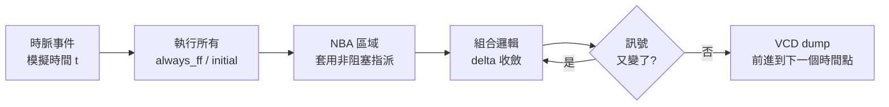
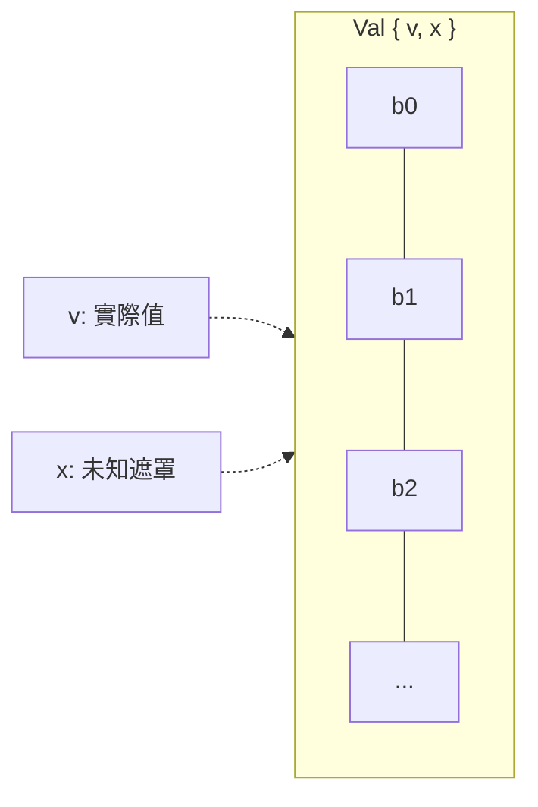
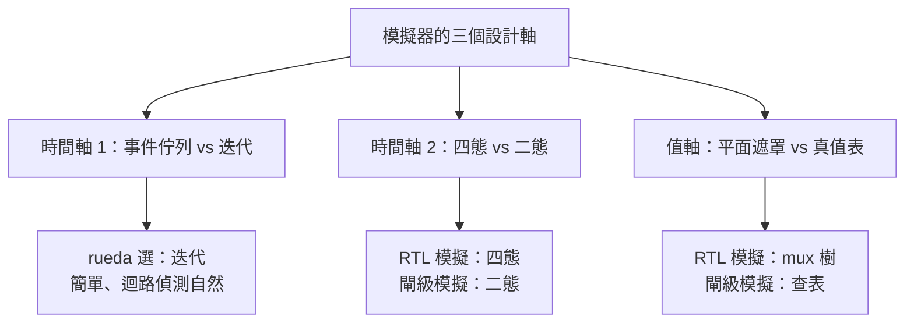

# 3.1 四態值與 delta cycle

> 對應原始碼：`veryl/sim/src/sim.rs`（核心、排程器、VCD）、`veryl/sim/src/value.rs`（四態值）、`veryl/sim/src/expr.rs`（表示式）
> 下一節：[3.2 測試平台與 initial 區塊的編譯](03.2-測試平台與initial區塊的編譯.md)

---

## 3.1.1 硬體是並行的，CPU 是序列的

一個典型的設計裡有上百個 `always_comb` 與 `always_ff` 區塊，它們「同時」對訊號驅動。但模擬器一次只能執行一段程式碼。

事件驅動模擬器的解法是把時間切成兩種：

- **模擬時間（simulation time）**：`#10`、時脈週期這種真實的前進，對應 `$time`。
- **delta 週期（delta cycle）**：同一個模擬時間點內部的微觀迭代。每輪讓「上一輪被改變的訊號」傳播到讀取它們的邏輯，直到整個組合邏輯網路穩定。

一個 posedge 到輸出翻轉可能經過 5 層組合邏輯，就是 5 個 delta cycle——但 `$time` 一動也不動。

Verilog LRM 稱之為 *iteration*；業界慣稱 delta cycle。



## 3.1.2 兩種指派語意

Verilog 的老問題：為什麼有 `=` 和 `<=` 兩種指派？

- **阻塞指派（blocking, `=`）**：立刻寫入，下一行馬上看到新值。組合邏輯用它。
- **非阻塞指派（non-blocking, `<=`）**：先「排程」，等所有程序都讀完舊值後再一次套用。序向邏輯用它。

如果 flip-flop 用阻塞指派，`q <= d` 會立刻把 `q` 改掉，同一時脈緣上後面讀 `q` 的另一個 flip-flop 就會看到「穿越一級」的錯誤結果（race condition）。**NBA 區域的存在就是為了消除這個 race：先全部讀、再全部寫。**

rueda 把這個語意直接放進 IR：

```rust
// veryl/sim/src/sim.rs
pub struct Sim {
    ...
    pub nba: Vec<(usize, u32, u32, Val)>,   // 排程中的 NBA：(sig, bit lo, width, 值)
}

pub fn assign(&mut self, lv: &LValue, e: &Expr, nb: bool) {
    let Some((sig, lo, w)) = self.target(lv) else { return };
    let v = self.eval(e, w).resize(w);
    if nb { self.nba.push((sig, lo, w, v)); }   // <= : 只排程
    else  { self.write_bits(sig, lo, w, v); }   // =  : 立即寫
}

pub fn apply_nba(&mut self) {
    let q = std::mem::take(&mut self.nba);
    for (s, lo, w, v) in q { self.write_bits(s, lo, w, v); }
}
```

`Proc::Ff` 的主體透過 `self.sim.exec(body, true)`（`nb = true`）執行，所以 flip-flop 內所有指派都是 NBA；`Proc::Comb` 則用 `nb = false`。**這個分類讓 race condition 在架構上不可能發生**——不需要靠使用者紀律。

## 3.1.3 主迴圈

`Design` 是排程器，持有 `Sim`（訊號狀態）、`procs`（程序列表）與 `inits`（initial 區塊的編譯結果）。

```rust
// veryl/sim/src/sim.rs  Design::settle
pub fn settle(&mut self) {
    for _ in 0..1000 {
        self.settle_comb();                      // (1) 組合邏輯收斂
        // (2) 邊緣偵測
        // (3) 觸發正反器
        // (4) 套用 NBA
    }
}
```

### 3.1.3.1 組合邏輯收斂

```rust
fn settle_comb(&mut self) {
    for it in 0..500 {
        // 比較整輪前後的狀態
        let before: Vec<(Bits, Bits)> = self.sim.sigs.iter().map(|s| (s.val.v, s.val.x)).collect();
        for p in &self.procs { if let Proc::Comb(b) = p { self.sim.exec(b, false); } }
        let same = self.sim.sigs.iter().zip(&before).all(|(s, b)| (s.val.v, s.val.x) == *b);
        if same { return; }
        if it == 499 { /* 警告：組合迴路沒有收斂 */ }
    }
}
```

**這裡沒有「事件佇列」。** 這是本章最重要的一點。

Verilog 的事件驅動模擬器維護一個精細的事件佇列，只重新求值「輸出改變了」的閘。rueda 的模擬器用的是**反覆迭代直到穩定**（levelized by iteration）。

**為什麼這樣做？**

| | 事件佇列 | 反覆迭代 |
|---|---|---|
| 速度 | 快（只碰改變的部分） | 慢（每輪掃全部 `Proc::Comb`） |
| 實作複雜度 | 高（事件優先序、去重、競態處理） | 低 |
| 迴路偵測 | 需要額外機制 | 天然（迭代不收斂） |

對一個教學與中等規模設計用的模擬器，**簡單**這個優勢勝出。而且迭代法的迴路偵測特別優雅：迭代 500 次還不穩定，就是有組合迴路。

**一個重要的細節**：狀態比較是針對**整個訊號向量**，而不是個別訊號。所以一段程式碼合法地寫兩次同一個訊號（`x = 0; x += 1;`）不會被誤判為迴路。

### 3.1.3.2 邊緣偵測

```rust
// 對每個被 watch 的訊號（時脈與非同步重置）比較現在與上一次的值
let mut prev = vec![2u8; n];   // 2 = 「未知」
for &s in &self.watched {
    let b = bitv(&self.sim.sigs[s].val);
    let o = self.prev[s];
    if b != o {
        if b == 1 { pos[s] = true; any = true; }
        if b == 0 { neg[s] = true; any = true; }
    }
    self.prev[s] = b;
}
if !any { return; }   // 沒有任何邊緣 → 收斂完成
```

**邊緣偵測是靠「比較前後」而不是「事件排程」**。這意味著：

- 只有被 `watched` 的訊號才有邊緣偵測（`watched` 收集所有 `always_ff` 的時脈與非同步重置）；
- 下降沿與上升沿都會被偵測，因此 `clock_negedge` 型別的時脈可以正常工作。

### 3.1.3.3 觸發與 NBA

```rust
for p in &self.procs {
    if let Proc::Ff { clk, pos: edge_pos, rst, body } = p {
        let mut trig = if *edge_pos { pos[*clk] } else { neg[*clk] };
        if let Some((r, low, asynch)) = rst {
            if *asynch && ((*low && neg[*r]) || (!*low && pos[*r])) { trig = true; }
        }
        if trig { self.sim.exec(body, true); }     // NB: 非阻塞
    }
}
self.sim.apply_nba();
```

**非同步重置會獨立觸發正反器**，不需要等時脈——這正確反映了硬體行為（重置接腳是異步的）。

## 3.1.4 時間與時脈產生器

時間是一個 `u64` 計數器。`Design::run` 用一個 `BinaryHeap<Reverse<(u64, usize)>>` 驅動時脈產生器：

```rust
pub fn run(&mut self, max_time: u64) {
    let mut heap: BinaryHeap<Reverse<(u64, usize)>> = BinaryHeap::new();
    for (i, p) in self.procs.iter().enumerate() {
        if let Proc::ClockGen { half, .. } = p { heap.push(Reverse((*half, i))); }
    }
    self.sim.time = 0;
    self.settle();
    for (k) in 0..self.inits.len() { self.run_init(k); }
    self.settle();
    while !self.sim.finished {
        let Some(Reverse((t, _))) = heap.peek().copied() else { break };
        if t > max_time { break; }
        self.sim.time = t;
        while let Some(Reverse((t2, i))) = heap.peek().copied() {
            if t2 != t { break; }
            heap.pop();
            if let Proc::ClockGen { sig, half } = &self.procs[i] {
                let cur = self.sim.sigs[*sig].val.v.bit(0);
                self.sim.write_bits(*sig, 0, 1, Val::bit(!cur));   // .toggle
                heap.push(Reverse((t + *half, i)));
            }
        }
        self.settle();
        ...
    }
}
```

**整個「事件佇列」就是這一個時脈切換的最小堆。** 其他所有活動都是從時脈的觀測轉移中產生的。

時脈**每 `half` 個時間單位切換一次**（預設 `half = 5`，即週期 10）。時間單位在 VCD 裡是 1 ns：

```
$timescale 1ns $end
```

## 3.1.5 四態邏輯

Verilog 的值不只是 0/1，還有 `x`（未知）與 `z`（高阻）。

```rust
// veryl/sim/src/value.rs
pub struct Val { pub w: u32, pub v: Bits, pub x: Bits, pub s: bool }
```

`v` 與 `x` 是兩個平行的位元平面；**不變式**是「`x` 為 1 的位置，`v` 必為 0」。



**雙平面表示的好處**是運算子可以自然處理未知：

| 運算 | 結果 | 理由 |
|---|---|---|
| `x & 0` | 0 | 0 與任何值都是 0 |
| `x \| 1` | 1 | 1 與任何值都是 1 |
| `x & 1` | x | 未知 |
| `x ^ x` | x | |
| 三元 `c ? a : b`，`c` 為 x | `a` 與 `b` 的差異遮罩 | 已知的部分照常，未知的部分保持 x |

不需要為每個運算子寫 16 列的真值表——只需要處理「兩邊都是 1」的位元。

### 3.1.5.1 `x` 從哪裡來

主要有三個來源：

1. **未初始化的正反器。** `reg [7:0] r;` 未賦值時所有位元是 `x`。
2. **越界的陣列索引。** `Expr::Elem(base, idx)` 超出陣列長度時回傳全 `x`。
3. **未驅動的訊號。** 宣告但沒有任何程序寫它。

### 3.1.5.2 為什麼 `x` 很重要

`x` 不是裝飾，它是**硬體事實的模型**：

- 上電時 SRAM 的內容未知 → `x`；
- 尚未收到有效資料的匯流排 → `x`；
- reset 尚未解除的正反器 → `x`。

因此 `x` 讓模擬器能抓到**初始化順序的 bug**：如果一個正反器在 reset 解除前就被讀取，它的值會是 `x`，而測試平台可以斷言它不是 `x`。

```veryl
$assert(q != 8'hxx, "q must be reset before use");
```

## 3.1.6 兩態對照

模擬器是四態的，但**閘級模擬器**（`eda/src/netsim.rs`）是二態的：

```rust
/// 一個小小的二態閘級模擬器，在合成後的網表上執行，用來檢查綜合結果
/// （單一時脈域：step = 一個有效邊緣）
pub struct NetSim<'n> {
    nl: &'n Netlist,
    v: HashMap<u32, bool>,
    ...
}
```

**為什麼閘級模擬是二態？**

1. **實際硬體就是二態的**（除了老化造成的邏輯 0/1 失效）。閘級模擬的目的是**驗證合成的功能等價性**，不是重新模擬開機狀態。
2. **合成已經把「初始狀態」處理掉了**。`optimize` 假設正反器開機為 0（iCE40 就是如此），並把永遠卡在 0 的正反器折成常數。在這個前提下，四態沒有意義。
3. **簡化實作**：`bool` vs `Val`（兩個 `Bits` 平面）。

> 這也解釋了為什麼形式等價性檢查要用 `-set-init-zero`（第 4 章）。

### 3.1.6.1 閘級模擬的評價引擎

```rust
/// 評價組合邏輯（單元依拓樸順序）；非同步重置可以改變正反器，所以重複直到穩定
pub fn settle(&mut self) {
    for _ in 0..4 {
        for c in &self.nl.cells {
            if c.is_ff() || c.typ == "SB_RAM40_4K" || c.typ == "SRAM" || c.typ == "DP16KD" || c.typ == "DIODE" { continue; }
            // 評價組合單元
        }
        // 檢查非同步重置是否改變了正反器；若是，再跑一輪
        if !changed { break; }
    }
}
```

**`for _ in 0..4` 是「重複直到穩定」的機制**，因為非同步重置可以在掃描過程中改變正反器，進而改變下游組合邏輯，需要再掃一輪。4 次是實務上夠用的 magic number。

**單元評價表**涵蓋：

| 家族 | 支援的單元 |
|---|---|
| 通用 | `$_NOT_` `$_AND_` `$_OR_` `$_XOR_` `$_MUX_` |
| vlib / ASIC | `INV` `BUF` `CLKBUF` `NAND2` `NOR2` `AND2` `OR2` `XOR2` `XNOR2` `AOI21` `AO21` `OA21` `NAND3` `NOR3` `AND3` `OR3` `AOI22` `OAI22` `OAI21` `MUX2` `TIEL` `TIEH` |
| iCE40 | `SB_CARRY` `SB_LUT4` `SB_RAM40_4K` `SB_DFF*` |
| ECP5 | `LUT4` `CCU2C` `TRELLIS_FF` `DP16KD` |
| ASIC | `SRAM` macro、`DIODE` |

### 3.1.6.2 LUT 的評價

LUT 用**真值表查表**：

```rust
"SB_LUT4" => {
    let idx = ["I0", "I1", "I2", "I3"].iter().enumerate()
        .fold(0, |a, (i, p)| a | ((g(p, self) as usize) << i));
    let init = &c.params.iter().find(|p| p.0 == "LUT_INIT").unwrap().1;
    init.as_bytes()[15 - idx] == b'1'
}
```

注意 `15 - idx`：**`LUT_INIT` 字串是 MSB 優先的 16 字元二進位串**，索引 15 是索引 0。這是 yosys 的慣例，容易弄錯。

相對地，**模擬器裡的 LUT 模型**（`veryl/sim/src/gates.rs`）卻是用 **mux 樹**：

```rust
fn tree(init: u128, ins: &[Expr], k: usize, base: usize) -> Expr {
    if k == 0 { return Expr::Num(Val::new(1, (init >> base) & 1)); }
    let half = 1usize << (k - 1);
    let part = |b: usize| (init >> b) & ((1u128 << half) - 1);
    if part(base) == part(base + half) { return tree(init, ins, k - 1, base); }
    let (lo, hi) = (tree(init, ins, k - 1, base), tree(init, ins, k - 1, base + half));
    Expr::Tern(Box::new(ins[k - 1].clone()), Box::new(hi), Box::new(lo))
}
```

**為什麼模擬器要用 mux 樹而不是查表？** 因為查表無法處理 `x`。mux 樹是資料流表達式，求值時自然地把 `x` 傳播到輸出。這與前面「運算子自然處理未知」的原則一致。

> 這是同一個語意的第三種實作：RTL 表達式 → mux 樹（模擬器）→ 真值表字串（合成器）→ 查表（閘級模擬器）。三者必須一致，這就是 `reda gatesim` 存在的理由。

### 3.1.6.3 時脈邊緣偵測

閘級模擬器的 `tick()` 用**同一個技巧**——比較時脈接腳的前後值：

```rust
/// 輸入時脈 clk 的一個完整週期（上升，然後下降）：只有時脈接腳看到有效邊緣的
/// 正反器 / RAM 才擷取（多個時脈域、負沿正反器、經過緩衝器的時脈）
pub fn tick(&mut self, clk: &str) {
    let cells: Vec<Option<(Bit, bool)>> = self.nl.cells.iter().map(Self::clock_of).collect();
    self.set(clk, 0);
    for level in [1u128, 0] {
        let before: Vec<bool> = cells.iter().map(|c| c.map(|(p, _)| self.get_bit(p)).unwrap_or(false)).collect();
        self.set(clk, level);
        let sel: Vec<bool> = cells.iter().zip(&before).map(|(c, b)| match c {
            Some((p, rising)) => { let now = self.get_bit(*p); now != *b && now == *rising }
            None => false,
        }).collect();
        if sel.iter().any(|x| *x) { self.capture(&sel); }
    }
}
```

**這個技巧讓 `tick()` 支援多種時脈拓樿，不需要任何時脈樹分析**：時脈可以經過緩衝器、可以被 AND 閘門控、可以是負沿、也可以有好幾個域。

時脈接腳名稱的清單：

```rust
let pin = ["C", "CK", "RCLK", "CLK", "CLKB"].iter().find_map(|p| c.port(p))?;
```

涵蓋 yosys 的 `C`、vlib 的 `CK`、iCE40 的 `C`、ECP5 的 `CLK`/`CLKB`。

### 3.1.6.4 重置語意

```rust
/// （重置接腳, 高有效, 非同步, 值）
fn reset_of(c: &Cell) -> Option<(&'static str, bool, bool, bool)> {
    let t = c.typ.as_str();
    if t == "TRELLIS_FF" {
        // ECP5：LSR 經過 LSRMUX，值來自 REGSET，SRMODE 決定 ASYNC 或同步
        c.port("LSR")?;
        let p = |k: &str| c.params.iter().find(|x| x.0 == k).map(|x| x.1.as_str()).unwrap_or("");
        return Some(("LSR", p("LSRMUX") != "INV", p("SRMODE") == "ASYNC", p("REGSET") == "SET"));
    }
    // vlib 正反器：低有效非同步重置 / 設定
    match t {
        "DFFR" | "DFFNR" => return Some(("RN", false, true, false)),
        "DFFS" | "DFFNS" => return Some(("SN", false, true, true)),
        "DFF" | "DFFN" => return None,
        _ => {}
    }
    if let Some(k) = t.strip_prefix("SB_DFF") {
        // iCE40 的重置 / 設定都是高有效
        let k = k.trim_start_matches('N');
        let (sync, k) = if k.len() == 2 { (true, &k[1..]) } else { (false, k) };
        return match k { "R" => Some(("R", true, !sync, false)), "S" => Some(("S", true, !sync, true)), _ => None };
    }
    ...
}
```

**注意每個家族的慣例不同**：

| 家族 | 重置接腳 | 極性 | 同步性 |
|---|---|---|---|
| iCE40 `SB_DFF*` | `R` / `S` | 高有效 | 看名稱有沒有 `S`（同步） |
| ECP5 `TRELLIS_FF` | `LSR` | 看參數 `LSRMUX` | 看參數 `SRMODE` |
| vlib `DFFR` / `DFFS` | `RN` / `SN` | **低有效** | 非同步 |

這些差異正是「技術無關的 IR 必須編碼足夠資訊」的證明：光有「有一個重置」是不夠的，必須知道極性與同步性。

## 3.1.7 記憶體的模擬語意

閘級模擬器的 `capture()` 有三個階段，且採用**先讀舊值再寫入**的慣例：

```rust
/// 被選中的正反器與 RAM 取下一個狀態
fn capture(&mut self, sel: &[bool]) {
```

1. **正反器**：計算 `D`（含重置覆蓋），收集到 `next`。
2. **Block RAM**：先讀**舊內容**到 `next_ram`，再執行寫入。這模擬 yosys `cells_sim.v` 的「registered read of the old contents, then the write」。
3. **SRAM macro**（ASIC）：`RA`/`WA`/`WD` 匯流排從索引化的接腳名讀取（`RA[3]`、`WD[0]`），位址對 `DEPTH` 取模。

iCE40 `SB_RAM40_4K` 的位址切分：

```text
word = addr & 0xff
lane = (addr >> 8) & ((1 << rm) - 1)
```

寫入模式 0 是簡單遮罩寫入；模式 > 0 是每個 lane 的位元位置擺放。

ECP5 `DP16KD` 是 2048 × 9，埠 A 寫、埠 B 讀（`DOB`）。

最後：

```rust
for (w, d) in next { self.v.insert(w, d); }
for (w, d) in next_ram { self.v.insert(w, d); }
self.settle();
```

正反器輸出**先**套用，RAM 輸出**後**套用，然後重新求值組合邏輯。

## 3.1.8 初始狀態

```rust
/// 網表上電：正反器為 0，記憶體為其初始內容
/// （通用網表的 $mem:NAME:init 網線、block RAM 的 INIT 參數）
pub fn new(nl: &'n Netlist) -> Self {
    ...
}
```

block RAM 的初始內容從 `INIT_0`..`INIT_F` 參數解碼：

```rust
/// SB_RAM40_4K 的 256 個字，從它的 INIT_0..INIT_F（msb 優先，每個 16 個字）解出
fn ram40_words(c: &Cell) -> Vec<u16> {
    let mut ram = vec![0u16; 256];
    for (i, name) in crate::bram::INIT.iter().enumerate() {
        // ...
        for bit in 0..256 { if b[255 - bit] == b'1' { ram[i * 16 + bit / 16] |= 1 << (bit % 16); } }
    }
    ram
}
```

`load_mem(name, words)` 模仿測試平台的 `$readmemh`：寫進通用網表的 `$mem:NAME:wd` 正反器，或是 iCE40 block RAM 的 `INIT_*` 參數，或 ECP5 `DP16KD` 的初始值。

## 3.1.9 VCD 輸出

```rust
// veryl/sim/src/sim.rs  Vcd
```

- 檔頭是 `$timescale 1ns $end`，scope `top`，每個訊號一個 `$var wire <w> <id> <name> $end`。
- 識別符用 base-94（`!` 到 `~`）產生：`fn vcd_id(mut i: usize)`。
- **只在值改變時輸出**，並用一個 `#<time>` 標頭表示時間點。

這是「delta cycle 對使用者的可見性」的來源：在同一個 `#time` 下可能有多次變化，VCD 會把它們全部記錄下來。

## 3.1.10 設計取捨總結



**每個選擇都有代價，也都有理由。** 讀程式碼時看到一個「不尋常」的設計，先問「它在換取什麼」——這是讀 EDA 原始碼最有用的姿勢。

---

**下一節**：[3.2 測試平台與 initial 區塊的編譯](03.2-測試平台與initial區塊的編譯.md)
