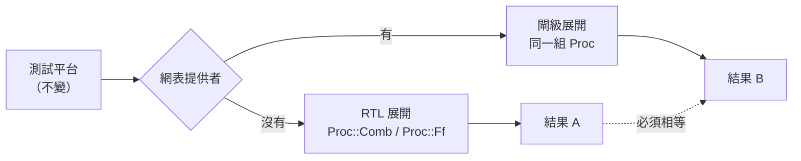

# 3.2 測試平台與 initial 區塊的編譯

> 對應原始碼：`veryl/sim/src/sim.rs`（`compile_initial`、`run_init`）、`veryl/sim/src/lib.rs`（CLI 與函式庫 API）、`veryl/sim/src/gates.rs`（閘級替換）
> 上一節：[3.1 四態值與 delta cycle](03.1-四態值與delta-cycle.md)　下一節：[3.3 Kahn 程序網路](03.3-Kahn程序網路-Fluxa的時間模型.md)

---

## 3.2.1 測試平台是什麼

在硬體工程裡，**測試平台（testbench）** 是驗證用的激勵與觀測環境。它包含：

- **激勵（stimulus）**：驅動 DUT 輸入的訊號；
- **觀測（observation）**：檢查 DUT 輸出；
- **斷言（assertion）**：失敗時報錯；
- **控制流程**：何時施加刺激、何時檢查。

Veryl 用 `#[test(...)]` 屬性標記測試平台模組：

```veryl
#[test(fifo_test)]
module TestFifo {
    inst clk: $tb::clock_gen;
    inst rst: $tb::reset_gen(clk);

    // ...
    initial {
        rst.assert();
        $assert(empty == 1'b1, "empty after reset");
        push = 1; din = 8'h11; clk.next();
        // ...
        $finish();
    }
}
```

## 3.2.2 時脈作為元件

**沒有自由運轉的振盪器。** 一個時脈訊號只存在於測試平台裡，而且它的存在方式是**一個特殊的元件實例**：

```rust
// veryl/sim/src/elab.rs
"$tb::clock_gen" => {
    let mut half = 5;                     // PERIOD 預設 10 → 半週期 5
    // ... 讀 PERIOD 參數 ...
    let id = self.declare(sc, &name, &TypeInfo { kind: Kind::Clock(true), two_state: true, ..ty });
    self.procs.push(Proc::ClockGen { sig: id, half });
}
```

**時脈訊號就是這個元件的實例。** 測試平台把它接到 DUT 的 `i_clk` 埠：

```veryl
inst clk: $tb::clock_gen;
```

DUT 的 `always_ff` 透過型別（`clock`）找到它。

**這個設計解決了 Verilog 裡的一個實際問題。** 在 Verilog 中：

```verilog
always #5 clk = ~clk;    // 自由運轉的時脈
```

這是一個**無限循環**。它讓模擬無法自動結束、讓 `$time` 變得不可預測、讓測試平台難以控制。Veryl 的做法是：時脈只在測試平台裡存在，而且由測試平台用 `clk.next()` **主動推進**。

### 3.2.2.1 重置產生器

```rust
"$tb::reset_gen(clk)" => {
    // 建立一個初值為 1 的重置訊號
    // （對低有效重置而言，1 = 未作用）
    // 並記住時脈
    self.tb_clk.insert(inst_id, clk_id);
}
```

`tb_clk` 這張表的用途是：`rst.assert()` 不帶參數時，知道要等哪個時脈。

## 3.2.3 `assert` 與 `release`

`rst.assert()` 被**脫糖**成三個陳述句：

```rust
// veryl/sim/src/elab.rs  lower_ident_stmt
out.push(Stmt::Assign(lv, Expr::Num(Val::new(1, 0))));            // 驅動重置為作用中
out.push(Stmt::Wait(clk, Expr::Num(Val::new(32, 2))));            // 等 2 個時脈邊緣
out.push(Stmt::Assign(lv, Expr::Num(Val::new(1, 1))));            // 解除
```

**注意「等 2 個時脈邊緣」而不是「等 1 個」**。這是硬體設計的常規做法：重置解除後，要等一個時脈邊緣讓所有正反器看到「解除後的值」。

`Stmt::Wait` 是 `initial` 區塊能暫停的唯一機制，這就引出了下一個問題。

## 3.2.4 `initial` 區塊必須被編譯成程式

`initial` 區塊裡可以有 `clk.next()`（等待），所以它**不能**只是一串陳述句。它必須被編譯成一個小型指令程式：

```rust
// veryl/sim/src/sim.rs
pub enum Op {
    Exec(Stmt),
    Wait(usize, Expr),      // 等 clk 上升沿 n 次
    Jmp(usize),
    JmpIfNot(Expr, usize),
}
pub struct InitState {
    pub ops: Vec<Op>,
    pub pc: usize,
    pub wait: Option<(usize, u128)>,
    pub done: bool,
}
```

**為什麼需要跳轉？** 因為 `if` 與 `for` 裡面可以有等待：

```veryl
initial {
    for i in 0..10 {
        din = i;
        clk.next();
        $assert(dout == i, "mismatch");
    }
}
```

編譯成：

```
0: Exec(din = i)
1: Wait(clk, 1)
2: JmpIfNot(i < 10, 5)
3: Exec($assert(...))
4: Jmp(0)
5: (結束)
```

**含等待的 `if` 與 `for` 都被轉成跳轉。** 這是一個小而完整的「結構化程式 → 扁平指令序列」的編譯。

### 3.2.4.1 執行程式

```rust
fn run_init(&mut self, k: usize) {
    // ...
}
```

每次 `Op::Exec` 之後會呼叫 `settle()`，讓後續的讀取看到最新的值：

```rust
// 每個 Op::Exec 後呼叫 settle()，讓同一個 initial 區塊裡後面的讀取
// 看到最新的值——這是測試平台依賴的 delta cycle 語意
```

**這是正確性的關鍵。** 考慮：

```veryl
initial {
    dout = 1;
    $assert(dout == 1, "must be visible immediately");
}
```

在 Verilog 裡，阻塞指派後立即讀取會看到新值。`settle()` 呼叫保證了這點。

### 3.2.4.2 計數等待邊緣

等待的計數在 `settle()` 裡遞減：

```rust
for st in &mut self.inits {
    if let Some((c, ref mut k)) = st.wait {
        if pos[c] && *k > 0 { *k -= 1; }
    }
}
```

注意只數**上升沿**（`pos[c]`），與 `clk.next()` 的語意一致。

## 3.2.5 測試平台的選擇與執行

```rust
// veryl/sim/src/lib.rs
pub fn list(files: &[VFile]) -> Vec<(String, bool)>
pub fn run(files: &[VFile], top: Option<&str>, max_time: u64, vcd: bool, echo: bool) -> RunResult
pub fn run_gates(files: &[VFile], top: Option<&str>, max_time: u64, vcd: bool,
                 echo: bool, gate: GateFn) -> RunResult
```

`RunResult` 包含：

```rust
pub struct RunResult {
    pub log: String,
    pub tops: Vec<TopResult>,     // 每個 top 的失敗數與是否結束
    pub vcd: Option<(String, String)>,
}
```

**預設的 top 選擇規則**：所有帶 `#[test(...)]` 屬性的模組；如果沒有，就用最後宣告的模組。

CLI：

```
reda sim [--top MODULE] [--vcd out.vcd] [--max-time N] [--list] a.veryl ...
```

退出碼：斷言失敗 → 1。`--vcd` 在多個 top 時會寫成 `out_<top>.vcd`。

## 3.2.6 用閘級網表替換 RTL

這是 `veryl/sim/src/gates.rs` 的功能，也是整個驗證策略的核心。

```rust
pub type GateFn = dyn Fn(&str, &HashMap<String, Val>) -> Result<Option<GateNetlist>, String>;
```

`Elab.gates` 是一個回呼。當它對某個模組回傳網表時，`elab_gates` 就**用網表建立該模組的作用域**，取代原本的 RTL 展開：

```rust
// 每個網表導線變成 1 位元訊號
// 組合單元變成 Proc::Comb 指派
// 正反器變成 Proc::Ff
// RAM 變成有同步埠的陣列
```

`gate_cache` 依 `module#param=value,...` 做記憶化，避免同一個參數化模組被展開多次。

**這個機制的意義**：



**同一個測試平台，跑兩次，結果必須相同。** 這是「合成正確性」的驗證方式，而且**不需要形式方法**。

CLI：

```
reda gatesim opt|ice40|ecp5|asic|sky130 FILE...
```

`opt` 是「通用閘（未映射）」，`ice40`/`ecp5`/`asic`/`sky130` 是映射後的。**退出碼 1 表示測試平台失敗**。

### 3.2.6.1 網表提供者

```rust
// veryl/synth/src/gatesim.rs
pub struct Provider<'a> {
    pub lib: &'a crate::elab::Lib<'a>,
    pub top: String,
    pub kind: String,
    pub built: RefCell<Vec<(String, usize)>>,
}
```

`Provider::get` 為 top 模組合成指定 `kind` 的網表，並轉成模擬器的 `GateNetlist`。

**注意 `kind` 是一個字串**：`"opt" | "ice40" | "ecp5" | "asic" | "sky130"`。底層的 `eda::netsim::mapped` 負責分派：

```rust
/// 指定種類的網表，用於閘級模擬：
/// "opt"（通用閘原樣）、"ice40"、"ecp5"、"asic"（vlib 單元）、"sky130"（SKY130 單元）
pub fn mapped(nl: &Netlist, kind: &str) -> Result<Netlist, String> {
    match kind {
        "opt" | "gate" => Ok(nl.clone()),
        "ice40" => crate::fpga::ice40::map(nl),
        "ecp5" => crate::fpga::ecp5::map(nl),
        "asic" => crate::asic::map::map(nl),
        "sky130" => crate::pdk::with_tech(crate::pdk::sky130_builtin()?, || crate::asic::map::map(nl)),
        k => Err(format!("unknown netlist kind '{}' (opt, ice40, ecp5, asic, sky130)", k)),
    }
}
```

**五個層級的等價性檢查**——同一個設計，在五種網表上跑同一個測試平台：

1. 通用閘（`$_AND_` 等）
2. iCE40（`SB_LUT4`、`SB_CARRY`、`SB_RAM40_4K`）
3. ECP5（`LUT4`、`CCU2C`、`DP16KD`）
4. ASIC vlib 標準單元
5. SKY130

這就是「**同一語意、多種實作、交叉驗證**」的方法論在硬體上的完整應用。

## 3.2.7 系統任務

模擬器支援 Verilog 的一組系統任務：

| 任務 | 行為 |
|---|---|
| `$display` `$info` `$write` `$warning` `$error` `$fatal` | 輸出；`$error`/`$fatal` 增加失敗數 |
| `$assert` | 檢查條件，失敗則報錯並計數 |
| `$finish` | 結束模擬 |
| `$stop` | 暫停 |

`format()` 實作了 `%d` `%b` `%h` `%x` `%o` `%t` `%c` `%s` `%m`，含寬度與零填充。

**有號除法向零截斷，餘數取被除數的符號**（SystemVerilog 語意）。這個細節經常是 bug 的來源。

## 3.2.8 系統函式

```rust
// veryl/sim/src/sim.rs  eval_call
```

支援 `$clog2` `$signed` `$unsigned` `$bits` `$time` `$stime` `$random` `$urandom`。

`$random` 是一個 xorshift64（13/7/17），種子 `0x2545F4914F6CDD1D`。

`$clog2` 從參數的寬度計算： $`\lceil \log_2 w \rceil`$ 。這是硬體設計裡最常用的常數函數（算位址寬度、算移位量）。

## 3.2.9 函式呼叫：`call_user`

`Stmt` 裡有 `Call` 與 `Return`，這是為了支援使用者定義的函式：

```rust
// veryl/sim/src/sim.rs
fn call_user(&mut self, name: &str, args: &[Expr]) -> R<Val>
```

函式主體被編譯成 `Vec<Stmt>`，執行時：

1. 參數綁定到**參數訊號**（所以函式主體可以對它們 `assign`）；
2. 執行主體；
3. 讀回 `ret_val`。

`ret_now` 是提前返回的旗標。

這與合成端的函式內嵌（第 2.3.12 節）是兩種不同的策略，但**語意必須一致**——這是 `reda gatesim` 與 `reda emu` 差異測試要保證的事。

## 3.2.10 測試平台的寫作模式

綜合前面的機制，一個典型的 Veryl 測試平台長這樣：

```veryl
#[test(counter_test)]
module TestCounter {
    // 時脈與重置
    inst clk: $tb::clock_gen;
    inst rst: $tb::reset_gen(clk);

    // DUT
    inst dut: Counter;

    // 連接
    connect clk.clk => dut.i_clk;
    connect rst.rst => dut.i_rst;

    // 觀測點
    let count: logic<8> = dut.o_count;

    initial {
        rst.assert();

        // 等一個時脈，看重置是否生效
        clk.next();
        $assert(count == 8'h00, "counter must reset to 0");

        // 推幾個時脈
        for i in 0..4 {
            clk.next();
        }
        $assert(count == 8'h04, "counter must count up");

        $finish();
    }
}
```

**注意 `$assert` 的訊息是給人看的**——它應該說明「什麼條件沒成立」，而不只是「斷言失敗」。這是測試平台可讀性的關鍵。

## 3.2.11 教學流程的自動化

`veryl/tutorial/` 是一套「虛擬實驗課」，每個實驗都有一個設計與一份檢查腳本：

```
veryl/tutorial/
├── src/uart.veryl
├── src/knight.veryl
├── src/blinky.veryl
├── labs.tw.md        實驗說明
├── check.sh          自動檢查
├── Veryl.toml
└── icebreaker.pcf
```

`check.sh` 會建置、模擬，並檢查結果。**這是把教科書變成可執行環境的做法**：學生改完程式碼，跑一支腳本就知道對不對。

這也是本專案的一貫信念：**工具必須能自我檢驗**，否則教學無法進行。

---

**下一節**：[3.3 Kahn 程序網路：Fluxa 的時間模型](03.3-Kahn程序網路-Fluxa的時間模型.md)
