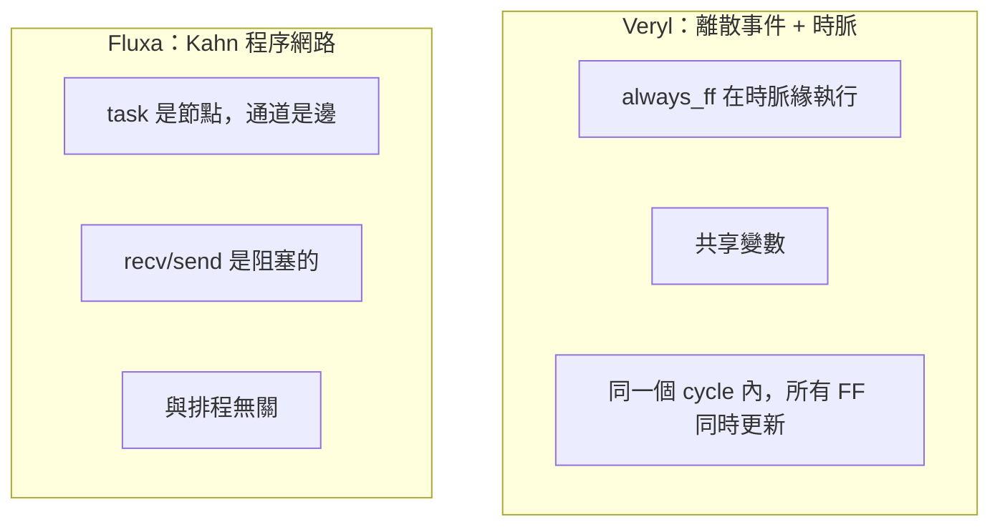

# 3.3 Kahn 程序網路：Fluxa 的時間模型

> 對應原始碼：`fluxa/sim/src/interp.rs`（非同步直譯器）、`fluxa/sim/src/runtime.rs`（兩種排程器）、`fluxa/docs/Fluxa語言規格v0.1.md`（規格）
> 上一節：[3.2 測試平台與 initial 區塊的編譯](03.2-測試平台與initial區塊的編譯.md)

---

## 3.3.1 高階合成最難的問題

第 1.2.6 節提過：HLS 的核心挑戰是語義落差。C 是順序執行的語言，硬體是並行的。工具必須「猜測」：

- 這個迴圈能不能展開？
- 這個陣列索引能不能變成一個 port？
- 迴圈能不能流水化？
- 猜錯了怎麼辦？

主流 HLS 工具的答案是**註解 + 代價模型**：

```c
void fir(int *x, int *y) {
#pragma HLS PIPELINE
    for (int i = 0; i < N; i++) {
        acc += x[i] * COEF[i];
    }
}
```

`#pragma HLS PIPELINE` 是一個**要求**，不是保證。工具會盡力而為，但使用者無法確定結果。

Fluxa 走的是另一條路：**把「猜測」換成「宣告」**。

## 3.3.2 Fluxa 的語言骨架

Fluxa 是 2026 年設計的高階合成語言（規格檔案日期 2026-10-29）。它有四種宣告形式，也就是**三個時間層次**加組合邏輯：

| 形式 | 意義 | 內部可用 |
|---|---|---|
| `comb fn` | 零週期，無迴圈 | — |
| `fn` | 純函數，無狀態 | — |
| `task` | **Kahn 程序網路節點** | `carry`、`pipeline` 迴圈、阻塞式 send/recv、`spawn`、`parallel` |
| `stage` | 週期精確（Filament 風格的值區間） | `;;` 時脈邊界、非阻塞 `try_recv`/`empty` |

規格 §2.7 的上下文表由型別檢查器強制，不是文法：

| 構造 | `comb fn` | `fn` | `task` | `stage` |
|---|---|---|---|---|
| `carry` | ✗ | ✗ | ✓ | ✓ |
| `pipeline` 迴圈 | ✗ | ✗ | ✓ | ✗ |
| 阻塞式通道 send/recv | ✗ | ✗ | ✓ | ✓ |
| `try_recv` / `empty` | ✗ | ✗ | ✗ | ✓ |
| `spawn`、`parallel` | ✗ | ✗ | ✓ | ✗ |
| `;;` | ✗ | ✗ | ✗ | ✓ |

**這個表格就是 Fluxa 的設計哲學**：

> **非阻塞接收是唯一會破壞決定性的操作，所以把它關在 `stage` 層裡，而 `stage` 層不在行為模擬器的範圍內。**

## 3.3.3 型別系統：所有整數都是範圍型別

這是 Fluxa 最激進的設計。

```
uN  ≡ int<0..=2^N-1>          iN ≡ int<-2^(N-1)..=2^(N-1)-1>
```

**位寬是從範圍推導出來的，不是使用者輸入的。** 型別檢查器推導表達式的值域，硬體的位寬就等於值域需要的位數。

推導規則（一套規則管所有整數型別）：

```
(T-ADD)  int<a..=b> + int<c..=d>  :  int<a+c..=b+d>
(T-SUB)  e1 - e2                    :  int<a-d..=b-c>
(T-MUL)  e1 * e2                    :  int<min P..=max P>,  P={ac,ad,bc,bd}
(T-SHL)  e << k                    :  int<a·2^k..=b·2^k>
(T-WRAP) e1 +% e2                  :  同 e1 的型別（明確的環繞）
```

**一個好處是：硬體的位寬永遠夠用，不會溢位。** 這與 Verilog 的「上下文決定寬度 + 隱式截斷」形成對比。

定點數：

```
(T-FADD) fixed<I1,F1> + fixed<I2,F2> : fixed<max(I1,I2)+1, max(F1,F2)>
(T-FMUL) fixed<I1,F1> * fixed<I2,F2> : fixed<I1+I2, F1+F2>
```

定點數的**小數位數相加**而不是四捨五入，是硬體乘法器最自然的行為。

## 3.3.4 通道：語言的第一級概念

```fluxa
task Fir(x: in chan<i16>, y: out chan<i16>) {
    let mut hist: [i16; TAPS - 1] @reg = [0; TAPS - 1];

    pipeline(ii = 1) for s in x {
        let win: [i16; TAPS] = concat([s], hist);
        let acc = (0..TAPS).unrolled()
                           .map(|k| win[k] * COEF[k])
                           .tree_sum();
        hist = win[0..TAPS - 1];
        y.send(acc.to::<i16>(round = nearest, ovf = sat));
    }
}
```

**`x` 是通道，`for s in x` 是從通道取出元素。** 這不是迴圈——這是「從上游取資料，直到上游關閉」。

三個關鍵語意：

**(a) 通道是有界 FIFO，send/recv 都是阻塞的。**

- 通道滿時 `send` 阻塞；
- 通道空時 `recv` 阻塞。

**(b) 端點是線性資源（linear resource）。**

```rust
/// 線性所有權轉移：端點必須由 from 擁有，轉給 to
pub fn transfer(&self, v: &Value, from: usize, to: usize, line: u32) -> R<()> {
    match v {
        Value::Tx(ch) | Value::Rx(ch) => {
            let owner = if is_tx { &mut w.chans[*ch].tx_owner } else { &mut w.chans[*ch].rx_owner };
            if *owner != from {
                return msg(line, format!("{} endpoint of channel `{}` was already moved (channel endpoints are linear)", ...));
            }
            *owner = to; Ok(())
        }
        ...
    }
}
```

`spawn` **消耗**端點；轉移後再用就是錯誤。端點不能被複製，也不能被靜默丟棄。

這是 Rust 的線性型別在硬體描述裡的應用：它讓「兩個人用同一個通道」這種 bug 在編譯期就被抓到。

**(c) 任務結束時關閉它仍擁有的 `Tx` 端點。**

```rust
/// 結束任務時關閉其仍擁有的 Tx 端點（等同硬體的 end-of-stream）
pub fn close_owned_tx(&self, task: usize, v: &Value) { ... }
```

所以 `for v in rx { ... }` 會自然終止——上游任務結束 → 通道關閉 → `recv` 回傳 `None` → 迴圈結束。**這是硬體的 end-of-stream 訊號，用語言的線性所有權自然表達。**

## 3.3.5 決定性：整個語言設計的樞紐

規格 §3.10 的性質 5：

> **延遲不敏感等價**：一個 `task` 程式在每個輸出通道上的 token 序列，與參考語意（Kahn 程序網路）一致，且**與實作延遲和 FIFO 深度無關**。深度不足只會降低吞吐量，不會改變結果（除非死結）。

這是一個非常強的承諾。它的後果是深遠的：

1. **模擬器可以用任意排程。** 結果一樣。
2. **合成後的硬體可以用任意通道深度。** 結果一樣。
3. **模擬器與硬體的結果必須逐 token 相同。** 這給了 Fluxa 一個**極強的等價性判準**（第 4.3 節）：不是「波形看起來像」，而是「token 序列完全相同」。

**它的代價是：不能有非阻塞操作。**

```rust
// 執行期也拒絕非阻塞操作
(Value::Rx(_), "try_recv") | (Value::Rx(_), "empty") | (Value::Rx(_), "len") => {
    return self.err(format!(
        "`{}` is non-deterministic and is only allowed in `stage` code (task-level programs must use blocking recv)", name));
}
```

**「非阻塞」為什麼破壞決定性？** 想象兩個任務都對同一個通道做 `try_recv`：誰拿到 token 取決於排程。而阻塞式 `recv` 中，等待本身就是排程點，但所有等待同一個通道的任務會以 FIFO 順序被喚醒——這是確定的。

> 這是 KPN 理論的原始結果（Kahn 1966）：只要通訊是同步的（blocking send/recv），程式的行為就與排程無關。

## 3.3.6 波前免費：脈動陣列的優雅之處

規格 §5.3 的例子是 Fluxa 設計最漂亮的地方：

> 為什麼不需要手寫 skew：每個 PE 的 `recv()` 都是阻塞式，必須兩個輸入都到才觸發，所以資料在陣列中自然形成斜向波前。傳統 HLS 要手動寫延遲暫存器，這裡由握手語意免費取得。

看看 `fluxa/examples/gemm.fx`：

```fluxa
task Pe(a_in: in chan<i8>, b_in: in chan<i8>, a_out: out chan<i8>, b_out: out chan<i8>,
        k: u16, c_out: out chan<i32>) {
    carry acc: i32 = 0;
    pipeline(ii = 1) for _ in 0..k {
        let a = a_in.recv();
        let b = b_in.recv();
        acc += a * b;
        a_out.send(a);
        b_out.send(b);
    }
    c_out.send(acc);
}
```

**沒有任何延遲暫存器，沒有任何手寫的 skew 排程。** 阻塞式 `recv` 意味著一個 PE 只有在左右兩邊的資料都到了才會動作，這自動產生了斜向的資料波前。

**這是語言設計改變硬體結構的最好例子。** 在傳統 HLS 裡，同樣的 systolic array 需要：

1. 手動決定 PE 之間的延遲；
2. 寫出延遲暫存器陣列；
3. 保證每個 PE 的啟動順序。

Fluxa 把這三件事變成語義的必然結果。

## 3.3.7 `@reg`：硬體暫存器的語意

```rust
pub struct Var {
    pub val: Value,
    pub ty: Option<RtType>,
    /// `@reg`：迭代內讀到舊值，寫入在迭代結束提交
    pub reg: bool,
    pub pending: Option<Value>,
}
```

`@reg` 的語意是：**迭代內讀到舊值，寫入在迭代結束時提交。**

```rust
fn commit_regs(&mut self) {
    for sc in self.scopes.iter_mut() {
        for v in sc.values_mut() { if let Some(p) = v.pending.take() { v.val = p; } }
    }
}
```

這**完全匹配硬體移位暫存器的行為**。在 `unroll`（展開）之後，`hist = win[0..TAPS-1]` 這類語句就自然變成一個移位暫存器鏈。

**這是 Fluxa 裡「宣告硬體結構」的第三個機制**（前兩個是通道與 `carry`）。

## 3.3.8 `carry`：累積器的寬度是使用者宣告的

```fluxa
carry acc: i32 = 0;
```

`carry` 宣告一個跨迭代累積的變數。**它的寬度由使用者決定**，而不是由值域推導。

為什麼？因為累積器的寬度在硬體上是**設計決策**：

- 寬度足夠 → 精確累加，但面積大；
- 寬度不足 → 環繞，但面積小（這就是 `err_overflow.fx` 展示的錯誤）。

因此 Fluxa **不做值域推導**，而是讓使用者負責，並在合成時檢查：

```rust
// fluxa/synth/src/ty.rs 的 mul()
// 寬度照值域推導，但 carry 變數是「使用者指定」的型別，
// 所以合成時要檢查累加的結果是否放得下
```

`err_overflow.fx` 就是這個檢查的反例：`carry acc: i24` 太窄，容不下 8 個 `i16*i16`。

**`carry` 與 `@reg` 的分工**：

| 機制 | 跨迭代的值 | 提交時機 |
|---|---|---|
| `@reg` | 舊值（迭代內讀） | 迭代結束 |
| `carry` | 新值（迭代內讀到新值） | 立即 |

`carry` 變數在迭代內讀到的是**已經累加過的值**，所以它對應硬體上「餵回自己的累加器」。

## 3.3.9 `pipeline(ii = n)`：宣告 initiation interval

```fluxa
pipeline(ii = 1) for s in x {
    ...
}
```

`ii` 是「啟動間隔」：每 $`n`$ 個時脈可以啟動一次新的迭代。`ii = 1` 意味著完全流水化（每個時脈一個結果）。

**Fluxa 的 `pipeline` 迴圈有嚴格的規則**，在降階時強制：

```rust
PipeOp::Recv(d, c) => {
    if !sends.is_empty() {
        return Err(format!("`{}` is received after a send in the same iteration", ...));
    }
    if !seen.insert(c.clone()) {
        return Err(format!("`{}` is received twice in an iteration (one token a clock): use ii = 2", ...));
    }
}
PipeOp::Send(c, v) => {
    if sends.iter().any(|(x,_)| *x == c) {
        return Err(format!("`{}` is sent twice in an iteration (one token a clock): use ii = 2", ...));
    }
}
```

**規則：一個迭代裡，同一個通道不能收兩次，也不能送兩次。**

**為什麼？** 因為 `ii = 1` 意味著「一個時脈一個迭代」。如果一個迭代要從同一個通道收兩個 token，那兩個 token 必須在同一個時脈內到達——除非通道深度是 0（硬體上不可能）。所以必須 `ii = 2`。

**這是把硬體的物理限制寫進語言規則的一個漂亮例子。** 使用者得到的是一個**明確的錯誤訊息**，而不是一個「工具做不到」的模糊結果。

**還有降級（rollback）機制**：

```rust
// 若流水化形式不可行但 ii > 1 被要求，降階會回滾
// （記錄 mark = (blocks.len(), temps.len(), n)）並退回一般的 FSM 迴圈
// 若 ii == 1，錯誤就變成：
Err(e) => Err(format!("line {}: error[E0412]: pipeline(ii = {}) cannot be met: {}", line, ii, e));
```

**`ii > 1` 允許降級，`ii = 1` 不允許。** 因為 `ii = 1` 是效能承諾，降級會違反承諾；`ii > 1` 只是「至少這個速率」，降級到更慢是可以接受的。

> 這個「承诺 vs 請求」的區分，是工具設計中非常精細的一層。

## 3.3.10 兩種排程器

`fluxa/sim/src/runtime.rs` 實作了兩種排程器，共用同一份 `World` 狀態。

### 3.3.10.1 原生排程器：一個 task 一條 OS 執行緒

```rust
// 每個 task 一條執行緒，8 MB 堆疊
std::thread::Builder::new().stack_size(8 * 1024 * 1024)
```

每條執行緒跑一個 future。直譯器在原生模式下其實從不回傳 `Pending`（等待是由 `Condvar` 阻塞的），所以只需要一次 poll 加 `yield_now`。

**死結偵測**：

```rust
w.blocked += 1;
let my_epoch = w.epoch;
if w.blocked >= w.live {
    w.deadlock = true;
    // 產生報告，每個被阻塞的 task 一行
    w.deadlock_report = Some(format!("deadlock: all {} live task(s) are blocked\n{}", w.live, lines.join("\n")));
    return Err(RtErr::Deadlock);
}
```

**epoch 機制是這段程式碼最微妙的地方**：

> epoch 機制：任何狀態變更（send/recv/close/任務結束/spawn）都 epoch++ 並把 blocked 歸零，等待者醒來後必須重新檢查並重新登記，避免「通知已送出但對方尚未醒來」造成的誤判。

任何狀態變更呼叫 `World::bump()`，它同時做兩件事：**epoch 加一**，並且 **blocked 歸零**。

**為什麼需要這個？** 考慮：

```
task A: recv(x)      // 阻塞，blocked = 1
task B: send(x)      // 這個 send 喚醒 A
```

在 A 真正從 `Condvar` 醒來之前，B 的 `send` 已經呼叫了 `bump()`，把 `blocked` 歸零。此時如果 C 也阻塞了，`blocked` 計數就不對了。

有了 epoch，等待者醒來後會**重新檢查自己的條件**（通道裡真的有東西了嗎？），如果還沒滿足就重新登記計數。

**這個機制是所有「用計數偵測死結」的系統都需要的**，而它是最容易被寫錯的地方。

### 3.3.10.2 協作式排程器：給 WebAssembly 用

wasm32 沒有執行緒。所以所有 task 都是單一執行緒上的 future：

```rust
struct YieldOnce(bool);
impl Future for YieldOnce {
    fn poll(mut self: Pin<&mut Self>, _: &mut Context<'_>) -> Poll<()> {
        if self.0 { Poll::Ready(()) } else { self.0 = true; Poll::Pending }
    }
}
```

`Shared::run_coop` 用一個**無操作 waker**（`RawWakerVTable` 的四個函式都忽略 null 指標）輪詢各個 task：

```rust
pub fn run_coop<'a, T>(&self, mut main: Pin<Box<dyn Future<Output = R<T>> + 'a>>) -> R<T> {
    loop {
        let epoch = self.lock().epoch;
        if let Poll::Ready(r) = main.as_mut().poll(&mut cx) { return r; }
        // 輪詢每個 task 一次；新 spawn 的 task 加入佇列
        let mut w = self.lock();
        if w.epoch == epoch {
            /* 整整一輪都沒有任何進展 → 死結 */
        }
    }
}
```

**死結的判準不同**：協作式排程器是「**一整輪 epoch 都沒變**」。這比原生版的「blocked >= live」更簡單也更保守。

**兩種排程器必須給出相同的結果**——這是 KPN 決定性的直接測試。`fluxa/sim/tests/examples.rs` 對每個測試都跑兩種排程器，並斷言它們的通過/失敗與第一行訊息一致。

## 3.3.11 120 位精確整數

```rust
pub enum Value {
    Unit, Bool(bool), Int(i128), Float(f64),
    Fixed(i128, u32),   // (raw, fraction bits)；值 = raw / 2^frac
    Str(String), Array(Vec<Value>), Tuple(Vec<Value>),
    Range(i128, i128),  // 半開 [lo,hi)
    Tx(usize), Rx(usize)   // 通道端點 = 通道索引
}
pub const MAX_WIDTH: u32 = 120;
```

**語言承諾整數運算精確到 120 位。** 這比硬體的 64 位寬鬆太多了——但這正是「行為模擬」該做的事：**模擬器不該因為硬體位寬而改變結果**，否則「模擬通過但硬體錯」就無法避免。

**兩種轉換的區分**很重要：

| | 意義 | 失敗時 |
|---|---|---|
| `coerce(v, t)` | **隱式**，只能無損加寬 | 報錯，提示用 `.to::<T>()` |
| `convert(v, t, round, ovf)` | **顯式**，可指定捨入與溢位模式 | 依 `ovf` 決定 |

```rust
// 窄化固定點值（有小數位）會被拒絕：
// "fractional bits would be lost"
```

**這個區分把「會不會溢位」變成語言層面的顯式選擇**，而不是硬體的意外。

## 3.3.12 非同步直譯器：boxed future 的必要性

直譯器是 `async` 的，因為**通道操作是唯一的 await 點**：

```rust
ExprKind::Method(recv, "recv") => {
    return match self.sh.recv(self.task, *ch, line).await? {
        Some(v) => Ok(v),
        None => self.err("recv() on a closed, empty channel"),
    };
}
```

但 `eval` → `exec_block` → `exec_stmt` → `eval` 是**互相遞迴**的。光用 `async fn` 會讓 future 巢狀到無限深，爆堆疊。

解法是**每個遞迴入口都 boxing**：

```rust
/// 一個 boxed future：打破非同步直譯器的遞迴（eval -> ... -> eval）
pub type BoxFut<'a, T> = Pin<Box<dyn Future<Output = T> + Send + 'a>>;

pub fn eval<'a>(&'a mut self, e: &'a Expr) -> BoxFut<'a, R<Value>> { Box::pin(self.eval_impl(e)) }
fn exec_body<'a>(&'a mut self, b: &'a Block) -> BoxFut<'a, R<Value>> { Box::pin(self.exec_body_impl(b)) }
```

**每次 boxing 都有成本**（一次堆積配置），但它保證了**堆疊深度與程式碼深度無關**。對於一個語言層級的直譯器，這是必要的取捨。

## 3.3.13 `tree_sum` 與硬體adder tree 對應

```rust
fn tree_sum(mut items: Vec<Value>) -> Result<Value, String> {
    while items.len() > 1 {
        let mut next = Vec::with_capacity(items.len() / 2 + 1);
        for ch in items.chunks(2) {
            if ch.len() == 2 { next.push(binop(BinOp::Add, &ch[0], &ch[1])?); }
            else { next.push(ch[0].clone()); }
        }
        items = next;
    }
    Ok(items.remove(0))
}
```

**模擬器裡的 `tree_sum` 建的是一棵平衡加法樹**——這不是任意的選擇，而是**硬體 adder tree 的直接對應**。合成器（第 4.3 節）也會產生同樣形狀的平衡樹。

**這是「模擬器與硬體共享結構」的一個小而重要的實例**：如果模擬器用線性累加、硬體用平衡樹，浮點加法的**結合律誤差**就會讓兩者結果不同。整數不會，但定點數與浮點會。

## 3.3.14 兩種語言的時間模型對照



| | Veryl | Fluxa |
|---|---|---|
| 時間的來源 | 時脈 | 通道握手 |
| 資料的載體 | 共享變數 | 通道（FIFO） |
| 同一時刻的行為 | 所有 `always_ff` 同時更新 | 各 task 獨立推進，順序不確定 |
| 決定性 | 單一時脈域內確定 | **全域排程無關** |
| 硬體對應 | 正反器 + 組合邏輯 | FIFO + 狀態機 + 資料路徑 |
| 適合 | 狀態機、算術管線 | 濾波器陣列、矩陣乘法、資料流 |

**兩者可以描述同一顆硬體。** 這不是巧合——rueda 的 Fluxa 合成器把 task 降階成 FSM + 資料路徑（第 4.3 節），得到的網表與 Veryl 寫出來的網表是同一種東西。

## 3.3.15 為什麼要有兩種語言

| 需求 | Veryl 適合 | Fluxa 適合 |
|---|---|---|
| 一顆 RISC-V CPU | ✓（明確的時脈與狀態） | △（可以但彆扭） |
| 一個矩陣乘法器陣列 | △（要手寫波前排程） | ✓（免費） |
| 需要精確的週期數 | ✓ | ✗（KPN 不承諾） |
| 需要位元精確的行為 | ✓（四態） | ✓（120 位） |
| 需要快速探索演算法 | ✗ | ✓ |

**兩者在 rueda 裡共用同一個後端**（網表 IR），所以一個專案可以混用：一個用 Fluxa 寫的 FIR 濾波器，接到一個用 Veryl 寫的 UART 控制器上。

---

**下一章**：[第 4 章 合成](04.1-網表IR與位元層級Builder.md) — 把語意變成閘。
