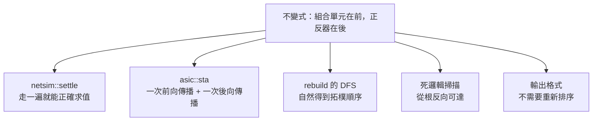
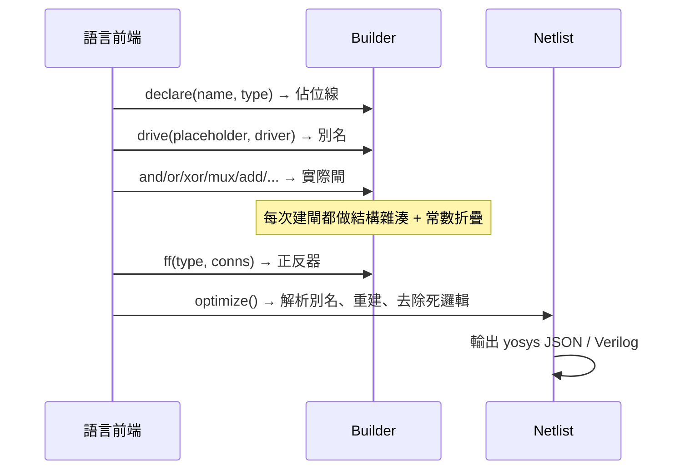

# 4.1 網表 IR 與位元層級 Builder

> 對應原始碼：`eda/src/netlist.rs`、`eda/src/bram.rs`、`eda/src/output.rs`
> 下一節：[4.2 最佳化：常數證明與固定點](04.2-最佳化-常數證明與固定點.md)

---

## 4.1.1 為什麼 IR 選在這個位置

一個 EDA 流程有許多個可能的切入點：AST、RTL IR、邏輯網表、閘級網表、版圖。IR 選在哪裡，決定了哪些最佳化可以被做、哪些不能。

rueda 選的位置是**閘級網表**（yosys 內部單元層級），理由：

1. **前端與後端都已經是「硬體」的形狀。** 前端不需要知道目標技術；後端不需要知道語言。
2. **它是一個公開的、大家都懂的格式。** yosys JSON、Verilog——任何工具都能接上。
3. **所有最佳化機會都還在。** LUT 覆蓋（第 5 章）、樹覆蓋（第 6 章）、時序驅動最佳化都在這之上。

被放棄的選項：

| 選項 | 放棄理由 |
|---|---|
| AST | 太早，無法做硬體層面的最佳化 |
| RTL IR（保留 `always` 結構） | 技術映射時必須拆開，浪費一次轉換 |
| 標準單元網表 | 太晚，FPGA 流程需要保持 LUT 抽象 |

## 4.1.2 資料結構詳解

```rust
/// 一個位元：編譯期常數，或一條網線（net id >= 2，如 yosys JSON）
#[derive(Clone, Copy, PartialEq, Eq, Hash, Debug, PartialOrd, Ord)]
pub enum Bit {
    C0,
    C1,
    W(u32),
}
```

`Bit` 是 `Copy + Hash + Ord`，這三個 derive 各有用途：

- `Copy`：值到處傳遞，不用到處 clone。
- `Hash`：可以當 `HashMap` 的鍵（結構雜湊）。
- `Ord`：**交換律正規化**（`a.min(b), a.max(b)`）與排序輸出都需要。

`Bit::W(u32::MAX)` 是 `NO_OUT` 哨兵，表示「這個單元不驅動任何東西」（天線二極體）。

```rust
#[derive(Clone, Debug)]
pub struct Cell {
    pub typ: String,
    /// (接腳名稱, 位元)；輸出接腳是 "Y"（閘）、"O"（LUT）或 "Q"（正反器）
    pub conns: Vec<(&'static str, Bit)>,
    /// 單元參數（如同 LUT_INIT，msb 優先）
    pub params: Vec<(&'static str, String)>,
}
```

**接腳名稱是 `&'static str`**，這代表：

- 零配置；
- 合法接腳名的集合在編譯期就固定。

**但接腳數量是動態的**（不同技術有不同數量的接腳），所以 `conns` 是一個 `Vec` 而不是一個固定長度的陣列。

```rust
#[derive(Clone, Copy, PartialEq, Debug)]
pub enum Dir { In, Out }

#[derive(Clone)]
pub struct Port { pub name: String, pub dir: Dir, pub bits: Vec<Bit> }

#[derive(Clone)]
pub struct Netlist {
    pub name: String,
    pub ports: Vec<Port>,
    /// 具名網線（階層式名稱）
    pub nets: Vec<(String, Vec<Bit>)>,
    /// 組合單元依拓樸順序，接著是正反器
    pub cells: Vec<Cell>,
}
```

**沒有顯式的寬度欄位。** 寬度是隱含的：

- 埠的寬度 = `port.bits.len()`；
- 匯流排接腳 `"RADDR[0..10]"` = 11 個分開的 `conns` 項目。

**`cells` 的順序不變式**（「組合在前、正反器在後」）是整個工具鏈的隱藏基石，第 4.1.7 節會說明它撐起了多少東西。

## 4.1.3 `Builder`：一個閘一個閘地建構

```rust
pub struct Builder {
    pub cells: Vec<Cell>,
    pub next_wire: u32,
    cache: HashMap<(&'static str, [Bit; 3]), Bit>,
    /// x <-> !x，因此雙重否定與 x & !x 會被折疊掉
    inv: HashMap<Bit, Bit>,
    /// 把多工器折疊進它選擇的兩個相同值之間
    /// （`s ? (t ? v : a) : a` = `(s & t) ? v : a`）
    pub fold_mux: bool,
    muxes: HashMap<Bit, [Bit; 3]>,
}
```

### 4.1.3.1 結構雜湊

```rust
fn gate(&mut self, typ: &'static str, ins: &[(&'static str, Bit)]) -> Bit {
    let mut key = [Bit::C0; 3];
    for (k, (_, b)) in ins.iter().enumerate() { key[k] = *b; }
    if let Some(&y) = self.cache.get(&(typ, key)) { return y; }
    let y = self.wire();
    // ...
    self.cache.insert((typ, key), y);
    y
}
```

**三輸入簽章統一了不同 arity 的閘**：

| 單元 | 使用的鍵 |
|---|---|
| `$_NOT_` | `(typ, [A, C0, C0])` |
| `$_AND_` | `(typ, [A, B, C0])` |
| `$_MUX_` | `(typ, [A, B, S])` |

這是個小技巧，但避免了泛型化 `HashMap` 鍵的複雜度。

### 4.1.3.2 常數折疊

```rust
pub fn and(&mut self, a: Bit, b: Bit) -> Bit {
    match (a, b) {
        (Bit::C0, _) | (_, Bit::C0) => Bit::C0,
        (Bit::C1, x) | (x, Bit::C1) => x,
        _ if a == b => a,
        _ if self.is_inv(a, b) => Bit::C0,
        _ => {
            let (x, y) = (a.min(b), a.max(b));
            self.gate("$_AND_", &[("A", x), ("B", y)])
        }
    }
}
```

**交換律正規化**（`a.min(b), a.max(b)`）是結構雜湊能生效的前提。少了它，`a & b` 與 `b & a` 會是兩個 cell。

`mux` 的真值表折疊更細緻：

```rust
match (s, a, b) {
    (Bit::C0, _, _) => a,
    (Bit::C1, _, _) => b,
    (_, Bit::C0, Bit::C1) => s,        // 0 ? 1 : 0 == S
    (_, Bit::C1, Bit::C0) => self.not(s),
    (_, Bit::C0, _) => self.and(s, b),
    (_, _, Bit::C1) => self.or(s, a),
    // ...
}
```

### 4.1.3.3 MUX 折疊

`fold_mux` 預設關閉，由 Fluxa 前端開啟。規則是：

$$ s ? (t ? v : a) : a \;=\; (s \wedge t) ? v : a $$

**為什麼重要？** 考慮「在巢狀條件下寫入陣列的一個元素」：

```veryl
always_ff (i_clk) {
    if cond1 { mem[i] = x; }
    if cond2 { mem[i] = y; }
}
```

每一個條件都需要一個 mux： $n$ 個條件就是 $n$ 個 mux **串聯**（深度 $n$ ）。用折疊規則：

$$ (c_1 \wedge c_2) ? y : (c_1 ? x : \text{old}) $$

每個位元只需要**一個** mux。**這是把 mux 鏈變成平衡樹的關鍵最佳化。**

### 4.1.3.4 互補追蹤

```rust
/// x <-> !x，讓雙重否定與 x & !x 能折疊
inv: HashMap<Bit, Bit>,
```

這個 map 讓 `not()` 是對稱的：

```rust
pub fn not(&mut self, a: Bit) -> Bit {
    // 若 !a 已知，直接回傳
    // 否則建立新的 not 閘並記錄雙向關係
}
```

於是：

- `!!x → x`
- `x & !x → 0`
- `x | !x → 1`
- `x ^ !x → 1`

全部在**建構時**完成，不需要事後的邏輯化簡 pass。

## 4.1.4 算術元件庫的實作

### 4.1.4.1 平衡歸約

```rust
n => {
    let (l, r) = a.split_at(n / 2);
    let (x, y) = (self.reduce(l, unit, f), self.reduce(r, unit, f));
    f(self, x, y)
}
```

**平衡樹 vs 線性鏈**：32 位元的 AND，線性鏈深度 32，平衡樹深度 5。這個差異在 ASIC 流程裡直接變成 Fmax。

### 4.1.4.2 漣波進位加法器

```rust
// p = x^y, g = x&y, pc = p&c, c' = g|pc
```

這是標準的 ripple-carry。**在 FPGA 上它會被進位鏈取代**（第 5.1 節），在 ASIC 上它會被技術映射重寫（第 6.1 節）。

### 4.1.4.3 回復式除法

```rust
pub fn udivmod(&mut self, a: &[Bit], b: &[Bit]) -> (Vec<Bit>, Vec<Bit>)
```

每一位元一次「減法 + 比較 + 條件選擇」。除數為零時，商是全 1、餘數是被除數。

**這個邊界行為必須與硬體一致**，所以它不是「錯誤」，而是規格的一部分。

### 4.1.4.4 對數桶形移位器

```rust
pub fn shift(&mut self, a: &[Bit], amt: &[Bit], left: bool) -> Vec<Bit>
```

每一個移位量位元對應一個 mux 階段，深度 $O(\log w)$ 。當某階段的移位量 $n \ge w$ 時，後續階段飽和，剩餘的量位元被 OR 起來餵給一個「全部移出去」的 mux。

### 4.1.4.5 一熱解碼

```rust
pub fn decode(&mut self, idx: &[Bit], k: usize) -> Vec<Bit>
```

`idx == k`，用與常數比較實作。

## 4.1.5 記憶體推論的介面

第 2.3.9 節提過 `$mem:` 命名約定。這裡看 `bram.rs` 怎麼用。

```rust
pub struct Mem {
    pub name: String,
    pub depth: usize,
    pub width: usize,
    pub clk: Bit,
    pub we: Bit,
    pub waddr: Vec<Bit>,
    pub wdata: Vec<Bit>,
    pub reads: Vec<ReadPort>,
    /// 初始內容（init_words），若有
    pub init: Option<Vec<u128>>,
}

pub struct ReadPort {
    pub addr: Vec<Bit>,
    /// 讀取使能（C1 = 永遠啟用）
    pub en: Bit,
    /// 每個資料位元的讀取暫存器輸出（None = 該位元未使用）
    pub data: Vec<Option<Bit>>,
}
```

### 4.1.5.1 幾何條件

```rust
if width == 0 || store.len() % width != 0 { continue 'mem; }
let depth = store.len() / width;
let abits = bits_for(depth);
if depth != 1 << abits || wa.len() != abits { continue 'mem; }
```

**深度必須是 2 的冪，且寫入位址必須恰好是 $\lceil \log_2 depth \rceil$ 位。**

### 4.1.5.2 兩種讀取形狀

```rust
let (ff, e) = if p == "D" && plain_ff(i) {
    (i, Bit::C1)                                        // 直接暫存器讀取
} else if p == "B" && c.typ == "$_MUX_" && !port_bits.contains(&c.out()) {
    // 使能：D = en ? rd : Q
    let uu = users.get(&c.out()).cloned().unwrap_or_default();
    if uu.len() != 1 || uu[0].1 != "D" || !plain_ff(uu[0].0)
        || c.port("A") != Some(nl.cells[uu[0].0].out()) { continue 'mem; }
    gone.push(i);
    (uu[0].0, c.port("S").unwrap())
} else { continue 'mem; };
```

1. **直接形狀**：`rd[k]` 直接接到同時脈的 `$_DFF_P_` 的 `D`。
2. **帶使能的形狀**：`rd[k]` 接到一個 `$_MUX_` 的 `B`，而該 mux 的 `A` 是**同一個正反器的 `Q`**——也就是 $D = en \wedge rd \vee \overline{en} \wedge Q$ ，這是「用回授 mux 實作的時脈使能」。

**為什麼只有這兩種？** 因為這正是硬體 block RAM 的讀取埠形狀。其他形狀（例如讀取資料經過邏輯運算）代表這不是一個簡單的記憶體，應該留在邏輯裡。

### 4.1.5.3 位址檢查

```rust
// 記憶體大小之上的位址位元必須是 0（不容許環繞）
if ra.iter().skip(abits).any(|b| *b != Bit::C0) { continue 'mem; }
```

**為什麼？** 因為 block RAM 的位址是固定寬度的，多出來的位元會被硬體忽略（相當於環繞）。語言層的環繞與硬體層的環繞語意不同（語言上是索引錯誤，硬體上是別的位址），所以必須拒絕。

### 4.1.5.4 讀取必須是同步的

> Asynchronous reads stay logic, because the block RAM only has a registered read port.

這是 iCE40 `SB_RAM40_4K` 的限制。**非同步讀取的記憶體必須留在 flip-flop 實作。**

**這解釋了一個常見的現象**：RV32I 的暫存器檔（`Ram`）因為是非同步讀取，留在正反器；而 `SyncRam` 變成 block RAM。第 2.1.9 節的 `Fifo` 例子正是把記憶體寫入與讀取分開成兩塊的原因。

## 4.1.6 輸出格式

`eda/src/output.rs` 有兩個寫出器。

### 4.1.6.1 網線重新編號

```rust
/// 緊湊的網線編號（2, 3, ...），依首次出現的順序
fn numbering(nl: &Netlist) -> HashMap<u32, u32> {
    let mut m = HashMap::new();
    let mut add = |b: Bit| if let Bit::W(w) = b { let n = m.len() as u32 + 2; m.entry(w).or_insert(n); };
    for p in &nl.ports { p.bits.iter().for_each(|b| add(*b)); }
    for c in &nl.cells { c.conns.iter().for_each(|(_, b)| add(*b)); }
    for (_, bits) in &nl.nets { bits.iter().for_each(|b| add(*b)); }
    m
}
```

**從 2 開始**（保留 yosys 的 0/1 給常數），**依首次出現順序**（埠 → 單元 → 網線）。內部網表經過 `rebuild` 後可能有跳號，yosys 要的是密集編號。

### 4.1.6.2 yosys JSON

```json
{
  "creator": "rueda <version>",
  "modules": {
    "<name>": {
      "attributes": { "top": "00000000000000000000000000000001" },
      "ports": { "<port>": { "direction": "input|output", "bits": [ ... ] } },
      "cells": { "$veryl$0": { "type": "$_AND_", "connections": {...}, "parameters": {...} } },
      "netnames": { ... }
    }
  }
}
```

位元編碼：`Bit::C0` → 字串 `"0"`，`Bit::C1` → `"1"`，`Bit::W(w)` → 數字。

單元名稱用 `"$veryl${i}"`——`$` 前綴讓 yosys 視為自動生成的名稱，`hide_name: 1` 讓它不出現在報告裡。

### 4.1.6.3 一個容易踩到的坑：字串參數

```rust
// 只含 0 / 1 的字串參數加上一個尾端空格（yosys 的 JSON 慣例），
// 否則它會被讀成位元向量
let sp = if crate::fpga::ecp5::is_string_param(&c.typ, k) && v.chars().all(|ch| ch == '0' || ch == '1') {
    " "
} else { "" };
format!("\"{}\": \"{}{}\"", k, v, sp)
```

**yosys 靠字元內容判斷一個參數是「字串」還是「位元向量」。** `"0101"` 會被讀成二進位位元，而不是字串 `"0101"`。加上一個尾端空格可以強制它被當成字串。

這對 `LUT_INIT`（16 個字元的二進位字串，必須保持字串）與 ECP5 的 `INIT0`/`INIT1` 是必要的。

### 4.1.6.4 `MEM_SLOT` 變成屬性

```rust
let attrs: Vec<String> = c.params.iter().filter(|(k, _)| *k == crate::bram::SLOT)
    .map(|(_, v)| format!("\"veryl_mem\": \"{}\"", v)).collect();
```

`MEM_SLOT` 是 rueda 特有的擴充（記錄「這個 block RAM 裝的是哪個記憶體的第幾塊」），**不是真正的 iCE40 參數**。所以它被寫成 yosys 的 *attribute* 而不是 parameter，這樣它可以安全地往返而不會變成一個假的硬體參數。

它是「把程式燒進記憶體」這件事的基礎：`pnr::patch_ram` 靠它知道要改哪一塊。

### 4.1.6.5 結構化 Verilog

`to_verilog` 產生的是**閘級 Verilog**（給 iverilog 之類的工具用）。

幾個細節：

**正反器變成 `reg`，其他變成 `wire`：**

```rust
let regs: HashSet<Bit> = nl.cells.iter()
    .filter(|c| c.is_ff() && c.typ.starts_with("$_"))
    .map(|c| c.out()).collect();
```

**正反器的類型字串被解碼回 Verilog：**

```rust
// $_DFF_P_ / $_DFF_PN0_ / $_SDFF_PP1_ ...
let f: Vec<char> = t.trim_start_matches("$_").trim_start_matches("S").trim_start_matches("DFF_").chars().collect();
let edge = if f[0] == 'P' { "posedge" } else { "negedge" };
```

同步重置（`$_SDFF*`）的敏感度列表只有時脈；非同步重則是 `posedge C or negedge R`。

**匯流排接腳的組合**：

```rust
// 索引接腳 "NAME[i]" 組成一個匯流排埠（缺少的輸入位元讀 0）
let bits: Vec<String> = (0..=top).rev().map(|k| match v.iter().find(|x| x.0 == k) {
    Some(x) => name(&x.1),
    None if is_out(p) => { dangling += 1; format!("nc{}_{}", i, dangling) }
    None => "1'b0".to_string(),
}).collect();
format!(".{}({{{}}})", p, bits.join(", "))
```

**MSB 優先**（`.rev()`），符合 Verilog 的 `{a[3],a[2],a[1],a[0]}` 慣例。

**輸出的懸空位元變成具名導線** `nc<cell>_<k>`，因為 Verilog 不允許輸出接腳的某些位元不連。

## 4.1.7 「組合在前、正反器在後」撐起了什麼

這個不變式看起來只是個實作細節，但它被多處依賴：



具體來說：

**閘級模擬**（`netsim::settle`）走一遍 cells 就得到正確的組合邏輯值。若順序不保證，就得反覆迭代直到收斂——那就是事件驅動模擬器的複雜度。

**時序分析**（`asic::sta`）不需要拓樸排序，因為順序天然滿足資料流方向。

**`rebuild` 的 DFS** 在拓樸順序上重新發出 cell，因此所有折疊與雜湊都能重新套用。

> **這是一個「用資料結構的物理順序承載語意」的漂亮例子。** 在很多系統裡，這種隱含不變式會成為維護的負擔；但在這裡，它讓三個演算法都變簡單了。

## 4.1.8 完整的一次建構流程



## 4.1.9 一個完整的算術例子

從 Veryl 的：

```veryl
assign o_sum = a + b;
```

到網表：

1. `a` 與 `b` 的佔位線被 `drive` 到實際的運算結果；
2. 合成器的 `eval` 認出 `Bin("+", a, b)`，呼叫 `Builder::add_c`；
3. `add_c` 產生 32 顆全加器（`p = x^y`、`g = x&y`、`c' = g | (p & c)`），並串接進位；
4. 每顆全加器的閘經過結構雜湊——**如果設計裡有多個加法器，共用的部分會自動共用**；
5. 常數折疊會把 `a + 0` 變成 `a`；
6. `optimize` 解析別名，把佔位線換成真正的驅動線；
7. 死邏輯掃描刪掉沒有連到任何輸出的閘；
8. 輸出成 yosys JSON。

**第 3 章的 `case` 一熱編碼、第 2 章的 `if_reset` 兩路徑、第 1 章的 `is_out` 判準，全部都發生在這條管線裡。**

---

**下一節**：[4.2 最佳化：常數證明與固定點](04.2-最佳化-常數證明與固定點.md)
