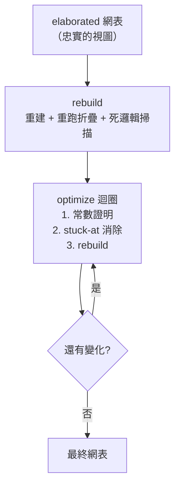
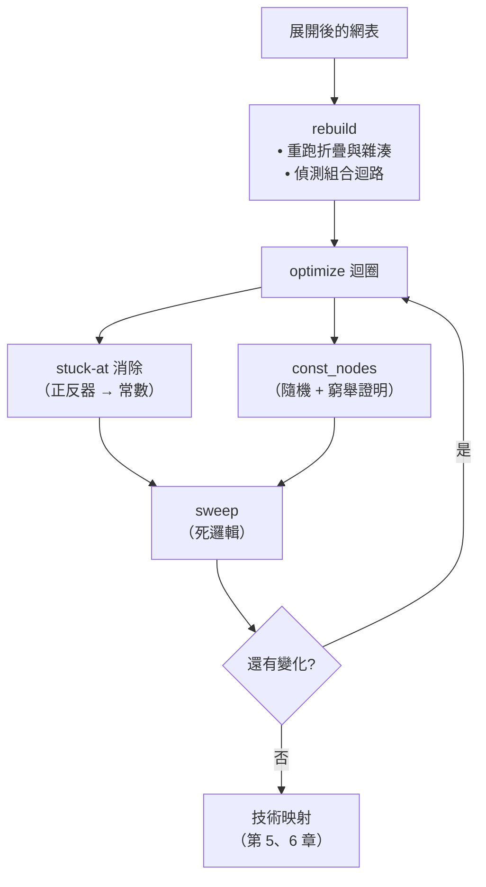

# 4.2 最佳化：常數證明與固定點

> 對應原始碼：`eda/src/netlist.rs`（`rebuild`、`optimize`、`const_nodes`、`sweep`）、`eda/src/power.rs`
> 上一節：[4.1 網表 IR 與位元層級 Builder](04.1-網表IR與位元層級Builder.md)　下一節：[4.3 高階合成](04.3-高階合成-從task到FSM與資料路徑.md)

---

## 4.2.1 最佳化的三個層級

合成後的網表要經過三層最佳化，它們的**觸發條件**與**目標**都不同：



**兩個入口是刻意分開的**：

```rust
/// 網表就像被展開出來的那樣：佔位別名已解析，抵達不到任何輸出的單元被丟棄，
/// 其他都沒有被簡化
pub fn elaborated(b: &Builder, alias: &HashMap<u32, Bit>, ports: &[Port],
                  nets: &[(String, Vec<Bit>)], name: &str) -> R<Netlist>

/// 在展開後最佳化網表：rebuild 它，然後把永遠無法離開初始 0 的正反器換成常數 0，
/// 重複直到沒有變化
pub fn optimize(b: Builder, alias: &HashMap<u32, Bit>, ports: Vec<Port>,
                nets: Vec<(String, Vec<Bit>)], name: &str) -> R<Netlist>
```

**為什麼需要 `elaborated`？** 因為在某些情況下你需要**未最佳化**的視圖來除錯——「我的設計為什麼少了一顆閘？」這個問題只有對照未最佳化的網表才答得出來。

## 4.2.2 `rebuild`：重新正規化

`rebuild` 是一個迭代式 DFS：

```rust
let mut stack: Vec<(u32, bool)> = vec![(rw, false)];
let mut onstack: HashSet<u32> = HashSet::new();
while let Some((w, expanded)) = stack.pop() {
    // ...
    if !onstack.insert(w) {
        return Err(format!("combinational loop through '{}'", net_name(w)));
    }
    // ...
}
```

三個作用：

1. **偵測組合迴路**（在 stack 上重複出現）。
2. **建立拓樸順序**。
3. **用新的 `Builder` 重新發出所有 cell**——因此**所有的折疊與結構雜湊全部重新套用**。

**第 3 點是最重要的。** 網表建構期間的折疊是「局部」的：當時 `a` 和 `b` 是兩條不同的線，現在它們可能已經解析成同一條線，於是 `a & b` 應該塌縮成 `a`。`rebuild` 讓這種全局的機會被利用。

## 4.2.3 `optimize`：迭代到定點

```rust
pub fn optimize(...) -> R<Netlist> {
    let mut nl = rebuild(b, alias, ports, nets, name)?;
    loop {
        // 1. 卡在 0 的正反器：D == Q，或 D == 0，且有 0 重置 → 換成常數
        // 2. 常數節點證明（const_nodes）
        // 3. rebuild 並重複直到沒有變化
    }
}
```

**為什麼要迭代？** 因為**一個最佳化會使另一個變得可能**：

```
某個正反器的 D 變成常數 0
  → 它的 Q 變成常數
    → 依賴它的閘變成常數
      → 更多正反器的 D 變成常數
        → ...
```

這個「級聯」是固定點迭代的自然結果。

## 4.2.4 Stuck-at 消除

```rust
let is_stuck = |c: &Cell| {
    let (q, d) = (c.out(), c.port("D"));
    let zero_reset = c.port("R").is_none() || c.typ.ends_with("0_");
    c.is_ff() && zero_reset && (d == Some(q) || d == Some(Bit::C0))
};
```

**條件拆解**：

| 條件 | 意義 |
|---|---|
| `c.is_ff()` | 是正反器 |
| `zero_reset` | 沒有重置，或重置值為 0 |
| `d == Some(q)` | D 與 Q 同一條線 → 永遠保持原值 |
| `d == Some(Bit::C0)` | D 是常數 0 → 永遠是 0 |

**為什麼要求重置值為 0？** 因為優化器假設**正反器開機為 0**。如果重置值是 1，那正反器在開機瞬間是 1，不能被換成常數 0。

這個假設是**技術特定的**：

- iCE40 的正反器開機為 0 → 成立；
- 許多 ASIC 製程的正反器開機為 0 或不定（scan 會打亂）→ 需要更保守。

因此形式等價性檢查（第 4.2.8 節）必須用 `-set-init-zero`。

### 4.2.4.1 ROM 例外

這是整個最佳化裡最需要小心的一處：

> A memory that is never written at all is exempt: a block RAM can be given initial contents (a program, see `bram::set_mem_init`), so it is a ROM, not 0.

實作：

```rust
// 掃描 $mem:NAME:clk 網線，檢查對應的 $mem:NAME 網線是否完全由卡住的正反器輸出組成
```

**如果不處理這個例外會怎樣？** 一個把 bootloader 燒進 block RAM 的設計：記憶體永遠不被寫入，所以所有位元都是「卡住」的，會被整個換成 0，程式就不見了。

**這個例外的存在，是「語意（這是 ROM）優先於結構（這些是正反器）」的一個具體證據。**

## 4.2.5 常數證明：隨機猜測 + 列舉證明

這是合成器裡最精巧的一段。

### 4.2.5.1 問題

**區域性折疊看不到全域性的常數。** 舉例：一個從常數 ROM 解碼出來的寫入致能，在局部看起來是一個正常的訊號，但它其實永遠是 0（因為 ROM 的內容是常數）。

### 4.2.5.2 支援集（support）

```rust
/// 找出那些雖然沒有局部折疊規則能看到、但其實是常數的組合節點……
/// 隨機模擬提出候選，再用對其輸入支援的窮舉模擬證明
fn const_nodes(nl: &Netlist) -> HashMap<u32, Bit> {
    const MAXSUP: usize = 16;
```

「支援集」是一個閘所依賴的**葉節點輸入集合**：

$$
\text{supp}(v) = \bigcup_{u \in \text{fanin}(v)} \text{supp}(u) \cup \{u \mid u \text{ 是主要輸入或正反器輸出}\}
$$

支援集超過 16 個輸入的閘被標記為「不可證明」（`None`）。

### 4.2.5.3 階段一：隨機模擬

```rust
// 隨機模擬：4 × 64 位元樣本，xorshift PRNG，種子 0x9e3779b97f4a7c15
let mut seed = 0x9e3779b97f4a7c15u64;
let mut rnd = move || { seed ^= seed << 13; seed ^= seed >> 7; seed ^= seed << 17; seed };
```

每個閘用 4 組隨機的 64 位元樣本評估。**如果 4 組樣本下都是全 0 或全 1，就成為候選。**

這是 SAT 求解器的「隨機搜尋」啟發式：**先用便宜的隨機測試篩掉絕大多數的非候選**。

### 4.2.5.4 階段二：窮舉證明

候選依「支援集」分組（**相同支援集的候選可以一起評估**），然後對每個支援集窮舉所有 $`2^n`$ 種輸入組合（ $`n \le 16`$ ）。

**位元平行**：64 個樣本打包成一個 `u64`，所以一個支援集 16 個輸入的窮舉只需要 1024 個 `u64` 運算。

```rust
let words = ((1usize << npat) / 64).max(1);
let valid = if npat >= 64 { !0u64 } else { (1u64 << npat) - 1 };
if r.iter().all(|x| x & valid == 0) { out.insert(w, Bit::C0); }
else if r.iter().all(|x| x & valid == valid) { out.insert(w, Bit::C1); }
```

`valid` 遮罩處理「樣本數不是 64 的倍數」的最後一個字。

### 4.2.5.5 可信度的關鍵

**「正反器輸出視為自由輸入」是讓這個證明保持正確（sound）的關鍵。**

```rust
// 計算支援時，正反器的輸出被當成自由輸入（葉節點）
```

**為什麼？**

- 正反器的輸出取決於**過去的狀態**，與當前的組合邏輯無關。
- 因此在窮舉「支援集」時，把正反器輸出當作獨立的自由輸入來窮舉，涵蓋了它**所有可能的值**。
- 如果把它當成「由組合邏輯決定」，窮舉空間就不完整，證明就不成立。

反過來說，這個處理方式**只會讓證明更保守，不會更激進**——這正是我們要的。

> 這是把「數學上的保守性」編進演算法設計的一個漂亮例子。整個技術可以看成：**一個 SAT 求解器的極簡版本——隨機模擬做啟發式搜尋，窮舉做確認。**

### 4.2.5.6 為什麼不用完整的 SAT 求解器？

| | 完整 SAT | 這個方法 |
|---|---|---|
| 能力 | 證明任意命題 | 只證明「是常數」 |
| 實作量 |  thousands 行 | 50 行 |
| 執行時間 | 可能指數 | 支援集 ≤ 16， $`2^{16}`$ 上限 |
| 需要的輸入 | CNF 公式 | 網表 |

**「是常數」這個命題的特點是：它的證明可以完全用窮舉完成。** 這是一個「用更簡單的方法覆蓋大部分實務需求」的取捨。

## 4.2.6 死邏輯掃描

```rust
/// 移除輸出接不到任何輸出埠的單元（也包含死掉的正反器）
pub fn sweep(cells: &mut Vec<Cell>, roots: &[Bit]) {
    let mut live: HashSet<Bit> = roots.iter().copied().collect();
    let by_out: HashMap<Bit, usize> = ...;
    let mut keep = vec![false; cells.len()];
    let mut work: Vec<Bit> = roots.to_vec();
    while let Some(x) = work.pop() {
        if let Some(&i) = by_out.get(&x) {
            if keep[i] { continue; }
            keep[i] = true;
            for (p, y) in &cells[i].conns {
                if !is_out(p) && !y.is_const() && live.insert(*y) { work.push(*y); }
            }
        }
    }
    // 移除未標記的單元
}
```

從輸出埠的位元出發，沿著「誰驅動這個位元」反向可達。走得到的活著，其餘刪除。

**特別注意 `!is_out(p)` 這個條件**：掃描是沿著「輸入接腳」反向走的，輸出接腳不追蹤（否則會把驅動方向搞反）。

### 4.2.6.1 記憶體寫入埠的例外

```rust
// 仍然被讀取的記憶體，其寫入埠會留下（映射器可能把它變成 RAM）
for (n, bits) in &nets2 {
    let Some(rest) = n.strip_prefix("$mem:") else { continue; };
    let Some((q, port)) = rest.rsplit_once(':') else { continue; };
    if !port.starts_with("rd") || !bits.iter().any(|b| used.contains(b)) { continue; }
    for (m, b) in &nets2 {
        if [":clk", ":we", ":wa", ":wd"].iter().any(|s| *m == format!("$mem:{}{}", q, s)) {
            roots.extend(b.iter().copied());
        }
    }
}
```

**這是「資料流分析」與「結構語意」之間張力的一個漂亮例子。**

死邏輯掃描只看資料流向。一個「永遠被讀、從不被寫」的記憶體，它的寫入邏輯**沒有任何資料流出到輸出埠**，所以會被刪掉。但那個寫入邏輯**就是 block RAM 的寫入埠**！

技術映射器需要它才能把這堆正反器認成一個 RAM。所以掃描時要把寫入埠加進「根」。

> 這是「光靠資料流分析不足以做結構化推論」的一個具體案例。**推論器必須理解 `$mem:` 命名約定的語意。**

## 4.2.7 從優化到映射：數字的變化

以 `SyncRam 512×8` 為例（來自 `veryl/synth/README.md`）：

| 階段 | 單元數 |
|---|---|
| 展開（512 × 8 個正反器 + 位址解碼 + 讀取 mux） | 12,832 |
| BRAM 推斷後 | 1 個 `SB_RAM40_4K` |

而 `BramMix`（256×32，2 個讀取埠）：

| 階段 | 單元數 |
|---|---|
| 展開 | 29,059（塞不進 UP5K） |
| BRAM 推斷後 | 4 個 BRAM + 86 個 LC，49 MHz |

**這就是最佳化與推論的價值**：不是「快一點」，而是「從做不成變成做不成」。

## 4.2.8 驗證策略：五層等價性 + 形式證明

`veryl/synth/test.sh` 用 yosys + slang 做**形式等價性檢查**：把官方 `veryl build` 產生的 SystemVerilog 與 rueda 產生的網表放在一起證明等價。

| 設計 | 等價性證明方式 |
|---|---|
| Adder / Max3 / AluUnit / BitRev / GrayConv / rv32i Alu / ProgRom | **完整 SAT 證明** |
| Seq101 / PktReg | k-induction 證明 |
| Ram / RegFile / RiscvCore | BMC，8 / 2 / 2 個時脈 |
| RiscvSoc | BMC，80 個時脈 |
| SyncRam / Bram2048x2 / BramMix / Fifo | BMC，4 / 4 / 12 / 6 個時脈 |
| HsTop（介面握手） | BMC，24 個時脈 |

**每個設計都被證明四次**：通用閘、vlib 標準單元、SKY130、ECP5；BRAM 設計另外在 iCE40 網表上證明。

### 4.2.8.1 為什麼 SAT 證明只用在小的設計上？

SAT 證明是**指數時間**的。對一個大設計，「證明兩個網表等價」基本上不可能在可接受的時間內完成。

所以策略是分層的：

| 設計大小 | 方法 | 成本 | 保證強度 |
|---|---|---|---|
| 小 | 完整 SAT | 高 | **完全等價**（所有輸入、所有時脈） |
| 中 | k-induction | 中 | 有界等價 + 歸納步驟 |
| 大 | BMC， $`k`$ 個時脈 | 低 | 只保證前 $`k`$ 個時脈 |

**BMC（bounded model checking）** 給出的是「前 $`k`$ 個時脈內等價」——不是完全保證，但涵蓋了大部分啟動與正常行為。

> **這是本章最值得學的一點**：驗證策略必須與設計大小**匹配**。用 SAT 證明整個 RISC-V SoC 是荒謬的；用 BMC 證明一個加法器則是浪費。

### 4.2.8.2 `-set-init-zero`

AGENTS.md 特別提到：

> The optimizer assumes flip-flops power up at 0 (true on iCE40), so equivalence checks use `-set-init-zero`, and never-written registers become constants.

**這是一個「優化器的假設必須被驗證工具知道」的具體例子。** 如果不傳 `-set-init-zero`，yosys 會用隨機初值，而 Nunca 被寫入的暫存器在 roda 裡是常數 0 ——兩邊就不等價了。

## 4.2.9 功耗估算

`eda/src/power.rs` 與 `eda/src/fpga/pnr/power.rs` 提供了兩種功率估算。

### 4.2.9.1 ASIC：活動因子 + IR drop

**開關能量**：每次電容充放電的能量是

$$
E = \frac{1}{2} C V^2
$$

其中 $`V_{DD} = 1.2\text{ V}`$ 。

**內部能量**： $`0.4 \times \text{width} \times \text{rate}`$ fJ。

**正反器時脈能量**：每個正反器每週期 3 fJ。

**SRAM**：每次存取 $`0.08 \times \text{width} \times \sqrt{\text{depth}}`$ 。

**漏電**：每個 site 0.25 nW，每個 SRAM 位元 0.02 nW。

**IR drop** 是最有意思的部分：

> 每個單元從它那一列的 VDD 軌供電。兩個 strap 之間的一段軌是一條電阻線，兩端都被供電；在段長 $`L`$ 中位置 $`x`$ 處的負載 $`I`$ 造成的壓降是
> 

$$
r I \frac{\min(x, x_0) (L - \max(x, x_0))}{L}
$$

> 首尾兩段只有一端供電。

**這個模型把「電源網路的拓樸」變成了一個一維的電阻網路問題。** 對一個教學級的模型來說已經相當細緻。

### 4.2.9.2 FPGA：活動模擬

```rust
// 每個會翻轉的網路充放它驅動的輸入（每個 5 fF）
// 與它使用的佈線（每個 pip / 線段 8 fF）
let c = 5.0 * net.sinks.len() as f64 + 8.0 * pips;   // fF
```

時鐘網路特別處理：

```rust
// 時鐘（活動為 0 的全域網路）：全域網路電容（0.5 pF = 500 fF）+ 局部電容，每週期切換兩次
e_clock += (500.0 + c) * V * V;
```

**全域網路 500 fF 的電容，遠大於一般網路**，這正是 FPGA 時鐘樹的功耗問題——它必須用低阻抗的金屬層與寬大的驅動器。

### 4.2.9.3 活動因子的取得

```rust
// crate::power::activity 對最終網表跑隨機輸入模擬
// cycles = clamp(2_000_000 / cells, 100, 1000)
```

**用隨機輸入模擬取得切換率。** 這個方法的前提是**隨機輸入能代表真實活動**——對於資料路徑大致成立，對控制路徑則不太行。

## 4.2.10 最佳化的全景



| 最佳化 | 類型 | 安全性保證 |
|---|---|---|
| 常數折疊 | 局部 | 建構時保證正確 |
| 結構雜湊 | 局部 | 建構時保證正確 |
| 互補追蹤 | 局部 | 建構時保證正確 |
| MUX 折疊 | 全域 | 布林恆等式，可證明 |
| `rebuild` | 全域 | 重新套用局部規則 |
| stuck-at 消除 | 全域 | 依賴「開機為 0」的技術假設 |
| 常數證明 | 全域 | **窮舉證明**（支援集 ≤ 16） |
| 死邏輯掃描 | 全域 | 資料流可達性分析 |

**注意最後三列的「安全性保證」性質不同。** 前兩列是建構時的保證；`stuck-at` 依賴技術假設；`const_nodes` 有窮舉證明。**知道每個最佳化「為什麼是對的」，是使用合成器的前提。**

---

**下一節**：[4.3 高階合成：從 task 到 FSM 與資料路徑](04.3-高階合成-從task到FSM與資料路徑.md)
