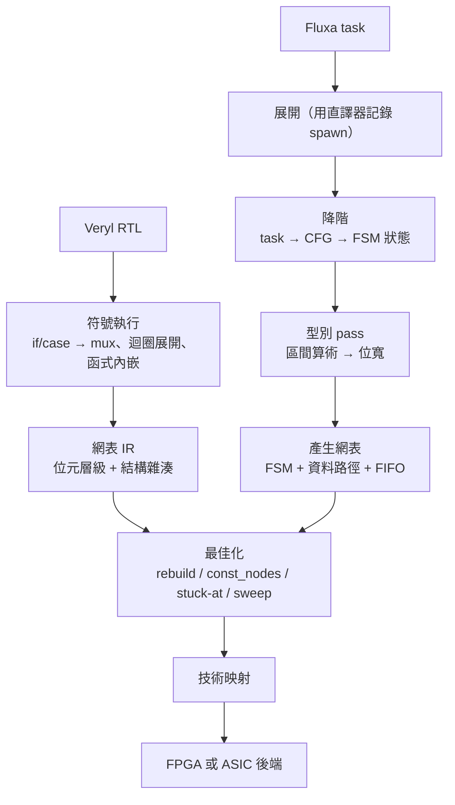

# 4.3 高階合成：從 task 到 FSM 與資料路徑

> 對應原始碼：`fluxa/synth/lower.rs`、`fluxa/synth/gen.rs`、`fluxa/synth/ty.rs`、`fluxa/synth/graph.rs`、`fluxa/synth/hw.rs`、`fluxa/docs/synthesis-plan.md`
> 上一節：[4.2 最佳化：常數證明與固定點](04.2-最佳化-常數證明與固定點.md)

---

## 4.3.1 目標

把一個 Fluxa 程式（task 的集合）變成**一個閘級網表**。

看起來簡單，但實際上要處理四個問題：

1. **任務網路是動態的**（`spawn` 在執行時決定要啟動誰）——必須先「展開」成靜態的。
2. **通道是 FIFO**——必須變成硬體。
3. **task 內部的控制流是順序的**——必須變成 FSM。
4. **值域必須映射到位寬**——必須有型別推導。

## 4.3.2 完整流程

```
.fx ──► parse（沿用 fluxa/sim 的 lexer/parser/AST）
     ──► fluxa/synth
          ① 展開   ：comptime 與 const 由既有直譯器求值；從 --top 靜態展開 spawn 樹；
                      泛型單體化；每個 chan 變成一個 FIFO
          ② 位寬推導：區間算術（int<lo..=hi>、fixed<I,F>）→ 每個運算式的靜態寬度
          ③ 降階   ：每個 task → 一個控制流程圖（迴圈、recv/send、if/match、@reg、carry）
          ④ 排程   ：先 FSM（每個通道操作是一個狀態邊界），再 pipeline(ii=n)
          ⑤ 產生網表：資料路徑、FSM、FIFO，寫進 eda::netlist 的位元層級 builder
     ──► eda::netlist::Netlist ──► 既有的 FPGA / ASIC / P&R 流程，完全不變
```

**⑤ 輸出的還是同一個 `Netlist`。** 這是第 1.3.2 節那條架構規則的回報：Fluxa 合成完之後，後端完全不知道這是 Fluxa 寫的。

## 4.3.3 步驟①：展開——用直譯器記錄 spawn 樹

這是 Fluxa 合成裡最巧妙的一招。

**問題**：`spawn` 的目標在執行時才知道，而且參數可能是執行期算出來的。

**解法**：**用行為模擬器跑一遍，用一個「錄影機」取代真正的硬體任務。**

```rust
struct Recorder { spawns: Mutex<Vec<Spawn>> }
impl HwProvider for Recorder {
    fn start(&self, task: &str, args: &[(String, Value)]) -> Option<Result<Box<dyn HwTask>, String>> {
        self.spawns.lock().unwrap().push((task.to_string(), args.to_vec()));
        Some(Ok(Box::new(Idle)))       // 被錄到的任務什麼都不做
    }
}
```

每個 `spawn`（與 `broadcast`）被**記錄下來而不是執行**，每個 `chan()` 都是模擬器世界裡的一個真實通道。

**結果**：「這個網路就是模擬器實際建構、實際迴圈、實際 comptime 出來的樣子。」**展開的正確性直接繼承了模擬器的正確性。**

### 4.3.3.1 `broadcast` 的處理

`broadcast` 需要被合成成硬體。rueda 的做法是**生成一個小的 Fluxa task 來實作它**：

```rust
let src_text = format!("task Broadcast(x: in chan<{}>{}) {{ for v in x {{ {}}} }}", elem, ps, sends);
let p2 = fluxa::load_many(&[("broadcast.fx".into(), src_text)])?;
```

**用語言本身來描述要合成的硬體。** 這是一個非常漂亮的手法——不需要手寫「複製器」的硬體描述。

## 4.3.4 步驟②：位寬推導——區間算術

Fluxa 的型別是值域，所以位寬可以直接從值域算出來。

```rust
// fluxa/synth/src/ty.rs
pub enum Ty {
    Int { lo: i128, hi: i128 },
    Bool,
    Fixed { i: u32, f: u32, round: Round, ovf: Ovf },
    Array(Box<Ty>, usize),
    Tuple(Vec<Ty>),
}

pub struct SVal {
    pub bits: Vec<Bit>,
    pub lo: i128, pub hi: i128,
    pub boolean: bool,
    pub frac: u32,
}
```

### 4.3.4.1 乘法為什麼安全

```rust
pub fn mul(g: &mut Builder, a: &SVal, b: &SVal) -> SVal {
    let p = [a.lo * b.lo, a.lo * b.hi, a.hi * b.lo, a.hi * b.hi];
    let (lo, hi) = (*p.iter().min().unwrap(), *p.iter().max().unwrap());
    let w = int_bits(lo, hi) as usize;
    let m = g.mul(&a.ext(w), &b.ext(w));
    ranged(m, lo, hi, a.frac + b.frac)     // 小數位數相加
}
```

**乘法之後的寬度是四個角落乘積的最小與最大值。** 這個區間包含了所有可能的乘積結果，所以硬體的位寬**永遠不會溢位**。

這是 Fluxa 相對 Verilog 最大的優勢之一。Verilog 的 `8bit * 8bit` 需要 16 位，但設計者常常忘記寫 16 位，結果是**硬體乘法器的輸出被截斷**。Fluxa 不可能犯這個錯——**寬度是推導出來的，不是寫出來的**。

### 4.3.4.2 定點數的小數位數

```rust
// 對齊：位元數較少的小數的操作元左移
// T-FADD: fixed<I1,F1> + fixed<I2,F2> : fixed<max(I1,I2)+1, max(F1,F2)>
// T-FMUL: fixed<I1,F1> * fixed<I2,F2> : fixed<I1+I2, F1+F2>
```

**小數位數相加**是硬體乘法器最自然的行為（兩個 $F$ 位小數相乘得到 $2F$ 位小數）。

### 4.3.4.3 轉換與溢位模式

`convert()` 實作 T-FCONV：先重新捨入到目標的小數位數，然後套用溢位模式。

| 模式 | 硬體 | 說明 |
|---|---|---|
| `sat` | 兩個比較器 + mux | 飽和到上下界 |
| `wrap` | 保留低位 | 硬體就是這樣 |
| `check` | **不產生硬體** | 只有模擬器會報錯 |

**`check` 模式在硬體上不產生任何東西**——因為硬體無法「檢查後中止」。這是一個語意在硬體上無法完整實作的例子，工具必須誠實地說明。

### 4.3.4.4 位移飽和

```rust
// shl_sat 把結果夾在 ±2^120
```

因為語言承諾精確到 120 位，硬體的移位也要能表示這麼大的值（不折疊）。

## 4.3.5 步驟③：降階——task 主體變成 CFG

### 4.3.5.1 基本區塊

```rust
// fluxa/synth/src/lower.rs
pub enum Term {
    Goto(B),
    Branch(Expr, B, B),
    Recv  { dst: String, ch: String, closed: Option<B>, next: B },
    Send  { ch: String, val: Expr, next: B },
    Close { ch: String, next: B },
    CloseOwned { ch: String, next: B },
    MemRead  { dst: String, mem: String, addr: Expr, next: B },
    MemWrite { mem: String, addr: Expr, val: Expr, next: B },
    Pipe { head: Option<(String,String)>, cond: Option<Expr>,
           recvs: Vec<(String,String)>, sends: Vec<(String,String)>, exit: B },
    Halt,
}
pub struct Bb { pub stmts: Vec<Stmt>, pub term: Term }
pub struct Cfg {
    pub blocks: Vec<Bb>,
    pub params: Vec<String>,
    pub temps: Vec<(String, Temp)>,
    pub mems: Vec<MemDecl>,
    pub warnings: Vec<String>,
}
```

**每個基本區塊 = 一個 FSM 狀態**：一段直線式的純陳述句（資料路徑，一個時脈），加一個終結指令。

**「每個通道操作是一個狀態邊界」** 是整個降階的核心原則。理由很直接：**通道操作是需要等待的**——接收方可能還沒有資料。硬體上要等，就必須有一個狀態可以停在上面。

### 4.3.5.2 重新命名

```rust
// 每個綁定都取得唯一名字（x → x.3），作用域因此消失，變數變成暫存器
```

這是「消除作用域」的最直接手段：**把名字變成全域唯一的**，然後每個名字就是一個暫存器。

### 4.3.5.3 `@reg` 改寫

```rust
StmtKind::Let { pat: Ident(n), placement: Some("reg"), .. } => {
    regs.push(n.clone());
    stmts.push(s.clone());
    stmts.push(let_stmt(&format!("{}~p", n), path(n, line), line));
}
```

一個 `@reg` 變數會得到一個 `pending` 副本 `x~p`：迴圈內的寫入到 `x~p`，每次迭代結束時把 `x~p` 拷回 `x`。

**這正是硬體移位暫存器的結構**：多一組暫存器 + 一組使能。

### 4.3.5.4 記憶體改寫

`m[i]` 變成 `m.$read(i)` / `m.$write(i, v)`，**讓每次存取都是一個時脈**（block RAM 的形式）。

如果記憶體被用在其他方式，就保留成暫存器陣列並發出警告。

### 4.3.5.5 把通道操作從運算式中提出來

這是降階裡最需要小心的一步。

```rust
// acc += a.recv() * b.recv() 變成兩個接收狀態（依求值順序）
ExprKind::Method(r, n, _, a) if n == "recv" && a.is_empty() => {
    let dst = self.temp("recv", Temp::ChanElem(ch.clone()));
    let next = self.new_block();
    self.blocks[*cur].term = Term::Recv { dst: dst.clone(), ch, closed: None, next };
    *cur = next;
    Ok(Expr { kind: ExprKind::Path(vec![dst]), line })
}
```

**硬體上，通道操作不能出現在一個算術運算式的中間。** 必須先取出來存進暫存器。

**而且 `recv` 有求值順序問題**：`a.recv() * b.recv()` 中，哪個先接收？在語言裡是左到右，但**在硬體上，兩個獨立的接收應該是並行的**（這是流水化的機會）。

所以 `&&` / `||` 右邊的 `recv` 被明確拒絕：

> "it is not always evaluated"

（因為 `a && b.recv()` 的短路語意在硬體上無法保證。）

### 4.3.5.6 `match` 轉成 `if` 鏈

```rust
// match_as_if：先把被比對值求值到一個變數
// else if 鏈共用一個結果變數，因此變成一個暫存器，而不是每層一個
```

**共用結果變數**是關鍵：若每個分支有自己的結果變數，硬體上就要多一個 mux 層。共用之後，整個 `match` 只需要一個結果暫存器。

### 4.3.5.7 流水化迴圈變成一個 `Pipe` 狀態

這是 Fluxa 合成最有特色的一步。

**一個流水化的 `for` 迴圈被降階成單一的 `Pipe` 狀態**，而不是展開成一連串狀態。

`Pipe` 狀態的結構：

```rust
Pipe { head: Option<(String,String)>, cond: Option<Expr>,
       recvs: Vec<(String,String)>, sends: Vec<(String,String)>, exit: B }
```

它表達的是：**「這個狀態每個時脈嘗試進行一次迭代；如果所需的資料還沒到，就停在這裡」**。

**這就是把 KPN 的阻塞式語意映射到硬體的關鍵：**

| KPN 語意 | 硬體 |
|---|---|
| `recv()` 阻塞直到有資料 | 讀取埠的 `valid` 為 0 時，FSM 停在 `Pipe` 狀態 |
| `send()` 阻塞直到有空間 | 寫入埠的 `ready` 為 0 時，FSM 停在 `Pipe` 狀態 |
| 一個迭代的所有 recv/send 同時發生 | 一次握手完成一個迭代 |

### 4.3.5.8 流水化的限制與降級

第 3.3.9 節提過的規則，在降階時強制。違反時：

- 若 `ii = 1`：報錯 `error[E0412]: pipeline(ii = 1) cannot be met: ...`。
- 若 `ii > 1`：**回滾**（記錄 `mark = (blocks.len(), temps.len(), n)`）並退回一般的 FSM 迴圈。

**回滾機制的實作**是「在降階前記錄 CFG 的長度，出錯時截斷回去」。

## 4.3.6 步驟④⑤：產生網表

### 4.3.6.1 型別 pass 先跑

```rust
// 無型別的變數會不斷加寬直到放得下所有被指派的值
for round in 0.. {
    let mut t = Gen::new(prog); t.vars = vars.clone(); t.untyped = untyped.clone();
    temps(&mut t, cfg, &chans, &mems, &hw)?;
    for b in &cfg.blocks { t.stmts(&b.stmts)?; term_values(&mut t, &b.term, ...)?; }
    if !t.grew { vars = t.vars; untyped = t.untyped; break; }
    if round == 12 {
        return Err(format!("{}: variable(s) {} keep growing with every assignment: give them a type (or use `carry`)", ...));
    }
    vars = t.vars; untyped = t.untyped;
}
```

**「無型別變數加寬到固定點」的機制**，上限 12 輪，超過就報錯並提示「給它一個型別（或用 `carry`）」。

**這個提示很有教學價值**：它指出了 `carry` 與一般變數的差別——一般變數的值域是推導出來的（所以會一直長），`carry` 的寬度是使用者宣告的（所以是固定的）。

### 4.3.6.2 FSM

```rust
// state 是 bits_for(nstates) 位的暫存器，每個狀態解碼
g.decode(&state, s)
```

正反器是 `$_DFF_P_`（無重置）與 `$_SDFF_PP0_`（同步重置）。

### 4.3.6.3 每個變數的 D 端

```rust
// 收集 (狀態條件, 值) 對，然後每一位元把「值與目前 Q 不同」的條件 OR 起來
for (c, v) in &ups {
    for i in 0..d.len() {
        if v[i] != qb[i] { d[i] = g.g.mux(*c, d[i], v[i]); }
    }
}
```

**「值與目前 Q 相同就不用 mux」** 是關鍵的最佳化：一個 32 位元暫存器，如果只有 1 位在某些狀態會變，那個位元只需要一個 mux，其他 31 位直接接回 Q。

**這讓「一個狀態只寫入陣列的一個字」的代價是那個字，不是整個陣列。**

### 4.3.6.4 埠的形態

```text
{channel}_data     資料
{channel}_close    end-of-stream
{channel}_valid    發送端：資料有效
{channel}_ready    接收端：可以接受
```

**這是 AXI-Stream 風格的有效/就緒握手，加上一個明確的 end-of-stream 旗標。**

### 4.3.6.5 `Pipe` 的點火條件

```rust
let fire = start && all sends ready;
// 每個 send 的致能排除其他 send 的 ready 訊號
let others: Vec<Bit> = readys.iter().enumerate().filter(|(j,_)| *j != k).map(|(_,r)| *r).collect();
let act = g.g.and(start, g.g.reduce_and(&others));
```

**「每個 send 的致能排除其他 send 的 ready」** 是一個防止同時送兩個 token 的硬體機制。

### 4.3.6.6 記憶體以 BRAM 友善的網線輸出

```
$mem:NAME:init
$mem:NAME:clk
$mem:NAME:we
$mem:NAME:wa
$mem:NAME:wd
$mem:NAME:ra0
$mem:NAME:rd0
```

**每個記憶體一個讀取埠**，讀出的值以別名接到消費它的暫存器。

這樣 `eda::bram::find_mems` 就能把它認成 block RAM（第 4.1.5 節）。

### 4.3.6.7 常數摺疊重用直譯器

```rust
// Gen 持有 fluxa::interp::Interp，用 block_on(self.it.eval(e)) 求值 comptime/const
```

**又是「重用行為模擬器」的技巧。** 一個浮點常數若是二進位分數，就轉成精確的定點常數（搜尋 $f \in [0, 60]$ 使 $x \cdot 2^f$ 為整數），否則報錯。

## 4.3.7 步驟：任務網路變成一個網表

`fluxa/synth/src/graph.rs` 把多個 task 合成到**同一個網表**。

做法：

1. 每個實例**分別合成**（它的標量參數作為常數）。
2. 它的網表被**複製**進一個大網表（新的網線編號，`b.next_wire = base + maxw + 1`）。
3. **每個通道變成一個硬體 FIFO**，深度是通道的深度，close 旗標當作額外的一個位元攜帶。

```rust
fn fifo(b, rst, clk, depth, w, d, c, v, pop_ready) -> (Vec<Bit>, Bit, Bit, Bit) {
    let entries: Vec<Vec<Bit>> = (0..depth).map(|_| b.wires(w as u32 + 1)).collect();
    let (wr, rd, cnt) = ...;
    let push = b.and(v, push_ready);  let pop = b.and(pop_ready, pop_valid);
    let word = b.select(&entries, &rd);
    // push 端寫入 wr 位置的 entry（附上 close 旗標），pop 端讀出 rd 位置
    // 計數分別用 only_push / only_pop 更新
}
```

**task 自己的通道參數變成網表的埠**（直通，沒有 FIFO）。

**陣列參數變成網路的輸入埠**，再傳給收到它的那個實例。

**通道有兩個發送者或兩個接收者時報錯。**

## 4.3.8 閘級協作模擬：等價性的判準

`fluxa/synth/src/hw.rs` 實作了硬體任務與行為任務的協作。

```rust
pub trait HwTask: Send {
    /// `offer`：每條輸入通道提供的 token；`room`：每條輸出通道還能不能收。
    fn cycle(&mut self, offer: &[Option<HwTok>], room: &[bool]) -> (Vec<bool>, Vec<Option<HwTok>>, bool);
    fn error(&self) -> Option<String> { None }
}
```

一個時脈週期：

```rust
pub fn cycle(&mut self, offer: &[Option<Tok>], room: &[bool]) -> (Vec<bool>, Vec<Option<Tok>>) {
    // 對輸入 poke {c}_valid / {c}_close / {c}_data，對輸出讀 {c}_ready
    self.sim.settle();
    let taken = ... self.sim.get(&format!("{}_ready", n)) == 1 ...;
    let sent  = ... self.sim.get(&format!("{}_valid", n)) == 0 → None ...;
    let before: Vec<bool> = self.state.iter().map(|b| self.sim.bit(*b)).collect();
    self.sim.step();  self.sim.settle();
    self.changed = self.state.iter().zip(&before).any(|(b,v)| self.sim.bit(*b) != v);
    (taken, sent)
}
```

**`changed` 是閒置偵測器**：一個不改變任何正反器、也不完成任何握手的時脈，代表硬體是閒置的（可以停在這個狀態）。

### 4.3.8.1 等價性判準

`fluxa/docs/synthesis-plan.md` §2 的論證：

> KPN 的輸出與排程無關，所以行為輸出與閘級輸出必須是**完全相同的 token 序列**。

**這是一個比「波形看起來像」強得多的判準。** 而且它不需要形式方法，只需要跑兩遍並比較。

`cargo test` 會對每個可合成的範例兩種方式都跑一遍。**任何差異就是合成器的 bug。**

## 4.3.9 從 Fluxa 到 Veryl：兩個前端的一致性

兩個前端產生同一種網表。這個事實有兩層意義：

1. **架構上正確**：網表 IR 真的做到技術無關。
2. **實務上可用**：一個專案可以混用語言。

最有說服力的實證是：**兩種語言寫的同一塊板子，開的是同一個 Linux 映像。**

- Veryl 的 `Rv64Soc`（`veryl/examples/rv64/src/rv64soc.veryl`）
- Fluxa 的 `fluxa/rv64/linux/soc.fx`

兩者開的是**同一個 OpenSBI + Linux + busybox 映像**。網頁 IDE 的「RV64 開發板」與「Fluxa 開發板」範例都跑這個映像。

> **這是整本書裡最強的一句話**：兩個完全獨立的前端、兩個完全不同範式的語言（時脈驅動 vs 資料流驅動）、兩套獨立的降階演算法（符號執行 vs FSM 建構），最後產生行為一致的系統。**如果網表 IR 有一絲「知道語言」的成分，這件事就不可能成立。**

## 4.3.10 高階合成的三種策略對照

| | 傳統 HLS（C + pragma） | Veryl 風格 | Fluxa 風格 |
|---|---|---|---|
| 描述方式 | 順序程碼 + 註解 | 顯式的時脈與狀態 | 通道與任務 |
| 平行化 | 工具猜測 | 使用者寫明 | 語義必然 |
| 流水線 | `#pragma HLS PIPELINE` | 寫多個 `always_ff` | `pipeline(ii = n)` |
| 陣列 | `#pragma HLS ARRAY_PARTITION` | 宣告成記憶體 | `mem<T,N>@placement` |
| 決定性 | 工具版本相關 | 語義決定 | **排程無關** |
| 失敗模式 | 工具「做不到」而不報錯 | 語言規則報錯 | 語言規則報錯 |

**Fluxa 的核心貢獻是把「工具猜測失敗」變成「語言規則報錯」。** 這是一個巨大的可用性改進。

## 4.3.11 回顧：整條合成管線



---

**下一章**：[第 5 章 FPGA](05.1-LUT覆蓋與進位鏈.md)
