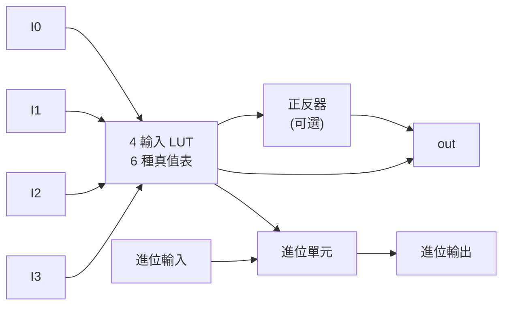
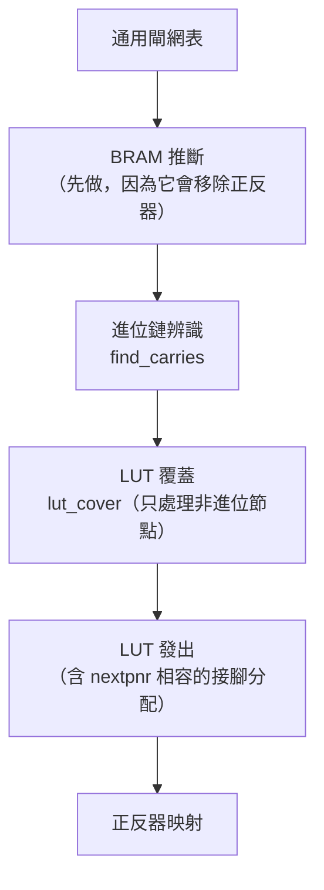
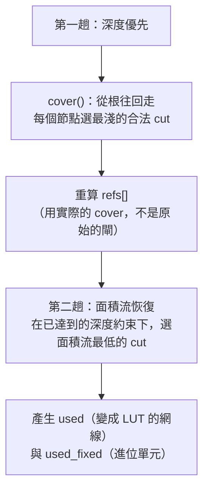

# 5.1 LUT 覆蓋與進位鏈

> 對應原始碼：`eda/src/fpga/ice40.rs`、`eda/src/fpga/ecp5.rs`、`eda/src/fpga/pnr/pack.rs`
> 下一節：[5.2 佈局與繞線](05.2-佈局與繞線-退火與PathFinder.md)

---

## 5.1.1 FPGA 的邏輯模型

主流 FPGA 的可程式化邏輯單元（LC）結構：



以 iCE40 為例，一個 **logic tile** 裡有 8 個 LC，它們**共用時脈、設定/重置與時脈極性**。

這三個共享資源是佈局的主要約束：**一個 tile 裡的 8 個 LC 必須有相同的控制集（control set）**。

## 5.1.2 映射的兩步

Veryl/Fluxa 產生的是通用閘（`$_AND_`、`$_OR_`、`$_XOR_`、`$_MUX_`）。映射到 FPGA 要做兩件事：

1. **把組合邏輯覆蓋成 LUT**。
2. **把算術的進位鏈變成專用硬體**。

順序很重要：**必須先找出進位鏈**，因為進位鏈的輸出不能被當成一般的 LUT 輸出。



**BRAM 推斷先做**，因為推斷會把一堆正反器換成 `SB_RAM40_4K`，那些正反器不應該參與進位鏈辨識。

## 5.1.3 進位鏈辨識：從結構認出全加器

`find_carries` 不是比對「模式」，而是**從閘的結構認出全加器的進位公式**：

$$
CO = (a \wedge b) \vee ((a \oplus b) \wedge c)
$$

```rust
pub(crate) fn find_carries(gates: &[&Cell], node: &HashMap<u32, usize>)
    -> HashMap<u32, (Bit, Bit, Bit, u32)>   // 進位輸出網線 → (a, b, c, a^b 網線)
```

識別過程：

1. 找一個 `$_OR_`，它的兩個輸入都是 `$_AND_`；
2. 其中一個 `$_AND_` 的輸入是 `(a, b)`；
3. 另一個 `$_AND_` 的輸入是 `(xor_wire, c)`；
4. `xor_wire` 來自 `$_XOR_(a, b)`。

**`a^b` 的兩種順序與 AND 輸入的兩種順序都被嘗試**，所以 `a&b`、`b&a`、`c&(a^b)`、`(a^b)&c` 都能匹配。

**為什麼用結構而不是模式匹配？** 因為一個通用合成器產生的加法器可能是任何形狀（ripple carry、carry-select、甚至平衡樹）。**結構辨識比字串模式匹配更robust。**

## 5.1.4 LUT 覆蓋：cut-based covering

這是 FPGA 映射的核心演算法。目標是：把組合邏輯網路覆蓋成 LUT 的集合，使得：

- 每個 LUT 有 ≤ 4 個輸入（iCE40）或 ≤ 4 個（ECP5 同樣是 LUT4）；
- 最小化 LUT 數量（面積）；
- 最小化邏輯深度（時序）。

### 5.1.4.1 Cut 的定義

一個 **cut** 是一組網線，滿足：

- 包含目標節點；
- 集合內的每個節點都是目標節點的**扇入**（fanin）；
- 集合內沒有節點是另一個節點的扇入（因此是「邊界」）。

```rust
const K: usize = 4;      // LUT 輸入數
const CUTS: usize = 16;  // 每個節點保留的 cut 數

pub(crate) struct Cut {
    pub leaves: Vec<u32>, // 排序後的網線 id
    depth: u32,
    flow: f32,
}
```

**每個網線節點都有多個可行的 cut**，選擇哪一個是演算法的核心。

### 5.1.4.2 Cut 的枚舉

```rust
// 每個閘的候選 cut 集合 = 它扇入的候選 cut 的兩兩聯集，
// 只保留長度 <= K 的；被支配的 cut（某個 cut 是另一個 cut 的超集）丟棄
// ——「某個 cut 是另一個 cut 的超集時，永遠不會比較好」
```

**「被支配的 cut 被丟棄」** 是一個關鍵的剪枝：超集的 cut 有更多輸入，通常更差。

然後：

```rust
// 依 (深度, 面積流, 葉數) 排序，截斷到 CUTS = 16：
// 前 CUTS/2 取最淺的，再取 CUTS/2 面積流最低的
```

**為什麼要分兩半取？** 因為只按深度取會得到一個「深度最淺但面積很大」的解；只按面積流取會得到「面積小但深度深」的解。兩者各取一半是一個簡單而有效的折衷。

### 5.1.4.3 面積流（area flow）

$$
\text{flow}(c) = 1.0 + \sum_{\ell \in c} \frac{\text{flow}(\ell)}{\text{refs}[\ell]}
$$

這是 Cong–Lin–Wong 的經典指標。直覺：**一個 cut 越「共享」它底下的邏輯（葉節點被很多地方用），這個 cut 就越划算。**

`refs[w]` 是網線 `w` 被讀取的次數。

### 5.1.4.4 兩趟演算法



**第一趟：深度優先。** 目標是先把邏輯深度壓到最低。這對時序最重要。

```rust
let pick = cs.iter().filter(|c| c.depth <= r)
    .min_by(|a, b| a.flow.partial_cmp(&b.flow).unwrap().then(a.depth.cmp(&b.depth)))
    .or_else(|| cs.iter().min_by_key(|c| c.depth)).unwrap().clone();
```

**第二趟：面積流恢復。** 在第一趟達到的深度要求下，改選面積流更低的 cut。

```rust
// req[w] 是從根往回算出的「需求到達時間」
// 只有 depth <= req[w] 的 cut 可以被重新選取
```

**「需求到達時間」（required time）的概念**：這是經典的「深度受限的面積最佳化」。它承認一個現實：**不是所有路徑都需要同樣快**，可以讓非關鍵路徑用更多面積。

### 5.1.4.5 扇出重估

`refs[]` 在第一趟之後**重新計算**：

```rust
// refs[w] = 網線 w 被讀取的次數
// 第一趟的 cover 完成後，用實際的 cover 重新計算 refs
```

**為什麼？** 因為原本的網表裡，一個信號可能被 10 個閘讀取；映射後其中 8 個被吸收進同一個 LUT，這個信號的實際扇出就降成 2。**用原始扇出算面積流會高估某些 cut 的代價。**

這就是為什麼整個演算法要跑**兩趟**。

## 5.1.5 LUT 真值表的產生

```rust
/// LUT 輸入 I0..I3 的真值表樣本
pub(crate) const PAT: [u16; 4] = [0xAAAA, 0xCCCC, 0xF0F0, 0xFF00];
```

`PAT[i]` 是「只有輸入 *i* 是 1」的真值表。用於快速計算。

真值表的計算是**記憶化的**（memoized），所以每個不同的輸入組合只算一次。

## 5.1.6 iCE40 映射

### 5.1.6.1 進位鏈與 LUT 的接腳分配

這是 iCE40 映射裡最「Hardware-specific」的一段。

**硬體規則**：nextpnr 把一個 LUT 和一個進位單元打包進同一個 LC 的條件是：

> **LUT 的 I1/I2 等於進位的 I0/I1，且 LUT 的 I3 等於 CI（進位輸入）。**

```rust
leaves = vec![rest.first(), Some(a), Some(b), Some(*ci)];
```

因此映射器必須**在所有葉的排列中找出符合這個規則的那一個**。這就是為什麼 `find_carries` 必須同時找出 `a`、`b`、`c` 與 `a^b` 網線。

**為什麼要這樣湊？** 因為硬體就是這樣連線的——進位單元的兩個輸入來自 LUT 的兩個接腳，所以那兩個邏輯功能（加法的被加數）與進位功能必須**由同一組訊號驅動**。

### 5.1.6.2 正反器映射

```rust
let f: Vec<char> = t.trim_start_matches("$_").trim_start_matches('S').trim_start_matches("DFF_").chars().collect();
let neg  = if f[0] == 'N' { "N" } else { "" };
let sync = if t.starts_with("$_SDFF") { "S" } else { "" };
let (kind, pin) = if f[2] == "1" { ("S", "S") } else { ("R", "R") };
```

| 通用網表 | iCE40 |
|---|---|
| `$_DFF_P_` | `SB_DFF` |
| `$_DFF_PN0_` | `SB_DFFN` |
| `$_SDFF_NP1_` | `SB_DFFNS` / `SB_DFFNSS` |

**iCE40 的重置/設定只有高有效版本。** 低有效重置需要插一個反相器 LUT：

```rust
// LUT_INIT = !PAT[0] = 0x5555
```

而且**反相器被快取**（每條網線一個），所以多個使用者共用一個反相器。

### 5.1.6.3 LUT 覆蓋的限制

```rust
const K: usize = 4;
```

iCE40 的 LC 是 4 輸入 LUT。**這是硬體的限制，不是演算法的選擇。**

## 5.1.7 ECP5 映射

ECP5 的 LUT 也是 4 輸入，但進位單元不同：**`CCU2C` 一個單元有兩個進位位**。

```rust
/// CCU2C 的半邊，做 A + B + CIN（C = 0, D = 1：LUT4 = A ^ B, LUT2 = A），與 yosys 相同
pub const ADD_INIT: u16 = 0x96AA;
/// CCU2C 的半邊，只把進位傳下去（LUT4 = 1: COUT = CIN）
pub const PASS_INIT: u16 = 0xFFFF;
```

`ccu2c()` 模型函式精確實作 yosys `cells_sim.v` 的語意：

```rust
let half = |init: u16, inject: bool, ins: [bool;4], cin: bool| {
    let l4 = lut(init, ins[0], ins[1], ins[2], ins[3]);
    let l2 = (init >> (ins[0] as u16 | (ins[1] as u16) << 1)) & 1 == 1;
    let s  = l4 ^ (!inject && cin);
    let co = (!l4 && !inject && l2) || (l4 && cin);
    (s, co)
};
```

進位輸出是

$$
COUT = (\overline{LUT4} \wedge \overline{inject} \wedge LUT2) \vee (LUT4 \wedge CIN)
$$

這是「用 LUT 實作的進位鏈」加上「進位旁路（inject）」位。

### 5.1.7.1 進位鏈的配對規則

```rust
// 只有當第一個進位輸出「只被」第二個進位當作進位輸入時，
// 兩個進位才放進同一個 CCU2C；否則第二個半邊用 PASS_INIT 傳遞進位
```

**進位鏈不能分岔。** 如果一個進位輸出還要驅動一般邏輯，就不能直接餵給下一個進位——必須用一個緩衝 LUT 把它讀出來：

```rust
// INIT = PAT[0]，即「輸出 = 輸入」
```

這是硬體的限制：**iCE40 與 ECP5 的進位鏈都是單向不可分岔的鏈。**

## 5.1.8 ECP5 的 block RAM：`DP16KD` 與 `INITVAL`

ECP5 的 BRAM 用 64 個 `INITVAL_00`..`INITVAL_3F` 參數，每個是 320 位元（80 個十六進位數字）。

**位元排列是這裡最難的部分**，而且有一個單元測試專門驗證它：

```rust
/// DP16KD 在 2048 × 9 形狀下的 INITVAL_00..3F，與 nextpnr-ecp5 接受的格式相同
/// （"0x" 加 80 個十六進位數字，320 位）：INITVAL_k 持有 16 個 20 位的 slot，
/// slot j 是字 2(16k + j)（位元 0..8）與字 2(16k + j)+1（位元 9..17）
pub fn initval(words: &[u16]) -> Vec<(&'static str, String)> {
    INITVAL.iter().enumerate().map(|(k, name)| {
        let mut nib = [0u8; 80];
        for j in 0..16 {
            let a = 2 * (16 * k + j);
            let slot = (words[a] & 0x1ff) | ((words[a+1] & 0x1ff) << 9);
            for b in 0..20 { if (slot >> b) & 1 == 1 {
                let bit = 20 * j + b; nib[79 - bit/4] |= 1 << (bit % 4); } }
        }
        (*name, format!("0x{}", nib.iter().map(|x| format!("{:X}", x)).collect::<String>()))
    }).collect()
}
```

**記憶體分解**：ECP5 的 BRAM 是 2048 × 9。寬度超過 9 位就橫向併排；深度超過 2048 就**縱向分成幾列**，寫入使能由高位址位元解碼，讀取資料由**多工器樹**選擇。

**讀取位址的高位元被寄存在正反器裡**，這符合 block RAM 的註冊讀取埠。

## 5.1.9 iCE40 的 block RAM 資料接腳排列

第 4.1.5 節提過的排列問題：

```rust
/// 模式 mode 下的資料接腳（yosys cells_sim.v）
pub fn data_pin(mode: usize, d: usize) -> usize {
    match mode { 0 => d, 1 => 2 * d, 2 => 4 * d + 1, _ => 8 * d + 3 }
}
```

| 模式 | 形狀 | 資料位元 0 的實體接腳 |
|---|---|---|
| 0 | 256 × 16 | 0 |
| 1 | 512 × 8 | 0 |
| 2 | 1024 × 4 | **1** |
| 3 | 2048 × 2 | **3** |

**為什麼模式 2 的位元 0 在接腳 1？** 因為在窄字長的模式下，硬體把資料位元交錯擺放在接腳上，以利用 SARAM 的組織結構。**這是「硬體的物理排列」與「邏輯位元順序」不一致的典型例子**，而且必須被精確建模，否則燒進去的程式會錯位。

## 5.1.10 打包：從單元到邏輯單元

`eda/src/fpga/pnr/pack.rs` 把映射後的網路打包成 iCE40 的 LC。

```rust
#[derive(Clone, Debug, Default)]
pub struct Lc {
    pub ins: [Option<Bit>; 4],   // in_0..in_3 上的網路（None = 未使用）
    pub in3_chain: bool,         // in_3 來自進位鏈而不是佈線
    pub init: u16,               // LUT 真值表
    pub carry: bool,             // LC 的進位單元啟用
    pub ff: Option<Ff>,
    pub out: Option<Bit>,        // 由 lutff_z/out 驅動的網路
}
```

### 5.1.10.1 進位鏈的分段

**(a) 找出和 LUT 的配對。** 一個 LUT 是某個進位的「和 LUT」，若它的 `I3` 是進位的 `CI`，且 `I1`/`I2` 是進位的 `I0`/`I1`（順序不拘）。

**(b) 從鏈頭走完整條鏈。**

**(c) Feed-in LC。** 若鏈頭的進位輸入是一般訊號（非常數），建立一個 **feed-in LC**，其進位計算 `CI & CI`（進位輸入為 0），也就是把訊號傳下去：

```rust
lcs.push(Lc { ins: [None, Some(ci), Some(ci), None], carry: true, ..Default::default() });
```

**(d) Feed-out LC。** 若某個進位輸出需要驅動一般邏輯：

```rust
const PASS: [u16; 4] = [0xAAAA, 0xCCCC, 0xF0F0, 0xFF00];
lcs.push(Lc { in3_chain: true, init: PASS[3], out: Some(fo), ..Default::default() });
```

**`PASS[3] = 0xFF00` 就是「輸出 = in_3」的真值表。** 進位鏈本身保持完整（保持進位路徑快速），原本要坐在那個位置的「和 LUT」搬到自己的 LC，並透過佈線讀回進位。

`Ctx::rewire` 執行這個網表外科手術。

### 5.1.10.2 常數折疊進 LUT

```rust
fn fold_consts(ins: &mut [Option<Bit>;4], init: &mut u16) {
    for k in 0..4 {
        let v = match ins[k] { Some(Bit::C0) => 0, Some(Bit::C1) => 1, _ => continue };
        let mut t = 0u16;
        for i in 0..16 { t |= ((*init >> ((i & !(1<<k)) | (v<<k))) & 1) << i; }
        *init = t; ins[k] = None;
    }
}
```

**把常數輸入折疊進真值表**，然後釋放那個接腳。如果折疊後整個 LUT 變成常數，就不需要實體 LC。

### 5.1.10.3 正反器合併

```rust
// 一個 SB_DFF* 只有在「驅動它的 LUT 輸出恰好有一個使用者，且不是埠輸出」時
// 才能合併進那個 LC；否則它自己一個 LC，其 LUT 是一個緩衝（PASS[0] = 0xAAAA）
```

**「不能合併進有其他使用者的 LUT」** 是硬體限制：一個 LC 的 LUT 輸出只能驅動自己的正反器（以及被讀出到佈線）。

### 5.1.10.4 正規化

```rust
pub fn canon(lc: &mut Lc) {
    for k in 0..4 {
        if lc.ins[k].is_none() && !(k == 3 && lc.in3_chain) {
            let mut v = 0u16;
            for i in 0..16 { v |= ((lc.init >> (i & !(1<<k))) & 1) << i; }
            lc.init = v;
        }
    }
}
```

**把未使用輸入從真值表裡消掉**，這樣那個接腳就可以完全不佈線（省下佈線資源，也讓 8-input LUT 的選擇邏輯更簡單）。

### 5.1.10.5 常數需要自己的 LC

```rust
// 任何以常數作為「輸入」出現的常數，都需要一個專用的常數 LC：
// init = 0xFFFF 表示 1，init = 0 表示 0
```

因為 iCE40 的 LUT 輸出不能直接接常數。

## 5.1.11 iCE40 的 LUT 設定位排列

這是一個必須記住的「魔術表」：

```rust
// LUT_INIT 的第 k 個位元位於 LC 設定的第 LUT_PERM[k] 位；
// 8 = 進位致能, 9 = 正反器致能, 18 = 設定（vs 重置）值, 19 = 非同步設定/重置
const LUT_PERM: [usize; 16] = [4, 14, 15, 5, 6, 16, 17, 7, 3, 13, 12, 2, 1, 11, 10, 0];
```

**一個 logic tile 的 20 個設定位**：

| 位 | 意義 |
|---|---|
| 0–15 | LUT 真值表（依 `LUT_PERM` 排列） |
| 8 | 進位致能 |
| 9 | 正反器致能 |
| 18 | 設定值（1 = set，0 = reset） |
| 19 | 非同步（1）或同步（0）設定/重置 |

**這個表同時被位元流寫入器與反解器使用**——兩者必須一致，否則燒進去的設計跟模擬的不一樣。

> 這是「硬體手冊裡的表格」在程式裡的樣子。**它存在的唯一理由是硬體如此**，沒有任何原理可以推導出來。

## 5.1.12 兩種映射的比較

| | iCE40 | ECP5 |
|---|---|---|
| LUT | `SB_LUT4`（4 輸入） | `LUT4`（4 輸入） |
| 進位 | `SB_CARRY`（1 位/單元） | `CCU2C`（**2 位/單元**） |
| 正反器 | `SB_DFF*` | `TRELLIS_FF`（參數化） |
| BRAM | `SB_RAM40_4K`（4096 bit） | `DP16KD`（18K bit） |
| 設定位 | 固定 20 位排列 | 參數化 |
| 逆向流程 | rueda 自己實作 | **交給 nextpnr-ecp5 + ecppack** |

**iCE40 走「自己的佈局佈線」**（第 5.2、5.3 節），**ECP5 走外部工具**：

```rust
// eda/src/flow.rs
// ECP5：映射後交給 nextpnr-ecp5 + ecppack
```

這是一個務實的取捨：iCE40 UP5K 很小，網路資料容易處理；ECP5 很大，自己寫一套成本太高。

---

**下一節**：[5.2 佈局與繞線：退火與 PathFinder](05.2-佈局與繞線-退火與PathFinder.md)
