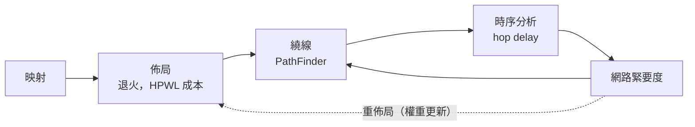

# 5.2 佈局與繞線：退火與 PathFinder

> 對應原始碼：`eda/src/fpga/pnr/place.rs`、`eda/src/fpga/pnr/route.rs`、`eda/src/fpga/pnr/sta.rs`、`eda/src/fpga/pnr/chipdb.rs`
> 上一節：[5.1 LUT 覆蓋與進位鏈](05.1-LUT覆蓋與進位鏈.md)　下一節：[5.3 位元流格式](05.3-位元流格式與CRC.md)

---

## 5.2.1 FPGA 佈局的約束

FPGA 佈局不是 ASIC 佈局。它受到三種結構性限制：

1. **固定結構**：晶片上的邏輯單元位置是固定的，不能移動。
2. **進位鏈必須連續**：一條進位鏈佔據同一欄的連續 LC。
3. **控制集共享**：一個 tile 的 8 個 LC 共用時脈與重置。

因此 FPGA 佈局是「**把設計塞進一個既定的格子**」，而不是「把格子畫在設計周圍」。

## 5.2.2 裝置資料庫：`chipdb-5k.txt`

FPGA 工具需要知道晶片上有什麼。rueda 用的是 **IceStorm 的 `chipdb-5k.txt`**。

### 5.2.2.1 尋找路徑

```rust
pub fn default_path() -> Option<String> {
    if let Ok(p) = std::env::var("VERYL_EDA_CHIPDB") { return Some(p); }
    let home = std::env::var("HOME").unwrap_or_default();
    let cands = [
        "/opt/homebrew/share/icebox/chipdb-5k.txt".to_string(),
        "/usr/local/share/icebox/chipdb-5k.txt".to_string(),
        "/usr/share/icebox/chipdb-5k.txt".to_string(),
        "/Users/Shared/ccc/oss-cad-suite/share/icebox/chipdb-5k.txt".to_string(),
        format!("{}/oss-cad-suite/share/icebox/chipdb-5k.txt", home),
    ];
    cands.into_iter().find(|p| std::path::Path::new(p).exists())
}
```

**環境變數優先**，否則試五個常見位置。找不到時的錯誤訊息是明確的：

> `"IceStorm chipdb-5k.txt not found (set VERYL_EDA_CHIPDB)"`

### 5.2.2.2 檔案格式

這是一個**分節的文字格式**。以 `.` 開頭的行是節標頭，資料行直到下一個 `.` 開頭的行。`#` 開頭是註解，會重置當前節。

| 節 | 意義 | 解析成 |
|---|---|---|
| `.device 5k <w> <h> <n>` | 裝置名稱、寬、高、網路數 | `w`、`h`、各陣列大小 |
| `.pins <package>` | 封裝接腳 | `pins`、`pin_order` |
| `.gbufin` | 每個 `fabout` 的 `(x, y, global_index)` | `gbufin` |
| `.gbufpin` | 可直接驅動全域網路的接腳 | `gbufpin` |
| `.extra_bits` | tile 之外的設定位 | `extra_bits` |
| `.ieren` | 輸入接腳到內部索引 | `ieren` |
| `.colbuf` | 每欄緩衝器的來源 tile | `colbuf_src` |
| `.net <id>` | 每個網路出現的 `(x, y, name)` | `net_box`、`net_label`、`kind` |
| `.buffer` / `.routing` | `(x, y, dst_net) <pattern> <src_net> B<row>[<col>]…` | `pips`、`groups` |
| `.<type>_tile_bits` | 設定位的座標 | `dims`、`tile_bits` |
| `.<type>_tile` | 各 tile 的位置 | `tiles`、`tile_type` |

**設定位在 tile 內的表示**是 `B<row>[<col>]`：

```rust
fn bitpos(s: &str) -> R<BitPos> {
    let s = s.strip_prefix('B').ok_or_else(|| format!("bad bit '{}'", s))?;
    let (r, c) = s.split_once('[').ok_or_else(|| format!("bad bit '{}'", s))?;
    let c = c.trim_end_matches(']');
    Ok((r.parse()..., c.parse()...))
}
```

**多工器的樣式是一個二進位字串**，第 *i* 個字元對應 `group[i]`（目的多工器的第 i 個設定位），LSB 優先解碼：

```rust
let pat = p[0].bytes().enumerate().fold(0u32, |a, (i, b)| a | (((b == b'1') as u32) << i));
```

### 5.2.2.3 記憶體的取捨

```rust
fn wanted(name: &str) -> bool {
    name.starts_with("lutff_") || name.starts_with("io_") || name.starts_with("glb_netwk_")
        || name == "fabout" || name.starts_with("carry_in") || name.starts_with("ram/")
}
```

**解析器只保留佈局繞線會查詢的網路。** UP5K 有上萬條網路，但佈局繞線只碰邏輯單元的輸入輸出、IO、全域網路、進位與 RAM。**過濾掉不需要的資料，記憶體用量降到 1/10。**

但每個網路的**邊界框、標籤與種類**仍然完整保留，所以繞線的圖是完整的。

### 5.2.2.4 記憶體中的結構

```rust
pub struct Pip { pub x: u8, pub y: u8, pub src: u32, pub dst: u32,
                 pub group: u32,  // Chip::groups 的索引
                 pub pat: u32 }   // 該 group 的位元值，位 i = group[i]

pub struct Chip {
    pub w: i32, pub h: i32,
    pub tiles: Vec<((i32,i32), String)>,
    pub tile_type: HashMap<(i32,i32), String>,
    pub dims: HashMap<String, (usize, usize)>,
    pub tile_bits: HashMap<String, HashMap<String, Vec<BitPos>>>,
    pub by_name: HashMap<(i32,i32,String), u32>,
    pub net_box: Vec<(i16,i16,i16,i16)>,
    pub net_label: Vec<(i32,i32,String)>,
    pub kind: Vec<Kind>,
    pub pips: Vec<Pip>,
    pub groups: Vec<Vec<BitPos>>,
    pub fanout: Vec<Vec<u32>>,
    pub pins: HashMap<String, (i32,i32,u8)>,
    ...
}
```

**`Kind` 從網路名稱推導**：

| 名稱前綴 | Kind |
|---|---|
| `local_g*` | Local |
| `lutff_*/in_*` | LutIn |
| `lutff_*/out` | LutOut |
| `glb_netwk_*` | Glb |
| `sp4_*` / `span4_*` | Sp4H / Sp4V |
| `sp12_*` | Sp12H / Sp12V |
| `ram/RDATA*` | LutOut |
| `ram/*ADDR|WDATA|MASK*` | LutIn |
| `carry_in*` | Carry |
| `fabout` | Fabout |
| `io_*` | Io |

## 5.2.3 佈局：模擬退火

### 5.2.3.1 成本函數

```rust
let hpwl = |n: usize, slot: &Vec<usize>, ram_site: &Vec<usize>| -> f64 {
    let (mut x0, mut y0, mut x1, mut y1) = (i32::MAX, i32::MAX, i32::MIN, i32::MIN);
    for pn in &net_pins[n] {
        let (x, y) = pos(pn, slot, ram_site);
        x0 = x0.min(x); y0 = y0.min(y); x1 = x1.max(x); y1 = y1.max(y);
    }
    if x0 == i32::MAX { 0.0 } else { ((x1 - x0) + (y1 - y0)) as f64 * net_w[n] }
};
```

**半周長線長（HPWL）** 是佈局成本函數的標準選擇：

$$
\text{HPWL}(n) = (x_{\max} - x_{\min}) + (y_{\max} - y_{\min})
$$

理由：**它是對實際線長的一階近似**。真實線長是曼哈頓距離的總和（受 routing channel 的形狀影響），HPWL 是它的下界，但相關性極高。

**全域網路（時脈、重置）與常數完全排除在成本之外**——它們走全域網路，不佔用一般佈線資源。

`net_w[n]` 是時序權重（佈線階段是 1.0）。

### 5.2.3.2 退火排程

**初始溫度**：

```rust
// 200 次隨機移動的代價差的標準差，乘 2，下限 1.0
let m = d.iter().sum::<f64>() / d.len() as f64;
(d.iter().map(|x| (x-m)*(x-m)).sum::<f64>() / d.len() as f64).sqrt().max(1.0) * 2.0
```

**每個溫度階段的移動次數**：

```rust
let moves_per_t = ((movable.len() + p.rams.len()) as f64).powf(1.33) as usize * 4 + 100;
```

指數 **1.33** 是經典的「單元數越多，移動次數略超線性」的啟發式。

**接受準則**（Metropolis）：

```rust
if delta <= 0.0 || rng.unit() < (-delta / temp).exp() { accept } else { undo }
```

**溫度排程（依接受率調整）**：

```rust
temp *= if rate > 0.96 { 0.5 } else if rate > 0.8 { 0.9 } else if rate > 0.15 { 0.95 } else { 0.8 };
rlim = (rlim * (1.0 - 0.44 + rate)).clamp(1.0, ncols.max(H) as f64);
```

**冷卻的邏輯**：幾乎全部都被接受時（rate > 0.96）快速冷卻（×0.5）；接受率中等時緩慢冷卻；接受率很低時最慢（×0.8），因為這時退火還有進步空間。

**移動半徑 `rlim` 用同樣的接受率訊號調整**：rate = 0 時半徑縮小 44%，rate = 1 時不變。

**終止條件**：

```rust
if temp < 0.005 * cost.max(1.0) / net_pins.len() as f64 { break; }
```

**溫度門檻是「每個網路的平均成本」的一個百分比**——這讓溫度的尺度與設計大小無關。

### 5.2.3.3 移動的合法性

```rust
// 選一個隨機 LC，選一個半徑內的隨機目的地，選目的地 tile 裡 8 個 LC 中的一個
let r = rlim.max(1.0) as i32;
let nci = (ci + rng.below((2*r+1) as usize) as i32 - r).clamp(0, ncols-1);
let ny  = (ay + rng.below((2*r+1) as usize) as i32 - r).clamp(1, H);
let sb  = nci as usize * PER_COL + (ny as usize - 1) * 8 + rng.below(8);
```

**如果目標位置被占用，兩個 LC 交換。** 固定的 LC（進位鏈）永遠不會被移走。

**交換後要重新檢查控制集合法性**：一個 tile 只能容納控制集相同的 LC（或是沒有正反器的 LC）。

### 5.2.3.4 初始合法佈局

退火之前先建立一個合法佈局：

1. **進位鏈優先**，最長的先放，欄位順序是「由中間向兩側」：

```rust
let col_order: Vec<usize> = (0..cols.len())
    .map(|i| if i % 2 == 0 { mid + i/2 } else { mid - 1 - i/2 })
    .filter(|c| *c < cols.len()).collect();
```

**「由中間向兩側」的理由**：進位鏈是垂直的，從中間開始讓上下平衡，減少水平佈線。

欄內的掃描**每次前進 8 個 slot**（整個 tile），確保一條鏈永遠從某個 tile 的 LC 0 開始——因為進位鏈必須從 tile 的進位輸入接起。

2. **其餘 LC** 逐 tile 放入同一欄序中控制集相符的第一個空位。
3. **RAM** 放在前 `rams.len()` 個 site。

### 5.2.3.5 RAM site 的排序

```rust
sites.sort_by_key(|&(x,y)| ((y - H/2).abs(), x, y));
```

**RAM site 由中間往外排。** 因為 RAM 的資料匯流排在垂直方向更長，放在中間可以讓資料匯流排的垂直線最短。

## 5.2.4 繞線：PathFinder 協商

FPGA 繞線的模型：

> **每條晶片網路（wire）只能載一個訊號。** 一個 pip 進入某條 wire，就是設定那條 wire 的輸入多工器。

因此繞線問題是：**把每個網路的 sink 用一組 pip 連到 source，且不共用任何 wire**。

### 5.2.4.1 資料結構

```rust
pub struct RNet {
    pub name: String,
    pub src: u32,
    pub sinks: Vec<u32>,
    /// 要使用的全域網路：(fabout wire, global wire, 直接從 global 到的 sinks)
    pub global: Option<(u32, u32, Vec<u32>)>,
    pub crit: f32,     // 時序緊要度 0..1
}
```

### 5.2.4.2 協商迴圈

```rust
for iter in 0..200 {
    for &ni in &order {              // 依 sink 數遞減排序
        // ...
        if iter > 0 && !nodes_of[ni].iter().any(|w| occ[*w as usize] > 1) { continue; }  // 只重繪衝突的網路
        // A* 搜尋
    }
    let over: Vec<usize> = (0..n).filter(|w| occ[w] > 1).collect();
    iters.push(over.len());
    if over.is_empty() { return Ok((routes, iters)); }
    for w in over { hist[w] += 0.5 * (occ[w] - 1) as f32; }
    pres *= 1.8;
}
```

這是經典的 PathFinder：

| 機制 | 作用 |
|---|---|
| `hist[w] += 0.5 × (occ[w] - 1)` | **歷史成本**：某條 wire 被超用過，就變得更貴，讓後來的網路避開 |
| `pres *= 1.8` | **當前成本**：每輪迭代，佔用越嚴重的 wire 成本成長越快 |
| 只重繪衝突網路 | **撕開重繪（rip-up and reroute）**：沒衝突的不動 |

**「歷史成本」與「當前成本」分離**是 PathFinder 的核心：

- 當前成本讓「現在擠」的 wire 變貴；
- 歷史成本讓「一直很擠」的 wire 逐漸累積更高的懲罰。

兩者相乘：

```rust
let over = occ[v as usize] as f32;
let cong = (1.0 + hist[v as usize]) * (1.0 + pres * over);
```

### 5.2.4.3 A* 搜尋

```rust
let mut heap = BinaryHeap::new();
for &t in &tree_order {
    dist[t as usize] = 0.0; prev[t as usize] = u32::MAX; seen[t as usize] = gen;
    heap.push(Item(tdist(t, tx, ty) * 0.3, t));
}
while let Some(Item(_, u)) = heap.pop() {
    if u == sink { found = true; break; }
    let fan = chip.fanout[u as usize].iter().map(|p| (*p, chip.pips[*p as usize].dst))
        .chain(extra_fanout.get(&u).into_iter().flatten().copied());
    for (p, v) in fan {
        let o = owner[v as usize];
        if o >= 0 && o != ni as i32 { continue; }     // 被保留的 wire
        let over = occ[v as usize] as f32;
        let cong = (1.0 + hist[v as usize]) * (1.0 + pres * over);
        let c = if crit > 0.0 {
            let d = super::sta::hop_delay(chip.kind[u as usize], chip.kind[v as usize]) as f32 / 0.6;
            crit * d + (1.0 - crit) * cong
        } else { cong };
        let nd = du + c;
        if seen[v as usize] != gen || nd < dist[v as usize] { ... }
    }
}
```

四個關鍵設計：

**(a) 從「整棵樹」而不是單一節點出發。** 初始堆裡放入樹上**所有**節點（距離 0）。這樣每個新 sink 都從樹上最合適的位置接上，形成一棵樹。

**(b) `owner[]` 保留機制。** 網路的 source 與 sink 所在的 wire 被**保留給那個網路**，其他網路不能經過。**這是路由安全的關鍵**——否則兩個網路會爭同一個 LC 的輸入接腳。

**(c) 時序混合。** 緊要度 $`c`$ 時，邊成本變成

$$
c \times \frac{\text{hop delay}}{0.6\text{ ns}} + (1 - c) \times \text{congestion}
$$

**`0.6 ns` 是「典型 hop」的正規化常數**。這樣成本函數的量綱一致（兩個項都是「越大越差」）。

**緊要的路線會選快的 wire，不緊要的會選不擠的 wire。**

**(d) 啟發函數。**

```rust
// tdist(v, target) × 0.3：目標點到 wire 邊界框的曼哈頓距離
```

**0.3 的權重讓啟發函數「不完全可接受」**（admissible-ish），這是**加權 A\***：它會找到更好的解，但可能探索更多節點。**在繞線裡這是對的取捨**——我們要的是品質，不是最短時間。

### 5.2.4.4 全域網路

時脈與重置是特殊的：

```rust
// 網路先被繞到一個 fabout wire，然後用一個偽 pip 代表硬接的
// fabout → glb_netwk_g 連接，全域網路的 sinks 直接由全域 wire 連出
let pip_dst = |p: u32| -> u32 {
    if p >= u32::MAX - extra_pips.len() as u32 { extra_pips[(u32::MAX - p) as usize].1 }
    else { chip.pips[p as usize].dst }
};
```

**全域網路的成本是 0**（`Kind::Fabout => 0.0`）——走全域網路不花費一般佈線資源。

### 5.2.4.5 樹的建構

```rust
// sink 依到 source 的距離排序（近的先），每個用 A* 從目前的樹接上，
// 然後把回溯路徑嫁接進樹
```

**「近的先」** 是重要的啟發式：先接最近的 sink，樹的形狀更緊湊。

## 5.2.5 時序分析

`eda/src/fpga/pnr/sta.rs` 用 IceStorm 的 `timings_up5k.txt`（slow corner）。

### 5.2.5.1 延遲模型

```rust
const CLK_Q: f64 = 1.391;                              // clk -> Q
const LUT: [f64; 4]   = [1.285, 1.232, 1.205, 0.874]; // in_k -> out
const SETUP: [f64; 4] = [1.232, 1.060, 0.980, 0.728]; // in_k -> setup
const CARRY_IN1: f64 = 0.675;   // in_1 -> carry
const CARRY_IN2: f64 = 0.609;   // in_2 -> carry
const CARRY_CIN: f64 = 0.278;   // carry-in -> carry-out
const RAM_CLK_Q: f64 = 1.179;   // RCLK -> RDATA
const IO_IN: f64 = 1.105;       // PRE_IO -> DIN0
const IO_OUT: f64 = 0.187;      // 輸出墊
```

**`LUT[k]` 隨著輸入編號 k 遞減**——因為 LUT 的輸入 0 通常來自最近的來源（延遲較短），這是硬體的實測特性。

**block RAM 輸入的建立時間**：

```rust
pub fn ram_setup(pin: &str) -> f64 {
    if pin.starts_with("RADDR") { 0.384 } else if pin.starts_with("WADDR") { 0.424 }
    else if pin.starts_with("WDATA") { 0.305 } else if pin.starts_with("MASK") { 0.517 }
    else if pin == "WE" { 0.252 } else if pin == "RE" { 0.185 } else { 0.503 }
}
```

### 5.2.5.2 Hop 延遲

```rust
pub fn hop_delay(src: Kind, dst: Kind) -> f64 {
    let from_lc = src == Kind::LutOut;
    match dst {
        Kind::LutIn     => 0.662,
        Kind::Local     => 1.099,
        Kind::Ctrl      => 0.636,
        Kind::Glb2Local => 0.583,
        Kind::Glb       => 0.278,
        Kind::Sp4H => if from_lc { 0.649 } else { 0.543 },
        Kind::Sp4V => if from_lc { 0.649 } else { 0.596 },
        Kind::Sp12H=> if from_lc { 1.232 } else { 1.231 },
        Kind::Sp12V=> if from_lc { 1.232 } else { 1.072 },
        Kind::Carry => 0.556,
        Kind::Fabout => 0.0,
        Kind::Io     => 0.0,
        Kind::LutOut | Kind::Other => 0.5,
    }
}
```

**延遲由「目的 wire 的種類」決定**（不是起點）。因為一個 wire 的延遲是它自己的（routing wire 的延遲來自它的長度與負載）。

**`Kind::Glb`（全域網路）只有 0.278 ns**，而 `Kind::Local`（本地佈線）有 1.099 ns——**接近 4 倍的差距**。這就是為什麼時鐘要用全域網路。

**`Kind::Fabout` 與 `Kind::Io` 是 0**：它們是連接點，不是真正的 wire。

### 5.2.5.3 三趟演算法

**(a) 路由延遲。** 對每個非全域網路，從每個 sink 沿著 pip 鏈往回走到 source，累加 `hop_delay(kind[pip.src], kind[pip.dst])`。

**(b) 前向到達時間。** 對每個 LC，用**顯式堆疊的 DFS** 計算 `out_arr[l]`：

- 到達輸入 k = 驅動 LC 的輸出到達時間 + 路由延遲，然後 `+ LUT[k]`；
- 進位 LC 從 `cin + CARRY_CIN` 或 `in_1 + CARRY_IN1` / `in_2 + CARRY_IN2` 算 `cout_arr[l]`；
- 有正反器的 LC 的 `out_arr = CLK_Q`（時脈理想，無偏斜）。

**在 FF 處切斷迴圈**——這是 DFS 不爆棧的原因。

**(c) 端點。**

| 端點 | 延遲 |
|---|---|
| FF 輸入 | 到達 + `SETUP[k]` |
| RAM 輸入 | 到達 + 路由 + 建立時間 |
| 輸出接腳 | 到達 + 路由 + `IO_OUT` |

最差的就是關鍵路徑； $`f_{\max} = 1000 / \text{period}`$ （MHz，週期是 ns）。

### 5.2.5.4 關鍵路徑報告

```rust
// 沿著路徑往回走，產生 Vec<Step>，每個 Step 有
// what（人類可讀的說明）、delay、at（累積時間）
```

**「人類可讀的說明」很重要**——時序報告是設計者唯一會讀的東西。

### 5.2.5.5 網路緊要度

```rust
// 後向最長路徑：tail_out[l] = 從 l 的輸出到端點的最長延遲
let net_crit: Vec<f32> = nets.iter().enumerate().map(|(ni, net)| {
    if net.global.is_some() { return 0.0; }
    let src = src_arr(ni, &out_arr);
    let mut worst = 0.0f64;
    for &s in &net.sinks {
        let d = sink_route.get(&s).map(|x| x.1).unwrap_or(0.0);
        let after = match sink_ep(s) { ... };
        worst = worst.max(src + d + after);
    }
    (worst / period).min(1.0) as f32
}).collect();
```

$$
\text{crit}(\text{net}) = \min\left(1,\; \frac{\text{經過這個網路的最長路徑}}{\text{關鍵路徑}}\right)
$$

**全域網路的緊要度是 0**——它們不在關鍵路徑上（時脈是理想的）。

這個值餵回繞線的成本函數（第 5.2.4.3 節），形成**「佈局 → 佈線 → 時序 → 佈線」的迭代閉環**。

## 5.2.6 迭代閉環



**這是現代 P&R 工具的核心迴圈。** 只佈線一次無法得到好的時序，因為佈線的結果決定了哪些路徑是關鍵的。

## 5.2.7 與 ASIC 佈局繞線的對比

| | FPGA（本章） | ASIC（第 6 章） |
|---|---|---|
| 佈局對象 | 固定網格上的 LC | 連續座標上的單元 |
| 成本 | HPWL | 加權 HPWL + 密度懲罰 |
| 繞線圖 | 晶片的 pip/wire 圖 | 網格圖（gcell）+ 層 |
| 容量 | 每條 wire 只能一個訊號 | 每個 gcell 邊有容量（CAP） |
| 演算法 | PathFinder | PathFinder + 走廊限制 |
| 特色 | 控制集、進位鏈連續性 | 密度、天線、PDN 阻塞 |

**共同的骨架是 PathFinder**，這是 1990 年代 Dean 的經典貢獻，兩個領域都沿用。

---

**下一節**：[5.3 位元流格式與 CRC](05.3-位元流格式與CRC.md)
