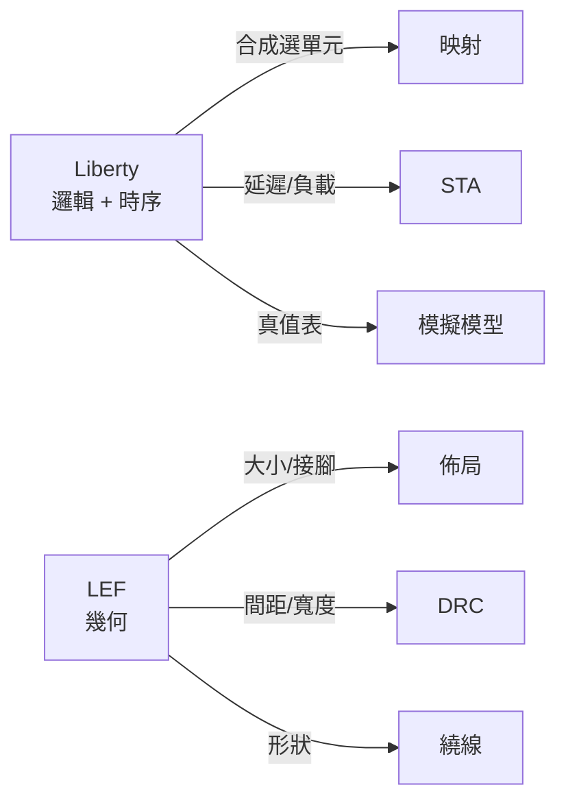
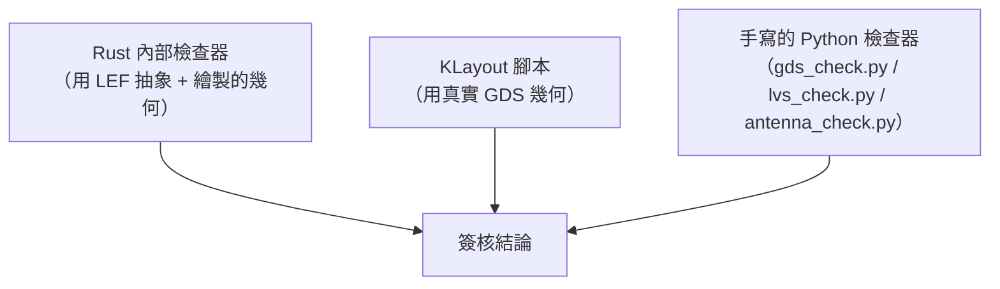

# 6.1 PDK：Liberty 與 LEF

> 對應原始碼：`eda/src/pdk/liberty.rs`、`eda/src/pdk/lef.rs`、`eda/src/pdk/def.rs`、`eda/src/pdk/mod.rs`、`eda/src/asic/lib.rs`、`eda/tools/sky130.sh`
> 下一節：[6.2 擺置、CTS、PDN 與繞線](06.2-擺置CTS-PDN與繞線.md)

---

## 6.1.1 什麼是 PDK

**PDK（Process Design Kit，製程設計套件）** 是晶圓廠商提供的、用來設計與驗證晶片的資料集合。

一個完整的 PDK 包含：

| 檔案 | 內容 | 用途 |
|---|---|---|
| **Liberty**（`.lib`） | 每個單元的邏輯函數與時序特性 | 合成、STA、模擬 |
| **LEF**（`.lef`） | 單元的幾何（大小、形狀、接腳位置、遮蔽層） | 佈局、繞線 |
| **GDS**（`.gds`） | 實際的圖形資料 | 交給光罩廠 |
| **CDL**（`.cdl`） | 電路描述（接腳順序、電源） | LVS 參考 |
| **SPICE** 模型 | 電晶體層級的模型 | 模擬 |
| **ERC / DRC** 規則 | 設計規則 | 檢查 |
| **Tech LEF** | 製程層（層號、方向規則、pitch） | 全域 |

**Liberty 與 LEF 的分工是本章的核心：**



**同一顆單元的「邏輯」與「形狀」是分開描述的**，這在物理設計上是必要的：Liberty 給你「這個閘的延遲是 35 ps」，LEF 給你「這個閘寬 1.4 µm，有三個接腳」。

## 6.1.2 兩種技術

rueda 支援兩種技術：

### 6.1.2.1 vlib：內建的教育用標準單元庫

```rust
// eda/src/asic/lib.rs
```

| 項目 | 值 |
|---|---|
| 列高 | 4.0 µm |
| site 寬 | 0.5 µm |
| 佈線層 | M2 / M3 / M4 / M5 + M1 接腳層 |

**延遲是「130 nm 左右」的教育用數字**：

| 單元 | 延遲 |
|---|---|
| INV | 0.025 ns |
| BUF | 0.045 ns |
| CLKBUF | 0.055 ns |
| NAND2 | 0.035 ns |
| NOR2 | 0.045 ns |
| AND2 | 0.065 ns |
| OR2 | 0.075 ns |
| XOR2 | 0.085 ns |
| AOI21 / OAI21 | 0.050 ns |
| MUX2 | 0.090 ns |
| DFF | 0.180 ns（建立 0.080） |
| DFFR / DFFS | 0.200 ns（建立 0.090） |

每個接腳的負載因子是 0.007–0.018 ns。

**vlib 的價值**：不需要任何外部資料就能跑完整個 ASIC 流程。教學不需要先下載 100 MB 的 PDK。

### 6.1.2.2 SKY130：開源 PDK

SkyWater 在 2020 年公開了 SKY130 製程（130 nm）的完整資料，Apache-2.0 授權。

```rust
// site "unithd"，列高 2.72 µm，site 寬 0.46 µm，每列 8 條 track
// （在 src/pdk/mod.rs:500 斷言）
```

**取得方式**：

```sh
eda/tools/sky130.sh
```

從 OpenROAD-flow-scripts 的 `flow/platforms/sky130hd` 下載：

```
lib/sky130_fd_sc_hd__tt_025C_1v80.lib
lef/sky130_fd_sc_hd.tlef
lef/sky130_fd_sc_hd_merged.lef
gds/sky130_fd_sc_hd.gds
cdl/sky130hd.cdl
```

外加 skywater-pdk-libs-sky130_fd_sc_hd 的 Apache-2.0 LICENSE。

**預設目錄** `~/sky130hd`。Rust 流程的尋找順序是：`$VERYL_EDA_SKY130` → `/Users/Shared/ccc/sky130hd` → `~/sky130hd`。

### 6.1.2.3 內建子集

```sh
python3 eda/tools/sky130_subset.py
```

產生 `eda/pdk/sky130hd/`，用 `include_str!` / `include_bytes!` 編進二進位。做法是：

- 保留 Liberty 標頭與列出的單元，**丟掉 `internal_power` 與 `leakage_power` 群組**（用括號配對的 `group_end` 掃描器）以縮小體積；
- tech LEF 原樣複製，從合併的 cell LEF 抽出列出的 `MACRO … END` 區塊；
- 從 PDK 的 GDS 複製列出單元的結構（**原始位元組**，保留標頭記錄）。

**單元清單**包含：

```
inv_1 inv_2 inv_4 buf_1 buf_2 buf_4 buf_8 clkbuf_1..8
nand2_1 nor2_1 and2_1 or2_1 xor2_1 xnor2_1
a21oi_1 o21ai_1 mux2_1 nand3_1 nor3_1 and3_1 or3_1 a22oi_1 o22ai_1 a21o_1 o21a_1
conb_1 dfxtp_1 dfrtp_1 dfstp_1 dfrtn_1
diode_2 fill_1..8 tapvpwrvgnd_1 decap_3..12
```

**以及 `_2` 與 `_4` 的加強版本**（供時序修復的 upsizing 使用）。

## 6.1.3 Liberty 解析器

Liberty 是一種奇怪的格式：它本質上是一個**巢狀的群組語言**。

```
library (sky130_fd_sc_hd) {
  delay_model : table_lookup;
  time_unit : "1ns";
  ...
  cell (nand2_1) {
    area : 3.75;
    pin (A) { direction : input; capacitance : 0.0018; }
    pin (Y) {
      direction : output;
      function : "(A B)";
      timing () {
        related_pin : "A";
        cell_rise (template) { index_1 ("0.01, 0.05"); ... }
      }
    }
  }
}
```

rueda 的 `liberty.rs` 解析出：

- **邏輯函數**（`function`）——用於把通用閘映射到單元，以及產生模擬模型；
- **時序表**（`cell_rise` / `cell_fall` / `rise_transition` / `fall_transition`）——用於 STA；
- **接腳電容**（`capacitance`）——用於負載計算；
- **面積**（`area`）——用於樹覆蓋的成本函數；
- **時序群組**（`timing` 內的 `related_pin`、`when`、`sdf_cond`、`cell_rise` 等）。

### 6.1.3.1 時序表

Liberty 的 NLDM（non-linear delay model）時序表是**二維查找表**：

```
cell_rise (scalar) {
    index_1 ("0.02, 0.05, 0.1");    // 輸入轉換時間
    index_2 ("0.001, 0.01, 0.1");    // 輸出負載
    values ("0.05, 0.08, 0.15", ...);
}
```

查表是**雙線性插值**：

```rust
// tech.arc(cell, pin, input_slew, output_load) 回傳 (延遲, 輸出轉換時間)
// 由 cell_rise / cell_fall 表做雙線性插值，取上升/下降中較差者
```

**「取上升/下降中較差者」** 是 STA 的標準保守做法。

### 6.1.3.2 為什麼要產生模擬模型

Liberty 的 `function` 描述了邏輯行為，但 SPICE 模擬需要**行為模型**。

rueda 從 Liberty 的函數**自動產生 Verilog 行為模型**：

```rust
// eda/src/pdk/mod.rs
pub fn verilog_models() -> String
```

這讓輸出的結構化 Verilog 網表可以直接用 iverilog 模擬——不需要另外維護一套模型檔。

## 6.1.4 LEF 解析器

LEF（Library Exchange Format）描述幾何。

```lef
VERSION 5.8 ;
DIVIDERCHAR "/" ;
BUSBITCHARS "[]" ;
UNITS
  DATABASE MICRONS 2000 ;
END UNITS

MACRO nand2_1
  CLASS CORE ;
  ORIGIN 0 0 ;
  SIZE 1.4 BY 2.72 ;
  SYMMETRY X Y ;
  SITE unithd ;
  PIN A
    DIRECTION INPUT ;
    USE SIGNAL ;
    SHAPE ABUTMENT ;
    PORT
      LAYER met1 ;
        RECT 0.0 0.0 0.28 0.56 ;
    END
  END A
  PIN Y
    ...
  END Y
  OBS
    LAYER met1 ;
      RECT 0.0 0.0 1.4 2.72 ;
    END
  END
END nand2_1
```

rueda 的 `lef.rs` 解析：

| 資料 | 用途 |
|---|---|
| `MACRO` 區塊 | 單元定義 |
| `SIZE` | 單元大小 |
| `SITE` | site 類型 |
| `PIN` / `PORT` / `RECT` | 接腳形狀 |
| `OBS` | 遮蔽（keep-out） |
| 技術層 | `LAYER` 定義（方向、間距、寬度、pitch、r/c per sq、edge cap） |
| `VIA` / `VIARULE` | 過孔定義 |

### 6.1.4.1 技術層的資訊

```rust
pub struct Layer {
    pub name: String,
    pub direction: i32,      // 0 = 水平, 1 = 垂直
    pub pitch: f64,
    pub width: f64,
    pub spacing: f64,
    pub area: f64,           // 最小面積
    pub rpersq: f64,         // 每平方的電阻
    pub cpersq: f64,         // 每平方的電容
    pub edgecap: f64,        // 邊緣電容
    ...
}
```

**`rpersq` 與 `cpersq` 是寄生參數提取的基礎**（第 6.3 節）。

### 6.1.4.2 遮蔽（OBS）的意義

`OBS` 區塊描述單元內部「不給別人用的區域」。

**對繞線器來說，一條線碰到別的單元的遮蔽就是短路。** 這是 DRC 裡最容易出現的錯誤之一，也是繞線器必須嚴格遵守的規則。

## 6.1.5 綁定：從邏輯名稱到實體單元

這是兩個格式之間的橋。

```rust
// eda/src/pdk/mod.rs
pub struct Binding {
    pub cell: String,
    pub pins: Vec<(&'static str, String)>,   // (邏輯接腳, 庫接腳)
    pub width: u32,                          // 以 site 為單位的寬度
    /// (邏輯接腳, 相對單元左緣的格線欄, 列內的 track, x 偏移（µm）)
    pub access: Vec<(&'static str, u32, u32, f64)>,
    pub area: f64,
}
```

**「邏輯接腳名」到「實體接腳名」的映射是必要的**：ASCI 的 `AOI21` 有 `A1 A2 B Y`，SRAM macro 的接腳名完全不同，而內部邏輯一律叫 `A B Y`。

### 6.1.5.1 接腳存取點（access point）

這是綁定裡最精細的部分。

```rust
/// 候選格線節點以 4·|dx| + |dy - 形狀中心| 評分；
/// 每個候選必須避開單元自己的 met1 / mcon 禁区，規則是精確的數字：
/// 0.16 µm（via 墊寬） + 0.14 µm（met1 間距）、
/// 0.085 µm（接觸半寬） + 0.19 µm（接觸間距）
```

**「接腳存取點」是「邏輯接腳」到「可落 over 的格線節點」的對應。** 沒有它，繞線器不知道該從哪裡鑽到接腳。

**評分函式 $`4|dx| + |dy - \text{中心}|`$ ** 表達了優先級：**水平方向偏離的代價是垂直方向的 4 倍**。

**這個係數 4 來自布線結構**：橫向金屬層通常是 M2/M4（比較多、比較快），縱向是 M3/M5。權重反映「橫向偏離比較難補救」。

**在自己 met1 上的接腳（set/reset）** 得到偏移 `NaN` = 「沒有 pin via」——因為它已經在 met1 上，不需要過孔。

### 6.1.5.2 綁定的驗證

```rust
// 每個綁定都會對照 Liberty 函式驗證（check_binding）：
// 組合單元比對真值表，正反器比對 clocked_on / next_state / clear / preset
```

**這是一個重要的自我檢查。** 如果 LEF 的接腳名與 Liberty 的接腳名不一致，或者映射搞反了，綁定驗證會立刻發現。

**真值表比對**是窮舉的（ $`2^n`$ 輸入），所以是完全的驗證。

## 6.1.6 技術映射：樹覆蓋

`eda/src/asic/map.rs` 實作**以面積為成本的模板式樹覆蓋**。

### 6.1.6.1 分割網路

先把網路切成**無扇出的樹（fanout-free trees）**：

- 一個閘的輸出被使用超過一次 → 在那裡切一刀；
- 或遇到正反器或輸出埠 → 切一刀。

**一個 fanout = 1 且沒有順序用途的閘可以被吸收進使用者的模式。**

### 6.1.6.2 動態規劃

```rust
struct Match { cell: &'static str, leaves: Vec<(&'static str, Bit)>, cost: f64 }
let mk = |cell_name, leaves, best| Match {
    cell: cell_name,
    cost: area(cell_name) + leaves.iter().map(|(_, x)| leaf_cost(*x, best)).sum::<f64>(),
};
let m = cands.into_iter().min_by(|x, y| x.cost.partial_cmp(&y.cost).unwrap()).unwrap();
```

**這是經典的「以面積為成本的樹覆蓋」**：把網路覆蓋成庫單元的組合，總面積最小。

**DP 是備忘化（memoized）的自底向上計算**，在拓樸順序上進行。

### 6.1.6.3 反相器吸收：映射的精髓

映射的價值不在於「把 AND 換成 AND2」，而在於**吸收反相器**：

| 通用網表 | 庫單元 |
|---|---|
| `$_NOT_` over `$_AND_` | **NAND2** |
| `$_NOT_` over `$_OR_` | **NOR2** |
| `$_NOT_` over `$_XOR_` | **XNOR2** |
| `$_NOT_` over AND-of-ORs | **OAI22** |
| `$_NOT_` over OR-of-ANDs | **AOI22** |
| `!((p|q)&c)` | **OAI21** |
| `!((p&q)|c)` | **AOI21** |
| `!(p&q&c)` | **NAND3** |
| `!(p|q|c)` | **NOR3** |
| `$_AND_` over `$_OR_` | **OA21** |
| `$_AND_` over `$_AND_` | **AND3** |
| `$_OR_` over `$_AND_` | **AO21** |
| `$_AND_` of two NOTs | **NOR2** |
| `$_OR_` of two NOTs | **NAND2** |
| `$_XOR_` with one NOT input | **XNOR2** |

**每一個反相器的消除都省下一顆單元。** 一個典型的組合網路裡有 20-30% 的反相器，所以這是映射的主要收益來源。

**更關鍵的是：NAND2/NOR2 比 AND2/OR2 快**（見 vlib 的延遲表：NAND2 0.035 vs AND2 0.065 ns）。**所以吸收反相器同時省面積又提速度。**

### 6.1.6.4 正反器的分解

```rust
// $_SDFF_...（同步 set/reset）被轉換成 D 端的邏輯（D | act 或 D & !act）
// 非同步的用 DFFR / DFFS / DFFNR / DFFNS（低有效 RN/SN）；
// 對 active-high 重置加一個反相器
// 若庫裡沒有負沿正反器，在時脈網路上插入一個反相器（每個時脈網路一個）
```

**同步重置轉成 D 端邏輯**是一個重要的取捨：同步重置在硬體上是 mux（在 D 端），而不是用專用的重置接腳。**這讓時序分析必須把這個 mux 的延遲算進去。**

### 6.1.6.5 常數與扇出

**常數**變成 `TIEH` / `TIEL` 單元（SKY130 是 `conb_1`），接腳叫 `HI` / `LO`。

**扇出限制**：

```rust
// MAX_FANOUT = 12
```

任何扇出超過 12 的資料網路被**拆成 BUF 樹**，sinks 依網表順序分組。**時脈與非同步 set/reset 網路除外**（它們由 CTS 處理）。

## 6.1.7 DEF：設計交換格式

`eda/src/pdk/def.rs` 解析 DEF 檔案——這是**佈局後的設計**交換格式。

```def
VERSION 5.8 ;
DIVIDERCHAR "/" ;
DESIGN alu ;
UNITS DISTANCE MICRONS 1000 ;
DIEAREA ( 0 0 ) ( 24000 24000 ) ;
ROW ROW_0 unithd 0 0 N DO 52 BY 1 STEP 46 0 ;
COMPONENTS 120 ;
    c0 nand2_1 + PLACED ( 0 0 ) N ;
    ...
END COMPONENTS
PINS 10 ;
    i_clk + NET i_clk + LAYER met4 ( 0 0 ) ( 200 200 ) ;
END PINS
SPECIALNETS 20 ;
    VDD + USE POWER ;
        + ROUTED met1 ( 0 0 ) ( 24000 480 ) ;
    END VDD
END SPECIALNETS
NETS 130 ;
    n12 + USE SIGNAL ;
        ( PIN i_clk ) ( COMP c3 ) ;
        + ROUTED met2 ( 100 100 ) ( 200 100 ) NEW met3 ( 200 100 ) ( 200 200 ) ;
    END n12
END NETS
```

**rueda 自己產生 DEF**（在 `asic/mod.rs::def`）：

- `VERSION 5.8`、`UNITS DISTANCE MICRONS 1000`；
- 每列一個 `ROW`，偶數列方向 `N`、奇數列 `FS`（**列的鏡射**——這是標準單元庫的慣例，因為單元在奇數列是上下翻轉的）；
- `COMPONENTS`（邏輯單元 + filler + tap）；
- `PINS`（頂層層的 IO 接腳與矩形）；
- `SPECIALNETS`（M1 上的 VDD/VSS 軌、頂層層的 strap、via stack）；
- `NETS`（已佈線的線段與過孔）。

**DEF 是「設計的完整描述」，可以被其他工具讀取。** 產生 DEF 是讓流程可被外部工具檢查的重要一步。

## 6.1.8 為什麼 LVS 不比較網表

這是一個關鍵的設計決定，第 6.3 節會詳細講。

> **檢查網路上的標籤只會檢查繞線器對它自己。**

rueda 的 LVS **完全從幾何重建連接性**，不使用繞線器寫進去的標籤。理由：

- 如果用標籤，那麼「繞線器把線接到正確的 pin」這件事永遠不會被檢查到——因為標籤就是繞線器自己寫的；
- 從幾何重建，檢查的就是「物理上真的連在一起」。

**這是「實體驗證（signoff）」的核心原則：驗證工具必須獨立於設計工具。**

## 6.1.9 三重驗證

rueda 的 ASIC 簽核用了**三層**：



| 工具 | 輸入 | 檢查 |
|---|---|---|
| `eda/src/asic/drc.rs` | LEF + 繪製的形狀 | 短路、間距、最小面積、斷路 |
| `eda/src/asic/lvs.rs` | LEF + 繪製的形狀 | 開路、短路、裝置錯誤 |
| `eda/src/asic/antenna.rs` | LEF + 繪製的形狀 | 天線比例 |
| `eda/tools/gds_check.py` | **GDS** | 實例不重疊、KLayout 寬度/間距檢查 |
| `eda/tools/lvs_check.py` | **GDS + SPICE** | KLayout `LayoutVsSchematic` |
| `eda/tools/antenna_check.py` | **GDS** | KLayout 的天線檢查器 |

**兩邊的差異正是驗證的價值**：

| | Rust 內部 | KLayout 腳本 |
|---|---|---|
| 幾何來源 | LEF 抽象 + 自己繪製的形狀 | 真正的 GDS（多邊形合併後） |
| 天線的閘極面積 | LEF 的 `ANTENNAGATEAREA` | **poly ∩ diff 的實際交集** |
| 規則引擎 | 自己寫的四條規則 | KLayout 的完整規則引擎 |

**兩邊一致 → 實作正確。兩邊不一致 → 有 bug。**

## 6.1.10 SKY130 的規則數字

從 `eda/tools/antenna_check.py` 可以看到 SKY130 的實際天線參數：

```python
# (名稱, 層, 厚度 µm, 比例)
li1  0.1  75
met1 0.35 400
met2 0.35 400
met3 0.8  400
met4 0.8  400
met5 1.2  400
```

**li1 的限制是 75，金屬層是 400。** 差距來自 li1 直接連到閘極（金屬層則透過接觸到源/擴散）。

**「延伸到擴散的區域被豁免」**：規則表是擴散面積的函數，接到擴散（驅動器的輸出、二極體）的區域限制至少是 2609。

**最小面積（µm²）**：

```
met1 0.083, met2 0.0676, met3 0.24, met4 0.24, li1 0.0561
```

**最小寬度與間距**：

```
(67,20) li1  w170 s170
(68,20) met1 w140 s140
(69,20) met2 w140 s140
(70,20) met3 w300 s300
(71,20) met4 w300 s300
(67,44) mcon w0 s190
(68,44) via  w0 s170
(69,44) via2 w0 s200
(70,44) via3 w0 s200
```

**注意 via 層的 `w0`**——過孔沒有「最小寬度」這回事，它的形狀由金屬墊決定。

## 6.1.11 這個章節的教訓

1. **PDK 是物理設計的「API」。** Liberty 是邏輯與時序的 API，LEF 是幾何的 API，DEF 是設計的 API。**沒有 PDK，物理設計無從談起。**

2. **開源 PDK 改變了教學的可能性。** SKY130 的公開意味著「沒有公司預算也能做真正的 ASIC」。

3. **內建的教學用庫（vlib）讓流程可以被完整執行。** 這是「用簡化模型教真實演算法」的策略。

4. **簽核必須獨立。** 兩套獨立的檢查器，一套用抽象資訊、一套用真實幾何。

---

**下一節**：[6.2 擺置、CTS、PDN 與繞線](06.2-擺置CTS-PDN與繞線.md)
