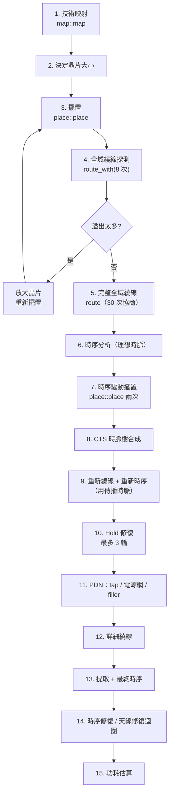
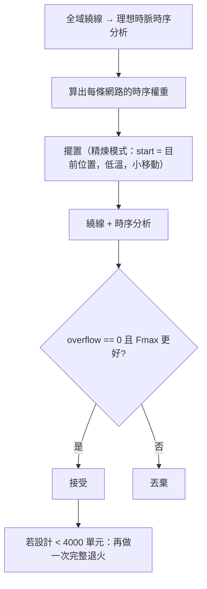

# 6.2 擺置、CTS、PDN 與繞線

> 對應原始碼：`eda/src/asic/place.rs`、`eda/src/asic/cts.rs`、`eda/src/asic/pdn.rs`、`eda/src/asic/route.rs`、`eda/src/asic/detail.rs`、`eda/src/asic/mod.rs`
> 上一節：[6.1 PDK：Liberty 與 LEF](06.1-PDK-Liberty與LEF.md)　下一節：[6.3 時序分析、DRC/LVS 與 GDSII](06.3-時序分析DRC-LVS與GDSII.md)

---

## 6.2.1 ASIC 流程的順序

順序不是任意的，每一步都為後面的步驟創造前提：



**為什麼是這個順序？**

| 順序 | 理由 |
|---|---|
| 映射最先 | 下游全部工作在標準單元上 |
| 擺置在全域繞線前 | 全域繞線需要 pin 的位置 |
| 全域繞線在時序驅動擺置前 | 需要知道目前的溢出情況 |
| CTS 在時序分析後 | 理想時脈的時序是時序驅動擺置的基礎；真實時脈要在 CTS 後才算 |
| PDN 在詳細繞線前 | **strap 與 via stack 是阻塞物，詳細繞線器必須繞開** |
| 提取最後 | 寄生參數依賴最終的線 |

## 6.2.2 擺置：模擬退火

### 6.2.2.1 資料結構

```rust
pub struct RowPlacement {
    pub rows: u32, pub sites: u32,
    pub w: f64, pub h: f64,                 // 晶片大小（µm）
    pub pos: Vec<(u32, u32)>,              // 單元 → (列, site)
    pub pins: Vec<Pin>,
    pub history: Vec<Frame>,               // 每輪的溫度 / 代價 / 接受率
    pub util: f64,
    pub max_density: f64, pub target_density: f64,
}
pub struct Pin { name: String, dir: Dir, x: f64, y: f64, bit: Bit }
pub struct PNet { cells: Vec<usize>, pins: Vec<usize>, bit: Bit }
```

### 6.2.2.2 晶片大小

```rust
let need = total_width / util + macro_area;
let side = (need * site_w * row_h).sqrt();
let rows = side / row_h;
let sites = need / rows;
```

**這是一個「保持近似正方形」的啟發式**——正方形的晶片有最小的周長，因此 IO 接腳的佈線最短。

**宏單元（SRAM）用 shelf 打包**從左下角開始。晶片會增長（`rows += 1; sites += sites/20 + 1`）直到放得下。

**對庫技術，晶片還要長大到周邊能容納 IO 接腳**：

```rust
// sites/2 + rows*TRACKS/2 >= 2*max(ins, outs) + 10
```

**這個不等式的意思是**：晶片的上邊與下邊（或左邊與右邊）加上左右邊（或上下邊），總共要能放下兩倍的接腳數（每個接腳都要一個存取點，而且要有餘裕）。

### 6.2.2.3 IO 接腳的擺放

- 輸入放在周邊的左半 + 上半；
- 輸出放在右半 + 下半；
- 均勻間隔： $d = \frac{k + 0.5}{n} (w + h)$ 。

**為什麼輸入與輸出分開放？** 因為輸入進到核心的邏輯區、輸出從核心出來。分開可以減少核心區域的佈線擁擠。

**接腳對齊到佈線格線**。對 SKY130，格線是**每隔一欄、每隔一條 track**：

```rust
// x &= !1; y &= !1
```

**為什麼？** 因為 met4 使用交替的 track。接腳必須對齊到 met4 能到達的格線上。

**被占用的格點會沿著邊移動接腳**（步長 2），並與角落保持 4 個格點的餘裕，也避開第一對 strap 的欄位。

### 6.2.2.4 佔據圖與初始擺放

```rust
// occ: Vec<Vec<i32>>，列 × site，-1 = 空闲
```

**初始擺置是網表順序**（拓樸順序，所以相連的單元落在附近），以**蛇形**分配到各列（奇數列反向），每列的配額與其空閒 site 數成比例。

**蛇形的理由**：相鄰的網表項在相鄰的列，但位置相反——這樣連續的網路在垂直方向上「來回」，比全部往右走更緊湊。

### 6.2.2.5 成本函數

```rust
let hpwl = |k, pos| -> f64 {
    let (x0,y0,x1,y1) = bbox over cells and pins;
    ((x1 - x0) + (y1 - y0)) * weights.get(&bit).unwrap_or(1.0)
};
// 密度 bin 是 32 sites × 4 rows；目標是 util + 0.15（上限 0.9）
let target = (util + 0.15).min(0.9);
let pen = |used, cap| lambda * (used - target * cap).max(0.0);   // DENSITY_WEIGHT = 1.0
```

**成本 = 加權 HPWL + 密度懲罰。**

**密度目標是 `util + 0.15`**，比當前利用率高 15%。理由：**要留出空間給繞線**。如果單元密度是 100%，繞線根本沒有空間。

**密度 bin 是 32 sites × 4 rows**——這是一個「局部密度」的量測。整體利用率 65% 的設計，仍可能在某個角落過度密集。

### 6.2.2.6 移動

**兩種保持合法性的移動**：

1. **移動**：單元移到一段長度足夠的空閒 run；
2. **交換**：兩個單元互換位置。

**交換被拒絕的條件**：

```rust
// 兩個新的跨度在同一列重疊
let clash = ra == rb && xb < xa + wb && xa < xb + wa;
```

**增量評估**：只有被移動單元的網路被重新計算（用 `stamp` / `gen` 世代計數器）。

### 6.2.2.7 退火排程

```rust
// 初始 temp = 抽樣的每單元網路代價的標準差，下限 1.0
// 每輪：
temp *= 0.5 if rate > 0.96 else 0.9 if rate > 0.8 else 0.95 if rate > 0.15 else 0.8;
rlim = (rlim * (1.0 - 0.44 + rate)).clamp(1, max(rows, sites/8));
// 終止：temp < 0.005 * cost / nets
// 輪數上限 400，每輪 moves = max(n*12, 2000)
// 移動半徑：x 方向 rr*8 sites，y 方向 rr rows
```

**x 方向的半徑是 y 方向的 8 倍**。理由：**列高（SKY130 是 2.72 µm）比 site 寬（0.46 µm）大得多**。要在垂直方向移動一個單元，必須跨過 site 寬的 6 倍。所以以「列」為單位的半徑要小得多。

**精煉模式**（`start = Some(pos)`）從 `temp × 0.02` 開始，`rlim = 2`——這是「在現有解上小幅度優化」。

### 6.2.2.8 全域擺置（大型設計）

```rust
// GLOBAL_MIN = 10000 個單元，無宏單元
```

超過一萬個單元時，改用**真正的二次全域擺置**：

1. **星模型二次線長**；網路權重 $1/(\text{端點數} - 1)$ ；超過 100 個端點的網路忽略。
2. **Gauss-Seidel 掃描**：每個單元移到其網路中心的加權平均（IO 接腳固定）。25 輪：第 0 輪 60 次掃描，其餘 20 次。
3. **遞迴二分擴散**：沿較長的一邊二分晶片；單元依座標排序，**在它的一半寬度處切開**；區域內 ≤ 4 個單元（或小於 2 sites × 1 列）就均勻散開。
4. **錨點**：擴散後的位置成為「錨點」，拉力隨輪次增長： $\text{anchor} = 0.02 \times \text{round}^2$ 。
5. **合法化**：依 `ay` 排序的單元逐列填入，每列內依 `ax` 排序，用一個游標從左打包。

**「在它的一半寬度處切開」** 是一個精細的細節：如果在座標處切，寬單元會被切成兩半。**在半寬處切，保證每個單元完整地落在其中一邊。**

### 6.2.2.9 時序驅動的權重

```rust
// 只有接近關鍵的網路獲得更重的權重，而且負載越多權重增加越少
1.0 + 6.0 * crit^8 / sqrt(fanout)
```

**`crit^8` 讓權重只對「非常關鍵」的網路爆炸**。線性的話，所有接近關鍵的網路都會被強烈拉動，把整個區域拉成一團（造成擁擠）。

**`1/sqrt(fanout)` 防止高扇出網路把整個區域拉在一起**——高扇出網路是「星形」的，強烈拉動會造成局部密度爆炸。

## 6.2.3 全域繞線

### 6.2.3.1 網格模型

一個 gcell 是一列高、 $T$ 條 track 寬：

```rust
pub const CAP: u16 = 12;          // vlib：每個 gcell 邊每個方向的容量
let (cap_h, cap_v) = if tech.is_vlib() { (CAP, CAP) } else { (6u16, 8u16) };
// SKY130：水平 met1（8 中的 6 個空閒）+ met3（4），垂直 met2（8）+ met4（4）
```

**層的分配**：水平 = M2/M4，垂直 = M3/M5（層 0/2 水平，1/3 垂直）。

**容量是一個「每個邊可以承載多少條線」**。全域繞線只決定「大致的走線路徑」，不決定實際的 track。

### 6.2.3.2 網路拓樸：Prim 的最小生成樹

```rust
// 終點依 gcell 網格上的曼哈頓距離，以 Prim 順序連接
let md = |a: u32, b: u32| (a % gx).abs_diff(b % gx) + (a / gx).abs_diff(b / gx);
```

**用 MST 而不是直接連每一對終點**，因為樹是最省線的連接方式。

### 6.2.3.3 A\* 路徑搜尋

```rust
let over = (us + 1).saturating_sub(cap) as f32;
let nd = du + (1.0 + hi) * (1.0 + pres * over);     // hi = 歷史成本, pres = 當前成本
```

**與 FPGA 的 PathFinder 結構相同**：歷史成本 × 當前成本。

啟發函數是曼哈頓距離。

### 6.2.3.4 協商

```rust
// 最多 30 次迭代
// 沒有溢出的網路被跳過
// 每次迭代後，每條超容量的邊 hist += 0.5，pres *= 1.6
// 網路依終點數遞增處理（短網路先）
```

**「短網路先」** 是一個重要的策略：短網路比較容易找到解，先處理它們可以讓長網路看到一個更擁擠但更真實的圖。

### 6.2.3.5 統計

- `wirelength`（µm）
- `vias` = （路線轉彎的節點數）+（接腳數，每個接腳一個 M1 過孔）
- `overflow`（最後一次迭代的）
- `demand` = 總使用量 /（邊數 ×（cap_h + cap_v)）

## 6.2.4 時序驅動的擺置迭代

這是流程中最精巧的一段（第 6.2.1 節的第 7 步）。



**「只接受 overflow == 0 且 Fmax 更好的候選」** 是關鍵的約束。**時序再好，繞線不通就沒有意義。**

**設計小於 4000 單元時會再做一次完整退火**（不只是精煉）。理由：小設計的全域退火成本低，值得多試一次。

## 6.2.5 CTS：時脈樹合成

### 6.2.5.1 演算法：中位數二分

對每一條時脈或非同步 set/reset 網路：

1. 收集 sinks（位置）。
2. 若 $\le \text{MAX_LEAF} = 16$ 個 sink，不建樹。
3. **自頂向下的工作清單**：取出一組，在**該組的質心**插入一個 `CLKBUF`，然後**沿較長的延伸方向，以中位數切分該組**：

```rust
let (x0,x1) = bbox.x; let (y0,y1) = bbox.y;
if x1 - x0 >= y1 - y0 { g.sort_by(|a,b| a.2.0.cmp(&b.2.0)); }   // 依 x 排序
else                    { g.sort_by(|a,b| a.2.1.cmp(&b.2.1)); }   // 依 y 排序
let right = g.split_off(g.len() / 2);
work.push((y, right, level + 1));
work.push((y, g,     level + 1));
```

**原始碼的註解說明了理由**：

> Balanced splits give every sink about the same number of buffers and the same wire length, so the skew stays small.

**這是 H-tree / DME 風格，但不是 DME 的葉節點合併最佳化。** 是一個簡單的遞迴中位數二分。

**為什麼「平衡」對偏斜重要？** 因為偏斜 = 各個 sink 到源的路徑延遲差。平衡的樹讓每個葉子的深度與線長都差不多。

### 6.2.5.2 緩衝器的合法化

```rust
fn take(&mut self, x: f64, y: f64, w: u32) -> (u32, u32) {
    for dr in 0..self.rows {
        if let Some((d,_,_)) = best { if dr as f64 * row_h() > d { break; } }   // 剪枝
        for r in [tr - dr, tr + dr] { ... 找第一段長度 w 的空閒 run ... }
    }
}
```

**距離度量是 $d_r \times \text{row\_h} + |s - t_x| \times \text{site\_w}$ **（以列與欄為單位的曼哈頓距離）。

**剪枝**：如果當前列距離已經超過目前找到的最佳距離，就不用看更遠的列了。

### 6.2.5.3 CTS 的其他工作

`cts.rs` 裡還有幾個共用 `Grid` 的功能：

**`add_diodes`**：天線二極體（第 6.3 節）。

**`upsize`**：時序修復的單元替換：

```rust
// NAND2 → NAND2@2 → NAND2@4（庫裡有的話）
// 單元變寬：右邊有空間就往右長，否則往左長
let nx = if free(x + w0, x + w1) { x }
        else if x >= dw && free(x - dw, x) { x - dw }
        else { continue };
```

**「NAND2@2」這種帶驅動強度後綴的命名**是一個優雅的技巧：

```rust
/// 不含驅動強度的單元型別：時序修復的加強版本（"NAND2@2"）是同一個單元
pub fn base(typ: &str) -> &str { typ.split('@').next().unwrap_or(typ) }
```

這樣 `upsize` 改變的是**參數**，不是單元型別。SKY130 的 `nand2_2`、`nand2_4` 就是這樣對應的。

**`isolate`**：把非關鍵的負載移到一個新的 BUF 後面（靠近驅動器）。

**`fix_hold`**：在違規的正反器輸入前插入延遲緩衝器。

```rust
// 每個違規的正反器輸入插入 ceil((-slack + 0.01) / 0.05) 個延遲緩衝器（約每個 50 ps）
```

**hold 修復的量是計算出來的，不是試出來的。** 需要多少延遲就直接算多少個緩衝器。

## 6.2.6 PDN：電源分配網路

### 6.2.6.1 電源軌

**每個列的邊界都有一條 M1 電源軌**，列的方向交替，所以邊界交替 VSS（偶數）/ VDD（奇數）。

**軌寬 480 nm**，畫在 `tech.layers[0]`。

**「列的方向交替」是標準單元庫的標準做法**：因為單元在奇數列是上下翻轉的，它們的 VDD/VSS 接腳也就上下顛倒。交替軌讓每一列的單元都能直接接上。

### 6.2.6.2 Strap

成對的垂直頂層 strap（先 VDD 後 VSS），每個寬 `STRAP_W = 2` 條 track，間距 `STRAP_PITCH = 80` 條 track。

```rust
pub fn strap_plan(sites: u32) -> Vec<u32> {
    let nx = sites + 1;
    let pairs = (nx / STRAP_PITCH).max(1);
    (0..pairs).map(|k| (k * nx) / pairs + nx / pairs / 2).collect()   // 每個間距的中心
}
```

**每個間距的中心放置一對 strap**。實際位置會向右移，直到避開 IO 接腳的欄位。

### 6.2.6.3 Via stack

每個列邊界，每個對應網路的 strap，放一個 M1→M2→M3→M4 的 via stack（三個過孔）。

**SKY130 只有偶數的 strap 欄位有 via stack**：

```rust
// if lib && (x + dx) % 2 == 1 { continue }
```

**為什麼？** 因為 SKY130 的 met4 使用交替的 track/column（前面提過），所以 via stack 必須對齊到 met4 能到達的位置。

### 6.2.6.4 Well tap

```rust
// TAP_PITCH = 20.0 µm，TAP_MAX = 14.0 µm（單元到 tap 的最大距離）
```

**「單元到 tap 的最大距離」是一個 Latch-up（閘鎖）規則**：如果 tap 距離太遠，substrate 的電荷沒有足夠快的泄放路徑，會觸發 latch-up。

**奇數列的 tap 位移半個間距**（交錯排列）。理想位置是 `pitch/4 + k·pitch`（以 site 計）。

**如果沒有空位放得下 tap，流程序把單元移開**：覆蓋理想 x 的單元往 tap 的寬度方向移（右或左，看哪邊近），中間的單元全部跟著移。

**這個「為了放 tap 而移動邏輯」的機制很粗暴但有效**——它保證了 tap 規則被滿足，代价是些微的線長增加。

### 6.2.6.5 Filler

每段空閒的 site 都用 filler 單元填滿，寬度 **8, 4, 2, 1**（先寬的）。

**為什麼要填 filler？**

1. **電性**：確保每個 column 的 power rail 連續；
2. **機械**：避免大面積的空白導致 CMP（化學機械拋光）不均；
3. **DRC**：某些製程要求金屬有最小密度。

### 6.2.6.6 阻塞資訊

```rust
pub fn blocked(ny) -> Vec<Node>
```

**PDN 對訊號繞線器來說是阻塞物**：

- 頂層層的整個 strap 欄位（庫技術再加 2 欄的淨空）；
- 每個 via stack：該節點在每一層，以及 **met2/met3 上的 9 節點光暈**：

```rust
// [(1,0,-1),(1,0,1),(2,±1,0),(2,±2,0),(2,0,-2),(2,-1,-2),(2,1,-2)]
```

**「9 節點光暈」是因為 via 的金屬墊會延伸到相鄰的節點**，所以相鄰節點不能被別的線用到。

> **這是第 6.2.1 節「PDN 必須在詳細繞線之前」的直接原因。**

## 6.2.7 詳細繞線

`eda/src/asic/detail.rs` 是真正把線畫到 track 上的繞線器。

```rust
pub const LAYERS: usize = 4;
pub const TRACKS: u32 = 8;          // 每列高 8 條 track
const VIA_COST: f32 = 4.0;           // 一個過孔的代價 = 4 條 track
fn horizontal(l: usize) -> bool { l % 2 == 0 }   // M2/M4 水平，M3/M5 垂直
```

**網格是 $(sites+1) \times (rows \times TRACKS + 1)$ 的節點 × 4 層。**

### 6.2.7.1 走廊限制

**每條網路被限制在自己的全域路由 gcell 內，加上周圍一圈**：

```text
dx, dy ∈ [-1, 1]
```

**這是全域繞線與詳細繞線之間的橋樑。** 全域繞線決定「大致走哪裡」，詳細繞線在這個範圍內找具體的 track。

**衝突嚴重的網路會得到更寬的走廊**：

```rust
// 迭代 >= 4 時每 4 次擴一次，>= 16 時每 2 次擴一次
```

### 6.2.7.2 加權 A\*

```rust
let c = step * (1.0 + hist[v]) * (1.0 + pres * (occ[v] + nv) as f32);
```

其中：

- `occ[v]` = 有幾條網路使用這個節點；
- `nv` = 這個節點的「近旁光暈」裡有幾條網路（它們的間距被這個節點的使用違反了）。

**啟發函數權重 1.5**：

```rust
// 啟發函數 × 1.5 —— 「路徑稍長，但訪問的節點少很多」
```

**加權啟發函數（> 1）讓 A\* 更快但可能不是最優。** 這是刻意的取捨：繞線的品質靠協商迴圈保證，單次搜尋只要夠好。

### 6.2.7.3 協商

```rust
const NEGOTIATE: u16 = 60;
// pres 從 0.5 開始，每輪 × 1.7，上限 1000
// 歷史成本：每多一個佔用者 +0.4，光暈衝突 +0.1
```

**「上限 1000」有一個明確的理由**：

> beyond this the costs stop being comparable in f32

** $f32$ 的動態範圍是有限的。** 當 `pres` 成長到 $10^3$ 時，`1.0 + pres * over` 的量級會讓其他項被吃掉。上限是必要的數值穩定性措施。

### 6.2.7.4 最後三輪是「硬」的

```rust
// 最後 3 輪：整個晶片都可用（所有 gcell 都蓋上當前網路的標記），
// 且每個被占用的節點都禁止 —— 嚴格的撕開重繪
// 若嚴格重繪無法連通所有東西，就保留舊的路由
```

**這是 PathFinder 的「最後手段」**：把所有先前的路由都當作不存在，強行找一個解。找不到就放棄（保留舊路由）。

### 6.2.7.5 SKY130 的特殊規則

詳細繞線器裡編碼了 SKY130 的具體限制：

| 規則 | 原因 |
|---|---|
| met3 在奇數 track、met4 在奇數欄位被擋 | 該層使用交替的 track/column |
| 電源軌下方兩條 track 不能有 met1 | 軌需要完整的連續性 |
| 不能超出核心（最後一欄與最後一條 track） | 邊界規則 |
| met1–met2 過孔只能在棋盤格節點 $(x+y) \bmod 2 = 1$ | 對齊到 via 定義的允許位置 |
| 不能在別的網路的 pin via 旁邊放 via 墊 | 間距規則 |
| 單元自己的 met1 是 keep-out | 那是它的內部佈線 |
| 偏移的 pin via 也佔用相鄰節點 | 墊的延伸 |

**「單元自己的 met1 是 keep-out；它的訊號接腳的 met1 屬於那個網路」** 是一個精細的區分：**接腳的引線金屬是電路的一部分，不是阻塞物。**

### 6.2.7.6 接腳存取

```rust
// 庫單元的存取點來自 LEF 推導的 Binding.access
// （奇數列鏡像：r % 2 == 1 → TRACKS - 1 - track）
// vlib：標準單元的接腳由左到右分佈在交替的高度（y = r*TRACKS + 2 + (k%2)*3）
// 宏單元的接腳沿著上邊緣分佈
```

**「奇數列鏡像」** 是因為單元在奇數列上下翻轉，接腳的 track 位置也跟著鏡像。

## 6.2.8 結果統計

```rust
pub struct Detail {
    pub nx: usize, pub ny: usize,
    pub nets: Vec<...>,
    pub wirelength: f64,
    pub vias: usize,
    pub conflicts: usize,
    pub opens: usize,
    pub iters: usize,
    pub per_layer: ...,
}
```

**`conflicts` 與 `opens` 是失敗的指標**：理論上兩個都應該是 0。

## 6.2.9 外層重試迴圈

```rust
// 對庫技術，若詳細繞線有衝突或開路，整個實體流程用新的種子重跑，
// 並且用更小的利用率（util = r * 0.85），最多 4 次
```

**這是「隨機化的流程需要重試」的必然結果。** 退火與繞線都是隨機的，有時會卡在壞的解上。**重試 + 降低密度**是最有效的Escape機制。

## 6.2.10 完整流程的數字速查

| 數字 | 意義 | 位置 |
|---|---|---|
| 12 | `MAX_FANOUT`（BUF 樹分割） | `map.rs` |
| 16 | `MAX_LEAF`（CTS 葉節點數） | `cts.rs` |
| 65% / 55% | 起始利用率（vlib / 庫） | `mod.rs` |
| 0.8 / 0.85 | 溢出時的晶片放大係數 | `mod.rs` |
| 30 | 全域繞線協商迭代 | `route.rs` |
| 6 | `REPAIR_ROUNDS`（時序修復） | `mod.rs` |
| 3000 | `REPAIR_EXACT` 單元數門檻 | `mod.rs` |
| 12 | `ANTENNA_ROUNDS` | `mod.rs` |
| 8 | 每列高的 track 數 / gcell 邊長 | `detail.rs` |
| 4.0 | 過孔代價（track 單位） | `detail.rs` |
| 60 | `NEGOTIATE` 詳細繞線迭代 | `detail.rs` |
| 1.7 / 1000 | 當前成本成長 / 上限 | `detail.rs` |
| 1.5 | A\* 啟發函數權重 | `detail.rs` |
| 80 / 2 | `STRAP_PITCH`（track）/ `STRAP_W` | `pdn.rs` |
| 20 / 14 µm | `TAP_PITCH` / `TAP_MAX` | `pdn.rs` |
| 8,4,2,1 | filler 寬度（site） | `pdn.rs` |
| 480 nm | M1 軌寬 | `layout.rs` |
| 32 sites × 4 rows | 密度 bin 大小 | `place.rs` |
| 10000 | 全域擺置的單元數門檻 | `place.rs` |
| 2000 nm | DRC/LVS/天線的空間 bin | `drc.rs` |

---

**下一節**：[6.3 時序分析、DRC/LVS 與 GDSII](06.3-時序分析DRC-LVS與GDSII.md)
