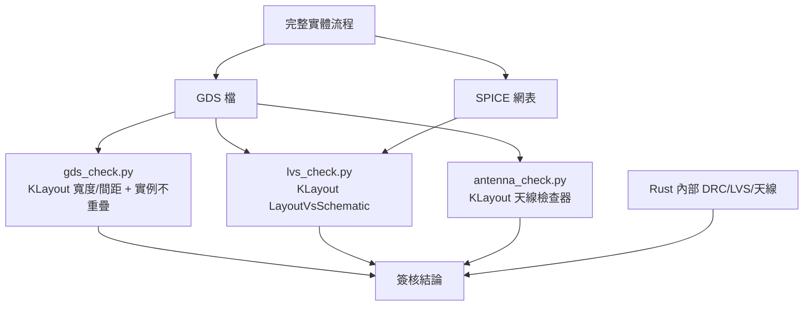

# 6.3 時序分析、DRC/LVS 與 GDSII

> 對應原始碼：`eda/src/asic/sta.rs`、`eda/src/asic/drc.rs`、`eda/src/asic/lvs.rs`、`eda/src/asic/extract.rs`、`eda/src/asic/antenna.rs`、`eda/src/asic/gds.rs`、`eda/src/asic/spice.rs`、`eda/src/asic/layout.rs`
> 上一節：[6.2 擺置、CTS、PDN 與繞線](06.2-擺置CTS-PDN與繞線.md)

---

## 6.3.1 靜態時序分析

### 6.3.1.1 不用 Dijkstra 的理由

一般的 STA 會把設計建成一個圖，用 Dijkstra 計算最長路徑。

**rueda 的 STA 不需要這麼做**，因為網表保證了「組合邏輯在前、正反器在後」（第 4.1.7 節）。因此：

- **一次前向傳播**就能算出所有到達時間（arrival）；
- **一次後向傳播**就能算出所有緊要度（criticality）。

**這是一個用資料結構的物理順序換掉一個演算法的漂亮例子。**

### 6.3.1.2 延遲模型

**vlib**：

```text
延遲 = cell.delay + cell.load × fanout
```

**SKY130（Liberty NLDM）**：

```rust
// tech.arc(cell, pin, input_slew, output_load) 回傳 (延遲, 輸出轉換時間)
// 由 cell_rise / cell_fall 表做雙線性插值，取上升/下降中較差者
```

**轉換時間（slew）會沿路徑傳播**——這是 NLDM 的精髓：一個閘的延遲取決於它的輸入 slew，而輸入 slew 取決於上一級的輸出負載。

### 6.3.1.3 線延遲

**vlib**（經驗公式）：

$$ d = 0.00015 \times L + 0.0004 \times D + 10^{-6} D^2 $$

其中 $L$ 是線長， $D$ 是到驅動器的距離。

**SKY130 + 提取**：查**從提取出的 RC 樹算出的 Elmore 延遲**，鍵是 sink 的座標 $(x_{nm}, y_{nm})$ 。

**SKY130 無提取**（Elmore 近似）：

$$ d = r_{pu} \times D \times \left(c_{pu} \times \frac{D}{2} + 0.002\right) \times 10^{-3} $$

### 6.3.1.4 負載

- sink 接腳電容（來自 Liberty 的 `pin_cap`）；
- 每個輸出埠 + 0.002 pF；
- 線電容（ $c_{pu} \times$ 長度）或提取出的電容。

### 6.3.1.5 時脈的傳播

```rust
// clk_at 由 CLKBUF 單元「父先於子」的順序填入（網表順序保證了這點）：
// t = clk_at[parent] + wire(parent, cell) + cell_delay
```

**insertion delay** = 最大時脈到達時間；**skew** = 最大 − 最小。

**外界用的是「樹的平均延遲」這個虛擬時脈**（`io_clk`），所以 I/O 路徑以這個時間啟動與擷取。

### 6.3.1.6 到達時間的前向傳播

- **FF / 宏單元**：`arrival = ck_arr + (clk→Q 延遲)`；
- **組合單元**：`arrival = max over inputs of (net_arrival + wire_delay + cell_delay)`；
- **同時追蹤 `min_at`**（最早的到達）用於 hold 檢查；
- **常數（tie 單元）的 `min_at = +∞`**：

> a constant never changes: it cannot violate hold

**這是一個漂亮的推理**：常數不會變化，所以它不可能造成 hold 違規（hold 違規需要 0→1 的轉換）。

### 6.3.1.7 端點與 slack

| 端點 | 檢查 |
|---|---|
| FF 的 D 接腳 | setup + hold |
| 輸出埠 | output delay |

**setup slack**： $t_{required} - t_{arrival}$ 。
**hold slack**： $t_{min\_at} + \text{wire} - (t_{ck\_arrival} + \text{hold} + \text{extra\_hold})$ 。

### 6.3.1.8 約束的套用

`eda/src/sdc.rs` 的 SDC 支援刻意很窄——**只處理 I/O 時序**，不處理暫存器到暫存器：

> the flattened, mapped netlist has no register names to constrain paths between registers.

**為什麼？** 因為網表是扁平的，沒有「暫存器名」可以用來指定路徑。要做暫存器到暫存器的多週期路徑，需要在網表裡保留階層資訊。

支援的子集：

```
create_clock -name clk -period 10 [get_ports i_clk]
set_input_delay 2 -clock clk [get_ports {i_a i_b}]
set_output_delay 1.5 -clock clk [all_outputs]
set_false_path -from [get_ports i_rst]
set_multicycle_path 2 -setup -from [get_ports i_slow]
```

**套用方式**：

| 約束 | 效果 |
|---|---|
| input delay | 輸入路徑的啟動時間 |
| output delay | 輸出路徑的允許時間 |
| 多週期 | 啟動提前 $(n-1) \times \text{period}$ ；輸出允許 $n \times \text{period}$ |
| false path（輸入） | 該輸入的啟動時間設為 $\text{NEVER} = -10^9$ ，路徑永遠不被檢查 |

**「false path 的輸入等於完全不檢查」** 是一個實用的近似。正確的做法是切斷該路徑，但在一個只有 I/O 約束的模型裡，把它的啟動時間設成負無限就等效了。

### 6.3.1.9 結果

```rust
pub struct Slack { pub wns: f64, pub tns: f64, pub failing: usize,
                   pub checked: usize, pub clocks: Vec<...>, pub worst: ... }
```

- **WNS**（worst negative slack）：最差的 slack；
- **TNS**（total negative slack）：所有負 slack 的總和。

## 6.3.2 DRC：設計規則檢查

**rueda 的 DRC 是完全內部的**，不依賴 KLayout。

### 6.3.2.1 四條規則

| 規則 | 檢查方式 |
|---|---|
| **short** | 同一層上，不同網路的形狀重疊 |
| **spacing** | 同一佈線層上，不同網路的形狀距離小於該層的 `SPACING`（角落用歐氏距離） |
| **cut spacing** | CUT 層上，任何兩個**不同**的 cut 距離小於 cut 間距（**完全相同的 cut 矩形重複畫是允許的**） |
| **min area** | 佈線層上，一個形狀的淨面積小於該層的最小 `AREA`，且沒有同網路的線延伸出去 |
| **open** | 一個網路的形狀（佈線的 + 單元接腳的）不是一整塊 |

**「完全相同的 cut 矩形重複畫是允許的」** 是一個必要的例外——如果兩個不同的網路在同一個位置各畫一個 cut，那當然是短路；但同一個網路在兩條線上都畫了同一個位置的 cut（視覺上重疊），那是正常的。

### 6.3.2.2 最小面積

硬編碼的每層最小面積（µm²）：

```
met1 0.083, met2 0.0676, met3 0.24, met4 0.24, li1 0.0561
```

**規則的實作**：把該層上與此形狀**相鄰**的同網路形狀的面積加起來；若沒有其他形狀相鄰且總面積低於最小值，就違規。

### 6.3.2.3 加速

```rust
// 每層 2 µm 的 bin；每個形狀只與自己 bin 與周圍 8 個 bin 的形狀比較
const BIN: u64 = 2000;   // nm
```

**空間分箱（spatial binning）** 是幾何檢查的標準加速法。2 µm 的 bin 對應 SKY130 的最小特徵尺寸（0.14 µm 寬、0.17 µm 間距）的十倍以上，確保任何可能違規的形狀對都在相鄰 bin 裡。

### 6.3.2.4 連通性

**同一層上「相鄰」的形狀相連**（union-find）；**奇數層索引（cut 層）上的 cut 把上下的金屬相連**。

```rust
// cut_pair(li) = (li - 1, li + 1)，li 是奇數
```

### 6.3.2.5 沒有檢查的規則

原始碼明確列出**不做**的檢查：

- 寬金屬的間距表（不同寬度的間距要求）；
- 端對端（end-of-line）規則；
- 天線（那是 `antenna.rs`）；
- **同一網路內的間距凹口**。

**最後一項由 `layout.rs` 的「金屬填充」處理**：

> 同一網路在一個金屬層上互相面對、比間距還近的兩塊，把中間的縫隙填滿

**這是一個很實際的取捨**：與其讓 DRC 去檢查同網路的凹口，不如在產生幾何時就把它消除。

### 6.3.2.6 結果

```rust
pub struct Drc {
    pub shorts: usize, pub spacing: usize, pub area: usize, pub opens: usize,
    pub examples: Vec<(rule, layer, x, y)>,
    pub shapes: ...,
    pub details: Vec<String>,
}
```

## 6.3.3 LVS：版圖對比原理圖

### 6.3.3.1 核心決定：不用標籤

> **檢查網路上的標籤只會檢查繞線器對它自己。**

**連接性完全從幾何重建。**

### 6.3.3.2 幾何連通性

- **導體** = 佈線的形狀（**丟掉標籤**）+ 單元來自 LEF 的接腳形狀；
- **單元的遮蔽（OBS）不是導體**——碰到它就是短路；
- 同層「相鄰」相連；cut（奇數層）重疊把上下的金屬相連。

### 6.3.3.3 終端

- **單元接腳**（帶著網表裡的邏輯網路；`VPWR`/`VGND` 是電源地）；
- **IO 接腳**（在標籤下的頂層形狀）。

### 6.3.3.4 比較項目

| 項目 | 意義 |
|---|---|
| **open** | 一個網路的終端落在多於一塊形狀上 |
| **short** | 一塊形狀含有多於一個網路的終端 |
| **device errors** | 版圖的實例名稱/單元與網表的單元不匹配 |
| **floating** | 佈線的形狀沒有連到任何終端（計數，但不當錯誤） |

```rust
pub struct Lvs {
    pub nets: usize, pub terminals: usize,
    pub opens: usize, pub shorts: usize, pub device_errors: usize,
    pub devices: usize, pub floating: usize,
    ...
}
```

**「floating 計數但不當錯誤」** 是一個實務判斷：一塊沒有接到的金屬（例如被刪掉的邏輯留下的線）不會造成功能錯誤，但會浪費面積並可能違反天線規則。

### 6.3.3.5 為什麼這是「簽核」

**如果 LVS 使用網表比對，它就永遠會通過**——因為網表就是從網表來的。

**從幾何重建，才是在問「物理上真的連在一起嗎」。**

這是第 6.1.9 節「三重驗證」的核心原理。

## 6.3.4 寄生參數提取

`eda/src/asic/extract.rs` 從詳細路由的 `segs` / `vias` 建立 RC 樹。

### 6.3.4.1 節點與切割

**節點** = $(layer, x, y)$ 在 track 格線上；**層 254 = 單元接腳，255 = pin via 標記**。

**切割**：一個網路的形狀在每個「其他形狀接上來」的地方被切斷（線段端點、過孔、pin via、IO 接腳節點）。

### 6.3.4.2 R 與 C

```rust
r_um[l] = layer.rpersq / layer.width;                                  // Ω/µm
c_um[l] = layer.cpersq * layer.width + 2.0 * layer.edgecap;             // pF/µm
via_r[l] = 該過孔的 CUT 層的 cut_r                                     // 每個 cut 的 Ω
```

一段長度為 `len` 的線：`R = len × r_um`，`C = len × c_um`，**電容一半給每個端點**。

**`edgecap`（邊緣電容）是 fringing capacitance**——一條窄線的兩側也有電容效應。忽略它會低估延遲。

### 6.3.4.3 Elmore 延遲

**驅動者** = 單元輸出（或輸入埠）；**sinks** = 輸入接腳（各帶 Liberty 的 `pin_cap`），加上每個輸出埠 0.002 pF。

**BFS 從驅動者建立樹**，計算每個節點下游的電容 `down[node]`，然後：

```rust
delay[x] = delay[parent] + r * down[x] * 1e-3;   // Ω·pF = ps → ns
```

**Elmore 延遲是樹狀網路延遲的標準近似。**

> 順帶一提：Elmore 延遲也可以由一階矩求得——把樹的每個電容視為集中在各分支的電容加權重心處，所有支路延遲取最大值，就是 Elmore 延遲。這比逐步遞推計算要簡單得多。

結果：

```rust
pub struct Extraction {
    pub cap: HashMap<Bit, f64>,
    pub delay: HashMap<(Bit, (i64, i64)), f64>,   // 鍵是 sink 的座標（nm）
    pub nets: usize, pub worst: ...,
}
```

## 6.3.5 天線規則

### 6.3.5.1 物理機制

**當一個金屬層正在被蝕刻時，上面的層還不存在。** 所以一條「日後會透過更高層連回驅動器」的線，在此時是一塊只靠電晶體閘極吊著的金屬。它累積的電荷可能破壞閘氧化層。

**規則**：金屬面積與它所連的閘極面積的比例不能超過限制。

### 6.3.5.2 演算法

**自底層逐層建立版面**（li1、mcon、met1、via、met2……）：

1. 金屬連接它**觸碰**到的同層形狀；
2. cut 在製作時連接下方的金屬，被製作時連接上方的金屬；
3. 對當前層的每個**連通塊**計算**側面積**：
   - 金屬層： $2(w + h) \times \text{厚度}$ （周長 × 厚度）；
   - cut 層： $w \times h$ （面積）；
4. **閘極面積**與**擴散面積**從單元的 LEF 接腳累積（`ANTENNAGATEAREA`、`ANTENNADIFFAREA`），一個接腳的閘極面積跟著它的第一個形狀；
5. 限制是 LEF 的 `ANTENNADIFFSIDEAREARATIO` / `ANTENNADIFFAREA` 表，**以擴散面積為引數的分段線性函數**：

```rust
let ratio = area[&r] / ga;
let limit = crate::pdk::lef::Layer::pwl(table, da);
```

6. 當 `ratio > limit` 就違規。

**「以擴散面積為引數的分段線性函數」** 是製程的標準做法：接到擴散（驅動器輸出、二極體）的區域限制更寬鬆，因為擴散可以洩放電荷。

### 6.3.5.3 SKY130 的實際數字

從 `tools/antenna_check.py`：

| 層 | 厚度 (µm) | 比例 |
|---|---|---|
| li1 | 0.1 | **75** |
| met1 | 0.35 | 400 |
| met2 | 0.35 | 400 |
| met3 | 0.8 | 400 |
| met4 | 0.8 | 400 |
| met5 | 1.2 | 400 |

**li1 的限制嚴格得多（75 vs 400）**，因為 li1 直接連到閘極。

**延伸到擴散的區域豁免**：比例表在擴散面積為 0 時限制是 75；接到擴散時限制至少是 **2609**。

### 6.3.5.4 修復

```rust
// 對每個違規的閘，在其網路上插入一個 DIODE 單元
// （sky130_fd_sc_hd__diode_2），放在離該單元最近的空位
// （絕不放在 tap 上，也不在 avoid 清單裡）
```

**最多 12 輪**；**讓繞線變差的修復會被放棄**，並在最多 3 個不同的位置重試。

**「二極體洩放電荷」** 正是天線效應的標準解法：二極體把閘極上的電荷導走。

## 6.3.6 SPICE 網表

`eda/src/asic/spice.rs` 產生 CDL 風格的 SPICE。

```
.SUBCKT alu A1 A2 Y VPWR VGND
Xc0 A1 A2 Y VPWR VGND sky130_fd_sc_hd__nand2_1
Xc1 A2 Y Z VPWR VGND sky130_fd_sc_hd__inv_1
...
.ENDS alu
```

**接腳順序是 CDL 的順序**：輸入（字母序）、電源接腳（`VGND VNB VPB VPWR`，字母序）、輸出（字母序）。

```rust
[ins.sort(), pw.sort(), outs.sort()].concat()
```

**`VPWR`/`VPB` 接到 `VPWR`，`VGND`/`VNB` 接到 `VGND`。**

**網路命名**：是埠就用埠的名，否則 `n<wire>`；名字被清理成 `[A-Za-z0-9_\[\].]`。

**可選的 `.INCLUDE <path>` 指向 PDK 的 `sky130hd.cdl`**（由 `tools/sky130.sh` 下載）。**沒有它，這個檔案沒有單元定義，無法用 ngspice 模擬。**

**這個 SPICE 檔是 KLayout LVS 的參考網路**（`tools/lvs_check.py`）。

## 6.3.7 版圖：形狀的集合

`eda/src/asic/layout.rs` 產生「形狀集合」——DRC、LVS、天線與 GDS 寫入器的共同輸入。

```rust
pub struct Layout {
    pub layers: Vec<String>,
    pub shapes: Vec<Shape>,
    pub insts: Vec<Inst>,
    pub nets: Vec<String>,
    pub net_of: HashMap<Bit, usize>,
    pub labels: Vec<(u8, i64, i64, String)>,
    pub die: (i64, i64),
}
pub struct Shape { pub layer: u8, pub x0: i64, pub y0: i64, pub x1: i64, pub y1: i64, pub net: usize }
```

**11 個層的槽位**：

```text
["li1","mcon","met1","via","met2","via2","met3","via3","met4","via4","met5"]
```

**奇數索引是 cut 層**——這就是程式裡到處用 `li % 2 == 1` 表示「cut」的原因。

**網索引 0 = VDD，1 = VSS，`usize::MAX` = 無。**

**實例命名**：`c{i}`（邏輯單元）、`fill{k}_{x}`（filler）、`tap{k}`（well tap）。

**`flip = r % 2 == 1`**（列的方向交替 N / FS）。

### 6.3.7.1 IO 接腳矩形

```rust
// 0.3 µm 寬的形狀，從最近的邊進入晶片 0.8 µm
```

**「進入 0.8 µm」** 是為了讓 IO 接腳的形狀有足夠的面積（met4 的最小面積是 0.24 µm²， $0.3 \times 0.8 = 0.24$ 剛好）。

## 6.3.8 GDSII 輸出

### 6.3.8.1 記錄格式

GDSII 記錄 = **2 位元組大端長度 + 2 位元組記錄型別 + 資料**。長度涵蓋標頭；奇數長度的資料補一個零位元組。

| 型別 | 意義 | 本專案的使用 |
|---|---|---|
| `0x0002` | HEADER | 版本 **600** |
| `0x0102` | BGNLIB | 日期 `2026-01-01 00:00:00` 兩次 |
| `0x0206` | LIBNAME | 設計名 |
| `0x0305` | UNITS | **每資料單位 0.001 使用者單位，每資料單位 1e-9 公尺**（1 nm DBU，1 µm 使用者單位） |
| `0x0502` | BGNSTR | 日期 |
| `0x0606` | STRNAME | 頂層結構名 |
| `0x0A00` | SREF | 單元參照 |
| `0x1206` | SNAME | 被參照的結構名 |
| `0x1A01` | STRANS | `0x8000` = 對 X 軸鏡射 |
| `0x1003` | XY | 座標（i32） |
| `0x1100` | ENDEL | 元素結束 |
| `0x0800` | BOUNDARY | 方塊 |
| `0x0D02` | LAYER | 層號（i16） |
| `0x0E02` | DATATYPE | 資料型別（i16） |
| `0x0C00` | TEXT | 標籤 |
| `0x1602` | TEXTTYPE | 5（標籤） |
| `0x1906` | STRING | 標籤文字 |
| `0x0700` | ENDSTR | |
| `0x0400` | ENDLIB | |

**UNITS 記錄是整個格式的關鍵**：

$$ 1\ \text{使用者單位} = 0.001\ \text{資料單位},\qquad 1\ \text{資料單位} = 10^{-9}\ \text{公尺} $$

所以 **1 資料單位 = 1 nm，1 使用者單位 = 1 µm**。

### 6.3.8.2 8 位元組 GDS 實數

這是 GDSII 最古老也最麻煩的部分。

**格式**：符號位在第 0 個位元組的 bit 7；**7 位元的以 64 為底、16 進位的指數**；**56 位元的尾數**。

```rust
let mut e: i32 = 64;
while m >= 1.0 { m /= 16.0; e += 1; }
while m < 1.0/16.0 { m *= 16.0; e -= 1; }
let mant = (m * (1u64 << 56) as f64).round() as u64;
out[0] = (if sign { 0x80 } else { 0 }) | (e as u8 & 0x7f);
```

**單元測試釘住了確切的位元組樣式**：

```text
real8(0.001) = 3e 41 89 37 4b c6 a7 f0
real8(1e-9) = 39 44 b8 2f a0 9b 5a 54
```

**這個測試是必要的**：GDS 的實數格式沒有公開的正式檔案流傳，唯一的可靠來源是舊的工具。任何一位元組的差異都會讓光罩廠的工具讀到錯誤的座標。

### 6.3.8.3 層對應

```
li1  (67, 20, 16)   mcon (67, 44, 44)
met1 (68, 20, 16)   via  (68, 44, 44)
met2 (69, 20, 16)   via2 (69, 44, 44)
met3 (70, 20, 16)   via3 (70, 44, 44)
met4 (71, 20, 16)   via4 (71, 44, 44)
met5 (72, 20, 16)
```

三元組是 `(層號, 繪圖型別, 接腳型別)`。

### 6.3.8.4 結構的複製

GDS 檔案是**階層式**的：每個單元只存一次，頂層用 SREF 參照。

寫入器的做法：

1. 讀 PDK 的 GDS，用 `structures()` 把原始位元組依 `BGNSTR..ENDSTR` 切成每個結構；
2. 對 `SNAME` 記錄（`0x12`）做**遞迴閉包**，把需要的單元（以及它們參照的單元）**逐字節複製**進輸出；
3. 寫出頂層結構：實例的 SREF（鏡射的列用 `STRANS 0x8000` 並上移一個單元高度）、已路由形狀的 BOUNDARY、IO 接腳的方塊 + TEXT 標籤（型別 5）。

**「逐字節複製」** 保證了複製的單元與 PDK 的原始資料完全一致——這是簽核的基礎。

**IO 接腳方塊是頂層層上的 150 nm 半尺寸的方形。**

## 6.3.9 簽核流程



### 6.3.9.1 `gds_check.py`

```sh
python3 eda/tools/gds_check.py OUT.gds DESIGN INSTANCES SHAPES LABELS
```

檢查：

- 恰好一個頂層單元，名稱等於設計名；
- 實例數、形狀數、標籤數與 Rust 流程報告的一致；
- 每個放置的單元都有定義且非空；
- **沒有兩個實例在同一列重疊**（用 PDK 標準單元外框層 `81/4`（`areaid.sc`），沒有就用包圍盒）；
- **KLayout 自己的寬度與間距檢查**（用上面第 6.1.10 節的規則表）。

```python
Region.merged().space_check(space).count()
Region.merged().width_check(width).count()
```

### 6.3.9.2 `lvs_check.py`

```sh
python eda/tools/lvs_check.py DESIGN.gds DESIGN.sp [TOP]
```

- **從 GDS 的幾何**（不是 LEF）提取連接性：
  - 導體 = `li1(67) met1(68) met2(69) met3(70) met4(71) met5(72)`，型別 20（繪圖）+ 16（接腳）；
  - cut = `mcon(67/44) via(68/44) via2(69/44) via3(70/44) via4(71/44)`；
  - 金屬↔文字（標籤是型別 5）相連；金屬↔cut↔金屬相連；
- **參考 = SPICE 網表**，用 `db.NetlistSpiceReader` 讀入；
- **兩邊的單元都是黑盒**（版圖的標準單元是 PDK 自己的，網表的單元是 PDK 的 CDL 子電路）；
- **不做 well 的提取**（`VPB`/`VNB`），從參考單元的接腳裡移除它們；
- 版圖的 filler 與 tap（沒有電晶體、沒有訊號接腳）被**扁平化進頂層**；
- 用 `db.NetlistComparer` 比較，交叉參照的狀態 `Match` / `MatchWithWarning` 都算通過。

### 6.3.9.3 `antenna_check.py`

**從 GDS 開始，不是從 LEF 抽象。**

- **閘 = poly ∩ diff**（poly 是層 66/20，diff 是 65/20）；**源/漏 = diff − poly**；
- 逐層建立版面；
- 呼叫 KLayout 自己的天線檢查器：

```python
bad = l2n.antenna_check(gate, 1.0, 0.0, metals[stage], 0.0, thick, ratio, [[sd, 1e9]])
```

**`[[sd, 1e9]]` 豁免接到源/漏的區域**（上限 $10^9$ ，等於無限）。

- 違規的區塊用 `l2n.probe_net(...)` 映射回網路。

## 6.3.10 為什麼要有兩套

| | Rust 內部 | KLayout 腳本 |
|---|---|---|
| 幾何來源 | LEF 抽象 + 自己繪製的形狀 | 真正的 GDS（多邊形合併後） |
| 閘極面積 | LEF 的 `ANTENNAGATEAREA` | **poly ∩ diff 的實際交集** |
| 規則引擎 | 自己寫的四條規則 | KLayout 的完整規則引擎 |
| 優點 | 快、整合、可在流程中即時回饋 | 獨立、權威 |
| 缺點 | 只覆蓋部分規則 | 需要外部工具 |

**兩邊一致 → 實作正確。兩邊不一致 → 有 bug。**

這正是本章一直在說的那個方法論：**同一語意、多種實作、交叉驗證。**

## 6.3.11 完整 ASIC 流程的命令

```sh
reda asic --pdk sky130 --gds alu.gds alu.veryl
```

內部流程（`asic/mod.rs::flow_opts`）：

1. `map::map` — 技術映射
2. 決定晶片大小
3. `place::place` — 擺置
4. `route::route_with(..., 8)` — 全域繞線探測
5. 溢出太多 → 放大晶片，重做
6. `route::route` — 完整全域繞線（30 次）
7. `sta::analyze` — 理想時脈時序分析
8. 時序驅動擺置（精煉 + 可能的完整退火）
9. `cts::build` — 時脈樹合成
10. 重新繞線 + 重新時序（傳播時脈）
11. Hold 修復（最多 3 輪）
12. `pdn::insert_taps` → `pdn::build` → `detail::route`
13. 外層重試迴圈（最多 4 次）
14. 時序修復（`REPAIR_ROUNDS = 6`）
15. 天線修復（`ANTENNA_ROUNDS = 12`）
16. 提取 + 最終時序
17. 功耗估算

**`REPAIR_EXACT = 3000`**：設計小於 3000 個單元時，「快速評估候選」用**詳細路由 + 提取**而不是全域路由的估計。**小設計值得更精確的評估。**

**時序修復的接受條件**：改善 WNS **而且**不讓詳細路由變差。

---

**下一章**：[第 7 章 RISC-V 與 SoC](07.1-RISC-V指令集與SoC結構.md)
