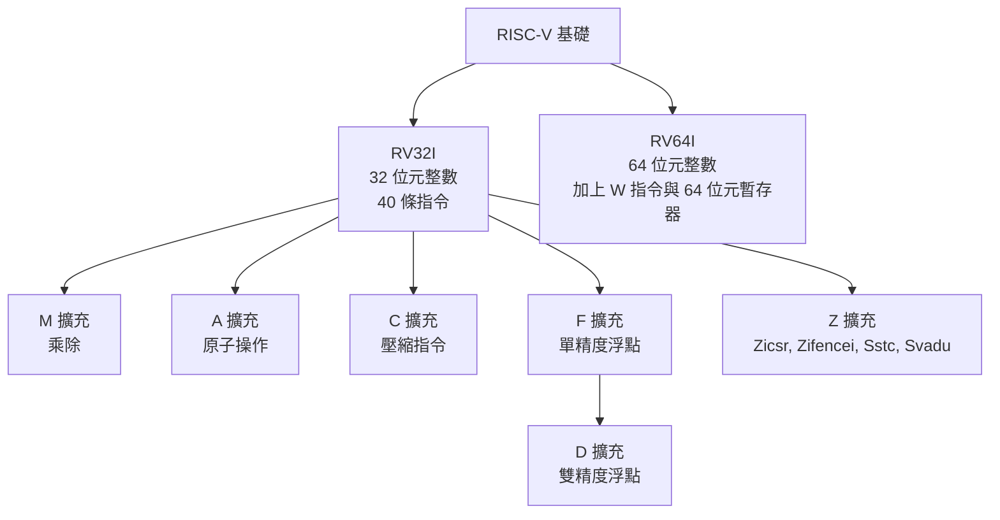
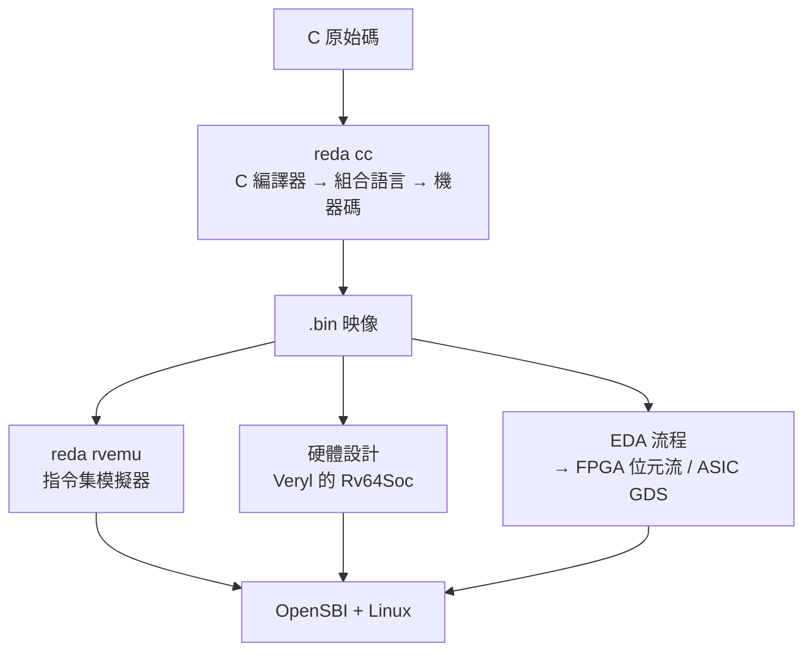
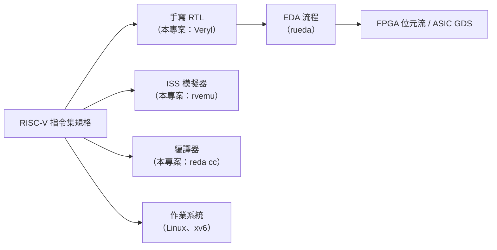

# 7.1 RISC-V 指令集與 SoC 結構

> 對應原始碼：`riscv/rvemu/src/cpu.rs`、`riscv/rvemu/src/bus.rs`、`veryl/examples/src/rvsoc.veryl`、`veryl/examples/rv64/src/rv64soc.veryl`
> 下一節：[7.2 C 編譯器、組譯器與指令集模擬器](07.2-C編譯器組譯器與指令集模擬器.md)

---

## 7.1.1 為什麼是 RISC-V

RISC-V 的歷史可以分三段：

**1980-2010：Berkeley 的研究。** David Patterson 與 Krste Asanović 從 2010 年開始推動 RISC-V，源於一個觀察：**x86 與 ARM 的指令集無法做學術研究**，因為它們有大量歷史包袱（16 位元的操作碼空間、一堆相容性限制、不能刪任何東西）。

**2010-2015：指令集定義。** RISC-V 的基本設計原則是：

- **精簡**：基礎指令集只有 47 條指令；
- **模組化**：可以由擴充指令組成各種「配置」（profiles）；
- **可移植**：同一份硬體描述碼（ISA spec）可以產生不同寬度（RV32 / RV64 / RV128）的處理器。

**2015-至今：開放與產業化。** RISC-V 基金會成立，各種配置（RV32I、RV64GC、嵌入式、Linux 平臺）定義完成。SiFive、StarFive、Alibaba（T-Head）等公司做出實體晶片。

**2017 年**：RISC-V 進入 Linux 核心（`arch/riscv`）。

**2020 年**：RISC-V 基金會遷移到瑞士，新的法律實體（RISC-V International）涵蓋所有專利。

> **RISC-V 對教學的意義**：它是第一個「你可以讀完整份規格、然後自己寫一個處理器」的指令集。指令集手冊只有幾百頁，沒有任何相容性包袱。

## 7.1.2 指令集的分層



**RV64IMAC** 是最常見的嵌入式 Linux 配置。**RV64GC** 是含浮點的一般用途配置。

## 7.1.3 SoC 的結構

rueda 的 SoC 是一個「教學用最小系統」。

### 7.1.3.1 RV64Soc 的記憶體映射

`riscv/rvemu/src/bus.rs` 的映射**逐個暫存器對應** `veryl/examples/rv64/src/rv64soc.veryl`：

```
0x0010_0000  finisher（sifive,test0）：寫入非零的低半部結束執行（0x5555 = 通過）
0x0200_0000  CLINT：msip(+0)、mtimecmp(+0x4000)、mtime(+0xBFF8)
0x0C00_0000  PLIC：優先權、pending、enable / threshold / claim（context 0 = M，1 = S）
0x1000_0000  UART：16550 的子集（THR 永遠空，一位元的接收緩衝），PLIC source 10
0x1006_0000  GPIO：16 個接腳，SiFive GPIO 暫存器，接腳 k = PLIC source 16 + k
0x8000_0000  RAM
```

**位址解碼用位移**：

```rust
// a >> 16 == 0x200（CLINT）、a >> 26 == 3（PLIC）、a >> 8 == 0x10_0000（UART）、
// a >> 12 == 0x10060（GPIO）、a >> 12 == 0x100（finisher）
```

**其他一律存取錯誤。**

### 7.1.3.2 裝置

**UART**（16550 子集）：

```rust
pub struct Uart { ier: u8, lcr: u8, mcr: u8, scr: u8, fcr: bool, dll: u8, dlm: u8,
                  rx_full: bool, rx_byte: u8, thre_pend: bool }
```

**THR 永遠空**（傳送不阻塞）、**接收者是一個位元的緩衝**。DLAB（lcr bit 7）選擇 DLL/DLM。LSR 回傳 `(fcr ? 0xc0 : 0) | rx_int?4 : tx_int?2 : 1`。

**GPIO** 混合輸出與外部接腳：

```rust
pub fn gpio_out(&self) -> u32 { (self.gpio.out_val ^ self.gpio.out_xor) & 0xffff }
pub fn gpio_pins(&self) -> u32 {
    (self.gpio.output_en & self.gpio_out()) | (!self.gpio.output_en & self.gpio.pins_in & 0xffff)
}
```

**`out_xor` 是一個「輸出反相」暫存器**——SiFive 的 GPIO 有這個特性，可以用軟體翻轉輸出而不必改變實際邏輯值。

**PLIC**：

```rust
pub struct Plic { prio: [u8; 32], en: [u32; 2], thr: [u8; 2], claimed: u32 }
```

31 個來源，兩個 context（M 與 S）。

```rust
// plic_src() = (gpio_irq() & 0xffff) << 16 | (uart_irq() as u32) << 10
// UART 是 source 10，GPIO 接腳 k 是 source 16 + k
```

**`plic_best(ctx)`** 掃描 pending 位元找最高優先權的；claim 設定 `claimed |= 1 << b`；complete 清除它。

**Finisher**：`0x0010_0000`，寫入非零 → `finished = Some(v)`。**`0x5555` = 通過**。

### 7.1.3.3 RISC-V 測試的 `tohost` 慣例

```rust
pub tohost: Option<u64>,
```

**riscv-tests 慣例**：把測試結果寫到一個名為 `tohost` 的符號。**`tohost == 1` 表示通過**（映射為 `0x5555`），其他值表示失敗（`0x3333`）。

## 7.1.4 RV32 SoC 的記憶體映射

`riscv/rvtools/src/iss.rs` 的 RV32 版本更簡單：

```rust
pub const IO_BASE: u32   = 0x1000_0000;
pub const LED: u32       = IO_BASE;         // +0
pub const BTN: u32       = IO_BASE + 4;     // +4
pub const UART: u32      = IO_BASE + 8;     // +8
pub const UART_ST: u32   = IO_BASE + 12;    // +12
pub const TIMER: u32     = IO_BASE + 16;    // +16
pub const MTIMECMP: u32  = IO_BASE + 0x18;
pub const MSIP: u32      = IO_BASE + 0x20;
pub const VGA_TEXT: u32  = IO_BASE + 0x2000;  // 字元
pub const VGA_FONT: u32  = IO_BASE + 0x4000;  // 字型列
pub const VGA_COLOR: u32 = IO_BASE + 0x6000;
```

**RV32 版本有 VGA 文字記憶體，RV64 版本沒有**（因為 RV64 走的是 Linux，Linux 有自己的 framebuffer）。

## 7.1.5 hart：處理器核心

`riscv/rvemu/src/cpu.rs` 是一個**指令集模擬器（ISS）**，但它是可以拿來寫 RTL 的參考模型。

### 7.1.5.1 狀態結構

```rust
#[repr(C)]
pub struct Machine {
    pub x: [u64; 32],
    pub pc: u64,
    /// 由轉譯後的程式碼的 helper 設定：1 = 陷入（trap），2 = 存儲命中已轉譯的程式碼
    pub jit_fault: u64,
    pub prv: u64,
    mstatus: u64, medeleg: u64, mideleg: u64, mie: u64, mip_sw: u64,
    mtvec: u64, mepc: u64, mcause: u64, mtval: u64, mscratch: u64,
    mcounteren: u64, menvcfg: u64,
    stvec: u64, sepc: u64, scause: u64, stval: u64, sscratch: u64,
    scounteren: u64, senvcfg: u64,
    satp: u64, stimecmp: u64,
    pmpcfg: [u64; 2], pmpaddr: [u64; 16],
    pub instret: u64,
    instret_off: u64, cycle_off: u64,
    resv: Option<u64>,
    tlb: Vec<Tlb>,
    pub bus: Bus,
    ...
}
```

**`#[repr(C)]` 是必需的**：JIT 產生的 wasm 程式碼在**固定的位元組偏移**尋找 `x`、`pc` 與 `jit_fault`。

**復位狀態**：

```rust
// pc = RAM_BASE = 0x8000_0000，prv = 3（M 模式）
// mstatus = XLEN_BITS = 2<<32 | 2<<34（即 0xA_0000_0000：SXL=2, UXL=2 → 64 位元 XLEN）
// stimecmp = u64::MAX，mip_sw = 0
```

### 7.1.5.2 特權層級

三層：**M（機器的）→ S（監管的）→ U（使用者）**。

**特權層的意義**是硬體隔離：M 模式可以控制所有東西，S 模式控制虛擬化與記憶體，U 模式只能用自己的位址空間。

**陷入（trap）** 的原因碼：

| 原因 | 意義 |
|---|---|
| 0/1/2/3 | 指令位址未對齊 / 存取錯誤 / 非法指令 / breakpoint |
| 4/5/6/7 | 載入位址未對齊 / 存取錯誤 / 存儲位址未對齊 / 存取錯誤 |
| 8/9/11 | 從 U / S / M 模式 ecall |
| 12/13/15 | 取指 / 載入 / 存儲的 page fault |

```rust
// ecall 的原因取決於當前特權層
exc(8 + self.prv, 0)
```

**中斷優先順序是固定的**：

```rust
[11, 3, 7, 9, 1, 5].into_iter().find(|i| pick >> i & 1 != 0)
// 11 = MEIP, 3 = MSIP, 7 = MTIP, 9 = SEIP, 1 = SSIP, 5 = STIP
```

**機器中斷優先於 supervise 中斷，同層級內外部中斷優先於軟體中斷。**

### 7.1.5.3 Sv39 位址轉換

**Sv39 是三級頁表，每級 9 個位元**（512 個項目）。

```rust
// satp >> 60 選擇模式：只接受 0（bare）與 8（Sv39）
// 根 = (satp & ((1<<44)-1)) << 12
// 葉 PTE 的位：V=1, R=2, W=4, X=8, U=16, A=0x40, D=0x80
```

**無效 PTE 的判斷**：

```rust
// !v，或 (!r && w)，或 pte >> 54 != 0 → page fault
```

**超級頁必須對齊**：

```rust
// ppn & ((1 << (9*level)) - 1) != 0 → page fault
```

**Svadu（Sv39 A/D 位更新）**：A/D 位**由硬體**設定（而不是由軟體），但**只有在 `menvcfg.ADUE`（bit 61）開啟時**：

```rust
let need = 0x40 | if acc == Acc::Store { 0x80 } else { 0 };
if pte & need != need {
    if self.menvcfg & ADUE == 0 { return Err(Self::page_fault(acc, va)); }
    pte |= need;
    self.bus.ram[o..o + 8].copy_from_slice(&pte.to_le_bytes());
}
```

**為什麼需要這個擴充？** 因為原本 A/D 位要由軟體更新，這需要「讀頁 → 檢查 → 寫回」的序列，在虛擬化下非常昂貴。Svadu 讓硬體自動更新，**大幅減少陷入次數**。

### 7.1.5.4 TLB

```rust
// TLB_N = 512 個直接映射項目
// 索引 = vpn & 511
```

**關鍵設計：權限檢查每次存取都從快取的 PTE 位重新做。**

```rust
fn perm_ok(&self, pte: u64, acc: Acc, prv: u64) -> bool {
    let (r, w, x, u) = (pte & 2 != 0, pte & 4 != 0, pte & 8 != 0, pte & 16 != 0);
    if prv == 0 && !u { return false; }
    if prv == 1 && u && (acc == Acc::Fetch || self.mstatus & SUM == 0) { return false; }
    match acc { Acc::Fetch => x, Acc::Load => r || (x && self.mstatus & MXR != 0), Acc::Store => w }
}
```

**為什麼要重做？** 因為 PTE 的權限位可能被改變（`mprotect` 之類的系統呼叫）。**快取不是授權，是加速。**

**這個設計是正確的**：即使 TLB 的內容過期，權限檢查仍然正確（因為權限是從 PTE 位推導的，而 PTE 本身會被 invalidate）。

### 7.1.5.5 非對齊存取會陷入

```rust
// vload → 原因 4，vstore → 原因 6
```

**與 spike 和 Veryl 的 `Rv64Core` 一致**。這是一個「實務上很多處理器支援、但規格允許陷入」的選擇。

### 7.1.5.6 CSR

`csr_read` / `csr_write` 是一個手寫的表。

**`misa` 的值**：

```rust
// 0x301 回傳 2<<62 | 1<<20 | 1<<18 | 1<<12 | 1<<8 | 1<<2 | 1
// = RV64 + I + M + A + C + Zicsr + Zifencei + Sstc + Svadu
```

**`mstatus` 的 bit 63（SD）** 只在 $FS == FS$ 時被設定。

**PMP 暫存器存在但不被強制執行**：

```rust
// pmpcfg[2]、pmpaddr[16] 存在，但不做硬體強制
```

**這是一個誠實的取捨**：PMP（實體記憶體保護）是安全功能，一個教學用模擬器不實作它，但保留了暫存器。

**寫 `mcycle` / `minstret` 會設定偏移量，讓寫入的那個指令不計入自己**：

```rust
0xb00 => self.cycle_off  = v.wrapping_sub(self.instret + 1),
0xb02 => self.instret_off = v.wrapping_sub(self.instret + 1),
```

**「寫入的指令不計入自己」** 是一個細節但很重要的規格要求。

**寫 `satp` 會清空 TLB**；寫 `mstatus` 的 `MPRV|SUM|MXR|MPP` 會清空 JIT 的 TLB。

### 7.1.5.7 RVC 展開

```rust
fn expand(c: u32) -> Option<u32>
```

把 16 位元的壓縮指令翻譯成 32 位元形式，用 `r_t` / `i_t` / `s_t` / `b_t` / `j_t` 建構。**`None` 表示非法。**

### 7.1.5.8 時間模型

**`mtime` 預設數的是指令，不是時脈**：

```rust
// self.bus.mtime += 1 在 step() 裡
```

除非 `realtime` 被設定（此時由宿主用真實時鐘設定 `mtime`）。

**`wfi`（等待中斷）的最佳化**：

```rust
if self.waiting {
    if self.mip() & self.mie != 0 { self.waiting = false; continue; }
    if !self.bus.rx.is_empty() { self.check = true; continue; }
    let t = if self.menvcfg & STCE != 0 { self.bus.mtimecmp.min(self.stimecmp) } else { self.bus.mtimecmp };
    if self.realtime || t == u64::MAX || t <= self.bus.mtime { return Stop::Idle; }
    self.bus.mtime = t;   // 睡到下一個計時器期限
    continue;
}
```

**「直接跳到下一個計時器期限」** 是一個重要的加速：如果沒有任何事要發生，就不必逐個指令空轉。

**`Stop` 列舉**：`Count | Finished | Idle | Jit`。

## 7.1.6 狀態的存取與還原

```rust
// Machine::state() 回傳 Vec<u64>：32 個暫存器 + 26 個純量 CSR
// + 2 個 pmpcfg + 16 個 pmpaddr + bus.state()（67 個字）
```

**`bus.state()` 的順序是固定的**：mtime、mtimecmp、msip，然後 10 個 UART 字、17 個 GPIO 字、32 個 PLIC 優先權、en[2]、thr[2]、claimed。

**快照檔案格式**（`rv_save`）：

```
magic "RVEM"
u32 字數
u64 的字（狀態）
對每個非零的 4 KB RAM 頁：u32 頁索引 + 4096 位元組
```

**這個格式的用途是「快照開機」**（IDE 的功能）：開 Linux 需要 30 秒，但把開機過程存成快照，之後只要載入快照。

## 7.1.7 從 C 語言到硬體的完整鏈



**三條路徑產生同一個結果**，這是「軟體與硬體分離」的價值：**軟體可以在硬體做出來之前就開發。**

## 7.1.8 為什麼要做自己的 SoC

商業上有現成的 SoC（SiFive 的 FE310、BOOM）。自己做 SoC 的教學價值：

1. **每一個暫存器位元的意義都是已知的**；
2. **可以隨時修改**（例如加一個新的周邊）；
3. **可以用同一套語言寫**（Veryl）；
4. **可以從 ISA 規格推導出 RTL**，學生可以對照著讀。

## 7.1.9 RISC-V 在輪廓上的位置



**所有東西都從同一份規格出發。** 這是 RISC-V 生態最大的優點，也是本專案能夠端到端運作的原因。

---

**下一節**：[7.2 C 編譯器、組譯器與指令集模擬器](07.2-C編譯器組譯器與指令集模擬器.md)
