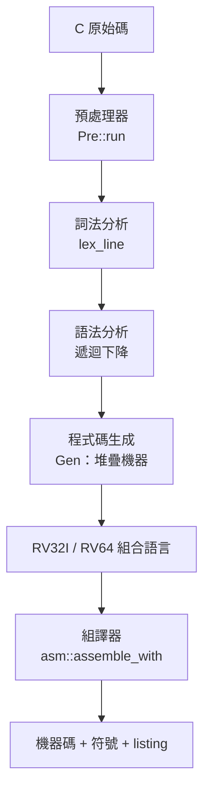
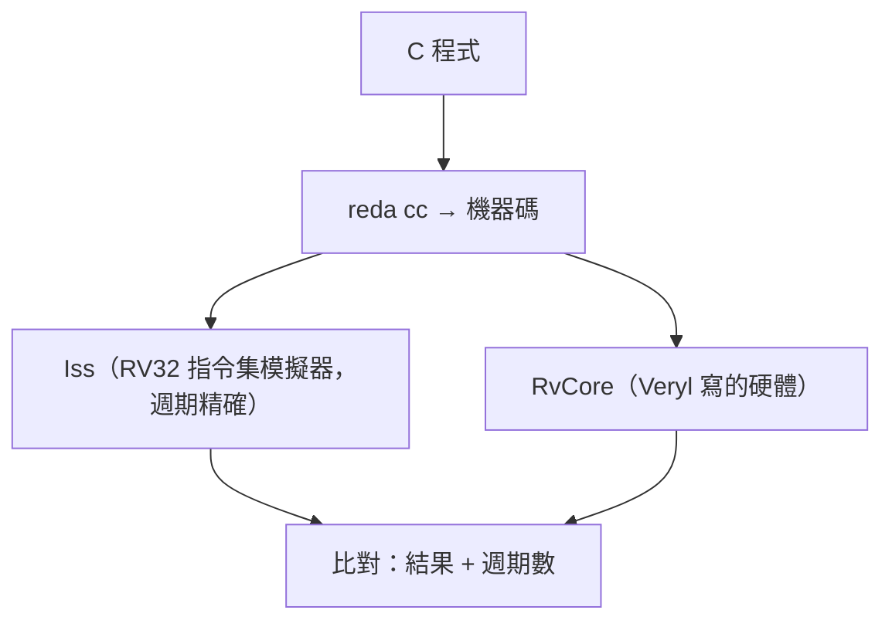

# 7.2 C 編譯器、組譯器與指令集模擬器

> 對應原始碼：`riscv/rvtools/src/cc.rs`、`riscv/rvtools/src/asm.rs`、`riscv/rvtools/src/iss.rs`、`riscv/rvtools/src/prelude.c`
> 上一節：[7.1 RISC-V 指令集與 SoC 結構](07.1-RISC-V指令集與SoC結構.md)　下一節：[7.3 Linux 開機](07.3-Linux開機-從OpenSBI到busybox.md)

---

## 7.2.1 為什麼需要自己的 C 編譯器

GCC 與 Clang 都能交叉編譯 RISC-V。但自己寫一個的理由是：

1. **教學價值**：一個 1700 行的 C 編譯器可以完整讀完；
2. **完全控制**：可以針對這個簡單的 SoC 產生最有效率的碼；
3. **零相依**：整個 workspace 不需要 LLVM。

**限制是明確的**（模組頭註明）：

- 沒有結構体/聯合体/列舉/typedef；
- 沒有浮點；
- 沒有函式指標；
- 最多 8 個參數（加上 `...`）；
- **`char` 是無號的**（依 RISC-V ABI）。

## 7.2.2 編譯器的四個階段



### 7.2.2.1 預處理器

`Pre::run` 的功能：

- `strip_comments`（**保留換行**，所以行號不會跑掉；處理 `\` 續行）；
- `#define`（含參數與 `__VA_ARGS__`）；
- `#undef`；
- `#ifdef` / `#ifndef` / `#if` / `#else` / `#endif`；
- `#include` / `#pragma` **被忽略**（執行期庫永遠存在）。

**巨集展開是遞迴的，用一個 `hide` 清單防止無限遞迴。**

### 7.2.2.2 詞法分析

```rust
enum Tok { Id(String), Num(i64, bool /*unsigned*/), Str(Vec<u8>), P(&'static str) }
```

47 個標點 token（最長優先）。數字支援 `u`/`U`/`l`/`L` 後綴、`0x`/`0b`/八進位/字元常數、**相鄰字串常數的串接**。

### 7.2.2.3 型別

```rust
pub enum Ty {
    Void,
    Char(bool),      // 有號？（char 是無號的，依 RISC-V ABI）
    Short(bool),
    Int(bool),
    Ptr(Box<Ty>),
    Arr(Box<Ty>, Option<usize>),
    Func(Box<Ty>, Vec<Ty>, bool),   // 回傳型別、參數、可變參數
}
```

**`size()`**：void 1、char 1、short 2、int/ptr/func 4、array = 元素 × 個數。
**`align()`** = size 上限 4。

### 7.2.2.4 程式碼生成：堆疊機器

模組頭的說明：

> 程式碼刻意做得簡單且可預期：每個運算式的結果都放在 a0，中間值推入堆疊，區域變數放在 frame 裡（s0 = frame pointer）。每個陳述句前面都有一個帶 C 原始碼行號的註解，所以組合語言可以跟著程式一起讀。

**這是一個重要的教學設計：把 C 與組合語言的對應關係「印」在輸出裡。**

**關鍵常數**：

```rust
/// 參數：8 個字在 s0 - 40 .. s0 - 12（遞增，所以 `...` 參數接在具名參數之後）
const ARGS: i32 = 40;
```

**frame 大小 16 位元組對齊**：

```rust
let frame = (ARGS + self.max_frame + 15) / 16 * 16;
```

**序言**：`addi sp, sp, -frame` / `sw ra, frame-4(sp)` / `sw s0, frame-8(sp)` / `addi s0, sp, frame`。frame ≥ 2048 時用 `t0`/`t1`（因為 12 位元立即數不夠）。

### 7.2.2.5 序言／結語的關鍵細節

**結語絕不讀取 `sp` 以下的位置**：

```rust
v.push("    addi sp, s0, -8".into());
v.push("    lw ra, 4(sp)".into());
v.push("    lw s0, 0(sp)".into());
v.push("    addi sp, sp, 8".into());
v.push("    ret".into());
```

**為什麼？** 因為中斷處理程式會把它自己的 frame 推到 `sp` 以下。如果結語讀取 `sp-4`，而中斷剛好發生在結語期間，**它會讀到被中斷推掉的內容**。

**這個細節在真實系統裡是個經典的 bug 來源。** 把它寫在註解裡說明，是好程式碼的特徵。

### 7.2.2.6 立即數形式的最佳化

`binop_imm` 挑最短的指令：

| 運算 | 選擇 |
|---|---|
| `x + c` | `addi`（12 位元立即數） |
| `x * 2^k` | `slli` |
| `x / 2^k`（無號） | `srli` |
| `x % 2^k` | `andi` |
| `x == 0` | `seqz` |
| `x != 0` | `snez` |
| `x < c` | `slti` / `sltiu` |

### 7.2.2.7 常數折疊

```rust
fn constant(e: &E) -> Option<(i64, Ty)> {
    let v = const_eval(e)?;
    let u = has_unsigned(e);
    if u && v < 0 { return None; }      // 無號運算變負時不折疊
    Some((v, Ty::Int(!u)))
}
```

**「無號運算變負時不折疊」** 是正確性關鍵：無號的負值在 C 裡是實作定義的（實際上是模運算），折疊成一個負的 i64 會產生不同的結果。

### 7.2.2.8 分支折疊

`cond_jump` 處理：

- `!` → 反轉條件；
- `&&` / `||` → **短路跳轉**（用分支實作，不做布林運算）；
- 與零比較 → `beqz` / `bnez`；
- 常數條件 → 恆真或恆假。

**用分支實作 `&&` / `||`** 是重要的：它避免了建立一個 0/1 的值，也讓分支預測器的工作方式自然。

### 7.2.2.9 型別推導

```rust
// type_of 是用「乾跑」模式執行運算式產生器並丟棄輸出來計算的
```

**這是一個簡單但有效的技巧**：既然程式碼生成器已經知道每個運算式的型別，就用它自己來算。

### 7.2.2.10 裸函式

```rust
// 主體只由 asm(...) 陳述句組成的函式，不產生序言／結語
```

**這是寫中斷處理程式與啟動碼的標準技巧。**

### 7.2.2.11 可達性剪枝

```rust
// 產生器記錄每個函式/全局變數引用的符號集合；
// 只有從 main 連通可達的函式（Linux 模式還有 exit，
// 加上頂層組合語言引用的符號）才會被輸出
```

**函式層級的死碼消除**。C 編譯器不做全域最佳化，但這個簡單的剪枝已經省下很多。

### 7.2.2.12 Linux 模式：x32 資料模型

```rust
pub const LINUX_ORIGIN: u32 = 0x10000;
const LINUX_STACK: u32 = 256 * 1024;
```

**RV64 的 Linux 模式用同一個 32 位元資料模型**（int、long、指標都是 4 位元組，x32 風格），但用 `*W` 指令產生 RV64 程式碼。

**轉換是一個函式**：

```rust
/// 計算 32 位元整數（有號延伸）的 RV64 形式之指令
fn w_form(s: &str) -> String {
    let (op, rest) = s.split_once(' ').unwrap_or((s, ""));
    match op {
        "add" | "sub" | "mul" | "div" | "divu" | "rem" | "remu" | "sll" | "srl" | "sra" |
        "addi" | "slli" | "srli" | "srai" | "neg" => format!("{}w {}", op, rest),
        _ => s.to_string(),
    }
}
```

**「W 指令讓暫存器永遠持有 32 位元值（符號延伸）」**，這正是 x32 資料模型需要的語意。

**為什麼用 x32 而不是完整的 LP64？** 因為 **Linux 核心預設假設 64 位元的 `long` 與指標**。用 x32 會讓核心無法啟動。**除非核心也用 x32 編譯。**

### 7.2.2.13 輸出的佈局

```
.text
_start:
    li sp, <mem_size>              # 裸機：堆疊在 RAM 的頂端
    la t0, __bss_start
    la t1, __bss_end
.Lbss:  bgeu t0, t1, .Lmain
        sw zero, 0(t0); addi t0, t0, 4; j .Lbss
.Lmain: call main
_halt:  j _halt
```

Linux 模式：

```
.text
_start:
    la sp, __stack_top
    call main
    call exit
```

外加 `.rodata`（字串常數 `.LS0`、`.LS1`…）、`.data` / `.bss`（全域變數，`.balign` 對齊）。

**bss 清零**是一個必備步驟——C 語言保證未初始化的全域變數是 0。

## 7.2.3 執行期庫

`riscv/rvtools/src/prelude.c`（652 行）**永遠被編譯進去**（檔案索引 0），使用者檔案是索引 1。

### 7.2.3.1 周邊的巨集

```c
#define LED (*(volatile unsigned *)0x10000000)
#define BUTTONS     (*(volatile unsigned *)0x10000004 & 7)
#define SWITCHES    ((*(volatile unsigned *)0x10000004 >> 8) & 255)
#define UART_DATA   (*(volatile unsigned *)0x10000008)
#define UART_STATUS (*(volatile unsigned *)0x1000000c)
#define TIMER       (*(volatile unsigned *)0x10000010)
#define MTIMECMP    (*(volatile unsigned *)0x10000018)
#define VGA_TEXT    ((volatile unsigned *)0x10002000)
#define VGA_FONT    ((volatile unsigned *)0x10004000)
#define VGA_COLOR   ((volatile unsigned *)0x10006000)
```

**`volatile` 是必要的**：沒有它，編譯器可能把對 MMIO 的讀取迴圈最佳化掉（讀一次就好）。

### 7.2.3.2 軟體乘除

```c
// __mulsi3、__udivmod、__udivsi3、__umodsi3、__divsi3、__modsi3
```

**這樣編譯器就不需要 M 擴充**——RV32 目標沒有 M 擴充時也能跑 `int * int`。

### 7.2.3.3 printf

```c
// __emit、__pnum（含基底、寬度、零填充）、putchar、getchar、puts、kbhit、
// delay_ms、millis、rand
```

**一個完整的 printf 實作只有一百多行**，卻讓 C 教學變得完整。

### 7.2.3.4 Linux 系統呼叫

```c
// __syscall：透過 ecall
// open/read/write/close/lseek/unlink/getpid/exit
// malloc/free：brk 風格的配置器
```

## 7.2.4 組譯器

`riscv/rvtools/src/asm.rs` 是一個**兩趟**的 RV32I 組譯器。

### 7.2.4.1 輸出結構

```rust
pub struct Program {
    pub bytes: Vec<u8>,          // 從位址 0 起的映像（不含 bss）
    pub symbols: Vec<(String, u32)>,
    pub listing: Vec<Line>,
    pub end: u32,                // 所有 section 的結束（含 bss）
    pub origin: u32,
}
pub struct Line { pub addr: u32, pub bytes: Vec<u8>, pub line: usize, pub text: String }
pub struct Opts { pub origin: u32, pub rv64: bool }
```

**`listing` 是「位址 + 位元組 + 行號 + 原始文字」**，可以用來產生可讀的 listing 檔。

### 7.2.4.2 Section 佈局

```rust
const SECTIONS: [&str; 4] = [".text", ".rodata", ".data", ".bss"];
let mut base = [opts.origin; 4];
for s in 1..4 { base[s] = (base[s - 1] + off[s - 1] + 3) & !3; }
```

**四個 section 依序排在**同一個平坦映像**裡，從位址 0（或 `origin`）開始，每個 word 對齊。

**平坦映像是對的**，因為 SoC 把整個映像載入 RAM。

### 7.2.4.3 語法

GNU 風格：

- 標籤；
- `#` 與 `//` 註解；
- `off(reg)` 操作元；
- `%hi(...)` / `%lo(...)`；
- `;` 分隔陳述句；
- `.equ` / `.set`、`.align` / `.p2align` / `.balign`；
- `.word` / `.half` / `.byte`；
- `.ascii` / `.asciz` / `.string`；
- `.space` / `.zero` / `.skip`。

### 7.2.4.4 重定位運算

```rust
Part::Hi => ((v + 0x800) >> 12) & 0xfffff,
Part::Lo => ((v & 0xfff) ^ 0x800) - 0x800,     // 符號延伸的低 12 位
```

**`+ 0x800` 是「四捨五入」而不是「截斷」**：這樣 `%hi` 與 `%lo` 的組合在**任何**位址都正確產生一個能被 `addi` 接受的 12 位元立即數。

**`((v & 0xfff) ^ 0x800) - 0x800` 是符號延伸的技巧**：把低 12 位元的最高位翻轉後減去 0x800，等價於把無號的 12 位元轉成有號的。

### 7.2.4.5 偽指令

```
nop, li, la, mv, not, neg, seqz, snez, sltz, sgtz, beqz, bnez, blez, bgez,
bltz, bgtz, bgt, ble, bgtu, bleu, j, jr, ret, call, tail
```

`fence` → `0x0ff0_000f`，`fence.i` → `0x0000_100f`。

**`li` 的大小**：12 位元內或 4096 對齊時用一條指令，否則兩條（`lui` + `addi`）；RV64 上 `lui` + `addiw`。

### 7.2.4.6 RV64 模式

`Opts.rv64` 加入：

- `*W` 指令；
- `ld` / `sd` / `lwu`；
- 64 位元移位；
- 32 位元值的 `li` 用 `addiw`。

### 7.2.4.7 `elf_linux`

```rust
// 最小靜態 ELF64：0x1000 位元組標頭，e_type = ET_EXEC (2)，
// e_machine = EM_RISCV (243)，e_flags = 0（無 C，軟浮點），
// 沒有 section header，一個 PT_LOAD segment（flags R|W|X）
// 在檔案偏移 0x1000，p_vaddr = p.origin，entry = _start
```

**「沒有 section header」** 是靜態可執行檔的常見簡化——核心只需要 `PT_LOAD` 段落。

## 7.2.5 指令集模擬器（ISS）

`riscv/rvtools/src/iss.rs` 是 **RV32IMA 的「週期精確」參考模型**。

> 它像 RvCore 一樣精確地數時脈週期——每個指令 2 個，載入 / LR / AMO 3 個，乘除 35 個，陷入 3 個，`wfi` 直到有中斷待處理，重置後 1 個。

**「週期精確」是關鍵**：它不只是檢查功能正確，而是檢查**時序模型也正確**。這讓它可以驗證硬體的流水線深度。

### 7.2.5.1 狀態

```rust
pub struct Iss {
    pub pc: u32,
    pub x: [u32; 32],
    pub mem: Vec<u8>,
    pub led: u32,
    /// bit 2..0 = BTN3..BTN1，bit 15..8 = 開關
    pub btn: u32,
    pub tx: Vec<u8>,
    pub rx: VecDeque<u8>,
    pub cycles: u64,
    pub instret: u64,
    pub tx_cycles: u64,
    tx_busy_until: u64,
    pub vram: Vec<u8>,      // 40 × 30 字元（2048 個項目）
    pub font: Vec<u8>,      // 128 × 8 列
    pub colors: u32,        // 前景 | 背景 << 16
    pub mie_bit: bool, pub mpie: bool, pub mie: u32,
    pub mtvec: u32, pub mscratch: u32, pub mepc: u32, pub mcause: u32, pub minstret: u32,
    resv: Option<u32>,
    mtime_off: u32, pub mtimecmp: u32, pub msip: bool, pub wfi: bool,
}
```

**VGA 文字記憶體是 2048 個字元（40 × 30）**，字型是 128 個字元 × 8 列。

### 7.2.5.2 週期會計

```rust
let mut cyc = 2;                          // 預設
// 載入、LR/SC、AMO：cyc = 3
// M 擴充的乘除：cyc = 35
// 陷入：self.cycles += 3;   // 處理器的 Decode, Exec, Fetch
```

**「陷入花 3 個週期」** 是硬體的典型值（處理器把 PC 送到 trap handler 需要一個管線排空）。

### 7.2.5.3 計時器

```rust
// mtime = cycle + mtime_off
// 寫入計時器暫存器會設定偏移量，讓新值從「下一個週期」開始生效
self.mtime_off = v.wrapping_sub((t + 1) as u32);
```

### 7.2.5.4 UART

一個位元組每 `tx_cycles`；狀態暫存器 bit 0 = 忙碌，bit 1 = 收到一個位元組。

### 7.2.5.5 AMO 的保留集

```rust
// LR/SC 的保留是一個 resv: Option<u32>
// AMO 的寫入發生在 Mem 週期
self.store(addr, new, 15, e + 1);
```

### 7.2.5.6 陷阱的優先順序

RvCore 的順序：

1. 中斷（代碼 11/3/7 → MEIP/MSIP/MTIP）
2. 非法指令（`trap(2)`）
3. `ecall`（`trap(11)`）
4. `ebreak`（`trap(3)`）
5. 載入未對齊（4）
6. 存儲未對齊（6）
7. 錯誤的跳轉目標（0）

**中斷優先於所有例外**——這與 RISC-V 規格一致。

### 7.2.5.7 執行迴圈

```rust
// run(max) 在 pc 不再前進且沒有中斷可以喚醒時回傳 true（"j ." 的停止迴圈）
```

**「`j .` 是一個自我跳轉的無限迴圈」** 是嵌入式軟體常見的結束方式。

## 7.2.6 CLI

```
reda cc PROG.c [-o PROG.bin] [-S PROG.s] [-L PROG.lst] [--run [N]] [--mem BYTES] [--linux]
```

- `.s` / `.S` 輸入直接送給組譯器；
- `--run N` 在 `Iss` 上執行映像並印出 UART 輸出與 LED 的值；
- `--mem BYTES` 設定 RAM 大小。

## 7.2.7 三層驗證



**ISS 的「週期精確」讓它不只是功能參考，也是效能參考。**

這是硬體驗證的黃金模式：**先寫一個可執行的規格（ISS），再用它來驗硬體。**

---

**下一節**：[7.3 Linux 開機：從 OpenSBI 到 busybox](07.3-Linux開機-從OpenSBI到busybox.md)
