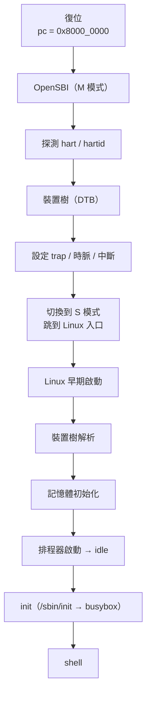
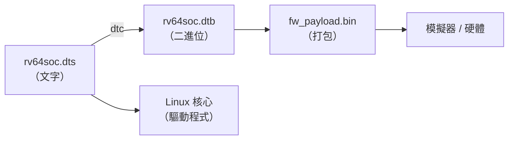
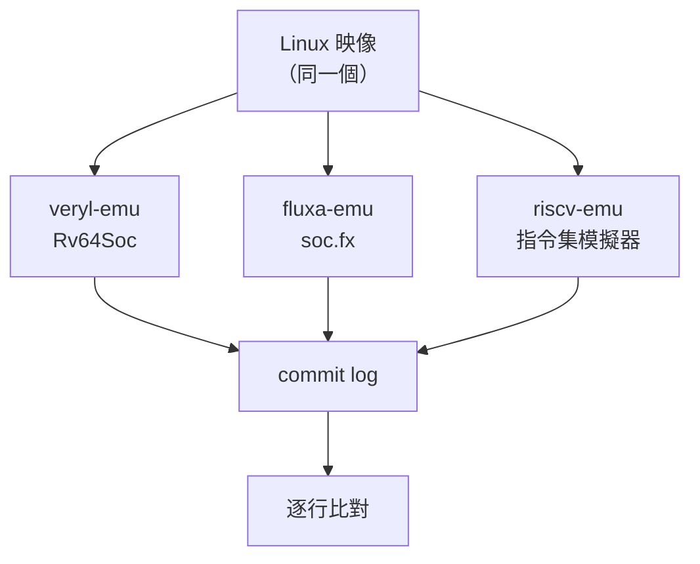

# 7.3 Linux 開機：從 OpenSBI 到 busybox

> 對應原始碼：`riscv/rvemu/src/lib.rs`（ELF 載入）、`riscv/rvemu/src/cli.rs`、`veryl/examples/rv64/linux/`、`docs/note/emu-compare.md`
> 上一節：[7.2 C 編譯器、組譯器與指令集模擬器](07.2-C編譯器組譯器與指令集模擬器.md)

---

## 7.3.1 一顆 RISC-V 晶片上 Linux 的開機鏈



**整個過程在模擬器裡完全不需要特殊支援**——這是「把模擬器做成真實的 SoC」的價值。

## 7.3.2 載入程式

```rust
// riscv/rvemu/src/lib.rs
pub fn load_program(&mut self, f: &[u8]) -> Result<(), String> {
    match elf_segments(f) {
        Some((segs, tohost)) => {
            for (a, b) in segs { self.load(a, &b)?; }
            self.bus.tohost = tohost;
            Ok(())
        }
        None => self.load(RAM_BASE, f),
    }
}
```

**兩種格式的自動偵測**：

- **ELF64**（`\x7fELF`、class 2）：載入 `PT_LOAD` 段落到他們的 `paddr`；
- **其他**（原始映像）：載入到 `RAM_BASE`。

**`elf_segments()` 同時掃描 ELF 符號表，找一個叫 `tohost` 的符號**（riscv-tests 慣例），回傳它的位址。

**OpenSBI 的 `fw_payload.bin` 不是 ELF**（它是 firmware + 裝置樹 + Linux 核心 + initramfs 打包在一起），所以它被載入 `0x8000_0000`，hart 從那裡開始執行。

## 7.3.3 裝置樹

Linux 需要知道它面對的硬體。**裝置樹（Device Tree）** 是一個描述硬體的資料結構。

`veryl/examples/rv64/linux/rv64soc.dts` 描述：

- CLINT；
- PLIC；
- 16550 序列埠；
- 256 MB RAM；
- `sifive,test0` 電源關閉裝置。



**有了正確的裝置樹，Linux 的 `gpio-sifive` 驅動、8250 序列驅動、`syscon` 電源關閉全部可以 unmodified 地工作。**

**這是「模擬器必須精確模擬裝置語意」的 payoff**：如果模擬器的 PLIC 或 CLINT 語意有一點偏差，Linux 就會卡住。

## 7.3.4 模擬器與硬體的差異

只有一個：

> **the `cycle` CSR**：硬體數時脈週期，模擬器數指令。

其他都是一樣的。這是「指令集模擬器」與「週期精確模擬器」的根本取捨——**指令集模擬器更快，但沒有時序資訊。**

**RV32 的 ISS 是週期精確的**（第 7.2.5 節），所以它可以做效能比對。

## 7.3.5 速度

從 `riscv/rvemu/README.tw.md`：

| 工作 | 模擬器 | 對比 |
|---|---|---|
| Linux 開機 | 約 1.6 秒 | Verilator 50 秒 |
| xv6 `usertests`（285 億指令） | 5.6 分鐘 | |

**「Verilator 50 秒 vs 模擬器 1.6 秒」** 這個對比會讓人驚訝，但它是可解釋的：

1. **開機程式幾乎沒有分支**（大部分是巨頁的複製與位元組搬移），**指令集模擬器每次指令的成本很低**，而 Verilator 的每個事件都要走完整的訊號傳播；
2. **Linux 的開機是一段一次性的程式**，不是迴圈密集的程式。

**Verilator 在「長時間、大量分支」的程式上會贏**，因為那時訊號傳播的成本被分支預測與快取攤薄了。

**這個對比說明了一件重要的事：沒有「最快」的模擬器，只有「對某類工作最快」的模擬器。**

## 7.3.6 commit log 對比：一個強烈的驗證方法

`riscv/rvemu/src/cli.rs` 有一個 `-t` 選項，**印出每一條指令**，格式與 spike 的 `--log-commits` 相同：

```
core   0: 3 0x0000000080000000 (0x00000013) x2  0x0000000000000000
```

**這個格式的存在，是為了能與 RTL 執行的結果逐行 diff。**

```sh
# 從硬體（RTL 模擬）產生 commit log
# 從指令集模擬器產生 commit log
diff spike.log rtl.log
```

**如果兩份 log 完全一樣，那麼硬體與規格是等價的。**

這個方法在 `fluxa/rv64/linux/test.sh` 裡被用到：

> `fluxa/rv64/linux/soc.fx` 是用 Fluxa 寫的 RV64 板（Linux 開得起來）：它遵循 `riscv/rvemu`（cpu.rs、bus.rs），所以 `fluxa/rv64/linux/test.sh` **逐行比較它們的 commit log**。

**這是本書中最強的驗證方法之一**：不是比對「最終結果」，而是比對「執行的每一條指令」。任何微小的時序或語意差異都會被捕捉。

## 7.3.7 xv6：從作業系統課本到真實核心

xv6 是 MIT 的作業系統課程教材，一個用 C 寫的完整的小核心。

**把 xv6 跑在自己的硬體上** 需要：

1. 一個能開 Linux 的核心（相容於 Linux 啟動協定的 SBI）；
2. 或者直接用 rvemu 執行。

`veryl/history.md` 記錄了這個過程：

| 版本 | 內容 |
|---|---|
| v2.4 | xv6 開到 shell |
| v2.11 | Linux 有 shell 了（busybox） |
| v2.26 | 哪個能按、先按哪個（IDE 的互動改進） |

**從 xv6 到 Linux 的跨越**是關鍵的里程碑：xv6 需要的是「核心 + shell」，Linux 需要的是「SBI 介面 + 裝置樹 + 完整的 UEFI 風格啟動」。

## 7.3.8 busybox：一個 busybox 的 busybox

**busybox** 把 dozens 個 Unix 工具合成一個小執行檔。開到 busybox 的 shell 就代表：

- 檔案系統可用了；
- `execve` 可用了；
- 行程與訊號可用了；
- 系統呼叫的 ABI 可用了。

**這是一個非常有效率的「完整性檢查」**：如果 busybox 的 `ls` 能列出檔案，那麼幾乎所有東西都對了。

## 7.3.9 開機快照

Linux 開機要 1.6 秒。在 IDE 裡每次都等 1.6 秒是不可接受的。

**快照機制**：

```rust
// rv_save() 的格式：
// magic "RVEM"，u32 字數，u64 的字（狀態），
// 對每個非零的 4 KB RAM 頁：u32 頁索引 + 4096 位元組
```

**只有非零的頁被儲存。** Linux 開機後 RAM 大部分是零（或重複的內容），所以快照很小。

**「快照開機」**（history.md v2.17）讓 IDE 可以：

1. 第一次啟動時跑完整開機並存快照；
2. 之後直接載入快照。

**這是「把慢的東西快取起來」的經典應用**，而且是安全的——因為快照包含了完整的 CPU 狀態 + RAM。

## 7.3.10 IDE 的互動

開到 shell 之後，還需要能「打字進去」。history.md 記錄了這個過程：

| 版本 | 內容 |
|---|---|
| v2.15 | 開發板 1，GPIO |
| v2.16 | 開發板 2，IDE 裡的虛擬開發板 |
| v2.17 | 開發板 3，快照開機 |
| v2.18 | 開發板 4，檔案進出板子 |
| v2.19 | 開發板 5，MicroPython |
| v2.20 | 開發板 6，C 程式 |
| v2.21 | 開發板 7，螢幕 |
| v2.30 | 鍵盤按按鈕 |

**「檔案進出板子」** 需要檔案系統支援：`files: { addr: '0x8F000000', size: 16777216 }`（一個 16 MB 的區域）。

**「螢幕」** 需要 framebuffer：`fb: { addr: '0x8EF00000', width: 320, height: 240 }`。

## 7.3.11 兩種語言的 Linux

**這是本章最值得講的整合。**

| | Veryl | Fluxa |
|---|---|---|
| SoC 原始碼 | `veryl/examples/rv64/src/rv64soc.veryl` | `fluxa/rv64/linux/soc.fx` |
| 模擬器 | veryl-emu（編譯成 wasm） | fluxa-emu |
| Linux 映像 | **同一個** OpenSBI + Linux + busybox | **同一個** |

**Fluxa 的版本值得特別說明。** Fluxa 是一個「資料流」語言，要用它寫一個 RV64 核心，需要：

- 不同的模組結構（task 而非 always_ff）；
- 用通道表達流水線的各階段；
- 用 `@reg` 表達移位暫存器；
- 用 `carry` 表達累加器。

**而它成功了。** `fluxa/docs/v0.3.md` 記錄了 M1–M6 的里程，每一個都有「實作筆記」記錄**偏離計畫的地方**。

### 7.3.11.1 設計的逆轉：沒有獨立的 Translate task

**計畫原本想做**：一個 TLB + 頁表 walker 作為獨立的 task。

**為什麼不行？** 因於 **KPN 禁止非阻塞接收**。`Mem` task 無法在「管線埠」與「walker 埠」之間做仲裁。

**實際的解法**：**位址轉換住在 `Decode` 裡**，TLB 是一個 `mem`，而頁表 walker 是**帶內（in-band）的 token**：

```text
C_PTW_R / C_PTW_W
```

這些 token 流經 `Execute` 到 `Mem`，因此**自動排在所有先前的存儲之後**。所以「寫 PTE，然後 `sfence.vma`」天然地正確。

**在 walker 之前，記分板（scoreboard）會被清空**，所以下一個寫回 token 一定是 walker 的結果——**不需要新增任何通道**。

> **這是一個精彩的例子：語言的決定性限制（不能有非阻塞）反而導致了更好的設計。** 帶內 token 是「所有存儲都有序」的保證，而這正是硬體上正確的做法。

### 7.3.11.2 120 位上限的兩個後果

**`sll64` 用兩次位移加中間環繞完成。**

**`mul_hi_lo` 用 32 位的學校乘法分塊完成**——因為 `a*b` 直接算會超過 $`2^{128}`$ 。

### 7.3.11.3 `wrap` 是模，不是符號延伸

```text
.wrap::<u32>().wrap::<u64>() 不做符號延伸
```

**W 指令需要 `.wrap::<i32>().wrap::<u64>()`**——先截成 32 位（有號解讀），再零延伸到 64 位。

**這是一個非常細微的差異，但錯了就會讓整個核心的行為不對。**

### 7.3.11.4 中斷只在等待點被接受

**M6 里程的決定。**

**問題**：如果中斷在任何地方都可以被接受，陷阱目標會待在 redirect 通道裡，而 `Fetch` 已經預取了下一條指令。

**M2 的教訓**（原始碼的說法）：

> Fetch 也必須停等 redirect；否則陷阱後 Fetch 已順序取入的下一條會洩漏進管線…甚至觸發第二個陷阱**覆蓋 mepc/mtval**

**解法**：為了保證「一定存在一個等待點」，**連 `JAL` 都被改成會停等**。

**「連 JAL 都要停等」** 是一個很不尋常的設計，但它保證了中斷的正確性。

### 7.3.11.5 寫回深度的死結

**繼承自 rv32i 的 bug**（刻意保留作為教材）：

`Decode` 只在資料相依或排空時才拿寫回 token，所以連續超過 `WBD + 3` 個獨立寫回會把整條管線卡死。

**它是被 `interrupt_determinism` 測試（`WBD = 2`）抓到的。**

`rv32i` 刻意保留這個 bug，作為 `err_wb_depth.fx` 的展示。

> **「把 bug 保留成教材」是一種值得尊敬的教學選擇。** 刪掉它，學生就學不到「為什麼管線深度與 FIFO 深度有關」。

## 7.3.12 完整驗證矩陣



**「同一個 Linux 映像、三個引擎、逐行比對 commit log」** 是這個專案最強的驗證。

它同時驗證了：

- Veryl 的硬體描述正確性；
- Fluxa 的硬體描述正確性；
- 網表 IR 的技術無關性；
- 兩個前端的一致性；
- 指令集模擬器與硬體的等價性。

**一個測試，五個結論。**

## 7.3.13 效能數據

| 引擎 | 速度 | 備註 |
|---|---|---|
| riscv-emu（Rust，JIT 關） | 約 44 MIPS | 開機 1.7 秒 |
| riscv-emu（wasm + JIT） | 約 176 MIPS | 開機 1.6 秒，穩態 4 倍加速 |
| fluxa-emu（wasm） | 約 430 萬指令/秒 | 開機 6.0 秒 |
| veryl-emu（wasm） | 約 500 萬指令/秒 | 瀏覽器內 |

**「指令集模擬器比編譯模擬器慢」** 表面上看起來奇怪，但可以解釋：

- **指令集模擬器每次指令要走一個完整的 switch 分派**，而且要處理特權層、TLB、陷入；
- **編譯模擬器把整個程式編譯成 wasm**，wasm 的執行速度接近原生。

**所以「指令集模擬器快」這個直覺只在「對比硬體模擬」時成立。** 對比編譯模擬器，它是慢的。

第 8 章會深入這個主題。

---

**下一章**：[第 8 章 快速模擬與 WebAssembly](08.1-veryl-emu-週期式編譯模擬.md)
