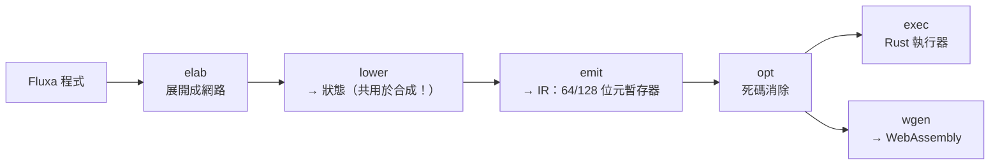

# 8.2 fluxa-emu：狀態機到程式碼

> 對應原始碼：`fluxa/emu/src/elab.rs`、`fluxa/emu/src/emit.rs`、`fluxa/emu/src/ir.rs`、`fluxa/emu/src/opt.rs`、`fluxa/emu/src/exec.rs`、`fluxa/emu/src/wgen.rs`、`fluxa/emu/src/wasm.rs`、`fluxa/docs/emu-plan.md`
> 上一節：[8.1 veryl-emu：週期式編譯模擬](08.1-veryl-emu-週期式編譯模擬.md)

---

## 8.2.1 動機

`fluxa/docs/emu-plan.md` 的開頭把問題講得很清楚：

> Fluxa 模擬器（`fluxa/sim`）是直譯器：每個運算走一次語法樹（async、boxed future），變數查雜湊表，值是 `i128` 的 enum，每個 task 是一條執行緒、通道操作要加鎖。**RV64 上每秒約一萬個指令，開 Linux 要兩小時。**

**每秒一萬個指令** vs 目標的**每秒幾百萬**——這是 300 倍的差距。

**直譯器慢在哪裡？**

| 開銷 | 說明 |
|---|---|
| 語法樹走訪 | 每個運算都是一次 AST 節點的分派 |
| boxed future | 每個遞迴呼叫一次堆積配置 |
| `i128` 的 enum | 每個值是一個 heap 分配的 enum |
| 執行緒 + 鎖 | 通道操作要鎖 mutex + 條件變數 |
| async 輪詢 | 每個 await 點都是一次 future 的 poll |

## 8.2.2 關鍵洞察：降階已經做好了

**Fluxa 的合成流程已經把 task 降階成「狀態」了**（第 4.3 節的 `lower.rs`）。



**「lower 這一步同時被合成器與模擬器使用」** 是整個設計的關鍵。

**為什麼這很重要？**

因為它意味著：

1. **模擬器跑的邏輯與硬體跑的邏輯是同一份**——不是兩種語意的兩次實作；
2. **不需要重新發明一套編譯策略**——合成器的降階已經把順序程式變成了狀態機。

**但這也意味著一個取捨**（第 8.2.8 節會詳述）：編譯模擬器不會像硬體那樣「切狀態」，所以它的狀態數與硬體不同。

## 8.2.3 `elab`：展開成網路

```rust
pub struct Leaf { pub task: String, pub path: String, pub args: Vec<(String, Arg)> }
pub struct NetChan { pub name: String, pub elem: RtType, pub depth: usize }
pub struct Net { pub leaves: Vec<Leaf>, pub chans: Vec<NetChan> }
pub enum Arg { Chan(usize), Val(Value) }
```

**用「錄影」技巧**（第 4.3.3 節）：用一個 recording provider 取代真正的硬體任務，記錄所有 `spawn`。

**與 `graph.rs` 的差別**：`graph.rs` 是**遞迴**的（深度限制 16），因為合成需要完整的實例樹。

## 8.2.4 `ir`：執行器的 IR

```rust
pub enum K { N, W }        // 64 位元或 128 位元暫存器
pub enum BOp { Add, Sub, Mul, And, Or, Xor, Shl, ShrS, ShrU, DivS, DivU, RemS, RemU,
                Eq, Ne, LtS, LtU, LeS, LeU }

pub enum Op {
    Const(Reg, i128), Mov(Reg,Reg), Load(Reg,Addr), Store(Addr,Reg),
    Bin(BOp, Reg, Reg, Reg), Ext(Reg,Reg,bool), Low(Reg,Reg), Sel(Reg,Reg,Reg,Reg),
    If(Reg, Vec<Op>, Vec<Op>), Trap(u32), Copy(Addr,Addr,u32), Zero(Addr,u32),
}
pub enum Term { Goto(u32), Branch(Reg,u32,u32), Halt,
                Recv { port: u32, closed: Option<u32>, next: u32 },
                Send { port: u32, next: u32 }, Close { port: u32, next: u32 },
                CloseOwned { port: u32, next: u32 } }
pub struct State { pub ops: Vec<Op>, pub term: Term, pub at: String }
pub struct Code { name, regs: Vec<K>, frame: u32, states: Vec<State>, ports: Vec<Port>,
                  init: Vec<(u32,K,i128)>, data: Vec<(String,u32,Vec<K>,u32)>,
                  traps: Vec<String>, mems: Vec<(String,u32,K,u32)> }
```

**`Term` 幾乎就是合成器的 `Term`**（第 4.3.5 節）——`Recv`、`Send`、`Close`、`CloseOwned`、`Goto`、`Branch`、`Halt`。

**唯一的差別**：`Op::If(cond, then, else)` 是**真的分支**，而不是 mux。

## 8.2.5 `emit`：從降階的區塊到程式碼

`fluxa/emu/src/emit.rs`（1904 行）。

### 8.2.5.1 寬度的選擇

```rust
pub fn kind(lo: i128, hi: i128) -> K { if int_bits(lo, hi) <= 64 { K::N } else { K::W } }
```

**「由值域決定暫存器寬度」**——這是 Fluxa 的型別系統直接給的。**大部分的值即使在 120 位的語言裡，也只佔 64 位元。**

**128 位的暫存器**用兩個 i64 區域變數（低/高）表示。

### 8.2.5.2 變數住在 frame 裡

**狀態之間，變數住在實例的 frame（一個位元組陣列）裡。** 一個狀態在開始時把用到的變數載入暫存器，在結束時把改變的存回去。

**這是「暫存器配置」的簡化版**——沒有做完整的暫存器分配，但變數在狀態之間的儲存位置是靜態的。

### 8.2.5.3 函式內嵌

**函式呼叫被內嵌**；它們的區域變數成為暫存器（`depth`、`rename` 計數器）。

### 8.2.5.4 分支而不是多工器

`emu-plan.md` 的設計說明：

> 運算式的值域、轉換、常數摺疊照 `gen`（合成）的規則，但 **`gen` 做多工器的地方這裡真的分支**：`if` 就是 `if`，用執行期索引的陣列就是一次 load。

**這個差異是重要的**：

| | 合成（硬體） | emu（軟體） |
|---|---|---|
| `if c { x } else { y }` | mux | 分支 |
| `arr[i]`（i 是執行期） | mux 樹 | 一次 load |

**因為在軟體裡，分支與間接存取都比重算兩邊便宜。**

### 8.2.5.5 執行期檢查被保留

```rust
// 越界的落地點、索引越界、除以零，都變成 Op::Trap(k)，訊息在 Code::traps 裡
```

**這些在硬體上不存在**（硬體上越界只是讀到別的位元）。**保留它們是為了讓行為模擬與硬體模擬的差異可以被偵測。**

**這是一個刻意的選擇**：如果硬體模擬器不報錯，那麼「硬體上的 bug」就無法與「模擬器的行為」區分開。

### 8.2.5.6 常數陣列變成 ROM

**常數陣列放在 frame 裡**（所以是 ROM）。**陣列參數變成 `Code::data`**，在實例啟動時載入。

## 8.2.6 `opt`：死碼消除

`fluxa/emu/src/opt.rs`（66 行）。

```rust
fn dce(ops: &mut Vec<Op>, live_out: &HashSet<Reg>) -> HashSet<Reg> {
    for k in (0..ops.len()).rev() {
        if let Op::If(c, t, f) = &mut ops[k] {
            let lt = dce(t, &live); let lf = dce(f, &live);
            if t.is_empty() && f.is_empty() { keep[k] = false; continue; }
            live = lt; live.extend(lf); live.insert(c); continue;
        }
        if let Some(d) = &def(&ops[k]) {
            if !live.contains(d) { keep[k] = false; continue; }
            live.remove(d);
        }
        // ...
    }
}
```

**反向的活性分析**（從出口往回）。**`If` 的兩個分支分別處理**，然後合併存活集合。

**「兩個分支都空的 `If` 被移除」** 是自然的結果。

## 8.2.7 `exec`：Rust 執行器

```rust
pub struct Exec {
    pub m: Machine, pub mem: Vec<u8>, pub frames: Vec<u32>, pub chans: Vec<u32>,
    pub tok: Vec<u32>, pub states: Vec<u32>, pub halted: Vec<bool>, pub regs: Vec<i128>,
    pub error: Option<String>, pub steps: u64, pub prof: Option<...>,
}
```

**一切都在一個位元組陣列裡**（`mem`），通道是記憶體裡的環形緩衝區。

```rust
pub fn run(&mut self, budget: u64) -> bool {
    loop {
        let mut moved = false;
        for i in 0..self.m.insts.len() {
            if self.halted[i] || self.error.is_some() { continue; }
            if self.step(i, 4096) { moved = true; }      // 每個實例跑到阻塞為止
        }
        if !moved || self.error.is_some() { return any; }
    }
}
```

**「每個實例跑到阻塞為止」** 是协作式排程的典型做法：給一個實例 4096 個步驟的預算，它跑到阻塞或預算用完。

**通道操作**：

- `Term::Recv` 把 token 從環形緩衝區複製到 frame 裡的埠緩衝區（`mem.copy_within`）；
- `Term::Send` 反過來。

**`FLUXA_EMU_PROF`** 開啟每個 (實例, 狀態) 的操作剖面，離開時印出。

## 8.2.8 `wgen`：WebAssembly 後端

### 8.2.8.1 wasm 編碼器

`fluxa/emu/src/wasm.rs` 是另一個手寫的編碼器（與 veryl/emu 的不同實作）：

- 支援第 1、3、5、7、10、11、12 段（型別、函式、記憶體、全域、匯出、程式碼、資料）；
- 支援任意函式型別；
- 支援多值回傳；
- 支援資料段；
- 支援 `memory.copy`。

**「兩個獨立的 wasm 編碼器實作」** 又是一次「同一格式、兩份實作」——它們可以互相驗證（產生的 wasm 都能被同一個引擎執行）。

### 8.2.8.2 一個程式碼一個 step 函式

```rust
/// 一個程式碼一個 step 函式，br_table 跳到狀態
fn step(code: &Code, ci: usize) -> Func {
    let f = Func::new(&format!("step_{}_{}", ci, code.name), FType(vec![I32, I32], vec![I32]));
    g.f.loop_();
    for _ in 0..k { g.f.block(); }
    g.f.get(g.s); g.f.op(0x0e).u(k as u64);   // br_table
    for i in 0..k { g.f.u(i as u64); }
    // ...
}
```

**用 `br_table` 做狀態分派**：這是一個經典的最佳化——**跳轉表比一串比較快得多**。

**暫存器是 i64 區域變數；W 暫存器是兩個區域變數（低/高）。**

### 8.2.8.3 128 位元輔助函式

| 函式 | 演算法 |
|---|---|
| `mul128` | 32×32 分解的學校乘法 |
| `shl128` / `shr128` | 跨 limb 的移位 |
| `div128` / `rem128` | **位序列長除法**（128 次迭代），符號另外處理 |

**`div128` 用位序列長除法**：因為 wasm 沒有 128 位元除法指令。**128 次迭代**是慢的，但 128 位元除法在硬體上也罕見。

### 8.2.8.4 跳轉的最佳化

```rust
// wasm 裡往後面狀態的跳躍直接 br（不分派；只在往回跳時看預算）
```

**這是 E3 里程碑的最佳化。**

**「往回跳才檢查預算」** 的理由：向前跳表示「這個狀態的剩餘工作一定會完成」，所以不需要檢查；往回跳表示繞回來，可能無限循環，所以要檢查。

**結果**：

| 里程碑 | 內容 | 結果 |
|---|---|---|
| E1 | elab、emit、opt、Rust 執行器、`reda emu x.fx` | 每個範例/RV32I/RV64 測試都與模擬器相符；37 萬指令的 RV64 迴圈：模擬器 1247 秒 vs 執行器 **30 秒** |
| E2 | wasm 後端、Node harness、`reda emu -o x.wasm` | 222 個機器重放；RV64 在 Node 約 **234 萬指令/秒**（Rust 執行器的 17 倍） |
| E3 | 前向跳 `br`、task 變數寫穿 | Linux 開機 9.7 → **6.0 秒**；每指令約 770 → 約 430 個操作；瀏覽器約 **500 萬指令/秒** |

**「Rust 執行器 30 秒 → wasm 6.0 秒」** 這個 5 倍的差距來自 wasm 的 JIT（瀏覽器與 Node 都用 tiering JIT 編譯 wasm）。

## 8.2.9 fluxa-emu 與硬體的差異

`emu-plan.md` 裡有一個非常重要的註記：

> fluxa-emu **不會**像硬體那樣切狀態（記憶體存取不是它自己的狀態；沒有通道的 `serial for` 會被展開）；hart 狀態 231 → 165；每指令的轉換 42 → 34

**意思是什麼？**

硬體上，一個記憶體存取需要一個獨立的狀態（因為要等 BRAM 的讀取延遲）。**fluxa-emu 裡，記憶體存取只是一次 load，不需要一個狀態。**

**所以 fluxa-emu 的狀態數比硬體少，執行速度比硬體快。** 這是「模擬器不是硬體」的直接後果。

**但可觀察的行為必須相同。** 這就是 `fluxa/emu/tests/agree.rs` 的作用：

> fluxa-emu must give the Fluxa simulator's results: `fluxa/emu/tests/agree.rs`（逐一測試比對）、`fluxa/emu/tests/wasm.sh`（WebAssembly 重放執行器的 token）

**兩個層次的驗證**：

1. **Rust 執行器 vs 直譯模擬器**（`agree.rs`）；
2. **wasm vs Rust 執行器**（`wasm.sh` 重放 token）。

**第二層特別重要**：因為 wasm 編譯器與 Rust 執行器是兩份實作，「重放 token」驗證的是「wasm 產生的程式碼與 Rust 執行器的語意一致」。

## 8.2.10 里程碑

| 里程碑 | 內容 | 狀態 |
|---|---|---|
| E1 | 展開、emit、opt、Rust 執行器 | ✓ |
| E2 | wasm 後端、Node harness | ✓ |
| E3 | 前向跳 `br`、變數寫穿 | ✓ |
| E3b | 認識到「emu 不是硬體」 | ✓ |
| L1 | `fluxa/rv64/linux/soc.fx`（用 Fluxa 寫的 Rv64Soc） | ✓ 開同一個 OpenSBI+Linux 映像；前 100 萬指令的 commit log 與 riscv-emu 逐行相符；8450 萬指令 9.8 秒（860 萬/秒） |
| L2 | IDE 的第三個引擎（`web/src/fx_machine.ts`） | ✓ Fluxa 板子開到 shell，跑 MicroPython、C、GPIO、螢幕 |

## 8.2.11 兩個編譯模擬器的對照

| | veryl-emu | fluxa-emu |
|---|---|---|
| 來源語意 | 週期式（RTL 的 `always_ff`） | 狀態機式（task 的 FSM） |
| 中間表示 | 型別化運算式 IR | 狀態 + 操作 IR |
| 非阻塞 | 影子副本 + 寫入佇列 | 狀態之間的值在 frame 裡 |
| 分派 | 函式呼叫 | `br_table` |
| 記憶體 | 線性記憶體 + 位元組 | frame 裡的 byte 陣列 |
| 分支 | 沒有（組合邏輯是資料流） | 有（`Op::If`） |
| 通道 | 沒有（RTL 沒有通道） | 記憶體裡的環形緩衝區 |

**根本差異**：Veryl 是「資料流 + 時脈」，所以 emu 是「每個時脈重算受影響的部分」；Fluxa 是「控制流 + 通道」，所以 emu 是「狀態機跳轉」。

**這印證了一個普遍規律：編譯模擬器的結構必須反映被模擬語言的結構。**

## 8.2.12 決定性的實際影響

**KPN 的決定性讓 fluxa-emu 的「排程」變成一個可以最佳化的對象。**

因為輸出與排程無關，所以「每個實例跑到阻塞為止」這個簡單的排程策略是安全的。**如果語言有非阻塞操作，這個策略就會改變結果。**

**所以 Fluxa 的語言決定直接決定了模擬器架構。** 這是「語言影響工具」的最好例子。

---

**下一節**：[8.3 瀏覽器裡的 JIT](08.3-瀏覽器裡的JIT.md)
