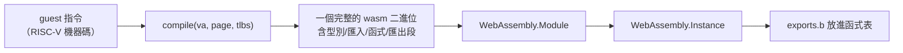

# 8.3 瀏覽器裡的 JIT

> 對應原始碼：`riscv/rvemu/src/jit.rs`、`riscv/rvemu/src/wasm.rs`、`web/src/rv_machine.ts`
> 上一節：[8.2 fluxa-emu：狀態機到程式碼](08.2-fluxa-emu-狀態機到程式碼.md)

---

## 8.3.1 三種引擎

瀏覽器裡有三個模擬引擎，共用同一個介面：

| 引擎 | 類別 | 背後 |
|---|---|---|
| `veryl` | `Machine`（`emu_machine.ts`） | veryl-emu：Veryl 設計編譯成的 wasm |
| `riscv` | `RvMachine`（`rv_machine.ts`） | riscv/rvemu（含 JIT）編譯成的 wasm |
| `fluxa` | `FluxaMachine`（`fx_machine.ts`） | fluxa-emu：Fluxa 網路編譯成的 wasm |

三者都提供：`load(bytes, addr?)`、`reset()`、`clear()`、`writeArea()` / `readArea()`、`screen()`、`input(bytes)`、`setGpio(bits)`、`snapshot()` / `restore(data, cycle)`、`step(max)`。

**「共用介面」的價值**：worker 與 Node 測試都能驅動任何一個引擎。

## 8.3.2 JIT 的模型：TCG

`riscv/rvemu/src/jit.rs` 實作一個 **TCG（Tiny Code Generator）風格**的 JIT。

**TCG 的核心思想**（TCG 是 QEMU 的核心）：

> 把一個基本區塊翻譯成一段主機程式碼，執行它，然後在需要時跳回解譯器。

**TCG 的三個部分**：

1. **翻譯塊（Translation Block, TB）**：一串以控制流轉移結束的指令；
2. **程式碼緩衝區（Code Buffer）**：存放翻譯出來的主機程式碼；
3. **查表（lookup）**：從 guest 位址查到翻譯塊。

## 8.3.3 基本區塊

```rust
// 一個基本區塊：不超過 MAX_INSNS = 64 條指令，
// 全在同一個 4 KB 頁內，以跳轉/分支結束，或在不可翻譯指令之前結束
```

**限制在同一個頁內**是因為**頁是記憶體保護與 TLB 失效的單位**。跨頁的區塊在頁界改變時需要額外的處理。

**64 條指令的上限**是一個平衡：太長的區塊比較難最佳化；太短的區塊翻譯開銷相對較大。

## 8.3.4 生成的模組

**每個基本區塊變成一個「小 wasm 模組」的一個函式**，匯出為 `"b"`，簽章是 `(m: i32) -> i32`：

- 參數是 `Machine` 的指標；
- 回傳值是退出的指令數。



**匯入的三個 helper**：

```rust
pub const HELP_LD: u32 = 0;   // ld(m, va, f3) -> i64
pub const HELP_ST: u32 = 1;   // st(m, va, v, f3)
pub const HELP_AR: u32 = 2;   // ar(a, b, kind) -> i64
```

**為什麼需要 helper？**

1. **陷入**：頁面錯誤、存取錯誤、算術例外需要慢速路徑；
2. **原子操作**：AMO 需要硬體保證；
3. **乘除**：`MULH`、`DIV` 等在 wasm 裡沒有直接對應（wasm 有 `i64.div_u` 但沒有 `mulhi`）。

## 8.3.5 熱度門檻

```rust
pub const HOT: u32 = 1000;
```

**一個區塊被執行 1000 次才翻譯。**

**為什麼要門檻？** 因為翻譯有成本。**如果一個區塊只執行幾次，翻譯它不划算**——直接解譯更快。

`hot_at` 可以覆寫這個門檻（wasm API 的 `rv_jit(hot)` 把 `hot <= 1` 映射成預設值）。

**「翻譯門檻」是所有 JIT 的基本參數**，它 trade-off 了「翻譯成本」與「執行速度」。

## 8.3.6 生成的程式碼

### 8.3.6.1 區域變數佈局

| 區域變數 | 內容 |
|---|---|
| 0 | `Machine*` 參數 |
| 1..=31 | x1..x31（只有用到的才載入/存回） |
| 32 | 位址暫存器 |
| 33 | 虛擬頁 |
| 34 | 值 |
| 35 | 錯誤旗標（i32） |
| 36 | TLB 項目位址（i32） |

**函式宣告 34 個 i64 與 2 個 i32 的區域變數。**

**「只有用到的暫存器才載入/存回」** 是重要的最佳化：RISC-V 程式經常只用少數暫存器。

### 8.3.6.2 指令編碼

```rust
fn op(&mut self, b: u8) -> &mut Self { self.c.push(b); self }
fn get(&mut self, l: u32) -> &mut Self { self.c.push(0x20); uleb(&mut self.c, l as u64); self }  // local.get
fn set(&mut self, l: u32) -> &mut Self { self.c.push(0x21); uleb(&mut self.c, l as u64); self }  // local.set
fn i64c(&mut self, v: u64) -> &mut Self { self.c.push(0x42); sleb(&mut self.c, v as i64); self } // i64.const
fn i32c(&mut self, v: i32) -> &mut Self { self.c.push(0x41); sleb(&mut self.c, v as i64); self } // i32.const
fn call(&mut self, f: u32) -> &mut Self { self.c.push(0x10); uleb(&mut self.c, f as u64); self }  // call
fn load64(&mut self, off: u32) -> &mut Self { self.c.extend([0x29, 3]); uleb(...); self } // i64.load align=8
fn store64(&mut self, off: u32) -> &mut Self { self.c.extend([0x37, 3]); uleb(...); self } // i64.store align=8
```

**手寫的 wasm 編碼器**（與第 8.2.8 節的 `wasm.rs` 同樣是零相依的）。

### 8.3.6.3 記憶體存取

**生成的程式碼有自己的 TLB**：

```rust
let i = ((prv as usize & 3) * TLB_N + ((va >> 12) as usize & (TLB_N - 1))) * 2;   // TLB_N = 512
```

**每個特權層有自己的 TLB 表**（因為不同特權層的位址空間不同）。

**命中時直接對 RAM 做 `i64.load` / `i64.store`**（帶對齊立即數）。**未命中時呼叫 helper** `ld` / `st`，由 Rust 做位址轉換（可能陷入）。

**這是「翻譯程式碼裡的內聯快取」**：把解譯器的 TLB 快取變成翻譯程式碼的一部分。

### 8.3.6.4 錯誤檢查

**每次 helper 呼叫後都檢查錯誤旗標**：

```rust
c.get(0).load32(OFF_FAULT).set(fl).get(fl).op(0x04).op(0x40);   // if (fl != 0)
wb(c);
c.get(0).i64c(i.pc).i64c(next).get(fl).i32c(1).op(0x46).op(0x1b).store64(OFF_PC);
c.i32c(k).i32c(k + 1).get(fl).i32c(1).op(0x46).op(0x1b).op(0x0f);
c.op(0x0b);   // end
```

**`OFF_FAULT = 264` 是 `Machine.jit_fault` 的位元組偏移。**

**「翻譯出來的程式碼在錯誤時把 PC 寫回 Machine 並結束」**——然後解譯器接手處理陷入。

## 8.3.7 狀態管理

```rust
pub struct State {
    pub on: bool,
    pub hot_at: u32,
    cache: Vec<(u64, u64, u32, u32)>,   // 直接映射查表快取：(pa, va, slot, insns)
    pub at_block: bool,
    blocks: HashMap<(u64, u64), (u32, u32)>,   // (pa, va) -> (表槽位, 指令數)
    counts: HashMap<(u64, u64), u32>,
    pages: Vec<u64>, // 有已翻譯程式碼的 RAM 頁（4 KB）的點陣圖
    page_blocks: HashMap<usize, Vec<(u64, u64)>>,
    pub free: Vec<u32>,              // 可重用的表槽位
    pub request: Option<(u64, u64, Vec<u8>, u32)>,  // (pa, va, 模組位元組, 指令數)
    pub trap: Option<Trap>,
    tlb_r: Vec<u64>, tlb_w: Vec<u64>, // 翻譯程式碼自己的 TLB
    pub hit: bool, pub blocks_run: u64, pub translated: u64,
}
```

**查表快取**：`CACHE = 4096` 個項目，索引 `(va >> 1) & (CACHE - 1)`。

**頁點陣圖**：

```rust
self.pages[page / 64] |= 1 << (page % 64);
```

**無效化**：

```rust
// 頁被寫入時丟掉該頁的所有區塊
fn invalidate_page(&mut self, page: usize)
// 安裝翻譯程式碼時清空寫入 TLB
```

**「頁被寫入就無效化」是必要的**：如果程式碼被自我修改，已翻譯的區塊就過時了。

## 8.3.8 宿主端：TypeScript

```ts
private translate(): void {
  const x = this.x;
  const n = x.rv_jit_code();
  const bytes = new Uint8Array(x.memory.buffer, x.rv_buf(0), n).slice();
  const inst = new WebAssembly.Instance(new WebAssembly.Module(bytes),
    { env: { mem: x.memory, ld: x.jit_ld, st: x.jit_st, ar: x.jit_ar } });
  const t = x.__indirect_function_table;
  let slot = x.rv_jit_slot();
  if (slot < 0) slot = t.grow(1);
  t.set(slot, inst.exports.b as Function);
  x.rv_jit_done(slot);
}
```

**三個關鍵細節**：

**(a) 生成的模組匯入核心自己的線性記憶體**（`env.mem`）。**所以翻譯出來的程式碼直接就地讀寫 RAM，零複製。**

**(b) wasm32 上，一個函式指標就是一個表索引。** 所以 `t.set(slot, inst.exports.b)` 把翻譯出的函式放進函式表，Rust 端用索引呼叫：

```rust
#[cfg(target_arch = "wasm32")]
pub fn call(f: u32, m: &mut Machine) -> i32 {
    let g: extern "C" fn(*mut Machine) -> i32 = unsafe { std::mem::transmute(f as usize) };
    g(m)
}
```

**（這個 `transmute` 在 wasm32 上是安全的，因為 wasm 的函式指標確實是表索引。）**

**(c) 表槽位的取得與重用**：`rv_jit_slot()` 回傳 -1 表示需要 `grow(1)`。

## 8.3.9 wasm32 的 C ABI

`riscv/rvemu/src/wasm.rs` 定義了完整的介面：

```rust
pub extern "C" fn rv_init(ram_mb: u32)          // 建立一個有 ram_mb MB RAM 的機器
pub extern "C" fn rv_buf(n: u32) -> *mut u8      // 輸入/輸出緩衝區
pub extern "C" fn rv_ram() -> *mut u8
pub extern "C" fn rv_ram_len() -> u32
pub extern "C" fn rv_reset() / rv_clear()
pub extern "C" fn rv_load(addr: f64, n: u32) -> u32      // 位元組進入 RAM
pub extern "C" fn rv_input(n: u32)                       // 位元組進入 UART
pub extern "C" fn rv_set_gpio(bits: u32)
pub extern "C" fn rv_gpio() -> u32             // 低 16 = 輸出，高 16 = 輸出致能
pub extern "C" fn rv_run(n: u32) -> u32        // 0 完成, 1 已結束, 2 閒置, 3 = 有區塊待翻譯
pub extern "C" fn rv_jit(hot: u32)             // 0 關, 1 預設門檻, n = 自訂
pub extern "C" fn rv_jit_code() -> u32         // 待翻譯的模組，在緩衝區裡
pub extern "C" fn rv_jit_slot() -> i32         // 可重用的表槽位，-1 = 需增長
pub extern "C" fn rv_jit_done(slot: u32)
pub extern "C" fn rv_jit_stats(which: u32) -> f64   // 0 = 已翻譯, 1 = 已執行區塊
pub extern "C" fn rv_output() -> u32           // 自上次呼叫以來的 UART 位元組
pub extern "C" fn rv_finished() -> u32         // 0x5555 通過 / 0x3333 失敗
pub extern "C" fn rv_load_program(n: u32) -> u32
pub extern "C" fn rv_instret() -> f64
pub extern "C" fn rv_set_realtime(on: u32) / rv_time() / rv_set_time(t: f64)
pub extern "C" fn rv_save() -> u32 / rv_restore(n: u32) -> u32
pub extern "C" fn rv_ram_base() -> f64
// JIT 的 helper（生成模組的匯入）
pub extern "C" fn jit_ld(mp: *mut Machine, va: i64, f3: i32) -> i64
pub extern "C" fn jit_st(mp: *mut Machine, va: i64, v: i64, f3: i32)
pub extern "C" fn jit_ar(a: i64, b: i64, kind: i32) -> i64
```

**所有 I/O 都經過一個緩衝區 `rv_buf(n)`。** RAM 直接由 `rv_ram()` 暴露。

**`rv_run` 的四個回傳值形成一個協定**：

| 值 | 意義 | 宿主的動作 |
|---|---|---|
| 0 | 完成 | 繼續 |
| 1 | 已結束 | 停止 |
| 2 | 閒置 | 可以跳過時間 |
| 3 | **有區塊待翻譯** | 呼叫 `rv_jit_code()`，編譯，安裝，然後繼續 |

**這個「宿主驅動的翻譯」協定**是因為 wasm 不能自己建立 `WebAssembly.Module`（需要宿主提供）。

## 8.3.10 效能

| 情境 | 沒有 JIT | 有 JIT |
|---|---|---|
| Linux 開機 | 1.7 秒 | 1.6 秒 |
| 穩態程式 | 1.4 秒 | **0.35 秒** |
| MIPS | 44 | **176** |

**開機幾乎沒有差別**（開機是一次性的程式，每個區塊只執行少數次，翻譯門檻達不到）；**穩態程式有 4 倍的差別**（迴圈密集，區塊被執行數千次）。

**這完美說明了 JIT 的運作原理**：JIT 對「重複執行的程式」有效。

## 8.3.11 為什麼用 wasm 做翻譯目標

**TCG 的傳統做法是翻譯成主機機器碼**（x86-64 或 ARM）。在瀏覽器裡不可行——沒有 mmap 執行權限、沒有可執行的記憶體。

**翻譯成 wasm 解決了這個問題**：

1. wasm 模組可以用 `WebAssembly.Module` 建立（不需要系統呼叫）；
2. wasm 引擎本身已經是高效的 JIT（瀏覽器與 Node 都有 tiering JIT）；
3. wasm 的沙箱模型不需要 mprotect；
4. 翻譯出的模組可以匯入核心的記憶體，零複製。

**這是一個非常漂亮的技術組合**：用 wasm 解決了「在瀏覽器裡做 JIT」的問題，同時利用了現成的 wasm JIT。

**「翻譯成 wasm」在學術上被稱為 "wasm-level JIT" 或「二級編譯」**。QEMU 現在也在探索這個方向。

## 8.3.12 兩個 JIT 的比較

| | veryl-emu / fluxa-emu | riscv-emu 的 JIT |
|---|---|---|
| 翻譯對象 | **整個設計**（離線，編譯期） | **基本區塊**（執行時，執行期） |
| 產出 | 一個 wasm 模組 | 一個一個的小 wasm 模組 |
| 開銷 | 編譯期 | 執行期（1000 次執行後） |
| 適用 | 固定的硬體設計 | 執行任意 guest 程式 |
| 分割依據 | 語言的結構（程序/狀態） | 硬體的結構（控制流） |

**前者是「AOT」（預先編譯），後者是「JIT」（即時編譯）。**

**AOT 適合固定的硬體**（設計不會變），**JIT 適合執行任意程式**（不知道會跑什麼）。

## 8.3.13 JIT 的正確性風險

**JIT 是「優化」也是「風險」**：

| 風險 | 緩解 |
|---|---|
| 翻譯錯誤 | 與解譯器逐指令比對（commit log diff） |
| 熱度統計錯誤 | 只影響效能，不影響正確性 |
| 頁失效 | 寫入時無效化該頁 |
| TLB 過期 | 寫 `satp` / `mstatus` 時清空 |

**「翻譯程式碼有自己的 TLB」** 是一個需要小心的地方：**它必須與核心的 TLB 保持一致**。所以「寫入已翻譯頁」時要清空寫入 TLB，並讓區塊停下來：

```rust
// 存儲命中已翻譯的頁時，設定 jit_fault = 2（區塊在那之後停止）
```

**這是「自我修改程式碼」的正當處理**。

---

**下一章**：[第 9 章 網頁 IDE 與回饋迴圈](09.1-wasm核心與JSON-ABI.md)
