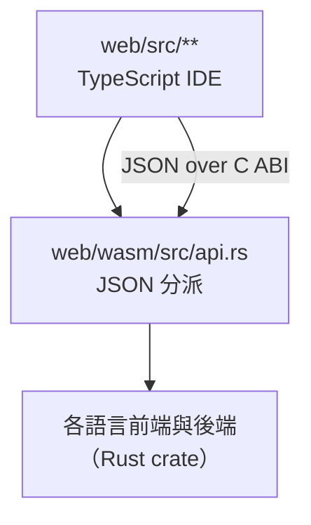

# 9.1 wasm 核心與 JSON ABI

> 對應原始碼：`web/wasm/src/lib.rs`、`web/wasm/src/api.rs`、`web/src/api.ts`、`web/build.mjs`
> 下一節：[9.2 虛擬開發板與麵包板](09.2-虛擬開發板與麵包板.md)

---

## 9.1.1 目標

**把整條 EDA 流程放進瀏覽器。**

這意味著：

- 不需要安裝任何東西；
- 不需要伺服器（`web/dist/index.html` 直接用瀏覽器打開就能用）；
- 分享一個設計只需要分享一個檔案。

**技術上的挑戰**：EDA 流程是 Rust 寫的、命令列的、需要檔案系統的。怎麼把它變成瀏覽器裡的應用程式？

## 9.1.2 三層架構



| 層 | 位置 | 職責 |
|---|---|---|
| IDE | `web/src/` | 編輯器、專案、範例、虛擬開發板、麵包板 |
| 核心 | `web/wasm/` | JSON 分派、編譯成 wasm |
| 工具 | workspace 的各 crate | 實際的工作 |

## 9.1.3 C ABI

`web/wasm/src/lib.rs` 只有五個匯出函式：

```rust
#[no_mangle] pub extern "C" fn alloc(n: usize) -> *mut u8
#[no_mangle] pub unsafe extern "C" fn dealloc(p: *mut u8, n: usize)
#[no_mangle] pub extern "C" fn result_len() -> usize
#[no_mangle] pub extern "C" fn panic_message() -> *const u8
#[no_mangle] pub unsafe extern "C" fn load_chipdb(p: *const u8, n: usize) -> i32
#[no_mangle] pub unsafe extern "C" fn call(p: *const u8, n: usize) -> *const u8
```

**用法**：

```
ptr = alloc(n); write request bytes; out = call(ptr, n);
read result_len() bytes at `out` (JSON); dealloc(ptr, n)
```

**為什麼是這麼薄的一層？** 因為**所有複雜度都在 JSON 那一層**。C ABI 只需要做記憶體管理。

**這個 wasm 模組沒有任何匯入（zero imports）。** 一個 Rust panic 會讓實例 trap；panic hook 把訊息寫進 thread-local，JS 端用 `panic_message()` 讀出來，然後**重新實例化一個模組**。

> **「panic 後重建實例」** 是一個務實的選擇。Rust 的 panic 是 unwind 的，但 wasm 沒有 unwinding 支援，panic 只能 trap 整個實例。**所以 panic 之後整個狀態都沒了，必須重建。**

**`load_chipdb`** 讓宿主把 IceStorm 的 `chipdb-5k.txt` 送進核心（第 5.2.2 節）。**因為那個檔案有幾 MB，放進二進位不合理。**

## 9.1.4 JSON 分派

```rust
pub fn dispatch(v: &Value) -> R<Value> {
    let cmd = v.get("cmd").and_then(|c| c.as_str()).ok_or("missing cmd")?;
    match cmd { ... c => Err(format!("unknown command '{}'", c)) }
}
```

**請求**：`{"cmd": "...", ...}`。
**回應**：永遠是 `{"ok": true, ...}` 或 `{"ok": false, "error": "..."}`。

### 9.1.4.1 命令清單

| `cmd` | 請求欄位 | 回應欄位 |
|---|---|---|
| `version` | — | `version` |
| `list` | `files: [{name, src}]` | `modules: [{name, test}]` |
| `simulate` | `files`、`top?`、`max_time?`（預設 1,000,000）、`vcd?`、`gate?`、`synth?` | `gate`、`log`、`tops: [{name, fails, finished}]`、`vcd: [{top, text}]` |
| `synth` | `files`、`top`、`sdc?` | `top`、`modules`、`warnings`、`hier`、`ports`、`signals`、`raw`、`opt`、`map` |
| `pnr` | files + stage | 各階段結果、`.asc` |
| `asic` | files + stage | ASIC 流程結果 |
| `asic_gds` | — | `top`、`gds`（base64）、`bytes` |
| `board_load` / `board_flash` / `board_load_bin` / `board_program` / `board_load_cpu` | 設計 + 接腳檔 / 位元流 / 程式 | 開發板狀態 |
| `board_run` | `cycles`、`vga_seen?` | `cycle`、`window`、`duty`、`evals`、`segs`、`edges`、`uart`、`vga` |
| `board_reset` | — | `cycle` |
| `board_periph` | — | 周邊狀態 |
| `cc` | C 原始碼 + 選項 | 編譯出的程式 / ELF |
| `emu_compile` | `files`、`top?`、`stops?` | `wasm`（base64）、`meta`、`stats` |
| `fluxa_emu_compile` | `files`、`top?`、`params?` | `wasm`、`meta`、`stats` |
| `fluxa_list` | `files` | `tests`、`tasks`、`fns` |
| `fluxa_run` | `files`、`tests?`、`trace?`、`stats?`、`gate?`、`synth?` | `results: [{name, passed, message, output, stats}]`、`gate` |
| `chipdb_loaded` | — | `loaded` |

### 9.1.4.2 兩個特別重要的命令

**`simulate` 帶 `gate` + `synth`**：把每個 `synth` 實例換成它的網表，然後**跑同一個測試平台**在閘級網表上。

**這就是「閘級驗證矩陣」在 IDE 裡的樣子**：使用者按一下「執行測試」，RTL 與閘級兩個結果並排顯示。

**`emu_compile` 的 `stops`**：指定哪些訊號會「停下」模型（UART 輸出與 finisher）：

```rust
let stops: Vec<String> = v.get("stops").and_then(|s| s.as_array())...unwrap_or_default();
let o = veryl_emu::compile(&files(v)?, top, &stops)?;
```

**`fluxa_emu_compile` 的 `params`** 可以是數字、布林或**Fluxa 運算式**：

```rust
"String" => fluxa::eval_str(&prog, s).map_err(|e| format!("param {}: {}", k, e))?,
```

**這是一個很貼心的設計**：參數可以用語言的運算式指定（例如 `TAPS = 8 * 2`）。

## 9.1.5 TypeScript 端

```ts
interface Exports {
  memory: WebAssembly.Memory;
  load_chipdb(p: number, n: number): number;
  alloc(n: number): number;
  dealloc(p: number, n: number): void;
  call(p: number, n: number): number;
  result_len(): number;
  panic_message(): number;
}

export class Veryl {
  static async load(bytes: Uint8Array): Promise<Veryl>
  static fromModule(mod: WebAssembly.Module): Veryl
  loadChipdb(text: Uint8Array): void
  call<T>(req: object): T {
    const enc = new TextEncoder().encode(JSON.stringify(req));
    const p = x.alloc(enc.length);
    new Uint8Array(x.memory.buffer, p, enc.length).set(enc);
    let out: number;
    try { out = x.call(p, enc.length); }
    catch (e) {
      let msg = String(e);
      try { msg = this.text(x.panic_message()) || msg; } catch {}
      this.reset();          // 重建實例
      throw new Error(msg);
    }
    const s = this.text(out);
    x.dealloc(p, enc.length);
    const r = JSON.parse(s);
    if (!r.ok) throw new Error(r.error);
    return r as T;
  }
}
```

**幾個細節**：

**(a) `this.reset()` 在 panic 後重建實例並重新載入 chipdb。**

**(b) `chipdb-5k.txt` 以 gzip + base64 的形式發佈，在瀏覽器裡用 `DecompressionStream('gzip')` 解壓。**

```ts
export async function gunzip(gz: Uint8Array): Promise<Uint8Array> {
  // DecompressionStream('gzip')
}
```

**用瀏覽器內建的 API 解壓，不需要 pako 這類的函式庫。**

**(c) `fromBase64`**：wasm 的 base64 編解碼（`emu_compile` 回傳的 `wasm` 欄位）。

## 9.1.6 建置

`web/build.mjs`：

1. 用 `cargo --profile web` 編譯 wasm32 的 crate；
2. 把 `web/src/**` 用 esbuild 打包；
3. **把範例資料生成成 `dist/examples.js`**（範例的原始碼內嵌成 JavaScript）；
4. 把 `web/static/` 複製到 `dist/`。

**`dist/` 是提交進版控的**——所以使用者不需要建置就能用 GitHub Pages 開 IDE。

**「提交產物」的取捨**：讓部署簡單，但會產生大的 diff。

### 9.1.6.1 範例的型別

```ts
export interface Example {
  id: string; group: string; title: string;
  files: VFile[];
  synth?: string; pcf?: string; note?: string;
  title_en?: string; note_en?: string; group_en?: string;
  board?: import('./ide/board').BoardSetup;
  lang?: 'fluxa';
  emu?: boolean;
  piBoard?: import('./ide/bbmodel').Part[];
}
declare const VERYL_EXAMPLES: Example[];
export function examples(): Example[] { return typeof VERYL_EXAMPLES === 'undefined' ? [] : VERYL_EXAMPLES; }
```

**`typeof VERYL_EXAMPLES === 'undefined'` 的檢查** 讓這個模組在沒有生成 `examples.js` 時也能被匯入（單元測試時用）。

**範例分組**：教學、實驗、C 程式、基礎、時序、綜合、周邊、RISC-V、RV64 開發板、Fluxa 開發板、Fluxa、其他。

## 9.1.7 三語言

```ts
export type Lang = 'zh-Hant' | 'zh-Hans' | 'en';
export const LANGS: [Lang, string][] = [['zh-Hant','繁體中文'], ['zh-Hans','简体中文'], ['en','English']];
export function fromLocale(loc: string | undefined): Lang
export function tr(hant: string, en: string): string    // 'en' 用英文，否則用中文
export function hans(s: string): string                // 繁體 → 簡體
export function translateDom(root: HTMLElement): void
```

**「原始文本是繁體中文，英文寫在旁邊」** 的模式：

```ts
tr('繁體中文', 'English')
```

**簡體中文是衍生出來的**：`i18n_hans.ts` 匯出 `HANS_CHARS`（逐字對照表）與 `HANS_PHRASES`（詞語對照表）。

```ts
// hans() 先替換最長的詞語（用依長度遞減排序的鍵建成的單一正則），
// 再映射剩下的字
```

**為什麼要用詞語表？** 因為有些字在中國大陸是**不同的用法**而不是不同的字（例如「資訊」vs「信息」、「軟體」vs「軟件」）。

**詞語優先於單字**是一個重要的排序：**「軟件」要在「軟」與「件」之前被替換掉**，否則會變成「軟件件」之類的東西。

**`translateDom()`** 處理靜態頁面文字：

- 英文：`data-en`、`data-en-html`、`data-en-title`、`data-en-ph`；
- 簡體：走訪每個含 `[\u3400-\u9fff]` 的文字節點，加上所有 `title` 與 `placeholder` 屬性。

## 9.1.8 IDE 的模組結構

| 檔案 | 大小 | 職責 |
|---|---|---|
| `main.ts` | 111 KB | 工作台：專案、分頁、檔案總管、大綱、問題、測試、綜合分頁、範例、分享 |
| `board.ts` | 39 KB | 虛擬 iCEBreaker：SVG 板子、PMOD 模組、七段、VGA 監視器、UART 終端機、LED 亮度、按鈕 |
| `emu.ts` | 20 KB | 模擬器分頁：終端機（VT100 子集）、開機/暫停/重設/存檔/檔案/執行按鈕、引擎選擇 |
| `pi.ts` | 14 KB | RV64 樹莓派風格開發板 |
| `caps.ts` | 9 KB | 能力分析：標題列的哪些動作適用於目前專案，以及為什麼不適用 |
| `highlight.ts` | 9 KB | Veryl / Fluxa / C / asm / Python / shell 的語法高亮 |
| `editor.ts` | 8 KB | 程式碼編輯器元件 |
| `bbmodel.ts` | 5 KB | 麵包板的**電性模型**（純函式，無 DOM，可單元測試） |
| `breadboard.ts` | 13 KB | 麵包板**編輯器**（SVG） |

**`caps.ts` 是個值得注意的設計**：標題列的按鈕會依專案狀態啟用/停用。**「為什麼不適用」也能說明**——這對使用者體驗的幫助比單純停用按鈕大得多。

## 9.1.9 編輯器

```ts
export class CodeEditor {
  private scroller, gutter, code, curLine, pre, ta;
  private markers: Marker[] = [];
  onChange: (text: string) => void;
  onCursor: (line: number, col: number) => void;
  onKey: (e: KeyboardEvent) => boolean;
  get lineHeight(): number                   // 19 px，手機上更大（ide.css --edlh）
  setMarkers(m: Marker[]): void
  goto(line: number, col = 1, selectLine = false): void
}
export interface Marker { line: number; col: number; msg: string; severity: 'error' | 'warning' }
```

### 9.1.9.1 一個透明 textarea 疊在高亮層上

- **重繪用 `requestAnimationFrame` 批次化**；
- `<pre>` 放高亮的 HTML，`<textarea>` 疊在上面（文字透明），並調整到 `pre.offsetHeight` 讓單一捲動容器同時移動行號槽、程式碼與 textarea；
- **行號槽只在行數或標記改變時重建**（用 `this.gutter.dataset.marked` 快取）。

### 9.1.9.2 鍵盤處理

- Tab 縮排/反縮排選取區塊（4 個空格）；
- Enter 保持縮排，並在 `{`/`(`/`[` 後加一級，同時自動補上閉合括號；
- 在空行輸入 `}` 會反縮排；
- `Ctrl+/` 切換 `//` 註解。

### 9.1.9.3 保留瀏覽器的 undo 堆疊

```ts
// 編輯透過 document.execCommand('insertText')，讓瀏覽器的 undo 堆疊存活，
// 失敗時退回 setRangeText
```

**這是一個很細的細節，但非常重要。** 用 `value = ...` 或 `setRangeText` 會摧毀 undo 堆疊——使用者按 Ctrl+Z 什麼都不會發生。

**`execCommand` 雖然是過時的 API，但在這裡是唯一能保留 undo 的方法。**

## 9.1.10 語法高亮

```ts
export type Lang = 'veryl' | 'fx' | 'c' | 'asm' | 'py' | 'sh' | 'text';
export function langOf(name: string): Lang   // 依副檔名
export function highlight(src: string, lang: Lang = 'veryl'): string[]
```

**六組關鍵字/型別集合**：Veryl、Fluxa、C、Python、shell。

**Veryl 的 token 正則**辨認 Verilog 風格的常數（`4'b1010`、`'d255`）、`$system` 名稱與 `#[attr]` 屬性。

**組合語言的高亮是有狀態的**：一行的第一個字是助記符，`label:` 是名稱，而暫存器用正則著色：

```ts
const REGS = /^(x([12]?\d|3[01])|zero|ra|sp|gp|tp|fp|t[0-6]|s([0-9]|1[01])|a[0-7])$/;
```

**CSS 類別**：`t-com`、`t-str`、`t-num`、`t-sys`、`t-attr`、`t-kw`、`t-type`、`t-name`、`t-dom`。

## 9.1.11 為什麼用 JSON 而不是 C ABI

| | C ABI（每個功能一個函式） | JSON 分派 |
|---|---|---|
| 新增功能 | 要改 Rust 的匯出 + TS 的包裝 | **只加一個 `match` 分支** |
| 參數 | 每個都要定義型別 | 任意 JSON |
| 除錯 | 二進位介面 | **看得懂的 JSON** |
| 型別檢查 | 有 | 無 |

**JSON 的代價是效能**（序列化開銷）與型別安全。**對一個互動式 IDE 來說，這兩者都可以接受。**

**「看得懂的 JSON」對教學特別重要**：你可以用瀏覽器的 devtools 直接看到工具鏈在做什麼。

---

**下一節**：[9.2 虛擬開發板與麵包板](09.2-虛擬開發板與麵包板.md)
