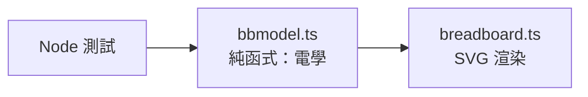
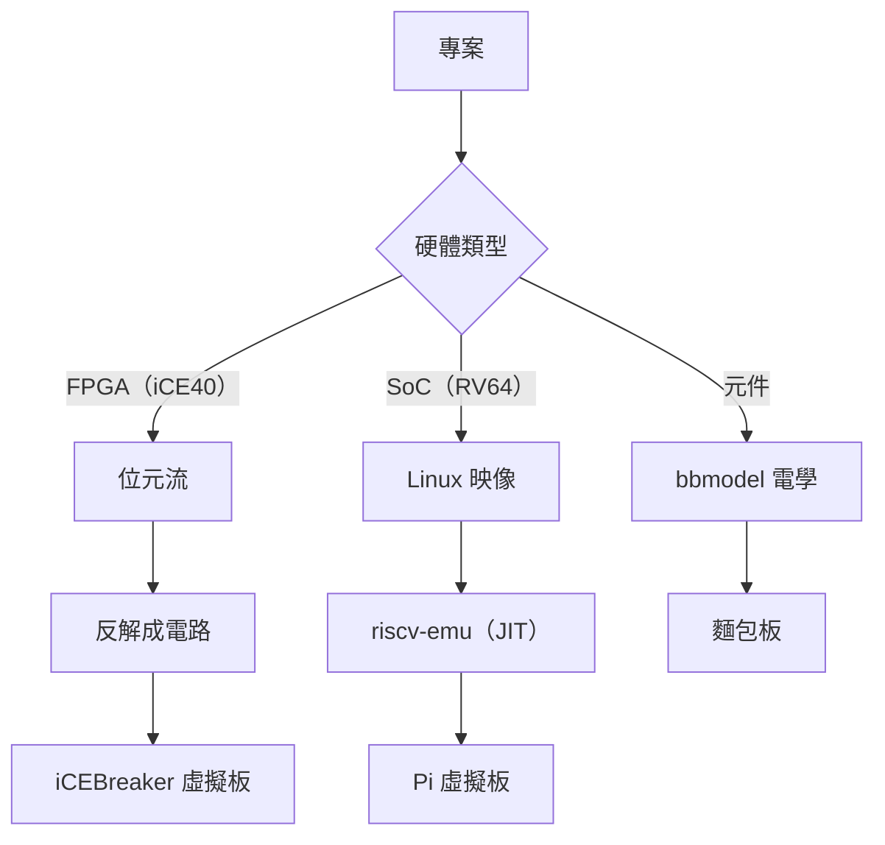

# 9.2 虛擬開發板與麵包板

> 對應原始碼：`web/src/ide/board.ts`、`web/src/ide/pi.ts`、`web/src/ide/breadboard.ts`、`web/src/ide/bbmodel.ts`、`web/src/ide/periph`（對應 `eda/src/fpga/board/periph.rs`）
> 上一節：[9.1 wasm 核心與 JSON ABI](09.1-wasm核心與JSON-ABI.md)　下一節：[9.3 從模擬到晶片](09.3-從模擬到晶片-完整流程.md)

---

## 9.2.1 三種「硬體」的虛擬化

| | iCEBreaker 開發板 | RV64 樹莓派板 | 麵包板 |
|---|---|---|---|
| 目標 | FPGA（iCE40UP5K） | SoC（RV64） | 電子元件 |
| 執行什麼 | **位元流反解出來的電路** | 指令集模擬器 | 電性模型 |
| 檔案 | `board.ts` | `pi.ts` | `breadboard.ts` + `bbmodel.ts` |
| 周邊 | LED、按鈕、UART、VGA、七段、蜂鳴器 | GPIO、螢幕、鍵盤 | 電阻、LED、按鈕、開關、導線 |

**「執行位元流反解出來的電路」** 這一點特別重要——**它不是執行 RTL**，而是執行真正會被燒進 FPGA 的那份設定（第 5.3.8 節）。

## 9.2.2 iCEBreaker 虛擬開發板

```ts
export interface BoardSetup {
  uart: boolean; baud: number;
  pmod1a: string; pmod1b: string;
  breadboard?: boolean; bb?: Part[];
  mode?: string;
}
export const DEFAULT_SETUP: BoardSetup = { uart: false, baud: 115200, pmod1a: '', pmod1b: '' };
const SLOT: Record<string, number[]> = {
  pmod1a: [4, 2, 47, 45, 3, 48, 46, 44],
  pmod1b: [43, 38, 34, 31, 42, 36, 32, 28],
};
const PMOD2 = [27, 25, 21, 19, 26, 23, 20, 18];
```

### 9.2.2.1 支援的 PMOD 模組

**8-LED、七段、VGA、按鈕、開關、蜂鳴器**等。

**七段的映射**：

```ts
// segs = [...pins.slice(0,7), null]，sels = [[pins[7],0],[pins[7],1]]
```

**PmodVGA 的映射**：

```text
R0–R3 → 1A 的接腳 1–4
B0–B3 → 1A 的接腳 7–10
G0–G3 → 1B 的接腳 1–4
HS/VS → 1B 的接腳 7/8
```

**這些映射是 Digilent 的 Pmod 規格**——虛擬板支援真實的 PMOD 模組，讓設計可以直接對接實體硬體。

### 9.2.2.2 LED 的亮度來自「工作週期」

**`board_run` 回傳 LED 的 duty（高電位佔空比），不是位準。**

**為什麼？** 因為 LED 的亮度與通過它的電流成比例，而 PWM 的平均電流正比於工作週期。**用 duty 而不是位準，模擬出的亮度才真實。**

```ts
// 板子透過 JSON ABI 與核心對話：
// board_load、board_load_bin、board_program、board_run、board_reset、board_periph
```

### 9.2.2.3 蜂鳴器是真的音訊

```ts
// 用 AudioContext 的振盪器，由接腳的 duty 驅動
```

**「duty 驅動頻率」** 是蜂鳴器的自然模型：**占空比決定發聲，通過接腳的邊緣計數決定音高**（第 5.3.10 節的 `take_edges()`）。

## 9.2.3 RV64 樹莓派板

```ts
export const PI_HEADER: string[] = ['3V3','5V','—','5V','GPIO3','GND','GPIO4','GPIO14','GND','GPIO15', ... ];
export const HEADER_GPIOS = [3,4,5,6,7,8,9,10,11,12,13,14,15];
export const PI_DEFAULT_BB: Part[] = [ /* GPIO 5/12/13 上的紅黃綠 LED 加電阻，GPIO 6 上的按鈕加下拉 */ ];
```

### 9.2.3.1 為什麼是「BCM 風格」的映射

**映射刻意做成 BCM-like**：SoC 的 GPIO *n* 就是樹莓派的 GPIO *n*。

- GPIO 0 = ACT LED（綠）
- GPIO 1 = USER LED（黃）
- GPIO 2 = 板上的按鈕
- GPIO 3–15 在 40 針接頭與麵包板上

**「BCM-like」而不是「BCM 編號」**：真正的樹莓派用 BCM 編號（GPIO 0 = 物理接腳 27 等等）。這裡用**連續編號**，比較好理解。

**板子被畫成 SVG**（PCB、40 針接頭、`Rv64Core RV64IMAC 256 MB` 晶片、USB/UART 方塊、三顆 LED、按鈕）。

### 9.2.3.2 螢幕

**可選的 320×240 LCD**（`machine.json` 的 `"fb"`），RGB565 小端像素轉成 8 位元 RGB：

```ts
const v = px[2*i] | px[2*i+1] << 8;
const r = v >> 11, g = v >> 5 & 63, b = v & 31;
d[4*i]     = r << 3 | r >> 2;
d[4*i + 1] = g << 2 | g >> 4;
d[4*i + 2] = b << 3 | b >> 2;
```

**「RGB565 → RGB888」的轉換用位移近似**（`r << 3 | r >> 2` 是 `r * 255 / 31` 的近似）。

### 9.2.3.3 鍵盤映射到按鈕

**前四個麵包板按鈕映射到方向鍵**，加上空白鍵與數字 1–9；`B` 是板上的按鈕（GPIO 2）。

**「按下的時間至少 120 ms」**：

```ts
const HOLD_MS = 120;
setTimeout(() => { if (this.since.get(k.id) === t) set(false); },
            Math.max(0, HOLD_MS - (performance.now() - t)));
```

**為什麼？** 因為**程式是用輪詢讀 GPIO 的**。如果按鈕只按住 10 ms，輪詢可能完全錯過。**保證 120 ms 讓任何輪詢間隔的程式都能讀到。**

**「這個按鈕接到哪個 GPIO」是從麵包板拓樸推導的**（找一條從該接腳條到某個 `p:` 點的導線）。

## 9.2.4 麵包板

### 9.2.4.1 佈局

**SVG `viewBox 0 0 560 296`**：

- **頂部條帶**放板上接腳（iCEBreaker 的 PMOD1A/PMOD1B，或 Pi 的 40 針接頭），加上 `3V3` 與 `GND`；
- **30 欄 × 10 列**的 5 孔接點條（上半 `a`–`e`，下半 `f`–`j`），加上電源軌 `r:top+:col`、`r:top-:col`、`r:bot+:col`、`r:bot-:col`。

**點的命名**：

| 前綴 | 意義 |
|---|---|
| `p:<pin>` | 接頭接腳 |
| `vcc` / `gnd` | 電源 |
| `h:<col>:<row>` | 接點 |
| `r:<rail>:<col>` | 電源軌 |

```ts
export const PMOD_HEADER: Header = { groups: [
  { label: 'PMOD1A', pins: [4, 2, 47, 45, 3, 48, 46, 44], names: NAMES },
  { label: 'PMOD1B', pins: [43, 38, 34, 31, 42, 36, 32, 28], names: NAMES },
]};
const COLS = 30;
```

**互動**：選一個工具（選取/導線/LED/電阻/按鈕/開關），**點兩個接點**放一個元件（LED 的第一次點擊是陽極）。右鍵或 Delete 移除；按鈕在指標按下時按住；開關點一下切換。

### 9.2.4.2 電性模型

**`bbmodel.ts` 是純函式，無 DOM，所以在 Node 裡可以單元測試。**

```ts
export interface Part { id: number; kind: 'led'|'res'|'btn'|'sw'|'wire'; a: string; b: string; color?: string; on?: boolean }
export interface Solved { level: Map<string, number|null>; led: Map<number, number>; inputs: Map<number, number>; warnings: string[] }
export function solve(parts, outputs: Map<number,number>, inputs: Set<number>, pressed: Set<number>, tr): Solved
```

**五個步驟**：

**(1) Union-find 建立連通性。**

```ts
// 一條接點條的 5 個孔是一個節點（node() 把 h:3:c 映射到 s:3:top，
// r:top-:4 映射到 rail:top-）；導線、閉合的開關、按住的按鈕把它們的兩端 union
```

**這個映射是麵包板的物理事實**：同一條接點條的五個孔在內部是相通的。

**(2) 強驅動者。**

`3V3` = 1，`GND` = 0，每個 FPGA 輸出接腳貢獻它的 **duty**（高電位的時間比例）。

**兩個強驅動者在同一個網路上 → 短路警告。**

**(3) 弱位準的傳播。**

**通過電阻傳播，迭代到固定點（最多 50 輪）。** 這是上拉/下拉電阻的模型。

**(4) LED 的亮度。**

```text
亮度 = max(0, level(a) * (1 - level(c)))
```

**（陽極位準）×（陰極的反相）**——這就是 LED 的導通條件。

**LED 串聯在兩個強位準之間而沒有電阻 → 警告「an LED has no series resistor」。**

**(5) 輸入接腳。**

讀 `level > 0.5`。**浮動的輸入（沒有位準）→ 警告「Pin N floats: add a pull-up or pull-down resistor」。**

### 9.2.4.3 為什麼要分成兩個檔案



**「模型」與「視圖」分離**，使得電學邏輯可以在沒有 DOM 的環境下測試。

**這是一個普遍適用的設計模式**：把可測的邏輯從不可測的呈現中抽出來。

## 9.2.5 三種虛擬化的比較

| | iCEBreaker | Pi 板 | 麵包板 |
|---|---|---|---|
| **被模擬的對象** | 硬體配置（位元流） | 指令集 | 電路 |
| **執行的是** | 反解後的電路網 | RISC-V 指令 | union-find + 電阻網路 |
| **輸入** | 按鈕、UART | 鍵盤、GPIO | 電阻網路 |
| **輸出** | LED、VGA、七段、蜂鳴器 | GPIO、螢幕 | LED 亮度、位準 |
| **保真度** | 高（就是燒進去的東西） | 中（指令集層級） | 中（直流穩態） |

## 9.2.6 麵包板的電學模型有多簡單

**它只有直流穩態**：

- 沒有電容（所以沒有 RC 時間常數）；
- 沒有電感；
- 沒有頻率相關的行為；
- LED 的亮度正比於位準差（不是電流）。

**這個簡化是刻意的。** 對教學來說，「電阻分壓 + LED 亮度 + 短路偵測」已經足夠傳達「硬體是電學」這個直覺。

**加入電容會帶來一個大問題：暫態分析需要時間步進，會讓互動變慢。**

## 9.2.7 虛擬開發板的三種引擎

**回顧第 8.1.1 節的三個引擎**，它們與三種虛擬化的關係：



## 9.2.8 開發板的示範遊戲

`web/src/examples.ts` 的範例清單裡有幾個遊戲：

| 範例 | 說明 |
|---|---|
| `chaser` | 跑馬燈 |
| `reaction` | 反應時間測試 |
| `breathe` | 呼吸燈 |
| `snake` | 貪食蛇 |
| `sysmon` | 系統監視器 |
| `tetris` | 俄羅斯方塊 |
| `linux` | Linux shell |

**`reaction`（反應時間測試）** 需要**精確的時間量測**——這是模擬器的一個硬測試：**模擬器的時脈必須與真實硬體一樣準確**，否則測出來的反應時間會是亂的。

## 9.2.9 與真實硬體的對應

**虛擬開發板的存在，是為了讓「不用買板子」也能學會設計。**

| | 虛擬 | 真實 |
|---|---|---|
| iCEBreaker | 位元流反解 + 閘級模擬 | USB 燒錄 + 真的 FPGA |
| Pi 板 | 指令集模擬器 | 真實的 RV64 板 |
| 麵包板 | 電阻網路 | 真的麵包板與元件 |

**設計在虛擬環境驗證過之後，燒到真實硬體上通常就會工作**——因為兩邊執行的是同一份位元流。

**這個「同一份位元流」是關鍵**：不是「模擬器與硬體行為相似」，而是「模擬器執行的是硬體的設定本身」。

## 9.2.10 虛擬環境的取捨

| 優點 | 代價 |
|---|---|
| 零成本 | 沒有真實的電氣效應 |
| 可重現 | 沒有真實的隨機性（時脈抖動等） |
| 可自動化測試 | 沒有機械與環境限制 |
| 立即回饋 | 沒有「燒錄要 30 秒」的摩擦 |
| 無限實驗 | **沒有「我得先買一塊板子」的門檻** |

**最後一項是教學上最重要的**。

---

**下一節**：[9.3 從模擬到晶片：完整流程](09.3-從模擬到晶片-完整流程.md)
