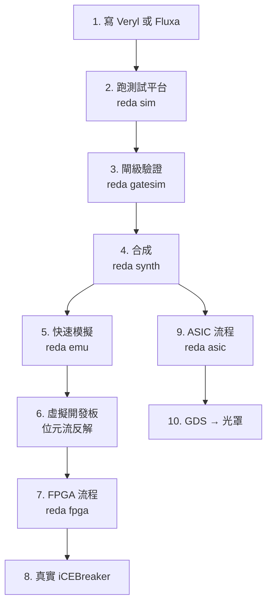
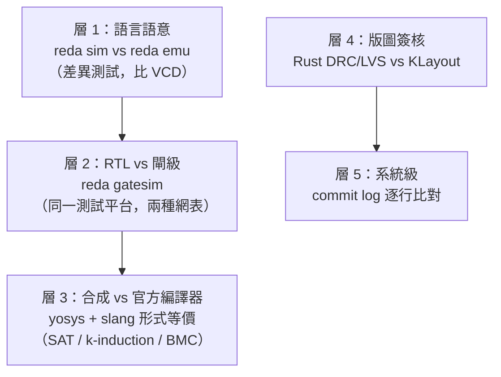
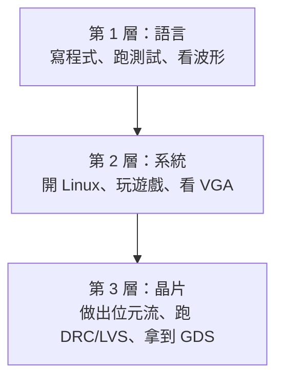
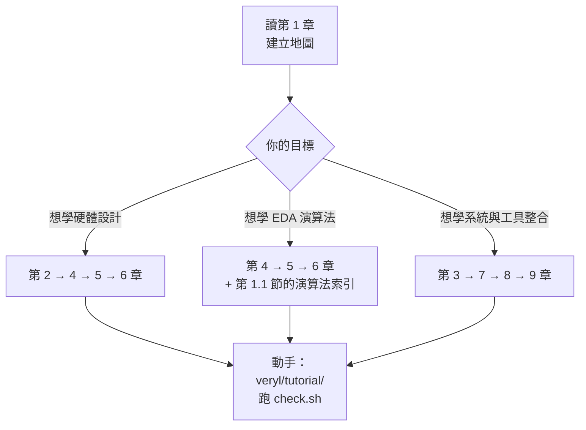

# 9.3 從模擬到晶片：完整流程

> 對應原始碼：`test.sh`、`run.sh`、`build.sh`、`publish.sh`、`veryl/tutorial/`、`docs/manual/`
> 上一節：[9.2 虛擬開發板與麵包板](09.2-虛擬開發板與麵包板.md)

---

## 9.3.1 一個設計的完整生命週期



**每一步的產物都是下一步的輸入**，而且每一步都有自動化檢查。

## 9.3.2 測試的層次

`test.sh` 是 CI 跑的完整測試：

```sh
./test.sh              # 整個 workspace 的 cargo test、教學流程、模擬機、Fluxa 處理器、npm test
./test.sh --full       # 再加上 yosys 形式等價、nextpnr 流程（需要 OSS CAD Suite）
```

**`--full` 需要 OSS CAD Suite**（yosys、nextpnr、slang、iverilog 的集合）。

## 9.3.3 分層的驗證



**每一層的保證強度不同，但每一層都便宜。**

**便宜的層先跑，貴的層才需要跑。** 這是測試策略的基本原則。

## 9.3.4 五層驗證的詳細對照

| 層 | 工具 | 比較什麼 | 保證 |
|---|---|---|---|
| 語言語意 | `reda sim` vs `reda emu` | VCD 波形 | 直譯與編譯語意一致 |
| RTL vs 閘級 | `reda gatesim` | 測試平台結果 | 合成沒有改變功能 |
| 合成 vs 參考 | yosys + slang | 形式等價 | 合成與 `veryl build` 等價 |
| 版圖簽核 | Rust + KLayout | DRC / LVS / 天線 | 物理設計合法 |
| 系統級 | commit log | 逐條指令 | SoC 與規格一致 |

## 9.3.5 教學流程

`veryl/tutorial/` 是一套「虛擬實驗課」：

```
veryl/tutorial/
├── src/uart.veryl
├── src/knight.veryl
├── src/blinky.veryl
├── labs.tw.md        實驗說明（繁體中文）
├── check.sh          自動檢查
├── Veryl.toml
├── Veryl.lock
└── icebreaker.pcf
```

**`check.sh` 會建置、模擬，並檢查結果。**

**「把教科書變成可執行環境」**：學生改完程式碼，跑一支腳本就知道對不對。

### 9.3.5.1 實驗的層次

從 `labs.tw.md` 的結構可以看出教學的設計：

1. **blinky**：最簡單的輸出（點燈）——認識 port 與 `always_ff`；
2. **knight**：跑馬燈——有限狀態機與陣列；
3. **uart**：序列埠——狀態機與位元層級操作。

**三個實驗依序引入三個核心概念**，而且每一個都能在虛擬開發板上看到結果。

## 9.3.6 建置與執行

```sh
./build.sh             # target/release/reda 與 web/dist（--no-web：只建 reda）
./test.sh              # CI 跑的完整測試
./run.sh serve         # 用本機伺服器開 web/dist 的 IDE
./run.sh help          # 列出所有指令
./publish.sh [--dry-run]  # 把 crate 上傳 crates.io（先檢查，再 dry run，確認後上傳）
```

**`publish.sh` 的流程值得注意**：

```sh
./publish.sh [--dry-run]
```

**「先檢查、再 dry run、然後才上傳」** 是發布套件的安全流程。

## 9.3.7 環境變數

**環境變數保持舊名**：`VERYL_EDA_CHIPDB`、`VERYL_EDA_SKY130`、`VERYL_EDA_PROFILE`。

**為什麼叫 `VERYL_EDA_*` 卻服務整個 rueda？** 因為這些變數是在「veryl2chip」時期就有的，合併成 rueda 時**刻意不改名**——改名會破壞既有的腳本。

**這是一個務實的決定**：相容性比一致性重要。

## 9.3.8 從語言到晶片的成本

| 目標 | 需要什麼 | 時間 |
|---|---|---|
| 模擬 | 只有 Rust | 秒 |
| 閘級模擬 | 只有 Rust | 秒 |
| 快速模擬 | 只有 Rust | 秒 |
| FPGA 位元流 | 只有 Rust（+ `chipdb-5k.txt`） | 分鐘 |
| ASIC GDS | 只有 Rust（+ SKY130 PDK） | 分鐘到小時 |
| 形式等價驗證 | OSS CAD Suite | 小時 |

**「ASIC 流程不需要商用工具」** 是這個專案最重要的可及性成果。

**SKY130 的 PDK 是唯一需要的外部資料，而且它是免費開源的。**

## 9.3.9 完整流程的命令序列

```sh
# 1. 寫程式
cat > counter.veryl <<'EOF'
module Counter (
    i_clk : input clock,
    i_rst : input reset,
    o_cnt : output logic<8>,
) {
    var c: logic<8>;
    always_ff (i_clk, i_rst) {
        if_reset { c = 0; } else { c = c + 1; }
    }
    assign o_cnt = c;
}
EOF

# 2. 測試平台
cat > test_counter.veryl <<'EOF'
#[test(counter_test)]
module TestCounter {
    inst clk: $tb::clock_gen;
    inst rst: $tb::reset_gen(clk);
    inst dut: Counter;
    connect clk.clk => dut.i_clk;
    connect rst.rst => dut.i_rst;
    initial {
        rst.assert();
        clk.next();
        $assert(dut.o_cnt == 8'h00, "reset");
        clk.next();
        $assert(dut.o_cnt == 8'h01, "count");
        $finish();
    }
}
EOF

# 3. 模擬
reda sim test_counter.veryl

# 4. 閘級驗證
reda gatesim opt test_counter.veryl

# 5. 合成
reda synth -o counter.json counter.veryl

# 6. FPGA 流程
reda fpga --pnr veryl --pcf icebreaker.pcf --bin counter.bin counter.veryl

# 7. ASIC 流程
reda asic --pdk sky130 --gds counter.gds counter.veryl
```

## 9.3.10 設計範例

`veryl/examples/` 與 `fluxa/examples/` 涵蓋了從簡單到完整的例子：

**Veryl 側**：

| 範例 | 說明 |
|---|---|
| `adder` `max3` `alu_pkg` | 基本組合邏輯 |
| `gen_rev` `seq101` `pkt_reg` | 時序邏輯 |
| `ram` `sync_ram` `fifo` `bram` | 記憶體與 BRAM 推斷 |
| `sevenseg` `counter` `features` | 周邊 |
| `uart` `vga` | 序列與視訊 |
| `rv32i` `soc` `alu_fail` | RISC-V |
| `rv64_linux` | RV64 + Linux |

**`alu_fail` 是故意失敗的斷言**——用來展示測試失敗的樣子。

**Fluxa 側**：

| 範例 | 說明 |
|---|---|
| `basics` `fir` `fir4` `mac` `gemm` `fanout` `pipeline` | 演算法 |
| `err_linear` `err_narrow` `err_overflow` `err_deadlock` | 錯誤示範 |
| `rv32i/` `rv64/` | 用 Fluxa 寫的處理器 |

**`err_*.fx` 是「預期會失敗」的範例**，而且測試會斷言錯誤訊息的**子字串**：

```rust
// 例如 "does not fit i24"、"deadlock"、"does not own the rx endpoint"
```

**「斷言錯誤訊息的子字串」** 是一個務實的選擇：**完整的訊息比對太脆弱**（任何措辭改動都會破壞測試），但**完全不檢查就會讓錯誤訊息退化**。子字串是中間地帶。

**而且 `fluxa/AGENTS.md` 明確規定**：「改變錯誤訊息的措辭會破壞這些測試——請在同一次變更裡更新 `tests/examples.rs`」。**這是把「錯誤訊息是 API 的一部分」寫進規範。**

## 9.3.11 教學的三個層次



**每一層都可以獨立完成**，不必一路走到 GDS。

**這是教學設計的關鍵**：如果只有一條路徑（必須走到 GDS），學生在第一步就會放棄。

## 9.3.12 使用手冊

`docs/manual/` 有三個語言版本（English、繁體中文、简体中文），每個 17 節：

```
01-intro 02-install 03-quickstart 04-veryl 05-sim 06-synth 07-fpga
08-gatesim 09-asic 10-riscv-c 11-ide 12-board 13-develop 14-reference
15-targets 16-examples 17-fluxa
```

**`tools/tocn.py` 負責英中轉換**——這與 IDE 的 `i18n_hans.ts` 是同一個問題的兩個實作。

## 9.3.13 兩個專案的合併

rueda 合併了兩個先前的專案：

- **veryl2chip**（Veryl 到晶片；版本歷史在 `veryl/history.md`）；
- **Fluxa**（`fluxa/docs/`）。

**合併的策略**：

1. **保留 `eda` 作為共用的核心**——這是合併的技術前提；
2. **`reda` 作為單一命令**——統一的使用者介面；
3. **保留舊的環境變數名**——相容性。

## 9.3.14 版本歷史作為教材

`veryl/history.md`（70 KB，繁體中文）是這個專案的**開發敘事**，記錄了每個版本的里程碑：

| 版本 | 內容 |
|---|---|
| v1.0（2026-10-25） | 完整的流程與網頁環境 |
| v1.1 | 第一次發布到 crates.io |
| v1.2 | 虛擬開發板與虛擬實驗課 |
| v1.3 | 在自己做的 RISC-V 上跑 C |
| v1.4 | 中斷與多執行緒 |
| v1.5 | SKY130 起步 |
| v1.6 | 設計規則 |
| v1.7 | GDSII，用 KLayout 檢查 |
| v1.8 | 更好的結果 |
| v1.9 | IDE 裡的 SKY130 |
| v2.0 | 2.0.0 |
| v2.1 | `v2c` 與使用手冊 |
| v2.2 | ECP5 對應 |
| v2.3 | `Rv64Core`，通過 riscv-tests |
| v2.4 | xv6 開到 shell |
| v2.5 | 加速與 C 擴充 |
| v2.6 | Linux |
| v2.7 | 驗證處理器的正確性 |
| v2.8 | 在我們的 EDA 上合成 Rv64 |
| v2.9 | Rv64 在 FPGA 上佈局繞線 |
| v2.10 | Rv64Core 用自己的 ASIC 流程佈局繞線（vlib） |
| v2.11 | Linux 有 shell 了（busybox） |
| v2.12 | veryl-emu |
| v2.13 | IDE 的模擬機 |
| v2.14 | veryl-emu 加速 |
| v2.15–v2.21 | 開發板 1–7：GPIO、虛擬板、快照開機、檔案進出、MicroPython、C 程式、螢幕 |
| v2.22–v2.24 | riscv-emu 1–3 |
| v2.25 | 四種目標 |
| v2.33 | LVS 與 SPICE 網表 |
| v2.34 | 天線規則 |
| v2.35 | 時序約束 |
| v2.36 | 時序收斂 |

**這份歷史本身就是一本教科書**——它記錄了「一個 EDA 專案如何從語言支援逐步長成完整的晶片流程」，以及每一步的**技術決策**。

**注意 v2.7「驗證處理器的正確性」在 v2.8「在我們的 EDA 上合成 Rv64」之前**——**先建立驗證基礎，再做硬體。** 這個順序是對的。

## 9.3.15 這個專案示範的方法論

綜合全書，有五條貫穿的方法論：

**(1) 中介表示的選擇決定一切。**
網表 IR 選成位元層級 + yosys 內部命名 + 扁平接腳，換來了跨語言共用後端、與開源生態相容、以及技術無關的所有保證。

**(2) 架構規則必須能被工具強制檢查。**
「`eda/` 不得依賴語言前端」不是靠紀律，而是靠 Cargo 的 crate 依賴圖。

**(3) 同一語意、多種實作、交叉驗證。**
直譯 vs 編譯、RTL vs 閘級、內部 DRC vs KLayout、自己的編譯器 vs 官方的。任何一個語意只寫一次會有兩份實作，就一定要有自動化的交叉驗證。

**(4) 兩套驗證策略要分層搭配。**
SAT（完全等價）、k-induction、BMC（有限等價）、功能測試——按設計大小分配。

**(5) 範圍控制與誠實。**
`fluxa/AGENTS.md` 的「Deliberate scope boundaries (do not "fix")」、SKY130 沒有 SRAM macro 就報錯、PMP 暫存器存在但不強制執行、**天線檢查沒有檢查同網路的凹口就明說**。

## 9.3.16 給讀者的建議路徑



**最好的學習方式是動手改一個例子，看它怎麼壞掉。**

**幾個值得試的實驗**：

| 實驗 | 會學到 |
|---|---|
| 把 `if_reset` 從 `always_ff` 移出來 | 語言規則如何強制風格 |
| 把 `mem[i_waddr]` 改成非同步讀 | BRAM 推斷失敗的原因 |
| 在 `always_ff` 裡讀一個被寫的訊號 | 非阻塞語意 |
| 把 Fluxa 的 `ii = 2` 改成 `ii = 1` | E0412 錯誤訊息 |
| 讓一條網路扇出到 20 個地方 | 扇出限制與 BUF 樹 |
| 手寫一個有組合迴路的設計 | 組合迴路偵測 |
| 用 `--full` 跑形式等價 | 驗證策略的分層 |

---

## 全書結語

rueda 展示了一件事：**EDA 的每一個技術細節，都是一個可以追溯到物理或數學的決定。**

- 為什麼網線編號從 2 開始？因為 yosys 的常數約定。
- 為什麼 `and` 要排序參數？因為結構雜湊需要交換律正規化。
- 為什麼 `is_out` 只有一個函式？因為技術無關性。
- 為什麼 LVS 不看標籤？因為簽核必須獨立。
- 為什麼常數證明要先隨機再窮舉？因為窮舉需要支援集有界。
- 為什麼改進機制要迭代到定點？因為最佳化會級聯。
- 為什麼 `wrap` 不是符號延伸？因為硬體就是那樣。
- 為什麼要用兩種排程器？因為決定性。

**讀懂這些「為什麼」，比背下這些「怎麼做」重要得多。**

因為工具會變，原理不會。

---

**回到目錄**：[README](README.md)
