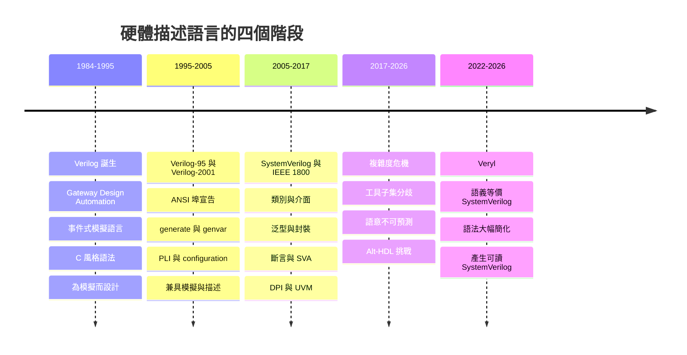
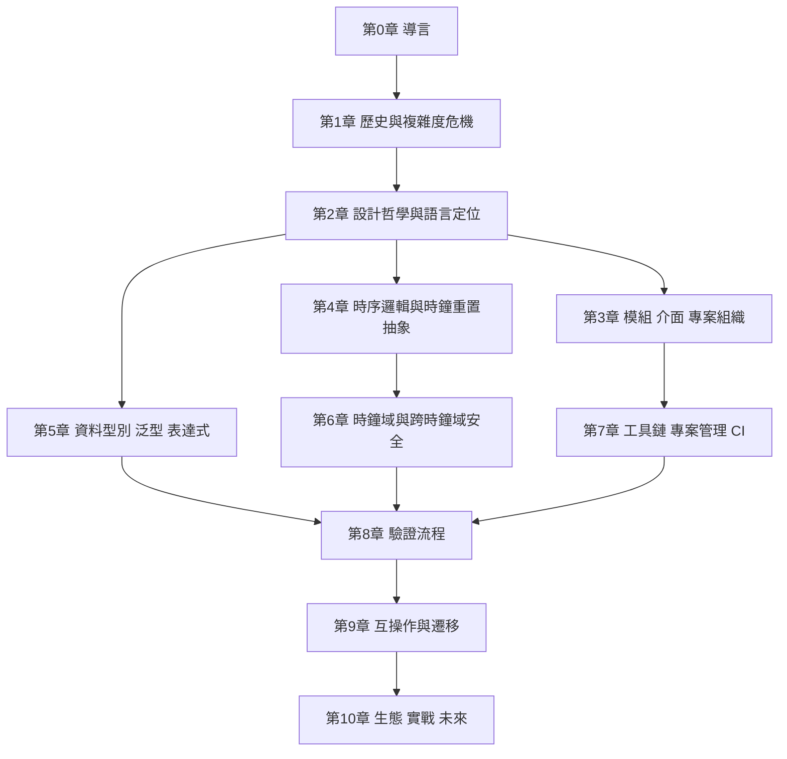

# 0.1 導言：硬體描述語言的困境與Veryl的出現（1984-2026）

## 一個特殊的語言種類

軟體工程裡，程式語言的選擇通常是**工程管理問題**：這個語言的工具鏈是否成熟、團隊是否熟悉、除錯是否方便、效能是否達標。只要語言的語意是明確的，錯誤就會被編譯器或測試框架攔下，修正成本也侷限在「重新部署」的代價以內。

硬體描述語言（Hardware Description Language, HDL）不是這樣。

一份 HDL 原始碼同時扮演兩個角色：

1. 它是**描述**。工程師用它說出「我要造什麼電路」——一組在時間上展開的資料流、狀態機、算術單元與匯流排協定。
2. 它也是**實作**。同一份程式碼會被綜合器（synthesizer）轉成閘級網路，被模擬器（simulator）拿來跑功能驗證，被形式驗證工具拿來證明性質，被時序分析工具拿來估計關鍵路徑。

這是硬體描述語言在整個軟體世界裡獨一無二的位置。它既不是「寫給機器看的程式碼」，也不是「寫給人看的規格」，它是**兩者的混合物**，而這個混合帶來了後續四十年所有的麻煩。

更關鍵的是：**語言不只是記號系統，它是工程方法論的載體**。同樣要寫一個非同步 FIFO，在 Verilog 裡你要手動管理指標位寬、在 SystemVerilog 裡你要寫 `always_ff` 加 `logic` 加結構體、在 Veryl 裡你寫 `fifo` 加一個型別參數。三種語言不只是「寫法不同」，而是**錯誤的種類不同、驗證方法不同、除錯時間不同、團隊技能需求不同**。語言選擇潛在地決定了一個專案的工程形態。

因此本書不是「Veryl 語法手冊」。它的核心工作是回答一個更上位的問題：

> 為什麼硬體描述語言在四十年裡不斷地「修補」，卻一次比一次更複雜？而 Veryl 為什麼可能是一個不同的方向？

---

## 語言演化史的三個階段（與第四階段）

### 一張時間線



### 第一階段（1984-1995）：Verilog——為模擬而生的語言

Verilog 的血統不是硬體設計，而是**電路模擬**。1984 年，Gateway Design Automation 發表 Verilog，作為他們的類比電路模擬器 Verilog-XL 的描述語言層。這個出身決定了它的 DNA：Verilog 最優秀的地方是**事件式模擬效率**，最薄弱的地方是**設計語意**。

具體地說，Verilog 的語法幾乎是 C 的翻版——同樣的 `if`、`case`、`for`、`while`、`function`、`task`、`module`。這大幅降低了軟體工程師進入硬體領域的門檻，是 Verilog 能在二十世紀末統治產業的關鍵。

但它帶來了兩個原生的、至今仍存留的問題：

- **四態邏輯**（ $`\{0,1,x,z\}`$ ）：語言為了偵測「未初始化」與「高阻抗」而引入 `x` 與 `z`，代價是所有比較運算子都要定義在四態語意上，`x` 會像傳染病一樣傳播。
- **求值順序依賴程式碼位置**：因為一切都是「事件驅動的」，`always` 區塊的執行先後決定了最終值。同一份 RTL 在不同模擬器、不同最佳化設定下可能給出不同結果——這是競態（race）的根源。

Verilog 的優點是「寫起來像 C」，代價是「讀起來像 C，但語意不是 C」。

### 第二階段（1995-2005）：Verilog-95 與 Verilog-2001——從模擬語言變成設計語言

Verilog-95（IEEE 1364-1995）與 Verilog-2001（IEEE 1364-2001）加入了幾項關鍵機制，把 Verilog 從「模擬語言」推成了「設計語言」：

- 阻塞賦值（blocking assignment, `=`）與非阻擋賦值（non-blocking assignment, `<=`）的明確區分；
- ANSI 風格埠宣告，讓埠的位寬與方向在模組介面上一次說清楚；
- `generate` / `genvar`，把「硬體迴圈」語法化；
- PLI（Programming Language Interface），把 Verilog 接到 C 語言；
- 配置（configuration）機制，讓同一組模組能組出不同組態。

到 2001 年，Verilog 已經**兼具模擬與描述能力**，成為產業不約而同的預設選擇。值得注意的是，IEEE 1364 正式標準晚了近十年才追上實務——這是硬體產業常見的現象：語言由使用行為決定，標準由既成事實追認。

### 第三階段（2005-2017）：SystemVerilog——「把所有東西放進來」

2005 年，IEEE 1800-2005 將 Verilog-2001 併入 SystemVerilog，並一次吸納了 C++ 的類別系統、PSL/OpenVera 的斷言語言、以及 DPI。SystemVerilog 幾乎是「Verilog + C++ + 硬體斷言 + 約束求解」的大集合。

這是一場豪賭，也是硬體語言史上最大的一次擴張。豪賭成功了大約十二年：SystemVerilog 確實解決了 Verilog 的所有結構性缺陷，也確實孕育了 UVM 這個至今仍主導驗證工程的主流方法學。但豪賭的帳單在 2017 年之後開始到期：完整語言規格超過一千八百頁，各家 EDA 工具只支援互相不重疊的子集，工程師被迫在「交集」而非「語言」裡寫程式。

### 第四階段（2022-至今）：Veryl——回到可預測性

Veryl 於 2022 年公開，是一套**語義等價於 SystemVerilog、語法大幅簡化、且保證輸出可讀 SystemVerilog** 的硬體描述語言。

它的核心洞見不是「語法要更漂亮」，而是：

> 語言的價值不來自表達力的最大值，而來自**「讀程式碼的人能預測這會變成什麼電路」的程度**。

---

## 核心命題：表達力與可預測性的取捨

### 價值函數

我們用一個簡化的模型來描述硬體描述語言的工程價值。令：

- $`E`$ ：**表達力**（expressiveness），語言能描述的硬體建構範圍與抽象層級；
- $`C`$ ：**複雜度成本**（complexity），包含實作成本、學習成本與歧義（ambiguity）成本；
- $`U`$ ：**不確定性**（uncertainty），指工程師無法從程式碼預測最終硬體的程度。

則語言的工程價值可以粗略地寫成

$$
V = \alpha \cdot E - \beta \cdot C - \gamma \cdot U
$$

其中 $`\alpha, \beta, \gamma > 0`$ 為權重。這個式子不追求嚴謹的數學意義，它的用途是**把常見的、直覺性的工程爭論攤開成可以辯論的形式**。

用它檢視歷史：

- **Verilog**： $`E`$ 偏低（沒有介面、沒有類別、沒有參數化泛型）， $`C`$ 也不高，但 $`U`$ 已經不小（四態邏輯、競態、隱含網路）。總值中等。
- **SystemVerilog**： $`E`$ 被推到歷史最高（幾乎沒有它描述不了的硬體建構），但 $`C`$ 與 $`U`$ 同樣爆炸。結果是——在大多數真實專案裡， $`V`$ 反而**低於**它的前一代。
- **Veryl**：刻意把 $`E`$ 限制在「工程上剛好夠用」的範圍，換取極低的 $`C`$ 與極低的 $`U`$ 。

### 為什麼硬體語言的複雜度代價更高

這個不等式在硬體領域的斜率比軟體更陡，原因有三個硬體特有的性質。

**第一，錯誤成本高且不可逆。** 軟體的 bug 通常可以熱更新修掉；ASIC 的掩膜（mask）一旦投片（tape-out），修改一顆 gate 的成本是數百萬美元量級，量產中的矽片甚至已經在客戶手上。因此語言層級的一個語意歧義，在硬體裡對應的不是「錯的值」，而是「錯的電路」，且必須靠 ECO 或整個重投片來收拾。

**第二，產出物是物理的。** 軟體的「效能」抽象成時間複雜度；硬體的產出物受矽物理限制：面積決定成本，時序（timing）決定最高工作頻率，功耗決定散熱與電池壽命。這些量都無法靠「多跑幾次」來改善。當語言允許過度 generality 時（例如任意寬度的算術運算子），設計者容易寫出「能跑但面積爆炸」的碼，而工具未必會警告。

**第三，語意不明確帶來的風險是不確定的。** 這是最容易被低估的一點。軟體裡的邏輯錯誤多數是確定性的：同樣輸入、同樣版本，必定同樣輸出，工程師可以重現、除錯、修正。硬體裡的語意不明確（例如阻塞/非阻擋用錯）產生的錯誤，是**只在罕見情境觸發的**：位元切換時序、特定的初始化值、特定的重置解除順序。這類 bug 可以通過幾乎所有回歸測試，只在量產後才現形。

用一句話總結這個差異：

> 軟體語言的 bug 通常是「算出來的值不對」；硬體語言的 bug 常常是「長出來的不是你想像的那個電路」。

### 一個最小的例子

```systemverilog
// A：正確的流水線風格
always_ff @(posedge clk) begin
    q <= d;
end

// B：把非阻塞改成阻塞
always_ff @(posedge clk) begin
    q = d;
end
```

在**功能模擬**上，若 `d` 依賴 `q`，兩者會在某些情境產生不同結果。在**合成**上：

| 寫法 | 合成結果 |
| --- | --- |
| `q <= d` | 一個 D 觸發器（FF） |
| `q = d` | 一條組合邏輯路徑（若放在時脈觸發區塊中，工具會發出警告，但形式上仍可能產生非預期結構） |

這不是「寫法風格」的問題，而是**語法決定硬體拓撲**的問題。整本書會反覆回到這一點。

---

## 硬體語言的三個結構性難題

在進入歷史之前，我們先把整本書會用到的三個難題講清楚，因為它們是後面所有語言決定的源頭。

### 難題一：時間不在程式碼裡

在軟體裡，一次「執行」是一個全序的指令序列。在硬體裡，「時間」是**獨立的物理軸**：所有訊號的值都是「時間 $`t`$ 的函數」。

這意味著硬體語言必須回答一個軟體語言永遠不需要回答的問題：

> 在同一個時間點，兩個敘述誰先發生？

Verilog 的答案是「不確定，取決於程式碼順序與模擬器排程」；SystemVerilog 試圖用 `always_comb` / `always_ff` / `always_latch` 與模擬器關鍵字 `program` 來限制它；Veryl 的答案是**用不同語法強迫設計者宣告這三種意圖**，把模糊的 `always` 消滅。

### 難題二：硬體是無限平行的

軟體的 `for` 迴圈是「執行很多次」；硬體的 `for` 迴圈通常是「複製很多份硬體」。這個差異衍生出語言裡最難處理的一類問題：參數化。

Verilog 用 `parameter` 與 `defparam`（後者事後被廣詬病為「就地修改」，是模擬器非標準擴充的產物）；SystemVerilog 用 `parameter type` 與泛型類別；Veryl 用 `gen` 與型別參數，把「複製硬體」變成一個宣告式的、可檢查的動作。

### 難題三：語言必須同時是描述與驗證

硬體的驗證環境往往比 DUT（Device Under Test）本身大上一個數量級。如果語言只有模組與連線，就沒法寫複雜的激勵器、記分板（scoreboard）與斷言。

SystemVerilog 之所以走向類別與物件導向，是因為**驗證環境的複雜度壓力**。但這也意味著語言被硬生生拉進了軟體工程的領域——帶來了軟體工程全部的複雜度，也帶來了軟體工程全部的誘惑（繼承、虛函式、動態派發）。

---

## Veryl 的定位

Veryl 官方把設計哲學歸納為三支柱：

| 支柱 | 內涵 | 對工程師的意義 |
| --- | --- | --- |
| **Optimized Syntax**（最佳化語法） | 消除隱含網路、隱含型別、隱含語意；每一條語法規則都只有一種解讀 | 讀程式碼就是在讀硬體 |
| **Interoperability**（互操作） | 生成可讀的 SystemVerilog，可與既有 SV 設計、驗證環境、IP 自由混用 | 不必推倒重來 |
| **Productivity**（生產力） | 建置、格式化（format）、檢查（lint）、文件產生與模擬器整合為一條工具鏈 | 團隊可持續 |

本書會把這三支柱拆開、驗證、並批評它們在實務上的邊界（第 2 章）。

Veryl 有一個「消極的」設計選擇值得特別指出：它**刻意不提供自動流水線（automatic pipelining）**之類會偷偷插入觸發器的功能。理由是這類功能會破壞整條因果鏈——「我改 Veryl 程式碼，工具替我插 FF」意味著「我改 Veryl 程式碼，硬體結構可能非預期地改變」，而這正是第 1.3 節要論證的核心問題。

### 一個 Veryl 與 SystemVerilog 的等價片段

```veryl
module Top (
    i_clk   : clock,
    i_rst_n : reset,
    i_d     : logic [7:0],
    o_q     : logic [7:0],
) {
    var r_q : logic [7:0]

    always_ff {
        r_q = i_d
    }

    assign o_q = r_q
}
```

它生成的 SystemVerilog 會是可直接交給既有流程的、可讀的 SystemVerilog。這個「等價性」是 Veryl 一切設計決策的基礎，也是第 9 章「互操作與遷移」的技術前提。

---

## 全書地圖與閱讀路線

### 十章分派邏輯



- **第 0 章（導言）**：建立「語言決定工程方法論」的論題。
- **第 1 章（歷史與複雜度危機）**：三節，分別處理 Verilog 時代、SystemVerilog 時代、以及 2017 年之後的三重危機。這是本卷的**理據**。
- **第 2 章（設計哲學）**：Veryl 的誕生、三支柱、以及「為什麼不是 Chisel」。
- **第 3-5 章（語言各論）**：模組與介面、時序邏輯與時鐘重置抽象、資料型別與泛型。這是**核心語法**。
- **第 6 章（時鐘域）**：跨時鐘域——硬體設計中最難的一類 bug。
- **第 7 章（工具鏈）**：`verylup`、`build` / `fmt` / `lint` / `doc`、CI 與相依性管理。
- **第 8 章（驗證）**：原生測試框架、內建模擬器、隨機測試與 cocotb 嵌入。
- **第 9 章（互操作）**：混合語言設計、`translate` 自動轉換、標準函式庫。
- **第 10 章（生態）**：Heliodor（RISC-V 多核）、周邊生態、以及未解問題。

### 三條建議閱讀路線

**路線一：Verilog 背景者**（讀過 Verilog、寫過幾個模組、對類別不熟）

1. 第 1 章全章——你需要知道 Verilog 的四態邏輯與競態是怎麼回事。
2. 第 2.2 節（三大支柱）→ 第 3 章 → 第 4 章 → 第 5 章。
3. 第 7.2 節（工具鏈與 CI）→ 第 8.1 節（原生測試框架）。
4. 第 9 章（若你已有 SystemVerilog 程式碼需要遷移）。

**路線二：SystemVerilog 專家**（熟悉類別、UVM、介面、隨機驗證）

1. 第 1.2 與 1.3 節——這兩節會把你日常感覺到的痛點（工具子集、`always_ff` 的爭論、UVM 的笨重）給出機制性解釋。
2. 第 2.3 節（為什麼不是 Chisel）——直接對話你的既有工作流。
3. 第 4 章（時序邏輯）與第 6 章（時鐘域）——這兩章是 Veryl 與 SystemVerilog 差異最大的地方。
4. 第 8 章（驗證）——了解 Veryl 如何在**不引入 UVM 式類別階層**的前提下做驗證。

**路線三：軟體背景轉硬體者**

1. 第 1.1 節（Verilog 的語意核心）與第 1.3 節（語意不可預測）——這兩節專門拆解「為什麼硬體不能用軟體的直覺」。
2. 第 2.1 節（誕生與動機）。
3. 第 4 章與第 5 章。
4. 第 10.1 節（Heliodor）——看一個真實規模的軟體背景者成果。

---

## 術語與記號約定

| 記號 | 意義 |
| --- | --- |
| $`I`$ | 輸入（Input） |
| $`O`$ | 輸出（Output） |
| $`CLK`$ | 時鐘訊號（Clock） |
| $`F`$ | 正規表達式／正規語法（Formal syntax） |
| $`\mathcal{L}`$ | 語意（Semantics） |
| $`F \models \varphi`$ | 系統 $`F`$ 滿足性質 $`\varphi`$ （形式驗證記號） |
| $`E`$ | 表達力（Expressiveness） |
| $`C`$ | 複雜度成本（Complexity） |
| $`U`$ | 不確定性（Uncertainty） |
| $`V`$ | 語言的工程價值 |
| DUT | 被驗證的設計本體（Device Under Test） |
| RTL | 暫存器傳輸層（Register Transfer Level） |
| UVM | 通用驗證方法學（Universal Verification Methodology） |
| ECO | 工程變更單（Engineering Change Order），投片後的硬體修改 |
| CDC | 跨時鐘域（Clock Domain Crossing） |
| SVA | SystemVerilog Assertions |
| DPI | 直接程式介面（Direct Programming Interface） |

補充說明：書中描述語法時，「Verilog 片段」一律標註為 `verilog`，「SystemVerilog 片段」標註為 `systemverilog`，「Veryl 片段」標註為 `veryl`，C/C++ 片段標註為 `cpp`。行內數學一律使用 $`...`$ 包裹，並在內側保留空白，以確保 GitHub 與 Obsidian 兩邊的渲染一致。

---

## 結語：從「語言是糖」到「語言是契約」

軟體界有一句常見的流行語：**「語言是糖，演算法是 guts」**（the language is sugar, the algorithm is the guts）。這句話背後的價值觀是：語言只是一層便利的外衣，換掉它不影響事情的本質。

對硬體來說，這句話幾乎是錯的。

硬體語言的每一條語法規則，都直接決定了**多少硬體、多少個狀態、什麼拓撲**。`always @(posedge clk) q <= d;` 與 `always @* q = d;` 的差別不是寫法，而是「一顆 FF」與「一條組合路徑」的差別。語言不是包裝，而是**與矽之間的契約**。

而一份不可預測的契約，比沒有契約更危險：沒有契約時，工程師至少知道自己在猜；有了一份不可預測的契約，工程師會誤以為自己知道。

這就是 Veryl 出現的時機與理由。它不是要造出表達力最強的硬體語言，而是要造出**最不容易騙人**的硬體語言。

接下來的三節，將把這四十二年的因果鏈攤開：Verilog 如何贏得標準地位（1.1）、SystemVerilog 如何贏得工具支援並因此負債（1.2）、以及這筆負債如何在 2017 年之後引爆成三場危機（1.3）。理解這條鏈，才能理解 Veryl 的每一條語法決定為什麼長成那個樣子。

---

*下一節：第 1.1 節「從 Verilog 到 SystemVerilog：一門語言的三十年演進（1984-2005）」*
