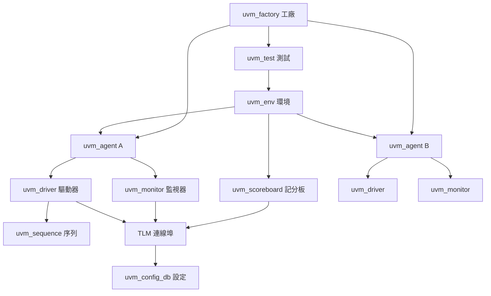

# 1.2 SystemVerilog的黃金年代與UVM的代價（2005-2017）

## 一場三合一的合併

2005 年 6 月，IEEE 發布 IEEE 1800-2005。這份標準的核心動作只有一句話：**把三種東西合成一種語言**。

1. **Verilog-2001**（IEEE 1364-2001）——成熟、被產業完全接受的硬體描述基礎。
2. **C++ 語言的核心機制**——類別、封裝（encapsulation）、繼承、多型、泛型、異常處理、隨機化與約束求解。
3. **PSL / OpenVera 的硬體斷言語言**（e 語言）與 **DPI**——專為硬體設計的時間語意與形式化性質表達。

這三者的來源與動機各自獨立，卻在同一時間點被合併，因為它們共同回答了同一個問題：**硬體設計已經變得比 Verilog 能表達的更複雜。**

### Accellera：從志願者組織到標準推手

推動這場合併的是 **Accellera**。它於 1995 年成立，最初名為 Open Verilog International（OVI），任務是推廣 Verilog-2001 之前的一些擴充；後來改名 Accellera，轉型為推動 SystemVerilog 的中立組織。

Accellera 的重要性在於它代表了硬體語言標準化的新形態：**由使用者聯盟先行、以實務程式碼為基礎、成熟後再交給 IEEE 認證**。這與 Verilog 的路徑恰好相反（Verilog 是廠商先定，IEEE 後追認）。

2003 到 2005 年間，SystemVerilog 經歷了一次戲劇性的插曲：**原本計畫在 2003 年發布的「Verilog-2005」被合併進 SystemVerilog，導致「Verilog 2005」這個版本編號從未存在**。這是因為 IEEE 認為把 Verilog 的擴充與 SystemVerilog 的擴充分成兩份標準，會造成工具支援的分裂與使用者混淆。於是 1364 的版本停在 2001，而 1800 承擔了 Verilog 的所有內容加上新特性。

這個插曲有一個長遠影響：**從 2005 年起，Verilog 與 SystemVerilog 之間就不再有「版本對應」了**。今天的工具在選項上寫「Verilog-2001 / SystemVerilog」，而 SystemVerilog 是唯一的完整語言。

### 規格頁數：第一個訊號

IEEE 1800-2005 的語言規格約 1100 頁；後續版本一路增長：1800-2009 約 1300 頁、1800-2012 約 1500 頁、1800-2017 約 1800 頁，加上相關的 IEEE 1800.2（UPF）、1800.2a 等，低功耗與多電壓的補充文件另外再加數百頁。

我們在第 0 章說過，頁數本身不是罪惡——C++ 的規格至今也超過一千頁，而 C++ 是一門成功的語言。但**硬體語言的頁數有一個 C++ 沒有的對照組**：Verilog 的規格只有約 400 頁，而 Verilog 支撐了整個半導體產業二十年。從 400 到 1800，功能增加了四倍多，**同時**整個產業的專案規模也增加了十倍。兩條曲線的乘積，就是工程師的負擔。

---

## SystemVerilog 的核心新增

### 一、類別與封裝：把資料與行為綁在一起

Verilog 的世界觀是**資料流與結構分離**的：資料放在 `wire` / `reg` 裡，行為放在 `always` / `module` 裡，兩者靠「名字」連結。

SystemVerilog 引進了類別：

```systemverilog
class Packet;
    rand bit [7:0]  addr;
    rand bit [31:0] data;
    int unsigned      id;

    function new(int unsigned id);
        this.id = id;
    endfunction

    function bit is_valid();
        return (addr inside {[0:255]});
    endfunction
endclass
```

語法上是 C++，但**設計意圖完全不同**。Verilog 的 `reg` 只是「可被程序性賦值的變數」；SystemVerilog 的類別把**屬性、行為、隨機性、約束**綁成一個具有生命週期的物件。

為什麼硬體需要這件事？兩個原因：

1. **驗證環境**。UVM 的整個架構建立在類別之上——transaction、sequence、driver、monitor、scoreboard 全是類別。這是語言支援的最大受惠者。
2. **參數化硬體建構**。SystemVerilog 的類別也能用在硬體建模上（例如用類別寫一個可參數化的 AXI 介面模型）。

但這也是一把雙刃劍：一旦語言有了類別與多型，就有了**繼承階層的深度**、**建構與析構的順序**、**句柄與物件的區別**、**虛函式派發**。這些概念對硬體工程師（通常沒有 C++ 背景）來說是全新的負擔，而它們最終全都會出現在 Verilog→SystemVerilog 的遷移道路上。

### 二、介面與 modport：SystemVerilog 最重要的進步

如果只能挑一項 SystemVerilog 的功能來說明它為什麼成功，那就是 **interface**。

#### 問題：Verilog 的「一束訊號」

用 Verilog 描述一個 SPI 從機介面：

```verilog
module SpiSlave (
    input  wire        clk,
    input  wire        rst_n,
    input  wire        cs_n,
    input  wire        sclk,
    input  wire        mosi,
    output reg         miso,
    output wire [7:0]  rx_data
);
```

每個模組都要**重新宣告**這五個訊號。若這是一個被 20 個模組共用的匯流排，就有 20 份重複宣告，改一個訊號名要改 20 個地方，而且沒有任何機制保證它們一致。

#### 解法：介面把「一束訊號」變成「一個有型別的物件」

```systemverilog
interface spi_if #(parameter int WIDTH = 8) (input logic clk, input logic rst_n);

    logic             cs_n;
    logic             sclk;
    logic             mosi;
    logic             miso;
    logic [WIDTH-1:0] rx_data;

    // 從機觀點：cs_n, sclk, mosi 是輸入；miso, rx_data 是輸出
    modport slave (
        input  clk, rst_n, cs_n, sclk, mosi,
        output miso, rx_data
    );

    // 主機觀點：反向
    modport master (
        input  clk, rst_n, miso, rx_data,
        output cs_n, sclk, mosi
    );

endinterface
```

用起來：

```systemverilog
module SpiSlave (spi_if.slave bus) (
    input logic clk,
    input logic rst_n
);
    // bus.cs_n, bus.sclk ... 直接可用
endmodule

module SpiMaster (spi_if.master bus) (
    input logic clk,
    input logic rst_n
);
endmodule

module Top (input logic clk, input logic rst_n);
    spi_if #(8) bus (clk, rst_n);

    SpiMaster u_master (.bus(bus));
    SpiSlave u_slave (.bus(bus));
endmodule
```

`interface` 帶來的四個立即收益：

1. **單一真相來源**。訊號宣告只寫一次。
2. **埠方向約束（modport）**。`spi_if.slave` 這個型別宣告了「從這個角度只能看到這些方向」，編譯器可以檢查方向錯誤。
3. **參數化**。同一個 `spi_if` 可以參數化成 8/16/32 位元。
4. **連接語義清楚**。`.bus(bus)` 是「把這個介面物件接上去」，不再是「手接 5 根線」。

這是**模組間契約**在硬體語言中第一次有了語言級的支持，直接解決了我們在第 1.1 節列出的 Verilog 缺陷三。

#### 副作用：新的複雜度來源

介面並非只有好處。它帶來了 Verilog 時代不存在的問題。

**問題一：驅動衝突（driver conflict）與 `tri` 邏輯。**

在 Verilog 中，`wire` 是單一驅動者（single-driver）語義：兩個 `assign` 驅動同一個 `wire` 是錯誤。當訊號被包進介面後，同一個介面訊號可能需要被多個模組驅動（例如多個 master 共用一條匯流排的仲裁邏輯），於是必須引入**解析邏輯**。

SystemVerilog 定義了四種邏輯值型別：

| 型別 | 驅動語意 |
| --- | --- |
| `logic` | 單一驅動者（Verilog 的 `wire` 近似） |
| `tri` | 多驅動者，強度解析（`0` 與 `1` 相遇得 `x`） |
| `wand` / `wor` | 連線（wired-AND / wired-OR）解析 |
| `tri0` / `tri1` | 預設值為 `0` / `1` 的多驅動者 |

Verilog 裡 `wire` 其實就是 `tri` 的別名，Verilog 的 `wand`/`wor` 也存在，但多數工程師從沒用過它們。**SystemVerilog 把多驅動從罕見邊角提升為日常概念**，代價是「這個訊號現在是誰在驅動、解析規則是什麼」變成每個設計者都要思考的問題。

**問題二：介面與模組埠的組合爆炸。**

一個模組可能接 5 個不同的介面，每個介面有 20 個訊號，`modport` 又有 3 種視角。型別參數與介面參數交錯之後，工具產生的錯誤訊息經常長得像這樣：

```
Error: Cannot bind port '.data' of type 'logic [31:0]' to
       expression of type 'logic [15:0]' in instance 'u_bridge'.
```

其中一半的型別來自介面參數的推斷。使用者要靠心裡「展開」介面的參數才能理解。

**問題三：`always_comb` 與介面訊號的敏感度計算。**

`always_comb` 的敏感度清單由工具自動推導，包含「讀取到的所有訊號」。若讀到的是介面訊號，工具需要跨介面邊界做依賴分析。在大型設計中這不僅是正確性問題，也是效能問題。

### 三、泛型與參數化

SystemVerilog 提供三種彼此獨立的參數化機制：

**（一）模組參數的型別化**

```systemverilog
module fifo #(
    parameter type DATA_T = logic [31:0],
    parameter int  DEPTH   = 16
) (
    input  logic             clk,
    input  logic             rst_n,
    input  logic             push,
    input  DATA_T            din,
    output logic             full,
    output logic             empty,
    output DATA_T            dout
);
```

`parameter type` 讓參數不只是一個數字，而是可以是一個**型別**。這是 Verilog 的 `parameter`（只能傳整數或字串常數）的根本性擴充。

**（二）類別的泛型參數**

```systemverilog
class stack #(type T = int);
    local stack #(T) m_items [$];
    ...
endclass
```

但要注意：**類別參數在編譯時是「靜態」的**。`stack #(int)` 與 `stack #(string)` 是兩個完全不同的編譯期型別，各有自己的 vtable 佈局。當你有多種資料型別時，類別數量會呈現乘法膨脹。

**（三）動態資料結構**

| 結構 | 語法 | 用途 |
| --- | --- | --- |
| 動態陣列 | `bit [7:0] q[$];` `q.push_back(x);` | 驗證環境的佇列 |
| 關聯陣列 | `int map[string];` `map["a"] = 1;` | 以任意鍵值索引 |
| 佇列 | `q.push_front(x); q.pop_front();` | 雙端操作 |
| 開列陣列 | `int q[$];`（`[]` 索引） | 稀疏陣列 |

**關鍵限制：這些結構不能被硬體綜合。** 它們是**純驗證語言**。這個界線在 SystemVerilog 中是明確的（硬體語法與驗證語法分離），但它的直接後果是：**SystemVerilog 中有兩套並存的世界觀，語法交集很小，而工具必須同時支援兩套。** 這是「工具子集」危機（第 1.3 節）的根源之一。

### 四、斷言與涵蓋：從「驗證」到「形式化」

SystemVerilog 斷言（SystemVerilog Assertions, SVA）是這門語言裡**最有深遠影響、也最被低估**的部分。

#### 為什麼需要 SVA

傳統的驗證方式是「寫 testbench、跑模擬、看結果」。它有兩個致命缺陷：

1. **覆蓋率無法窮舉**。一個 $`n`$ 輸入的設計有 $`2^n`$ 種可能輸入組合，`for` 迴圈跑不完。
2. **錯誤的發現是隨機的**。你不能證明「沒有 bug」，只能證明「跑過的測試沒有抓到 bug」。

SVA 讓工程師可以用**宣告式**的方式寫出「這個性質必須永遠成立」，然後交給**形式驗證工具**用數學方法證明它。JasperGold、Questa Formal VC、Conformal 等工具因此在 2005 年之後迅速成長，成為 ASIC 流程的標準環節。

#### SVA 的時間語意

SVA 的核心是「**並行蕴含**」——描述「在某個時間點發生的事件，會強制在另一個時間點發生什麼」。

| 運算子 | 名稱 | 語意 |
| --- | --- | --- |
| `\|->` | 重疊蕴含（overlapped implication） | 若antecedent 在時間 $`t`$ 成立，consequent 必須在**同一時間槽的下一個 sampling** 成立（即時間 $`t`$ 結束前） |
| `\|=>` | 非重疊蕴含（non-overlapped implication） | 若 antecedent 在時間 $`t`$ 成立，consequent 必須在**下一個 sampling 時間 $`t + 1`$ ** 成立 |
| `##n` | 延遲 | 往後 $`n`$ 個 sampling 事件 |
| `##[a:b]` | 延遲範圍 | 往後 $`a`$ 到 $`b`$ 個 sampling 事件之間任一者 |
| `[*n]` | 連續重複 | 連續 $`n`$ 個時間槽 |
| `throughout` | 貫穿 | 性質在整個區間持續成立 |
| `until` / `s_until` | 直到 | 某性質在某區間內首次成立 |
| `##0` | 零延遲 | 同一時間槽（與 `\|->` 組合用） |
| `\$rose` / `\$fell` / `\$stable` | 邊緣偵測 | 訊號剛剛上升 / 下降 / 保持穩定 |

一個典型的握手正確性斷言：

```systemverilog
// 要求：任何一次 request 之後，必須在 3 個週期內看到 ack
property p_req_ack;
    @(posedge clk) disable iff (rst_n)
    (req |-> ##[1:3] ack);
endproperty

assert property (p_req_ack) else $error("req 未被 ack");
```

一個典型的匯流排協定斷言：

```systemverilog
// 要求：寫入位址必須對齊到 4 bytes
property p_addr_align;
    @(posedge clk) disable iff (!rst_n)
    (wr_en |-> (addr[1:0] == 2'b00));
endproperty
```

#### SVA 的代價

SVA 是 expressive 的，但它的學習曲線**極陡**：

- **時間語意需要時間建模**。property 的 sampling event、disable iff、以及多個 property 間的互動，形成一套獨立的時間邏輯系統。
- **語法密度高**。`|-> ##[1:3]` 這種寫法對不熟悉 temporallogic 的工程師幾乎不可讀。
- **模擬與形式驗證的語意不完全一致**。同一條 SVA 在模擬器裡是「抽樣檢查」，在形式驗證工具裡是「數學證明」；兩者的邊界情況處理可能不同（例如在 `disable iff` 的競態時刻）。
- **工具支援分歧嚴重**。不同工具支援的 SVA 子集、支援的 temporal operator 集合、支援的 sequencer 種類都不同。

### 五、DPI：連接 C 語言

DPI（Direct Programming Interface）提供了一條從 SystemVerilog 呼叫 C 函數的路徑，語意上比 Verilog 的 PLI 簡單得多。

```systemverilog
import "DPI-C" function int unsigned crc32(
    input byte unsigned data[],
    input int unsigned length
);

function int unsigned compute_crc(input bit [31:0] w);
    byte unsigned buf[4];
    buf[0] = w[7:0];
    buf[1] = w[15:8];
    buf[2] = w[23:16];
    buf[3] = w[31:24];
    return crc32(buf, 4);
endfunction
```

DPI 的價值在於：**C 語言有所有硬體語言都缺的東西**——成熟的演算法函式庫、成熟的物件導向、成熟的 OS 與檔案系統存取。在「硬體加速驗證」或「硬體加速演算法」這類場景（例如 crypto IP 的參考模型、或把軟體模型接進硬體做 co-simulation），DPI 是不可或缺的。

DPI 也解決了 Verilog-AMS 混模（AMS 與 Verilog 混在同一個模擬器裡）的痛點——C 模型相容性好得多。

### 六、隨機化與約束求解

這是 SystemVerilog 對硬體驗證影響最深的一項功能。

```systemverilog
class AxiReq;
    rand bit [7:0]  addr;
    rand bit [31:0] data;
    rand bit [3:0]  burst_len;
    rand bit [1:0]  burst_size;

    constraint c_addr_align {
        addr[1:0] == 0;
    }

    constraint c_burst_size {
        burst_size inside {[1:4]};
    }

    constraint c_len_size {
        (burst_len * (1 << burst_size)) <= 256;
    }
endclass
```

**隨機化 + 約束求解**把驗證從「窮舉」轉向「有方向的搜尋」。這是整個硬體驗證產業在 2005-2017 年間最大的進步來源。

**排程（scheduling）**：當一個物件有隨機欄位之間存在相依時（例如 `addr` 依賴某個全域狀態），SystemVerilog 提供 `solve ... before ...` 排程指示，讓求解器決定求值順序。

**隨機化的代價**：約束求解器是一個複雜的軟體元件，求解時間隨約束數量呈指數成長。大型SoC 的隨機測試中，「隨機」意味著「每次跑的刺激序列都不同」，這使得**重現 bug 變得困難**——需要額外的 seed 管理機制。

---

## UVM：驗證方法學的巔峰與代價

### 為什麼需要 UVM

2005 年之後，SystemVerilog 提供類別，但**類別只是語言機制，不構成方法學**。每家公司要自己決定：交易物件怎麼定義？激勵怎麼產生？觀測點在哪裡？預期值怎麼算？怎麼比對？

2007 年推出的 **UVM（Universal Verification Methodology）** 把這些問題的答案標準化。它的架構分層如下：



- **transaction**：代表一次匯流排交易的物件，攜帶欄位與限制。
- **sequence**：產生 transaction 的序列物件，含隨機與約束。
- **driver**：把 transaction 轉成匯流排上的訊號活動。
- **monitor**：被動觀察匯流排，把活動轉回 transaction。
- **agent**：把 driver + monitor 組成一個可重用的驗證元件。
- **scoreboard**：收集預期值與實際值並比對。
- **environment**：把 agent 與 scoreboard 組成一個 DUT 的驗證環境。
- **factory**：動態建立物件、支援覆寫。
- **`uvm_config_db`**：以「路徑字串」為鍵的設定傳遞機制。

### UVM 的代價

UVM 是**硬體驗證史上最大的軟體框架**。它帶來的成功是顯著的：它讓驗證環境可重用、讓新人能透過標準框架學習驗證、讓跨專案的驗證資產可以累積。

但它的代價同樣顯著：

**第一，類別階層深到令人眩暈。**

一個驅動一個 AXI4 從機的 `uvm_driver` 衍生鏈可能是：

```text
uvm_component
  └─ uvm_driver
       └─ axi_slave_driver
            └─ my_project_axi_slave_driver   （專案特定）
```

而一個 scoreboard 常常需要 `uvm_scoreboard` → `uvm_subscriber` → 自訂類別。三到四層的繼承加上 `uvm_object` / `uvm_component` 兩套基底類別的語意差異（前者有 reference semantics，後者有 phase 與 hierarchy），使得**繼承的「坑」深到看不見底**。

**第二，一個測試的啟動成本極高。**

要跑一個基本測試，UVM 需要：建立 `uvm_test` → 建立 `uvm_env` → 建立所有 agent → 建立所有 driver 與 monitor → 建立 scoreboard → 建立 `uvm_phase` 調度器 → 解析 phase 依賴 → 依序跑 `build`、`connect`、`end_of_elaboration`、`start_of_simulation`、`run` 等 phase。

**啟動一個測試要建構數百甚至數千個物件**，而這只是為了「跑一個簡單的讀寫」。對一個只需要跑 100 個測試向量的小 IP 來說，UVM 的啟動開銷可能比測試本身還大。

**第三，scoreboard 的程式碼量常常超過 DUT。**

一個中等的 AXI4 從機驗證環境，scoreboard 常見的寫法是手寫一堆 `virtual sequence` 與「把收到的資料存起來、比較時取出來」的邏輯。這些程式碼：

- 冗長且高度重複；
- 與 DUT 的 RTL 幾乎無關；
- 卻是專案裡最常出 bug 的地方（記分板本身的 bug 會產生「假失敗」，浪費大量除錯時間）；
- 難以覆蓋邊界情況。

**第四，UVM 把硬體專案變成了軟體專案。**

這是最深層的代價。一個典型的 UVM 專案需要：

- 軟體工程師級的物件導向訓練；
- 建置系統（CMake / Makefile / Python）與相依性管理；
- 程式碼風格規範、靜態分析、單元測試；
- 開發者要能除錯一個多層繼承的物件圖。

**用軟體語言的能力解決硬體驗證問題是一次典型的成功**，因為隨機化與約束確實大幅提升了驗證效率。但**把硬體專案變成軟體專案是一次典型的失敗**，因為工具鏈複雜度、建置複雜度與人才需求都超過了硬體專案應有的比例。

**第五，效能。**

UVM 的物件建構與 phase 調度是純軟體開銷。在一個以數百萬個事件為單位的模擬中，UVM 的 monitor/scoreboard 每處理一個 transaction 都要做多次虛函式派發與物件操作。實際專案中，**驗證環境的執行時間往往是 DUT 的 10 到 100 倍**，而 DUT 本身可能只佔模擬時間的一小部分。

---

## 模擬器效能的隱形戰爭

SystemVerilog 時代的隱形戰爭，不在語言，而在**模擬速度**。

### 事件式模擬的天花板

Verilog/SystemVerilog 的事件式模擬是一種**樂觀執行**：只有在訊號值改變時才做工作。這個模型對「大部分時間靜止」的電路非常有效，但對現代 SoC 越來越不適用：

- 現代 CPU 的 pipeline 有數千個 in-flight 指令，每個 clock 都有大量狀態改變；
- 快取與記憶體子系統的行為高度非線性；
- 多核系統中數百個核同時活動；
- 開機（boot）序列牽涉到韌體的大量指令執行。

**量級的體感**：一個跑了 Linux 7.1 的完整開機流程模擬，可能需要數小時的模擬時間與數天的掛機時間。而一個 SoC 專案的完整回歸（regression）通常包含數千個測試。

### cycle-based 模擬器的崛起

正因為如此，**Verilator**（2011 年起）這類 **cycle-based 模擬器**（也稱 compiled simulator）崛起。Verilator 的做法是：

1. 把 RTL 轉譯成 C++ 或 SystemC；
2. 每次 clock 邊緣，整批評估所有邏輯；
3. 不維護事件佇列。

代價是**只能支援硬體可綜合的子集**（沒有延遲 `#`、沒有競態、沒有 `initial` 區塊的即時語意、沒有完整四態）。收穫是**模擬速度快一到兩個數量級**，而且可以直接產出 C++ 測試平台（Google  famously 用 Verilator 產生 verilated model 給 C++ 測試使用）。

Verilator 的成功不只是效能問題，更是**「語言子集才是真實需求」這個事實的公開證明**：整個產業的開發者最終選擇在一個子集裡工作。

### 額外負擔

SystemVerilog 的模擬負擔還包括：

- **程式碼覆蓋收集**。要達到 sign-off 要求的覆蓋率（line / branch / toggle / FSM state / functional coverage），工具需要插樁並在每個事件上更新計數器。這本身可能讓模擬變慢 1.5 到 3 倍。
- **交易紀錄（transaction logging）**。把每個 transaction 寫成文字或二進位紀錄，供除錯與後分析使用。一個完整回歸可能產生 TB 級的紀錄檔案。
- **DPI 呼叫的跨越邊界成本**。每次 DPI 呼叫都有序列化與型別轉換開銷，若在回圈裡密集呼叫，會嚴重拖慢模擬。
- **隨機測試的不可預測執行時間**。隨機測試的執行長度由 seed 決定，同一個測試在不同種子下可能快 10 倍或慢 10 倍，讓 CI 的時間估算變得困難。

---

## 文化層面的轉變

技術變遷最終一定會反映在人才結構上。

2005 年之前，一位硬體工程師的典型技能組合是：數位電路、Verilog、合成與時序的直覺、可能的 C。2005 年之後，期望的技能組合變成：Verilog/SystemVerilog 之外，還要有物件導向、Python（驗證腳本）、可能的 C++（UVM 加速或 DPI）、建置系統、除錯大型物件圖的能力。

這造成三個後果：

1. **學習曲線成為專案瓶頸**。一個原本 3 個月可以上手 Verilog 的團隊，改用 SystemVerilog + UVM 後需要 12 到 18 個月才有生產力。
2. **人才分層加劇**。RTL 工程師與驗證工程師的技能分化越來越大，兩者的薪資差距與溝通成本都上升。
3. **「會寫 RTL」不再是選拔指標**。越來越多面試在問「你如何做驗證環境架構」。

同時，SystemVerilog 的廣泛採用也帶來了正面效果：**它把硬體設計的工程標準拉高到與軟體相當的層次**。版本控制、程式碼審查、靜態分析、持續整合、程式碼覆蓋率——這些軟體工程文化確實隨著 SystemVerilog 一起進入了硬體產業。**這一點不應該被低估：它是 SystemVerilog 黃金年代最重要的正面遺產。**

---

## 收束：SystemVerilog 解決了什麼，又製造了什麼

我們把 1.1 節提出的 Verilog 四缺陷與 SystemVerilog 的對策並排：

| Verilog 的四缺陷 | SystemVerilog 的解方 | 引入的新代價 |
| --- | --- | --- |
| 語法糖掩蓋語意 | `always_comb` / `always_ff` / `always_latch` 意圖標記 | 三者語意相近但不完全一致，語意負擔只是被重新分配 |
| 無嚴謹型別系統 | `logic`、`enum`、`struct`、二維陣列、`parameter type` | 硬體子集與驗證子集並存，型別推斷規則更複雜 |
| 無模組間契約 | `interface` 與 `modport` | 多驅動與 `tri` 解析規則成為新的日常概念 |
| 語意負擔落在設計者 | 斷言、隨機化、約束求解、UVM 方法學 | 語言規模膨脹、學習曲線、工具分歧 |

**SystemVerilog 解決了 Verilog 的四個缺陷，但也製造了四個自己的缺陷**：

1. **語言規模膨脹**：規格從 400 頁變成 1800 頁，超過多數工程師終生能精讀的量。
2. **工具子集分化**：沒有一家 EDA 工具支援完整的 SystemVerilog，於是工程師實際工作在「工具的交集」裡。
3. **語意不可預測**：類別、巨集、繼承、`x` 傳播、`always` 家族的細微差別、多驅動解析，全部疊加在 Verilog 原有的隱藏規則之上。
4. **驗證方法學的複雜度外溢**：UVM 把驗證從「寫幾個 testbench」變成「寫一個框架」，框架本身的維護與除錯成為專案負擔。

這四個缺陷並不是 SystemVerilog 的設計者「沒想到」——他們想到了，而且標準裡有大量針對它們的規範。問題在於**結構性的**：只要語言要同時滿足「描述硬體」與「描述驗證環境」兩種本質迥異的需求，它的複雜度就會以乘積而不是加法的速度成長。

下一節（1.3）將把 2017 年之後這三場危機攤開：**工具子集**、**語意不可預測**、以及**替代語言的挑戰**。同時我們也會看到 Veryl 如何在 2022 年把這些危機收斂成一組設計目標。

---

*下一節：第 1.3 節「複雜度危機：工具子集、語意不可預測與替代語言的挑戰（2017-2026）」*
