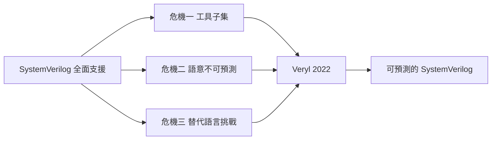

# 1.3 複雜度危機：工具子集、語意不可預測與替代語言的挑戰（2017-2026）

## 危機的時間軸

2017 年前後，SystemVerilog 的帳單全面到期。我們把三場危機並列：



這三場危機不是同時爆發的，但彼此強化：

- **工具子集**讓工程師無法信任語言規範，只能信任工具的文件。
- **語意不可預測**讓工程師無法信任語言，只能信任自己的經驗與 lint 工具。
- **替代語言**則證明了「換一個語言」是可能的——這既提供了出路，也提供了壓力。

本章依序處理這三場危機，最後說明 Veryl 如何在 2022 年把它們收斂成一組設計目標。

---

## 危機一：工具子集（Tool Subset）

### 核心事實

**沒有一家 EDA 工具支援完整的 SystemVerilog。**

這不是「支援度有高低」，而是**每家工具只支援一個子集，而且這些子集互相不重疊**。實際的工程含義是：

> 一個可攜的 SystemVerilog 專案，能用的語言不是 IEEE 1800 規定的那門語言，而是「所有參與專案的 EDA 工具都支援的那個交集」。

這個交集比任何單一工具的支援集還小，比 IEEE 1800 小得多。我們來看看它有多小。

### 具體例子

以下是業界常見的「某工具不支援某功能」情形（具體支援矩陣會隨版本改變，但**分歧的種類**是穩定的）：

| 功能 | 商用模擬器 | Verilator | 商業合成器 | 形式驗證工具 |
| --- | --- | --- | --- | --- |
| `class` 完整語意 | 多數支援 | 不支援 | 不支援 | 支援 |
| 動態陣列 / 佇列 | 支援 | 不支援 | 不支援 | 支援 |
| 關聯陣列 | 支援 | 不支援 | 不支援 | 支援 |
| `final` 關鍵字 | 部分支援 | 不支援 | 不支援 | 支援 |
| `covergroup` | 支援 | 不支援 | 不支援 | 部分支援 |
| 隨機化與約束 | 支援 | 不支援 | 不支援 | 支援 |
| `always_comb` / `always_ff` | 支援 | 支援 | 支援 | 支援 |
| `program` 區塊 | 支援 | 不支援 | 不支援 | 不支援 |
| `bind` | 部分支援 | 不支援 | 不支援 | 支援 |
| 介面與 modport | 支援 | 支援 | 支援 | 支援 |
| DPI | 支援 | 支援 | 部分支援 | 部分支援 |

值得注意的是這張表呈現出**結構性的分層**：

- **可綜合的硬體核心**（always 家族、介面、模組、generate、struct/enum）幾乎所有工具都支援。
- **驗證專用特性**（類別、隨機化、covergroup、動態陣列）在模擬器與形式驗證工具支援，在綜合器與 cycle-based 模擬器不支援。
- **邊緣特性**（`program`、`bind`、`final`、`covergroup` 的某些角落、`solve before`）則在工具之間真正分歧。

**「真正分歧」的區域，正是最容易出錯的區域。** 工程師在 `program` 區塊裡做一件對的形式驗證工作，在另一個工具上會得到一個語意不同的結果；`bind` 在某工具會覆寫方法、在另一個工具根本不支援。

### 語言規範變成了可攜性的敵人

這裡有一個殘酷的悖論。

SystemVerilog 規格不斷擴充，本意是讓語言更完整；但每一次擴充都讓「完整語言」與「實際工具支援」的差距變大，於是**使用完整語言變成一種風險**。結果是：

1. 語言規範越完善，實際上被使用的語言子集越小。
2. 每個子集的特性都記錄在某個工具的某個版本的文件裡，而不是 IEEE 標準裡。
3. 當團隊換工具或升版本時，需要重新確認「我們用到的那些冷門特性還在不在」。

**語言規範變成了可攜性的敵人**——這句話是對 SystemVerilog 擴張策略最尖銳的批評，也是 Many Keys to Many Countries 原則在硬體領域的具體表現。

### 可攜 SystemVerilog 風格的實務守則

儘管語言規範無法保證可攜性，**實務上存在一套公認的「保守子集」規範**。以下守則在業界被廣泛遵守（措辭是根據常見的專案規範整理而成）：

**硬體核心部分：**

1. 只使用可綜合的語法；`initial` 區塊僅用於 FPGA 的初始化值，並加上工具指示詞保護。
2. 優先使用 `logic` 而非 `reg` / `wire`；需要多驅動時才用 `tri` 家族。
3. 避免 `#` 延遲；需要延遲時用 `specify` 或改用同步設計。
4. 避免 `initial` 內部的賦值、避免 `force` / `release`（僅限測試平台）。
5. 不使用 `deassign`，需要覆寫值時用 `bind` 或參數。
6. 避免隱含網路；一律顯式宣告所有變數。
7. 用 `always_comb` / `always_ff` / `always_latch` 而非裸 `always`，並配合 `unique` / `priority` 讓工具檢查 case 覆蓋。
8. 參數覆寫一律用具名形式，不用 `defparam`。

**驗證部分：**

9. 避免 `program` 區塊；改用 `clocking` 區塊。
10. 避免 `bind`，改用設定參數或介面注入。
11. 避免 `final`，改用 factory 或設定覆寫。
12. 避免 `covergroup` 的進階功能（cross、transition、bin 的邊界情況）。
13. 隨機化只使用 `rand` 與簡單 `constraint`；避免 `solve before` 的複雜排程。
14. 不使用佇列的 `push_front` 與 `pop_back` 混用等冷門操作。

**一致性部分：**

15. 同一個專案固定使用一套工具版本，並把工具版本寫進 CI 設定。
16. 用 `verilator --lint-only` 與商用工具**同時**跑 lint，以暴露子集差異。
17. 在專案的風格文件中明確列出「禁用特性清單」。

這份清單本身就說明了一個殘酷的事實：**一個成熟的 SystemVerilog 專案，有相當一部分的程式碼規範是在描述「不要用什麼」，而不是「要用什麼」。**

### 對 Veryl 的啟示

Veryl 的策略是把這個問題**從根上消滅**：

- Veryl 的語言**只有一個實作**（官方編譯器 verylc），因此不存在「工具子集」的問題——你用到的就是全部。
- Veryl 生成 SystemVerilog 交給既有工具，因此**不需要在 SystemVerilog 裡寫新程式碼**，也就不會引入新的子集分歧。
- Veryl 刻意**不提供**語言層的隨機化、covergroup、動態陣列——這些是 Verilator 與商用工具之間分歧最嚴重的區域。Veryl 的策略是**把驗證語言留在 SystemVerilog 那一側**（用 cocotb 或 embed 的 SystemVerilog 測試平台），而自己只負責可綜合的硬體描述。

這一點在第 8 章會詳細展開。

---

## 危機二：語意不可預測（Semantic Unpredictability）

這是本卷最重要的一節。

### 論題

Verilog 與 SystemVerilog 中存在大量**「語法決定硬體結構」的隱式規則**。這些規則散落在語言的不同角落，必須靠記憶與經驗掌握，而且彼此之間經常互相衝突。

我們把主要的「隱式規則」列出來：

| 規則 | 表面形式 | 隱藏的問題 |
| --- | --- | --- |
| 阻塞 vs 非阻擋 | `=` 與 `<=` 差一個字元 | 決定暫存器或組合邏輯 |
| `always_comb` vs `always @*` | 兩種寫同一件事 | 敏感度清單推導規則不同、含 latch 檢查不同 |
| `logic` 是誰的責任 | 型別名不變 | `logic` 可以是 net 也可以是 variable，取決於宣告位置與驅動方式 |
| 多驅動 | 多個 `assign` | 需要 `tri` / `wand` 與強度解析 |
| `x` 傳播 | 運算子回傳 `x` | 何時該用 `===`、何時該用 `==`，全靠人記 |
| `casez` vs `casex` | 差一個字母 | `casex` 把 `x` 當 don't care，會遮蔽真實的 `x` |
| 隱含網路 | 不宣告就能用 | 打錯字會產生無聲的硬體 |
| `always @*` 的 latch 推論 | 漏掉分支 | 條件不完整時**自動**產生 latch，而不是報錯 |
| 位寬擴充與截斷 | 隱式 | `8 + 8` 的結果寬度取決於上下文 |
| `for` 迴圈 | 與軟體同形 | 在硬體中是複製，且迴圈變數寬度有限 |

**共同特徵：它們都不是「看起來像什麼就是什麼」。** 工程師在寫碼時**無法先在腦中建立硬體模型再寫碼**，因為語意需要大量隱藏規則，而這些規則在不同上下文裡還會變。

### 同一個字元，不同的語意

我們用一個具體的例子說明問題的尖銳性。

```systemverilog
always_ff @(posedge clk) begin
    q = d;      // 錯誤：always_ff 中不允許阻塞賦值
end             // 工具會報錯
```

```systemverilog
always_comb begin
    q <= d;     // 允許嗎？語法上合法，但會產生 race
end             // 非阻塞賦值在 always_comb 中，讀到的是舊值
```

第一個例子裡，工具會明確報錯（`always_ff` 要求非阻塞賦值）。第二個例子裡——**`always_comb` 加上非阻塞賦值，語法上合法**，但因為 `always_comb` 沒有時脈邊緣，「時間槽末端」是什麼意思就變得含糊，結果是模擬結果取決於模擬器的排程細節。

**同一個 `<=` 字元，在 `always_ff` 裡是正確的，在 `always_comb` 裡是危險的。** 工程師要記住的不是「`<=` 是什麼」，而是「`<=` 在這個上下文裡是什麼」。

而更麻煩的是第二個例子**通常不會報錯**。它可能通過 lint、通過 code review、通過回歸測試，然後在量產後以「偶發的資料錯誤」形式出現。

### 隱式規則如何累積

更關鍵的是，這些規則**不是獨立的**。它們會互相作用，產生組合爆炸。

舉例：一個 `always_comb` 區塊裡，

- 讀取了某個由 `assign` 驅動的 `logic` 訊號（該訊號同時也被某個 `always_comb` 驅動 → 多驅動 → 需要 `tri`）；
- 讀取了某個在另一個模組裡以 `always_ff` 驅動的 `logic` 訊號（跨模組的組合邏輯讀取時序邏輯輸出，這是合法的，但要小心）；
- 該訊號的驅動是透過 `interface` 的 `modport` 進來的（方向約束由 modport 決定，而 `modport` 的方向宣告與實際驅動者必須一致）；
- 該 `interface` 的參數由上層具名覆寫（位寬因此在整個階層中改變）。

要判斷這段程式碼的語意是否正確，工程師必須同時掌握：驅動者與被驅動者的型別關係、`always_comb` 的敏感度推導規則、`tri` 的解析規則、`modport` 的方向語意、參數覆寫的傳遞路徑。

**這就是「不可預測」的真正含義：不是語言有 bug，而是理解成本高到無法維持。**

### 對 ASIC 流程的致命影響

這一節要特別強調語意不可預測性在 ASIC 流程中的後果，因為這是硬體語言與軟體語言最不可同日而語的地方。

#### ECO 的本質

在 ASIC 流程中，設計完成後會進行 tape-out（投片）。投片後如果發現 RTL bug（bug 常常在 tape-out 後才被發現，因為這時才有真實的矽片可以跑真實的軟體），工程師會發起 **ECO（Engineering Change Order）**。

ECO 的流程是：

1. 定位到 RTL 的某個具體位置；
2. 修改 RTL；
3. **重新做邏輯合成與時序分析**；
4. 產生一個只替換部分邏輯的 FF 級（flip-flop level）patch 網表；
5. 交給晶圓廠做少量遮罩修正。

第 4 步是關鍵：**ECO 的成本隨著修改範圍擴大而急遽上升**。改一個小區塊的 FF 級網表，成本是數十萬美元級；改一個大區塊，接近重做一整個晶圓的遮罩。

因此 ECO 的實務原則是：**修改必須盡可能小、盡可能局部、且行為必須完全可預測。**

#### 語意不可預測如何摧毀 ECO

現在考慮：工程師在 tape-out 後發現某個 FIFO 的計數器有一個 off-by-one，希望做一個 ECO。

如果語言是**可預測的**，工程師可以：

1. 讀 RTL，確認計數器的邏輯；
2. 修改（例如把 `cnt <= cnt + 1` 改成 `cnt <= cnt + 2`）；
3. 重新合成，確認只有計數器那一段的 FF 網表改變；
4. 產生 ECO patch。

如果語言是**不可預測的**，以下任何一項都可能發生：

- **工具的自動最佳化改變了拓撲。** 例如某個工具因為偵測到某種模式而自動插入流水線暫存器，或做常數傳播時改變了邏輯深度。工程師改一行，工具產生的差異網表卻不只一行。
- **隱式網路讓修改落在錯誤的地方。** 打字錯誤產生一個隱含的 1-bit wire，合成結果「看起來合理」，但 bug 依然存在——ECO 沒有解決問題。
- **`x` 語意使比對失效。** 兩個版本之間做等價性比對（ECO 驗證的標準做法），如果新版把某個 `x` 變成 `0` 或 `1`，比對工具可能無法給出明確的「等價 / 不等價」結論。
- **參數覆寫的隱式修改。** 專案某處的 `defparam` 或某層的參數覆寫，改變了遠端的模組行為，ECO 工程師在本地根本看不到。

結果是：**ECO 的成本從「小而局部」變成「大而不可預測」**，於是很多專案在 tape-out 後寧可**不做 RTL 層 ECO**，改而在後段做金屬層 ECO（metal-only ECO）甚至全版重做。整體而言，一門語言的語意可預測性，直接決定了專案在後半段的**財務風險**。

#### Veryl 的官方立場

Veryl 專案在 FAQ 中明確陳述了相關立場，其要點是：

> Veryl **刻意不採用自動流水線（automatic pipelining）**等會插入觸發器的功能，因為這會破壞可預測性——工程師必須能夠預期「改一行程式碼會產生怎樣的硬體」。

這個立場背後的邏輯是完整的因果鏈：

1. 語言提供自動流水線 → 工程師無法預期生成的硬體拓撲。
2. 無法預期拓撲 → 無法信任綜合結果 → 必須用額外的驗證（例如手寫 pipeline register 註解）來確認。
3. 驗證成本上升 → 整體開發成本上升，而自動流水線本來要省下的量級遠小於此。
4. 最糟的情況：ECO 階段發現拓撲與預期不符，修改成本失控。

因此 Veryl 的立場可以概括為一句話：**硬體語言的「便利性」如果以「不可預測性」為代價，那不是便利，是負債。**

### 與軟體的對比：語義模型的根本差異

我們把這個問題放回第 0 章提過的「難題二」，因為它是所有語言設計決策的根源。

| 軟體 | 硬體 |
| --- | --- |
| `for` 迴圈 = 順序執行很多次 | `for` 迴圈 = 複製硬體 |
| `if` = 控制流程分支 | `if` = 多路選擇器（mux） |
| 賦值 = 覆寫記憶體位置 | 賦值 = 建立一條資料路徑 |
| 陣列 = 記憶體 | 陣列 = 觸發器或 RAM |
| 函式呼叫 = 呼叫堆疊 | 函式呼叫 = 組合邏輯（或狀態機） |
| 迴圈計數器 = 軟體變數 | 迴圈計數器 = 硬體計數器 |
| 程式執行有起點 | 硬體沒有「起點」，只有時間軸 |
| 副作用順序重要 | 硬體中多條路徑並行 |

我們把硬體語言的「時間」抽象得更清楚一點。硬體設計的實際模型是：

$$
x(t+\Delta) = F\bigl( x(t), u(t) \bigr)
$$

其中 $ x(t) $ 是狀態向量（所有暫存器的值），$ u(t) $ 是輸入，$ F $ 是組合邏輯決定的轉移函數，$ \Delta $ 是一個時脈週期。

這個模型裡有幾件事值得注意：

- $ F $ 是**純函數**。這就是為什麼硬體裡「阻塞賦值」與「非阻塞賦值」在**最終穩態**上等價（都是描述同一個 $ F $），但在**暫態**上不等價（暫態決定了 pipeline 深度與延遲）。
- 硬體裡**沒有「順序」這個概念**。所有的賦值都在描述 $ F $ 的不同部分，誰先誰後在物理上沒有意義，只有在事件式模擬器裡才有。
- **延遲（latency）是設計出來的，不是程式碼順序決定的。** 這個觀念是 Verilog 競態問題的根源，也是 SystemVerilog 用 `always_ff` 試圖固化的東西。

由此可以推導出一個重要的語言設計結論：

> 一門可預測的硬體語言，必須讓「硬體的結構」是**程式碼的直接函數**，而不依賴「程式碼的排列順序」或「模擬器的排程策略」。

Verilog 在這方面失敗（競態），SystemVerilog 部分修復（`always_*` 家族）但保留了 legacy `always`（向後相容），Veryl 則選擇**完全移除** legacy 路徑（第 4 章的主題）。

---

## 危機三：替代語言的挑戰（2010-2026）

2010 年前後，學術界與部分工業團隊開始嘗試一件在軟體界看來理所當然、在硬體界卻大膽的事：**用現代程式語言寫硬體**。

這些嘗試統稱為 **Alt-HDL**（Alternative HDL）。它們的共同企圖是：

1. 用有現代型別系統、組合子（combinator）、泛型的語言來描述硬體；
2. 用編譯器**產生** Verilog；
3. 讓硬體設計受益於軟體工程的方法（型別安全、巨集、DSL、套件管理）。

它們的想法是好的，並且在學術界與部分商業產品中取得成功。但在 ASIC 流程裡，它們遇到了**共同的致命障礙**。

### Chisel（2010- ，Scala）

Chisel 由 UC Berkeley 開發，是 Alt-HDL 路線的代表性成果，也是影響最廣泛的一個。它的核心概念是「用 Scala 寫硬體產生器」：

```scala
class Hello extends Module {
  val io = IO(new Bundle {
    val in  = Input(UInt(8.W))
    val out = Output(UInt(8.W))
  })
  io.out := io.in + 1.U
}
```

Chisel 的優點非常明確：

- **型別安全**。位寬是型別的一部分（`UInt(8.W)`），位寬錯誤在編譯期就被 Scala 的型別系統擋下。這是相對於 Verilog 的巨大進步。
- **參數化 DSL**。硬體可以用 Scala 的泛型與組合子自由構造。
- **硬體產生器**。Rocket Chip、TileLink、SiFive 的許多設計都用 Chisel 完成，並開源出來。

但 Chisel 有三個致命缺陷，而且這三個缺陷**不是實作問題，是設計取向的必然結果**。

#### 致命缺陷一：產生的 Verilog 不可讀

Chisel 的編譯過程會產生大量機器生成的 Verilog。問題在於：

- **模組名稱被機器改寫**。使用者寫的 `myFifo` 在產生的 Verilog 中可能變成 `myFifo_1`，因為 Scala 的編譯單元名稱與硬體模組名稱不對應。
- **位寬到處展開**。一個 32 位元的運算會變成 `((a + b) & 32'hFFFFFFFF)` 這類形式。
- **產生的是「拍平」的邏輯**。高階的 Scala 抽象（組合子、泛型）在編譯後**全部消失**，只剩下低位元的邏輯運算。工程師看到的是一份數千行的平坦 Verilog，而不是他們寫的結構。
- **介面被展開成散落的訊號**。Chisel 的 `Bundle` 在 Verilog 中變成一個模組，其欄位透過階層路徑存取。

結果是：**Verilog 工程的除錯流程在 Chisel 上失效。** 你不能用波形對照原始碼，因為原始碼和產生碼之間沒有可讀的對應關係。你不能用 Verilog 的 lint 與形式工具做有意義的檢查，因為它們看到的是一份平坦的機器輸出。

#### 致命缺陷二：無法做 FF 級 ECO

這是 ASIC 流程的決定性障礙。

ASIC 的 ECO 需要在**原始碼**上做修改（或者至少要知道原始碼與網表的對應），因為：

- 大型 SoC 的原始碼有數十萬行；網表有數千萬個 gate。
- ECO 需要的是「最小修改」——改一個計數器，而不是重做整個區塊。
- 修改網表是**不可能**的（網表來自邏輯合成，不是可維護的產物）。

在 Chisel 的流程裡：

1. 你改了 Scala 原始碼；
2. 重新產生 Verilog；
3. 重新做邏輯合成。

第 3 步會**重新最佳化整個設計**，網表會到處都是差異。ECO 的「局部修改」性質完全喪失。

更根本的是：如果 Chisel 產生的是不可讀的 Verilog，那麼在 tape-out 之後，當 bug 在矽片上被發現時，沒有人能在合理時間內讀懂產生的 Verilog 來定位問題。**這使得 Chisel 流程下的 ASIC 專案，面對 tape-out 後的 bug，實質上失去了 RTL 層 ECO 的能力。**

#### 致命缺陷三：無法與既有 SystemVerilog 生態對接

一個真實的 ASIC 專案不可能是「全部 Chisel」：

- 匯流排介面（AXI4）來自 IP 供應商，是 SystemVerilog。
- 類比介面（SerDes、PLL）來自供應商，是 Verilog-AMS 或加密網表。
- 記憶體編譯器（Memory Compiler）產生的是加密網表或特定格式。
- 硬體團隊已經寫了十萬行的 SystemVerilog。

在 Chisel 流程裡，這些元件要透過「把 Chisel 產生 Verilog 與 SV 一起編譯」來整合，然後**整個設計（Chisel 產生的部分 + SV 部分）都要重新做邏輯合成**。這沒問題——但只要有一個 ECO，整個流程的性質就改變了。

Veryl 專案在 FAQ 中明確指出這一點，論點是：

> 一門硬體語言若產生的程式碼不可讀，就無法與既有的 SystemVerilog 生態（介面、結構、驗證環境）對接，因此在 ASIC 流程中難以落地。

### SpinalHDL（2016- ，Scala）

SpinalHDL 是 Chisel 的改進版，由 SpinalHDL 社群維護，並成為 OpenTitan 計畫的主要硬體描述語言之一。它的改進包括：

- **更好的錯誤訊息**：編譯期就報出「這個訊號名稱不存在」而不是產生壞掉的 Verilog。
- **更強的型別系統**：`Data`、`Bits`、`Stream`、`Bundle` 等型別有更嚴格的結構。
- **更好的時序建構支援**：`ClockDomain`、`Area`、`RegNext` 等。

SpinalHDL 的產生碼可讀性明顯優於 Chisel（模組名稱被保留），這是一個重要的進步。但它的基本取向與 Chisel 相同：**產生 Verilog/Verilog 為主要產出**。因此前述三個缺陷——尤其是「ECO 與既有 SV 生態對接」——仍然存在。

值得注意的是 **OpenTitan 的選擇**：一個大型商業 SoC 專案選了 SpinalHDL 而不是 Chisel，這說明 Alt-HDL 在工業界確實有市場。但 OpenTitan 也同時面對「整個晶片是一個巨大的 SpinalHDL 產生碼 + 手寫 SV」的混合體，其 ECO 與整合體驗是外界持續關注的議題。

### Migen 與 LiteX（2013- ，Python）

Migen 是 Python 版的硬體產生器，用 Python 的語法（配合 `Signal` 物件）描述硬體，產生 Verilog。

```python
class Counter(Module):
    def __init__(self, width=8):
        self.count = Signal(width)
        self.en = Signal()
        ...

        self.sync += If(self.en, self.count.eq(self.count + 1))
```

Migen 的特色是**語法最接近硬體電路圖**，且 Python 生態（NumPy、腳本工具）友好。LiteX 建立在 Migen 之上，是 FPGA SoC 的整合框架，提供 CPU、匯流排、週邊等元件庫，在社群與教育用途上非常受歡迎。

Migen/LiteX 的問題與 Chisel 類同，且多一項：**Python 沒有靜態型別**。位寬錯誤在執行期才發現（而且是在產生 Verilog 時），錯誤訊息通常是 Python 的 traceback，對硬體工程師不友善。

### TL-Verilog（2017- ，SystemVerilog 的擴充）

TL-Verilog 是**另一條路線**的代表：不是新語言，而是在 SystemVerilog 上做擴充。

它的核心貢獻是為 **pipeline** 與 **clock domain crossing** 提供了一套**形式化方法論**：

- 用 `tlv_pipeline` 標記模組的流水線級數，讓工具自動插入 pipeline register。
- 用 `tlv_cdc` 標記跨時鐘域的握手，讓工具檢查 CDC 協議。
- 所有擴充都以巨集（`\`define`）與屬性（`*`）實作，**不修改語言本身**。

TL-Verilog 的價值在於它證明了：**很多被認為需要新語言才能解決的問題（流水線、CDC），其實可以用「既有語言 + 屬性 + 工具」解決。** 這個結論對 Veryl 的設計有直接影響：Veryl 在第 6 章的 CDC 檢查機制，思路與 TL-Verilog 同源。

但 TL-Verilog 也有它的代價：它是**巨集層的擴充**，因此：

- 語意仍然寄生在 SystemVerilog 的全部複雜度之上；
- 工具必須額外支援這個擴充層（同樣是「工具子集」問題）；
- 屬性是**宣告式但非強制**的——忘了標記，檢查就不會發生。

### 中間表示（IR）路線

最後，有一條路線值得單獨說明，因為**Veryl 走的正是這條路線**。

「生成 Verilog」不是唯一可能的架構。更一般的架構是：

$$
\text{來源語言} \longrightarrow \text{中間表示（IR）} \longrightarrow \text{目標語言}
$$

其中 IR 是一個**結構化的、工具友善的**硬體中間表示。Chisel 有 FIRRTL IR，SpinalHDL 有自己的 IR，Verilator 有內部 IR，而 Veryl 也有自己的 **analyzer 基於 IR** 架構（Veryl 專案在 2026 年 1 月的部落格文章中專門討論了 IR-based analyzer 的設計）。

IR 路線的價值在於：

1. **多前端、多後端**。同一份 IR 可以產生 Verilog、SystemVerilog、VHDL，也可以驅動模擬器。
2. **可攜性檢查有統一位置**。型別檢查、位寬檢查、驅動衝突檢查都在 IR 上做一次，不必在每個後端重做。
3. **工具鏈可以統一**。內建模擬器（第 8.2 節）可以直接在 IR 上做解譯或編譯，不需要先生成 Verilog 再餵給外部模擬器。
4. **更容易做最佳化與分析**：死邏輯消除、位寬分析、常數傳播都在 IR 上做。

但 IR 路線也有風險：

- **IR 本身是一門需要設計的語言**。如果 IR 太接近 Verilog，就继承了 Verilog 的問題；如果太抽象，就會丟失硬體語意。
- **多一層轉換 = 多一層不確定性**。「Veryl → IR → SystemVerilog」的鏈上，任何一層的語意損失都會造成「產生的 SV 與預期不符」。這是 Veryl 必須嚴格測試生成碼的原因。

### 其他語言與 VHDL

**VHDL（1987- ）** 是比 Verilog 更早的語言，由美國國防部推動，設計上更嚴謹：型別系統更強（區分 `signal`、`variable`、`constant`）、沒有隱含網路、沒有四態邏輯（在 `std_logic_1164` 中以解析方式建模）、語意比 Verilog 明確得多。

VHDL 在**教學**上表現出色——很多歐洲的數位設計課程以 VHDL 為主，因為它的型別系統能強迫學生建立正確的心智模型。但在**產業**上，VHDL 從未取得 Verilog/SystemVerilog 的地位。原因包括：

- 早期 VHDL 的工具效能不佳（尤其模擬速度）；
- IP 供應商與工具商都押注 Verilog；
- Verilog 的 C 風格語法更貼近軟體工程師的既有技能；
- 沒有形成「事實標準」的自我強化循環。

VHDL 的歷史對 Veryl 是一個重要的提醒：**「語言設計更好」不等於「產業會接受」。** 語言的採用是網路效應問題。

**Rust 作為硬體語言**：2020 年前後，Rust 生態中出現了幾個硬體描述方向：

- **rust-hdl**：一個以 Rust 描述硬體並產生 Verilog 的專案。值得注意的是，**rust-hdl 的部分貢獻者來自 Veryl 社群**，Veryl 後來的 Rust 元件機制（第 10.2 節）與這條線有關。
- **`fpga`** crate：提供以 Rust 描述數位邏輯的框架。
- **nerv、MirageOS**：以 Rust 實作作業系統核心或網路堆疊的專案，展示了 Rust 對「需要硬體與軟體共同設計」場景的適用性——但它們通常不是用 Rust 描述硬體，而是用 Rust 寫 firmware 搭配既有的硬體描述。

Rust 的吸引力在於**記憶體安全**與**硬體描述語言的組合**：一門語言同時能寫 driver 與描述硬體，會消除「硬體/軟體介面」的邊界摩擦。這是一個有趣的方向，但它面臨與 Chisel 相同的結構性問題：**若最終產出仍是 Verilog，ECO 與生態問題不變；若產出 Rust 原生描述，則整個 ASIC 流程（EDA 支援、sign-off、IP 生態）都要重建。**

---

## Veryl 的出場（2022）

把三場危機收攏起來，我們就得到 Veryl 的設計目標。

### 三個設計目標

**目標一：語義等價於 SystemVerilog（可預測）。**

Veryl 的語法與 SystemVerilog 不同，但**生成的 SystemVerilog 與手寫的等價 SystemVerilog 有相同的硬體語意**。這意味著：

- 語法簡化不帶來語意改變；
- 不會有「Veryl 的 `always_comb` 和 SV 的 `always_comb` 有一點不同」這類問題；
- 設計者從 SystemVerilog 遷移過來時，腦中的硬體模型仍然成立。

**目標二：語法簡化（消除隱藏規則）。**

Veryl 直接針對第 1.1 節列出的四個 Verilog 缺陷與本章的隱式規則清單：

| Verilog / SystemVerilog 的隱式規則 | Veryl 的處理 |
| --- | --- |
| 隱含網路 | 完全廢除，未宣告即編譯錯誤 |
| 裸 `always` | 廢除，改為 `always_ff` / `always_comb` / `always_latch` 專用區塊語法 |
| 阻塞 / 非阻擋的語意負擔 | 在 `always_ff` 中固定用非阻塞語意，`always_comb` 中固定用阻塞語意，設計者無需選擇 |
| `always_comb` 中允許 `<=` | 直接禁止 |
| 隱含型別 | 全部顯式宣告，型別與寬度必須寫出 |
| 四態邏輯 | 在硬體描述子集中限縮為二態（詳見第 5 章） |
| 參數覆寫的 `defparam` | 廢除，只保留具名、顯式的參數傳遞 |

**目標三：生成可讀的 SystemVerilog（保有互操作與 ECO 能力）。**

這是對 Alt-HDL 路線的直接回應。Veryl 的產生器必須做到：

- 保留模組名稱、埠名稱、訊號名稱；
- 產生結構化的、與手寫 SV 風格一致的程式碼；
- 讓工程師能讀懂產生碼，並在必要時閱讀、甚至手動修改它；
- 讓整個設計（Veryl 部分 + 既有 SV 部分）能一起做合成、驗證、ECO。

### 取捨原則：不追求最大表達力

Veryl 的取捨原則可以概括為一句話：

> **不追求最大表達力，而追求「工程上剛好夠用，且完全可預測」。**

這是一個與 SystemVerilog 完全相反的取向。SystemVerilog 的設計哲學是「把所有可能的硬體建構需求都納入語言」；Veryl 的哲學是「只納入那些可以用**單一、無歧義**的語法表達的需求，其餘交給 SystemVerilog 或其他工具」。

具體表現包括：

- **不提供類別**。驗證環境用 SystemVerilog 寫，或用 cocotb 等以 Python 為基礎的方法（第 8.3 節）。
- **不提供隨機化與約束**。這些留在 SystemVerilog 那一側。
- **不提供自動流水線**。如前所述。
- **不提供 `covergroup`**。功能覆蓋率由外部工具處理。
- **不嘗試取代 VHDL 的所有用途**，只聚焦於 ASIC/FPGA 的可綜合硬體描述。

這條原則是有代價的：**Veryl 的適用範圍比 SystemVerilog 窄。** 它的目標使用者是「寫 RTL 的人」，不是「寫整個驗證平台的人」。這是一個明確的市場切割，也是一個合理的工程切割。

### 為什麼這三個目標能同時成立

值得停下來想一想：目標一（語義等價 SV）、目標二（語法簡化）、目標三（產生可讀 SV）之間會不會衝突？

它們不衝突，因為 Veryl 走的是**「窄化輸入、放寬輸出」**的路徑：

- 輸入端只接受那些能**無歧義地**映射到 SystemVerilog 的建構；
- 輸出端產生的是**標準的、人寫的** SystemVerilog，因此可以直接餵給任何工具。

這與 Chisel 的「輸入端非常 expressive（可以用任何 Scala 組合子）、輸出端是機器生成的」正好相反。**Veryl 用輸入端的表達力限制，換取了輸出端的可預測性與可攜性。**

這個取捨能成立的關鍵前提是：**語言設計者願意拒絕功能。** 在一個所有語言都在競相加功能的產業裡，「我們不做這個」是一個需要信念的決定。

---

## 本章結語與過渡

我們把這四十二年的因果鏈完整地走了一遍：

1. **Verilog（1984）** 為模擬而設計，語法像 C，語意模糊但效率高。它贏得了產業，因為它先發、因為它好上手、因為它是唯一一個不用標準就統治了硬體設計的語言。
2. **Verilog-95 / 2001** 把它從模擬語言推成設計語言，但也把競態、隱含網路、`generate` 等語意負擔永久地固化了。
3. **SystemVerilog（2005）** 一次補齊了所有缺口，贏得了工具支援與人才庫，也製造了 1800 頁的規格、UVM 的框架成本、以及工具子集的分歧。
4. **2017 年之後**，三場危機同時爆發：工具子集讓規範失效，語意不可預測讓 ASIC 流程的 ECO 成本失控，Alt-HDL 提供了「換語言」的選項卻在 ASIC 落地時卡住。
5. **Veryl（2022）** 用「窄化輸入、放寬輸出」的取捨，把三場危機收斂成三個設計目標。

下一章（**第 2 章：Veryl 的設計哲學與語言定位**）將回答一個更細的問題：

> Veryl 具體做了哪些語法決定？每一個決定的背後理由是什麼？

我們會從 Veryl 的誕生講起，然後逐一檢視三大支柱，最後用一整節的篇幅回答那個最容易被誤問的問題——**「為什麼不是 Chisel？」**

---

*下一章：第 2 章「Veryl 的設計哲學與語言定位（2022-2026）」*
