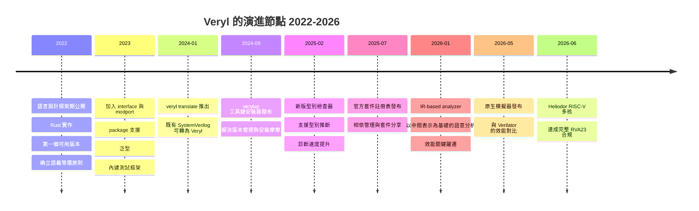

# 2.1 Veryl 的誕生：名字、動機與語言設計目標（2022-2024）

## 一個名字的重量

語言的名字不是行銷，而是**設計宣言**。名字在社群裡被反覆提及、被拿來開玩笑、被寫進論文標題，它最終會變成社群對這門語言的隱喻。一個好的名字要同時滿足三件事：好記、好念、而且**指向設計者希望它承擔的個性**。

Veryl 這個名字是一個雙關，而且是精心設計的雙關：

- **V** 來自 **Verilog** 的首字母，代表它的血統：它是一門硬體描述語言，而且它的存在是為了取代（或說改良）SystemVerilog 的使用體驗，而不是另起爐灶去描述一個完全不同的世界。
- **Beryl** 是一種寶石（中文常譯「綠柱石」，英文發音 /ˈbɛrəl/），Veryl 的發音完全相同。同時 **emerald（祖母綠）也是 beryl 家族的品種之一**——而 emerald 正是 Veryl 專案使用的主題色。

因此這個名字在內部是自洽的：Verilog 的 V 加上寶石的名字，暗示「一種更精緻的寶石」，一種既是 Verilog 的延伸、又比 Verilog 語法更打磨過的東西。主題色選用 emerald 而非 beryl 本身，也是一個細節的暗示——祖母綠比綠柱石稀有、更高階。

### 語言命名作為社群性格的預告

把 Veryl 放在同期軟體語言的命名傳統裡比較，會發現它宣稱的是哪一種社群性格：

| 語言 | 名字來源 | 命名傳達的訊息 |
| --- | --- | --- |
| Rust | 鏽（rust） | 可靠、抗腐蝕、安全；名字帶著「需要時間但值得」的語氣 |
| Go | 鵝（gopher） | 輕快、友善社群、官方吉祥物 |
| Zig | 字形 Z 的鋸齒（zigzag） | 沒有隱藏的曲折，語意直線 |
| Swift | 快速（swift），Swift 由 Taylor Swift 命名 | 速度與前衛感 |
| Kotlin | 舊金山 Java 島附近的一座山 | 地理坐標式的、工業血統 |
| **Veryl** | **Verilog 的 V + 寶石 beryl** | **「Verilog 的直系改良版，但打磨得更精緻」** |

Rust 的名字帶著工業的嚴肅與長期主義，Go 的名字帶著社群的操作性，Zig 的名字帶著對「語意彎曲」的厭惡。**Veryl 的名字則把「硬體血統」放在第一位，把「工藝品」放在第二位。** 這個順序很重要：它宣告這門語言的野心不是「我要發明一種新的硬體世界觀」，而是「我要讓既有的硬體世界觀可以被更愉快地表達」。

這也直接預告了本章後段要說明的核心設計決策：**Veryl 的改進對象是「人讀寫硬體的體驗」，不是「硬體的描述能力」。**

---

## 起源：一位開發者、一門語言、一個時間點

### 語言的發起

Veryl 由一位具有日本背景的開發者於 2022 年發起並公開。專案以 Rust 實作，編譯器以 `veryl` crate 的形式發佈於 crates.io，並採用 **MIT / Apache-2.0 雙授權**。

這個起點本身就傳達了兩個訊息。

**第一個訊息：語言不是大公司平台的產品。** 硬體設計語言在過去三十年的生態位置幾乎被壟斷——Synopsys、Cadence、Mentor 是硬體描述語言的主要定義者與推廣者（Verilog 來自 Gateway，SystemVerilog 由三大商共同推動）。一門由個人發起的語言要存活，唯一的機會是**在語法上做出大公司不會做的取捨**——因為大公司無法放棄既有的專利、既有的 IP 生態、既有的客戶綁定。

**第二個訊息：Rust 是實作語言，而這不是巧合。** 下一節專門討論這個選擇。

### 為什麼用 Rust 實作一個硬體描述語言編譯器

「用 Rust 實作編譯器」在 2022 年已經不算新鮮——Cranelift、LLVM、rustc 本身都提供了示範。但對一個硬體描述語言而言，這個選擇仍然值得逐一拆解，因為它會反過來影響語言的**可演進性**。

**（一）型別系統適合建構 AST。** 編譯器的核心資料結構是抽象語法樹（AST）與其上的各種分析結果。Rust 的代數資料型別（enum）與組合子（Option / Result）能夠把 AST 的節點種類完整地表達出來，而且**不可能出現「空指標」或「未初始化的 variant」**。對於一個要把語法保留下來、逐步擴充的語言專案，AST 是最寶貴的資產：它的演化速度決定了語言的演化速度。Rust 的型別系統讓 AST 的每一次擴充都伴隨編譯器端的 exhaustive match 檢查，**這種「漏了一個 case 就編譯不過」的性質，在語言演進期是巨大的安全網**。

**（二）borrow checker 減少編譯器自身的 bug。** 硬體語言編譯器最常見的缺陷類型不是演算法錯誤，而是**記憶體生命週期與所有權錯誤**。一個 borrow checker 在編譯期就攔截 use-after-free、double-free、data race 的 Rust 程式碼，意味著 Veryl 編譯器本身不需要為這類缺陷付出除錯成本。對一個語意**必須可預測**的語言而言，**編譯器自身的可預測性**格外重要：如果編譯器在邊界情況下會崩潰或產生未定義行為，那麼「Veryl 的輸出等價於 SystemVerilog」這個承諾就失去了基礎。

**（三）crate 生態成熟。** Rust 的 crates.io 提供了大量現成的基礎設施：序列化、錯誤報告、命令列介面、檔案監看、增量編譯快取、語法高亮與 LSP 伺服器框架。對一個資源有限的開源專案而言，這意味著「不用重造輪子」。

**（四）單一二進位部署。** Rust 產生的 `veryl` 是單一靜態可執行檔，可以透過 `cargo install`、`verylup` 或預編譯的 release binary 安裝。這讓「工程師只要裝一個程式就能用」這件事變得可行——對語言採用率而言，**安裝摩擦是最被低估的障礙**。

**（五）Rust 的社群倫理。** Rust 社群對「正確性優先於便利」有近乎偏執的文化，這與 Veryl 的設計哲學同源。一位在 Rust 社群長大的開發者，會自然地把「消除歧義」「讓編譯器在早期抓到錯誤」視為預設價值，而不是需要說明的選項。

### 雙授權的意義

MIT / Apache-2.0 雙授權（Dual License）的實務效果是：**任何使用者都可以自由選擇其中一份條款**。MIT 極簡、寬鬆，Apache-2.0 額外提供明確的專利授權條款。對企業採用者而言，Apache-2.0 的專利條款是一個重要的法律訊號——它意味著「你可以用在商業產品裡，而且專利風險有明確的處理方式」。對社群貢獻者而言，雙授權是 Rust 與 LLVM 生態的標準做法，貢獻者清楚知道自己的貢獻會被怎樣使用。

在一門語言企圖吸引企業採用、而自身沒有企業 backing 的情況下，**用最寬鬆的授權消除法律疑慮**是務實且必要的選擇。

---

## 官方表述的設計目標：Concept 三段

Veryl 官方網站的 Concept 頁面把設計目標分為三段：**Optimized Syntax（最佳化語法）**、**Interoperability（互操作）**、**Productivity（生產力）**。這三段不是行銷標語，而是三個可以逐項驗證的工程命題。我們在這裡先拆解它們的含義，具體的語法與工具實作留到 2.2 節。

### Optimized Syntax：最佳化語法

「最佳化」這個詞在這裡不是「最快的語法」，而是「**為特定目的被優化過的語法**」。它優化的目標是**可預測性**。

它的內涵是：語言中每一條規則都只有一種解讀，語法直接反映硬體結構，而不是反映寫作時的方便。例如：埠的方向寫在名稱之後（`i_data: input logic<10>`），因為「這個訊號是什麼方向、什麼寬度」是這個訊號的**本質屬性**，而不是它的宣告場合的副產品。

### Interoperability：互操作

互操作不是「可以呼叫 SystemVerilog 的函式」這種程度的互通，而是**整個專案生態層面的共存**：

- 既有 tens 萬行的 SystemVerilog 可以留在原處；
- 既有的 IP（介面、加密網表、SerDes）可以直接使用；
- 既有的驗證環境（UVM、cocotb）可以驗證 Veryl 產生的設計；
- Veryl 的輸出仍然是**標準的、人寫的那種 SystemVerilog**，可以直接送進既有的簽核流程。

關鍵在於最後一點：**互操作的前提是產出物品質合格**。如果 Veryl 產生的 SystemVerilog 是一堆機器展開的平坦邏輯，那麼「可以一起編譯」就毫無意義——因為沒有人能維護它。

### Productivity：生產力

生產力不是「用 Veryl 寫得比用 SystemVerilog 快幾倍」這種口號，而是指**工程流程的總摩擦成本**：格式化、lint、即時診斷、語言伺服器、相依管理、文件產生、整合測試、邏輯合成預估。

這三段合起來構成一個閉環，也是第 2.2 節要正式論證的核心命題：**語法最佳化使語意可預測；語意可預測使產生的 SystemVerilog 可讀；產生的 SystemVerilog 可讀才使互操作有意義；而互操作成立，生產力工具才有東西可以操作。**

---

## 最關鍵的設計決策：語義等價原則

### 命題

> **Veryl 在語義上與 SystemVerilog 等價。所有 Veryl 的語法改動，都能預測地反映在產生的 SystemVerilog 上。**

這個命題必須精確理解。它的意思**不是**「Veryl 是 SystemVerilog 的超集」，也**不是**「Veryl 有自己的語意模型，只是恰好類似」。

它的意思是：**Veryl 是 SystemVerilog 的一個「前端的別名層」（dialect / front-end），它的存在目的是為同一組硬體語意提供另一組記號。** 每一個 Veryl 程式碼片段，都對應到一個語意等價的 SystemVerilog 片段；反過來，任何一個「語意上無歧義且可綜合」的 SystemVerilog 建構，理論上都能在 Veryl 中被表達。

### 為什麼這個決策比任何語法決策都重要

一個語言可以靠「新增語法」變得更好用，也可以靠「刪除語法」變得更易讀。但**一旦語言有了自己的語意**，它就必須自己承擔全部的正確性責任：自己的模擬器、自己的形式驗證、自己的語意手冊、自己的勘誤、自己的向後相容政策。而這些正是 SystemVerilog 花了三十年建立的東西，也是任何新語言最難建立的東西。

語義等價原則讓 Veryl **免除**了這份負擔。Veryl 不需要自己的模擬器，因為生成的 SystemVerilog 可以用任何既有模擬器跑；Veryl 不需要自己的形式驗證工具，因為生成的 SystemVerilog 可以用任何既有形式工具驗證；Veryl 不需要自己的 IP 生態，因為 IP 本來就是 SystemVerilog。

### 三個直接後果

**後果一：可以用既有的 SystemVerilog 工具鏈驗證 Veryl 本身。**

這是一個極為強大的自我保證機制。Veryl 專案不需要說「請相信我們的 `always_comb` 語意是對的」，因為可以直接生成 SystemVerilog 然後交給 Verilator 或商用模擬器對拍。更進一步，Veryl 的**整合測試框架**正是建立在這個基礎上：同一個測試案例既可以在 Veryl 的語意下執行，也可以轉成 SystemVerilog 後在外部模擬器執行，兩者結果必須一致。**語義等價不是一句口號，而是每天都在跑的迴歸測試。**

**後果二：工程師不需要重新建立新的心智模型。**

這是採用成本最低的關鍵。一個熟悉 SystemVerilog 的資深工程師轉到 Veryl，腦中的硬體模型**完全保留**。他不需要重新學習「什麼是時序邏輯」「阻塞賦值意味著什麼」。他只是換了一套記號來寫同一套東西。

這個差別在實務上極為巨大。語言學習成本不是「記住關鍵字」的時間成本，而是**「建立正確的硬體心智模型」的時間成本**，後者是以月為單位、且高度依賴工程師經驗的。新人學習 SV 需要數月到數年才能建立可靠的直覺；學習 Veryl 則是把 SV 直覺直接帶過去，然後只需適應記號差異。

**後果三：可以做 FF 級別的 ECO。**

這是 ASIC 流程中的決定性能力，前面第 1.3 節已經詳細論證過 ECO 的經濟學。歸納一下因果鏈：

1. Veryl 產生的 SystemVerilog 是**結構化的、保留原始命名與結構**的；
2. 因此它可以被人工閱讀、註解、甚至在必要時手動修改；
3. 因此「定位問題 → 修改原始碼 → 重新綜合 → 產生局部 FF 級 patch 網表」這條 ECO 路徑保持完整；
4. 因此 ECO 的成本維持在「小而局部」的量級，而不是「重做整個區塊」。

Alt-HDL 路線（Chisel、SpinalHDL）在這一點上失敗，不是因為工程能力不足，而是因為**語言的架構決定了產出物的性質**——一個把所有高階抽象在編譯期「拍平」掉的語言，其產出物必然是不可讀的，而不可讀的產出物必然無法支撐 ECO 流程。

---

## 四條語言設計原則

把上述目標落實到具體的語法規則上，Veryl 的設計可以歸納為四條原則。它們不是四條風格偏好，而是**四個否決器（veto）**：當一項語法特性違反其中任何一條時，它就被拒絕。

### 原則一：保證可合成性與模擬一致性

**內容：** 語法只允許可合成的建構；語言避免出現「可以寫但語意模糊」的部分。

**理由：** 硬體描述語言裡最危險的區域，是「能寫出來、模擬器也接受、但綜合器或實際硬體行為另有解釋」的灰色地帶。在 SystemVerilog 中，這類灰色地帶包括：`initial` 區塊內的賦值（模擬有效、 ASIC 語意依賴記憶體初始化支援）、`#` 延遲（純模擬）、`force` / `release`、`real` 型別、`wait` 敘述、動態陣列操作。

**實作：** Veryl 把這類建構直接從語言中移除，或限制在明確的、可綜合的子集裡。字型與時間模型被刻意收斂到二態邏輯與同步重置模型（詳見第 4、5 章）。

**為什麼重要：** 一門語言的「可合成子集」如果是靠文件與工具警告維持的，那麼它就是不可靠的——警告會被忽略，文件會沒有人讀。把它變成**語法層面的硬性限制**，等於把「能不能用」從人的判斷變成編譯器的判斷。

### 原則二：消歧義

**內容：** 一個語法只對應一種硬體結構。

**理由：** 第 1.3 節列出的十項隱式規則，本質上全都是「同一個語法在不同上下文有不同語意」造成的。最典型的例子是 `<=`：在 `always_ff` 裡它代表「暫存器更新」，在 `always_comb` 裡它的行為取決於模擬器排程細節。

**實作：** Veryl 對這類情形採「**上下文決定賦值語意**」的做法：

| 區塊 | 唯一允許的賦值語意 | 對應 SystemVerilog |
| --- | --- | --- |
| `always_ff` | 非阻塞賦值 | `always_ff` + `<=` |
| `always_comb` | 阻塞賦值 | `always_comb` + `=` |
| `always_latch` | 阻塞賦值 | `always_latch` + `=` |

**關鍵差異：** 在 Veryl 中，`<=` 這個運算子**不存在**。工程師不需要記住「`<=` 在這個上下文是什麼」，因為「選哪種賦值語意」這個決定被語法本身接管了——你選了 `always_ff`，就自動得到非阻塞語意。**決定與語意綁定，消除「記住上下文」這個認知負擔。**

這是整個 Veryl 設計中**最漂亮的一個決定**，也是最能體現「語法即契約」這個本書主題的一個決定。

### 原則三：互操作優先

**內容：** 任何需要 SystemVerilog 專屬功能時，都有逃生門（escape hatch）。

**理由：** 原則一與原則二限制了語言的邊界，但語言邊界之外的硬體需求是真實存在的。**一個不提供逃生門的語言，工程師最終會因為「差一點功能做不到」而放棄它。** 與其如此，不如主動提供一個明確、可見、且被隔離的逃生門。

**實作：** 兩種機制：

- **`embed (inline) sv{{{ ... }}}`**：在 Veryl 檔案中直接嵌入原生 SystemVerilog 片段，不經任何轉換。
- **`$sv::` 命名空間**：以 `$sv::` 前綴存取 SystemVerilog 的模組、package、介面等。

**關鍵設計：** 逃生門是**明示的**，不是隱蔽的。工程師在 review 時一眼就能看出「這裡退回了 SystemVerilog」，而且可以針對這些位置做專門的檢查策略。相較之下，SystemVerilog 裡那些「其實是 Verilog-95 殘留」的寫法（例如裸 `always`、`wire` 隱含網路）是**隱蔽的**，會隨著時間腐化成一堆難以辨識的舊程式碼。

### 原則四：拒絕「以少量縮寫換取大量複雜度」的語法特性

**內容：** 刻意不採用某些在別的語言裡被認為「很棒」的縮寫性語法特性。

**理由：** 這是本節最重要、也最容易被忽略的一條。它的完整表述是：

> **如果一項語法特性只在少數情況下被使用，卻讓解析器（parser）、型別檢查器、格式化器、程式碼生成器與語言伺服器全部多出一個分支，那麼它的「省下的字元」是假的——因為維護成本被均攤到整個語言與整個工具鏈。**

**具體被拒絕的特性：**

| 被拒絕的特性 | 它在其他語言中的樣子 | 拒絕的理由 |
| --- | --- | --- |
| Off-side rule（縮排決定區塊） | Python | 需要處理縮排敏感、tab 與空白的歧義、格式化器複雜度暴增 |
| 省略分號 | Go、部分 DSL | 換來的是「新行結尾語意」這類需要額外規則消歧的機制 |
| 隱含型別推斷作為預設 | Rust 需型別標註、Ruby 全推斷 | 硬體語言的型別就是位寬，推斷錯誤等同硬體錯誤 |
| 自動流水線插入 | 某些 HLS 工具 | 直接違反「改一行不改拓撲」的可預測性原則 |
| 軟體風格的類別繼承 | SystemVerilog | 引入動態派發與虛函式，遠超硬體描述的需求 |

**特別值得說明的是 off-side rule。** Python 社群常把縮排語法視為 Python 最優雅的特性之一。但對硬體語言來說，它有兩個額外的問題：第一，硬體原始碼經常需要**對齊**以閱讀硬體結構（位元對齊、訊號對齊），而縮排語意會讓「對齊」與「縮排」打架；第二，格式化器的自動重排會**改變程式碼語意**，這對硬體語言是不可接受的（詳見 2.2 節對 `veryl fmt` 的語意無關性要求）。

Veryl 的選擇是：保留 C 家族的大括號區塊語法，因為它是**工具友善、格式化安全、而且已經被硬體工程師熟悉**的。

---

## 演進的關鍵節點

### 2022：探索期與第一個版本

最初的公開版本確立了幾件事：語義等價原則、`<>` / `[]` 的陣列切分、`always_ff` / `always_comb` 的專用區塊語法、以及「產生可讀 SystemVerilog」的輸出目標。此時語言特性集仍然很小，重點是先把架構立穩。

### 2022-2023：介面、package、泛型、測試框架

這一年半是把 Veryl 從「模組描述語言」推成「完整硬體設計語言」的關鍵期：

- **`interface` 與 `modport`**：讓匯流排協定能被封裝成可重用、可參數化的型別（詳見 3.2 節）。
- **`package`**：讓常數、型別、函式能被跨模組共享（詳見 3.3 節）。
- **泛型**：讓硬體參數化不再依賴 `defparam` 式的就地修改。
- **內建測試框架**：把「驗證」從外部拼裝變成語言內建的一等公民。這個決定極為重要——**如果驗證必須靠外部工具拼裝，語言採用率會停留在「寫 RTL 的人」而不會擴散到「做驗證的人」**。

### 2024-09：`verylup`

`verylup` 是工具鏈安裝器，解決的是語言採用最實際的一個障礙：**版本管理**。

在沒有 `verylup` 的年代，安裝 Veryl 需要手動 `cargo install veryl`，而一旦語言快速演進，團隊成員之間的版本分歧就會造成「我這裡可以過、你那裡不過」的痛苦。`verylup` 的作用類似 Rust 的 `rustup`：它管理多個版本、切換版本、並把「專案需要哪個版本」記錄在專案設定裡。

這一點值得單獨強調，因為它是**語言成熟度的重要指標**。一個語言的工具鏈裡如果缺少版本管理，那麼它在企業內的落地就會被「維護多個分支」的行政成本卡死。

### 2025-02：新版型別檢查器

新的型別檢查器引入型別推斷能力，同時大幅改善診斷速度。對一個語法層面刻意簡化的語言來說，型別推斷的意義是：**讓使用者不必重複書寫那些「原則上可以推導」的資訊**——例如一個只被當作整數常數使用的 `const`，其位寬可以從上下文推得。

這裡有個值得玩味的一致性問題：Veryl 在**語法層面**拒絕隱含型別（原則一：保證可合成性與語意明確），但在**語意層面**允許型別推斷。兩者不矛盾，因為前者關係的是「讀程式碼的人能否預測」，後者關係的是「撰寫時能否減少重複」。**推論出來的型別仍然會顯式寫在產生的 SystemVerilog 裡**，因此預測性沒有受損。

### 2025-07：套件註冊表

官方 registry 的發布讓 Veryl 進入「套件生態」階段。語言的相依管理是採用率的決定性因素之一：一門語言如果沒有共享機制，每個專案都會自己重造通用元件（UART、FIFO、仲裁器），重複勞動且品質參差。

Registry 同時帶來另一個價值：**它是社群規模的公開指標**。有多少套件被發布，代表有多少人在實際使用它。

### 2026-01：IR-based analyzer

這是 Veryl 效能的**關鍵躍遷**，也是本節最值得深入的一項。

到 2026 年初之前，Veryl 的編譯流程是「解析 → 直接產生 SystemVerilog」。改進後的架構是：

$$
\text{Veryl 原始碼} \longrightarrow \text{IR（中間表示）} \longrightarrow \text{SystemVerilog 生成}
$$

**IR-based analyzer 的意義不在「快了幾倍」，而在架構上的三點：**

1. **多前端、多後端成為可能。** 有了穩定的 IR，未來可以增加新的輸出目標（VHDL？其他 IR？）而不用重寫整條前端。
2. **語意分析只做一次。** 型別檢查、位寬檢查、驅動衝突檢查、模組連接檢查都在 IR 上完成，而不是散落在「產生某段 SV 之前先檢查」的過程裡。這對**診斷的正確性**有關鍵影響：檢查是在完整的模組層級與階層關係上做的，而不是在局部片段上做的。
3. **原生模擬器得以實作。** 模擬器可以直接解譯或編譯 IR，不需要先生成 SystemVerilog 再餵給外部工具。

**IR 路線的風險也在這裡。** 第 1.3 節提到過：IR 本身是一門需要設計的語言，如果太接近 Verilog 就繼承 Verilog 的問題，太抽象就會丟失硬體語意；而多一層轉換就多一層語意損失的機會。

Veryl 對此的處理方式是**嚴格測試生成碼**：既然語義等價是語言的根基，那麼這個根基就必須靠自動化測試來守住，而不是靠人工檢查。

### 2026-05：原生模擬器

原生模擬器的發布與 Verilator 的效能對比，是 Veryl 從「語言」走向「工具鏈」的分水嶺。

它解決的是一個長期被低估的問題：**硬體設計的驗證成本隨著設計規模的成長而快速上升**，而模擬器速度是瓶頸之一。有了原生模擬器，測試迴圈可以在不依賴外部 EDA 工具的情況下高速執行。

但這裡必須誠實地指出：**原生模擬器不會取代商用模擬器**。商用模擬器支援完整 SystemVerilog 語意（類別、UVM、隨機化），而 Veryl 刻意不實作這些。原生模擬器的定位是「跑 Veryl 描述的硬體」，驗證環境的複雜部分仍在 SystemVerilog 那一側。

### 2026-06：Heliodor 與 RVA23 合規

Heliodor 是 Veryl 社群開發的 RISC-V 多核處理器。它在 2026 年 6 月達成**完整的 RVA23 合規**（RISC-V International 的 RVA23 Profile 定義了 2024 年之後的 RISC-V 應用處理器架構要求）。

這個里程碑的意義在於**規模**：一個多核處理器不是幾百行的教學範例，它是數萬到數十萬行的實際設計，包含流水線、cache、仲裁、錯誤處理、除錯模組（debug module）等。**語言能不能承載這種規模的真實設計，是判斷它是不是「玩具語言」的唯一可靠標準。**

更關鍵的是，Heliodor 達成了 RVA23 合規，而 RVA23 合規**意味著它需要通過合規性測試套件**，這些測試套件是 SystemVerilog 寫的。這就是語義等價原則的實踐證明：Veryl 寫的處理器，通過了為 SystemVerilog 設計的驗證。

---

## 社群與治理

### Discord 與溝通

Veryl 社群的主要聚集地是 Discord。對開源語言而言，Discord 的功能是**降低「第一次提問」的門檻**——比起郵件清單或 GitHub issue（後者有「開 issue 要說清楚」的隱含壓力），Discord 讓初學者更容易問出「這個語法怎麼寫」這種問題。

語言社群的健康度有幾個可觀察指標：提問的友善程度、維護者回覆的頻率、以及**是否有人在社群裡回答問題**（而不只是維護者一個人回）。這是「社群是否能自我維持」的關鍵區別。

### Registry 與 Sponsor

Registry 提供套件分享；Sponsor 機制（類似 Rust Foundation 或 Open Collective 的模式）提供資金支持。對一個沒有企業 backing 的語言而言，**資金來源決定了維護的可持續性**——而語言的維護中斷是採用者最大的風險。

這裡有一個誠實的評估：**Sponsor 金額通常是語言影響力的滯後指標。** 一門語言要拿到穩定的贊助，通常需要先證明它在真實專案中的價值，而這需要時間。所以語言的財務狀況是採用決策時應該納入的「風險項」。

### 雙授權再確認

前面已經說過 MIT / Apache-2.0 的實務效果。值得補充的是雙授權對**學術與教育**場景的意義：學校把語言納入課程時，採購與法務審查都會大幅簡化。

---

## 本章結語與過渡

我們回到本章的核心：Veryl 的誕生不是一個「又一個硬體描述語言」的出現，而是一次**問題定義的轉向**。

前三十年，語言設計的問題是「**如何容納更多可能的硬體建構**」；Veryl 的問題是「**如何讓既有硬體建構更容易被正確地表達**」。前者的答案是 SystemVerilog 的 1800 頁與 UVM；後者的答案是語義等價加上語法簡化。

四條設計原則——保證可合成性與模擬一致性、消歧義、互操作優先、拒絕以縮寫換複雜度——共同構成一套**否決機制**，它們的共同指向是「**可預測**」這個詞。而可預測性正是第 1.3 節論證的：語意可預測性直接決定 ASIC 專案後半段的財務風險。

名字、語言、授權、社群、工具鏈——這些看起來是軟體工程的事務，但它們共同決定了一件硬體工程的事：**一個五年壽命、耗資千萬美元的晶片專案，能不能在三年後仍然由同一批人維護。**

下一節（2.2）將把官方概念的三支柱逐一拆開，用 SystemVerilog 與 Veryl 的並列程式碼，檢驗這些原則在具體語法上究竟長什麼樣子。

---

*下一節：第 2.2 節「三大支柱：語法最佳化、互操作與生產力（2022-2026）」*
