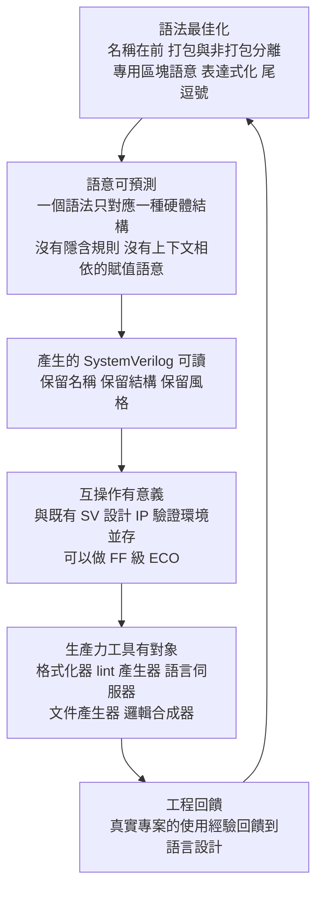

# 2.2 三大支柱：語法最佳化、互操作與生產力（2022-2026）

## 支柱之間的關係：先看結論

Veryl 官方網站把設計目標分為三段：**Optimized Syntax（最佳化語法）**、**Interoperability（互操作）**、**Productivity（生產力）**。官方把它們並列陳述，但從工程因果的角度看，它們其實是**一條鏈**，而不是三個可以獨立挑選的特點：

$$
\text{語法最佳化} \longrightarrow \text{語意可預測} \longrightarrow \text{產生的 SV 可讀} \longrightarrow \text{互操作有意義} \longrightarrow \text{生產力工具有對象}
$$

我們用一個具體的問題來驗證這條鏈：

> 如果 Veryl 產生的 SystemVerilog 是一堆不可讀的機器展開碼，那麼「和既有 SV 設計放在一起編譯」這件事還有意義嗎？

答案很明顯：沒有意義。你不能維護它、不能 review 它、不能在它上面做 ECO。因此「互操作」不是一個可以獨立成立的特性，它**依賴於產出物的可讀性**；而可讀性又依賴「語意可預測」；而語意可預測又依賴「語法最佳化」。

同樣地，「生產力工具」（格式化器、lint、LSP、文件產生）需要一個**足夠簡單、且語意分明的語法模型**才能實作。如果語法裡有二十種不同的隱含規則，那麼格式化器就要處理二十種排版情境，lint 就要實作二十套規則，LSP 的程式碼分析就會不準確。**語法簡化不是生產力的前提，而是生產力得以「準確」的前提**——一個不正確的格式化器比沒有格式化器更糟。

本節依序拆解三支柱，最後回到這條鏈。

---

## 支柱一：語法最佳化（Optimized Syntax）

「最佳化」指的是**為可預測性而優化**，不是「為打字速度而優化」。以下逐項說明 Veryl 的語法決定及其理由。

---

### 1. 名稱在前、型別在後

SystemVerilog 的 ANSI 埠宣告把方向放在最前面，型別緊接著，名字最後：

```systemverilog
module Top (
    input  logic [9:0] i_data,
    output logic [9:0] o_result
);
```

Veryl 把順序反轉，名字放最前面：

```veryl
module Top (
    i_data   : input  logic<10>,
    o_result : output logic<10>,
) {
}
```

**理由：這是宣告語法風格的哲學差異。**

SystemVerilog 的順序來自 Verilog-1995 的 ANSI 擴充：原本 Verilog 的埠宣告是分散在模組頭（`input a;`）與模組體（`reg [9:0] a;`）兩處，Verilog-1995 把它們合併時，必須保留 `input` 這個**方向關鍵字在最前**的既有位置——因為 ANSI 樣式是既有程式碼的「相容性擴充」，不能重排。

但這種相容性擴充留下了一個後果：**名字變成了宣告的最末端**。而名字恰恰是工程師在閱讀時最需要第一眼看到的東西。搜尋程式碼時，你先看到的是 `input logic [9:0]` 這種描述性前綴，然後才看到 `i_data`。

Veryl 的排序則讓「**這個訊號叫什麼**」成為第一眼資訊，型別與方向成為修飾資訊。更重要的是，這個排序是**一致**的：模組埠、內部變數宣告、實例連接、函式參數，全部都是「名稱在前」。

**在生成的 SystemVerilog 裡**，順序會被還原成 SV 的標準寫法，因為語義等價要求輸出的合法性與慣例性：

```systemverilog
module Top (
    input  logic [9:0] i_data,
    output logic [9:0] o_result
);
```

---

### 2. `<>` 打包陣列、`[]` 非打包陣列

這是 Veryl **最大的語法變更**，也是剛從 SystemVerilog 轉換過來的工程師最常卡住的地方。

核心規則只有一句：

| Veryl | SystemVerilog | 意義 |
| --- | --- | --- |
| `logic<10>` | `logic [9:0]` | 打包陣列（packed array），即位向量 |
| `logic [10]` | `logic [9:0] [7:0]` | 非打包陣列（unpacked array），即記憶體／陣列 |
| `logic<10, 8>` | `logic [9:0] [7:0]` | 多維打包陣列 |
| `logic<10> [8]` | `logic [9:0] [7:0]` | 打包陣列的陣列 |

**為什麼要這樣切分？**

這需要從 SystemVerilog 語意講起。SystemVerilog 裡有兩種完全不同的陣列語意：

**打包陣列（packed array）**：位元會被壓平進一個單一的向量。`logic [9:0]` 是一個 10-bit 的值，可以直接做加法、比較、切片。它本質上是「一個寬度為 10 的數值」。

**非打包陣列（unpacked array）**：是一個「元素的集合」，每個元素本身可以是任意寬度。它在硬體裡對應的是**記憶體**（RAM）或**陣列式觸發器**。`logic [9:0] [7:0]` 意思是「8 個元素，每個元素 10 bit」。

這兩者在 SystemVerilog 裡共用同一組括號語法 `[...]`，導致一個 notorious 的問題：看到 `logic [9:0] [7:0]` 時，**你必須依靠型別語境與工具的錯誤訊息才能判斷它是打包還是非打包**。資深工程師也常在此處猶豫。

Veryl 的切分把它變成**顯式的、字面上的、正交的**：

- `<>` 是**角度括號**，對應「維度資訊在型別內部」——打包；
- `[]` 是**方括號**，對應「維度資訊在型別外部」——非打包。

換句話說，`<>` 與 `[]` 的差別就是**維度放在型別裡面還是外面**，這與打包／非打包的實際語意完全對應。設計上它利用了「維度位置的內外」這個正交維度來編碼打包性質，讓兩者不再混淆。

**一個更實際的好處：位寬看起來像數量。** `logic<10>` 讀起來就是「10 位元」，不需要在腦中做 `WIDTH-1` 的換算。相較之下 SV 的 `logic [9:0]` 讓人每次都要確認索引方向與寬度的關係（`[9:0]` 是 10 個元素，`[0:9]` 也是 10 個元素但方向相反——SV 的 `[0:9]` 是遞增的 packed 陣列，位元 0 是最低位，但在 unpacked 用途上語意完全不同）。

---

### 3. `{}` 取代 `begin` / `end`

```systemverilog
always_ff @(posedge i_clk) begin
    if (i_en) begin
        r_cnt <= r_cnt + 1;
    end
end
```

```veryl
always_ff {
    if i_en {
        r_cnt = r_cnt + 1;
    }
}
```

**理由：**

`begin` / `end` 這組關鍵字是 Verilog 時代的產物，當時 Verilog 是 C 風格語言，設計者希望借用 C 的 `{}` 語感，於是發明了兩個新關鍵字來「模擬大括號」。這是一個**冗餘的翻譯層**：既然語法裡已經有大括號，就沒有理由再用一組關鍵字去表達同樣的事。

但 `begin` / `end` 並非全無功能——它可以**命名**（`begin: label ... end`）與**傳遞區域變數**（`begin: blk logic x; ... end`）。Veryl 保留了命名能力（見第 12 項），但把區域變數從開頭移到了大括號內部，讓 `begin` 對應的那部分職責完全消失。

生成的 SV 會把 `{}` 還原成 `begin ... end`，因為 SV 沒有大括號區塊語法：

```systemverilog
always_ff @(posedge i_clk) begin
    if (i_en) begin
        r_cnt <= r_cnt + 1;
    end
end
```

---

### 4. `<:` 與 `>:` 取代 `<` 與 `>`

```systemverilog
assign o_data = i_data << 2;
assign o_data = i_data >> 2;
```

```veryl
assign o_data = i_data <: 2;
assign o_data = i_data >: 2;
```

**理由：泛型語法的衝突。**

Veryl 支援泛型（泛型參數），泛型的語法採用 `::<>` 形式：

```veryl
interface InterfaceA::<W: u32> {
}
```

如果位移運算子沿用 `<` / `>`，那麼在泛型參數的位置上，解析器會面臨歧義：`Foo::<W>` 是「實例化泛型 W」還是「Foo 欄位左移 W」？

用 `<:` / `>:` 把位移與比較運算子區隔開，就消除了這個歧義。

**這裡有一個值得體會的設計原則**：語法設計者不只是要在「新語法與舊語法」之間選，還要在**新語法彼此之間**檢查歧義。Many Keys to Many Countries 原則（IEEE 1800 中 Verilog 併入 SystemVerilog 時的核心命題）的一個重要應用方向是：**衝突時選擇更專用、更不可能與其他上下文混淆的符號**，而不是選擇更短、更常見的符號。

---

### 5. `if` / `case` 表達式取代三運算子

SystemVerilog 的三運算子（ternary conditional）：

```systemverilog
assign o_sel = i_sel ? i_a : i_b;
```

多選一：

```systemverilog
assign o_sel = (i_sel == 2'd0) ? i_a :
                (i_sel == 2'd1) ? i_b :
                (i_sel == 2'd2) ? i_c : i_d;
```

Veryl 直接把 `if` 與 `case` 當成**表達式**：

```veryl
assign o_sel = if i_sel == 2'd0 {
    i_a
} else if i_sel == 2'd1 {
    i_b
} else {
    i_d
}
```

多選一：

```veryl
assign o_sel = case i_sel {
    2'd0: i_a,
    2'd1: i_b,
    2'd2: i_c,
    default: i_d,
}
```

**理由：**

三運算子的問題在於**巢狀時的可讀性崩塌**。上例中的四選一，如果條件複雜起來（`i_sel` 是一個 8-bit 訊號且條件是多位元比對），巢狀三運算子會變成一個橫向鋸齒形的行駛車道式的表達式，需要仔細數括號。

`case` 表達式把選擇關係**結構化**了：條件與結果在同一個可視的區塊內，每個分支的縮排層級相同，且 `default` 分支是顯式的。

**另一個理由是消歧義。** 三運算子的條件必須是布林值，而 SV 的布林語意是四態的（`x` 會導致結果合併為 `x`）。`case` 表達式的分支選擇語意在這方面更明確。

---

### 6. 範圍 `..`、`..=` 與範圍式迴圈

這是 Veryl 相對 SystemVerilog 最有「現代語言感」的設計之一。

**範圍操作符：**

```veryl
var r_mask : logic<8>
r_mask = 8'b1111_0000
// 取 [3:0]
r_low = r_mask[0..3]
```

在 SystemVerilog 中要寫 `r_mask[3:0]`。Veryl 用 `a..b` 表示「從 a 到 b 的範圍」，讀法是英文的自然順序（low 到 high）。

**範圍式迴圈：**

```veryl
for i in 0..10 {
    // i 從 0 到 9
}
```

對照 SystemVerilog：

```systemverilog
for (int i = 0; i < 10; i++) begin
end
```

**理由：**

SV 的 `for` 語法把三個不同的東西綁在一起：**起點、終點、遞增方向**。而且 SV 的迴圈變數有隱含的寬度規則：`for (int i = 0; i < 10; i++)` 中的 `i` 是 32-bit signed，而 `i < 10` 是 signed 比較——一旦有人寫 `for (int i = 0; i < 10; i = i + 1)` 混用了寬度規則，就會有隱含的截斷風險。

Veryl 的 `for i in 0..10` 有幾個好處：

1. **形式唯一**：沒有第三種形式（「遞減」是怎麼寫的？）。遞減在 Veryl 中用 `rev` 關鍵字表達（見第 6 項後半）。
2. **範圍是半開的**：`0..10` 表示 0 到 9，共 10 次。這個半開區間的慣例與 Rust、Python 的 range 一致，但與 SV 的 `<` 比較不同——**這是一個從 C 家族語言轉出來的工程師最容易踩的坑**，也正是 Veryl 選擇在語法上明確表達範圍（而非隱含在比較運算子裡）的理由：既然範圍是硬體複製的數量，那麼它的長度必須是**一眼可數**的。
3. **型別明確**。

**遞減與步進：**

```veryl
for i in 0..10 rev {
    // i 從 9 遞減到 0
}

for i in 0..20 step 2 {
    // i 為 0, 2, 4, ..., 18
}
```

SystemVerilog 裡遞減需要手寫 `for (int i = 9; i >= 0; i--)`，而且 `i >= 0` 對 signed 整數是危險寫法（`i` 遞減到 -1 時條件仍為真，因為 -1 >= 0 為 false 所以其實沒問題，但如果型別推導有誤就會變成無窮迴圈）。Veryl 的 `rev` 與 `step` 把這些常見錯誤從語法上消除了。

---

### 7. `inside` / `outside` 取代 `casez` / `casex`

```systemverilog
casez (i_opcode)
    4'b1???: o_result = o_a;
    4'b01??: o_result = o_b;
    default:  o_result = o_c;
endcase
```

```veryl
case {
    4'b1???: o_result = o_a,
    4'b01??: o_result = o_b,
    default:  o_result = o_c,
}
```

而「在某個集合內」的判定：

```veryl
if i_state inside { S_IDLE, S_DONE } {
    ...
}
```

**理由：**

`casez` 與 `casex` 是 SystemVerilog 中最容易被誤用的兩個關鍵字：

- `casez` 把 `z`（以及 `?`）視為 don't care，**但 `x` 仍是有意義的值**。
- `casex` 把 `x` 也視為 don't care，因此**會遮蔽真實的 `x`（未初始化）**，可能掩蓋硬體 bug。

兩者只差一個字母，語意卻有本質差異——這是第 1.3 節「同一個字元，不同的語意」的典型案例。

`inside` / `outside` 提供的是**集合語意**：

```veryl
if i_state inside { S_IDLE, S_DONE } { }
if i_state outside { S_ERROR } { }
```

這在 SystemVerilog 裡沒有直接對應的寫法（SV 有 `inside` 運算子，但只支援值集合而非狀態列舉的語意寫法）。

---

### 8. `msb` / `lsb` 記號取代手算

```systemverilog
assign o_top = i_data[WIDTH-1];
assign o_bot = i_data[0];
```

```veryl
assign o_top = i_data.msb;
assign o_bot = i_data.lsb;
```

**理由：** 這是「語法最佳化」最典型的案例：`WIDTH-1` 是一個**需要心算的運算式**，而心算是一個會出錯的步驟。更糟的是，`WIDTH-1` 在某些語境下是**隱含寬度陷阱**：如果 `WIDTH` 是 `u32` 而訊號是 64-bit，`WIDTH-1` 會先以 32-bit 計算再零擴充——對 `WIDTH = 0` 的邊界情況更是直接出錯。

`msb` / `lsb` 是**語意名字**而非**算術表達式**，工程師讀到時立刻知道意圖，不需要回頭查寬度。

---

### 9. `repeat` 關鍵字取代巢狀大括號

SystemVerilog 要重複 N 次串接一個值，只能用巢狀的複製運算子：

```systemverilog
assign o_data = {8{1'b1}};
assign o_data = {4{2'b00}};
```

Veryl：

```veryl
assign o_data = repeat 8 { 1'b1 };
```

**理由：** `{N{...}}` 的巢狀大括號在解析上是一個**特例**（`{` 內的第一個 `{` 語意不同），在格式化、錯誤訊息、以及產生器實作上都是麻煩。而更重要的是**可讀性**：`{8{1'b1}}` 讀起來像八層巢狀，而 `repeat 8 { 1'b1 }` 讀起來就是「重複八次」。

---

### 10. `let` 語句取代兩段式賦值

Verilog-2001 之前（以及今天的許多 SV 寫法），組合邏輯要避免重複計算，就得手寫暫存變數：

```systemverilog
always_comb begin
    tmp = a + b;
    x  = tmp > c;
    y  = tmp < c;
end
```

Veryl 的 `let`：

```veryl
always_comb {
    let tmp = a + b;
    x = tmp > c;
    y = tmp < c;
}
```

**理由：**

`let` 把「計算一次、多次使用」這個**共用的子運算式**提升為語言層級的一等概念。相較之下，SV 裡有兩種表達方式：一是手寫暫存變數（需要人工維護賦值順序，且容易出現「忘了賦值」或「重複賦值」的 lint 問題），二是 SV 的 `automatic` 函式（在 `always_comb` 中呼叫函式，某些工具會有語意上的爭議，且工具支援不一）。

`let` 的好處是**局部性**：它的作用域就是這個區塊，不會污染模組命名空間，也不會有「這個暫存變數是共用的嗎」的疑問。

---

### 11. 尾逗號（trailing comma）允許

```veryl
module Top (
    i_data   : input  logic<10>,
    o_result : output logic<10>,
) {
}
```

注意 `logic<10>,` 後面那個逗號。

**理由：這是一個對版本控制有實質影響的決定。**

在多行結構（模組埠清單、`case` 分支、函式參數、陣列初值）中，如果語言不接受尾逗號，那麼新增一個項目時就必須：

1. 在**舊的最後一行**加上逗號；
2. 在**新的一行**加上項目。

這會讓版本控制的 diff 顯示為「一行被修改 + 一行被新增」。

而接受尾逗號後，新增一個項目只需要：

1. 在**新的一行**加上項目（含逗號）。

diff 就變成**純粹的一行新增**，舊的行完全不動。

```diff
 module Top (
     i_data   : input  logic<10>,
-    o_result : output logic<10>
+    o_result : output logic<10>,
+    o_flag   : output logic<1>,
 ) {
```

這不是美觀問題。在大型硬體專案裡，埠清單可能有上百項，介面定義會有數百個欄位，diff 汙染會直接影響 code review 的品質——而 code review 的品質直接影響 bug 的逃逸率。**這是一個把「語法決定」與「團隊工程效率」直接連結起來的案例。**

---

### 12. 具名區塊取代 `begin: Label`

```systemverilog
begin: blk_fetch
    logic [3:0] state;
    ...
end
```

```veryl
:blk_fetch {
    var state : logic<4>
    ...
}
```

**理由：** SV 的具名區塊用 `begin: label` 開啟，而區域變數宣告在 `begin` 與 `:` 之間。Veryl 把它統一成「冒號開頭的標籤 + 大括號」，並且**把區域變數移進大括號內**。這讓區塊的語法與模組、介面的語法統一——所有「有作用域的主體」都用 `{ }`。

---

### 13. `enum` 變體各佔命名空間

SystemVerilog 的列舉成員是**全域的**（在編譯單元範圍內）：

```systemverilog
typedef enum logic [1:0] {
    IDLE, DONE, ERROR
} state_e;
```

在另一個地方：

```systemverilog
typedef enum logic [1:0] {
    IDLE, RUN, HALT
} ctrl_e;
```

這兩個 `IDLE` 在同一個編譯單元中**衝突**，必須改名（例如 `ST_IDLE` / `CT_IDLE`）或用不同 package 隔離——而 package 隔離又會讓程式碼變得冗長。

Veryl 的列舉變體有自己的命名空間：

```veryl
enum State {
    Idle,
    Done,
    Error,
}
```

使用時要寫成 `State::Idle`：

```veryl
if r_state == State::Idle {
}
```

**理由：**

這直接解決了 SV 的「列舉全域污染」問題——SV 裡一個大專案往往會出現 `STATE_IDLE`、`ST_IDLE`、`s_idle`、`IDLE_`、`IDLE_E` 這種前綴地獄，前綴的約定靠人的紀律維持，沒有任何工具保證。

Veryl 的做法把「命名空間隔離」變成**語言保證**，前綴可以完全消失。而且 `State::Idle` 這個寫法在閱讀時**自我說明**：看見 `State::` 就知道它是列舉 `State` 的成員，不需要回頭查 `typedef`。

---

### 14. 複合賦值運算子在 `always_ff` 中可用

SystemVerilog 在 `always_ff` 中**禁止**複合賦值：

```systemverilog
always_ff @(posedge clk) begin
    count <= count + 1;   // OK
    count <= count++;     // 禁止：複合賦值隱含阻塞語意
end
```

工具會報錯，因為 `count++` 展開成 `count = count + 1`，是阻塞賦值。

Veryl 因為在 `always_ff` 中**沒有 `<=` 運算子**，賦值語意由區塊決定，所以複合賦值可以正常使用：

```veryl
always_ff {
    count += 1;
}
```

**理由：** 這是一個「消歧義」的漂亮副產品。SV 之所以禁止，是因為它無法在不引入阻塞／非阻塞歧義的情況下表達「讀舊值、寫新值」。在 Veryl 裡，`always_ff` 區塊的賦值語意已經被固定為「非阻塞」，所以 `+=` 沒有任何歧義的可能——它就是「下一個時脈沿，把當前值加上 1 寫進暫存器」。

---

### 15. 文件註解 `///` 支援 Markdown / WaveDrom / Mermaid

```veryl
/// # 產生器
///
/// 這個模組把 8-bit 輸入左移 2 位。
///
/// ```mermaid
/// flowchart LR
///     A[Input] --> B[Shift] --> C[Output]
/// ```
module ShiftLeft (
    i_data : input  logic<8>,
    o_data : output logic<8>,
) {
}
```

`veryl doc` 會把這些註解轉成文件網頁。

**理由：**

硬體設計的文件有個尷尬的問題：**文件寫在 Word 裡，會與程式碼脫節**；寫在程式碼裡，則常常連基本格式都沒有。

`///` 的價值在於它**同時支援多種格式**：

- **Markdown**：一般說明。
- **WaveDrom**：時序圖。硬體工程師最需要的文件類型之一就是「這個介面的握手時序是什麼樣的」，WaveDrom 是一種文字化的時序圖格式，可以直接內嵌在原始碼裡並由工具渲染。
- **Mermaid**：方塊圖、流程圖、時序圖。

而「支援 Mermaid」這件事在 2022 年是個頗有遠見的選擇——它意味著 Veryl 的文件可以與整個開源文件生態（GitHub、Obsidian、VS Code、GitLab）無縫共用同一套渲染基礎設施。

---

### 16. `pub` 可視性控制

```veryl
pub module PublicModule {
}
```

預設所有頂層項目都是專案內可見（private），只有標記 `pub` 的項目才對外可見。

**理由：** 這是 3.3 節的主題，但放在這裡也恰當，因為它是「語法最佳化 → 生產力」的橋樑：`pub` 讓「公開 API 面」成為**語言層級可查詢的屬性**，而不是文件裡的一段約定。`veryl doc` 只為 `pub` 項目產生文件，於是「文件 = API」這個等式自動成立。

---

### 支柱一的總結

我們把支柱一的所有決定壓縮成一張表：

| 面向 | SystemVerilog 的做法 | Veryl 的做法 | 得到的性質 |
| --- | --- | --- | --- |
| 宣告順序 | 方向在前，名稱在後 | 名稱在前，型別在後 | 一眼看到訊號身分 |
| 陣列語法 | 打包／非打包共用 `[]` | `<>` 打包、`[]` 非打包 | 消除打包性歧義 |
| 區塊 | `begin` / `end` | `{ }` | 移除冗餘關鍵字 |
| 位移 | `<<` / `>>` | `<:` / `>:` | 與泛型語法脫鉤 |
| 條件 | 三運算子 | `if` / `case` 表達式 | 巢狀可讀性 |
| 迴圈 | 三段式 `for` | `for i in a..b` | 長度一眼可數 |
| 集合判定 | `casez` / `casex` | `inside` / `outside` | 消歧義 |
| 位元索引 | `WIDTH-1` | `.msb` / `.lsb` | 免心算 |
| 重複 | `{N{...}}` | `repeat N { ... }` | 可讀性 |
| 共用子式 | 手寫暫存 | `let` | 一等概念 |
| 尾逗號 | 不允許 | 允許 | 乾淨的 diff |
| 具名區塊 | `begin: L` | `:L { }` | 語法統一 |
| 列舉 | 全域成員 | `Enum::Member` | 命名空間隔離 |
| 複合賦值 | `always_ff` 中禁止 | 可用 | 消歧義的副產品 |
| 文件 | 無內建支援 | `///` + Markdown / WaveDrom / Mermaid | 文件與程式碼同源 |
| 可見性 | 約定 | `pub` | API 面可查詢 |

---

## 支柱二：互操作（Interoperability）

互操作有兩個方向：**Veryl 呼叫 SystemVerilog**，與 **SystemVerilog 呼叫 Veryl**。前者靠 `$sv::` 與 `embed`，後者靠「產出標準 SystemVerilog」與 `translate`。

---

### 1. 產生的 SystemVerilog 必須可讀

這是互操作的**前提條件**，也是最容易被低估的一項。

很多 Alt-HDL 的說法是「我們產生的 Verilog 可以和其他 Verilog 一起編譯」。這在字面上正確，在實務上無意義：**如果那份 Verilog 是不可讀的，那麼 review 它、等價性比對它、debug 它、對它做 ECO，都不可能進行。**

Veryl 對此的態度是明確的設計目標而非副作用：

- 保留模組名稱、埠名稱、訊號名稱；
- 保留原始的結構（例如 `if` 結構對應到 SV 的 `if` 結構，而不是展開成 mux 鏈）；
- 產生與手寫 SV 風格一致的程式碼（`begin` / `end`、`always_ff` / `always_comb`、`<=` / `=`）。

我們舉一個具體例子。

**Veryl 原始碼：**

```veryl
module Counter (
    i_clk   : clock,
    i_rst_n : reset,
    i_en    : input  logic<1>,
    o_count : output logic<8>,
) {
    var r_count : logic<8>

    always_ff {
        if !i_rst_n {
            r_count = 0;
        } else if i_en {
            r_count = r_count + 1;
        }
    }

    assign o_count = r_count;
}
```

**產生的 SystemVerilog：**

```systemverilog
module Counter (
    input  logic i_clk,
    input  logic i_rst_n,
    input  logic i_en,
    output logic [7:0] o_count
);

    logic [7:0] r_count;

    always_ff @(posedge i_clk) begin
        if (!i_rst_n) begin
            r_count <= 8'h0;
        end
        else if (i_en) begin
            r_count <= r_count + 8'h1;
        end
    end

    assign o_count = r_count;
endmodule
```

**這個輸出的每一行，工程師都能讀懂並對應回原始碼。** 這是「可讀」的操作性定義。

---

### 2. `$sv::` 命名空間存取 SystemVerilog

```veryl
inst u_arbiter : $sv::MyArbiter #(
    .N (4),
) (
    i_clk   : i_clk,
    i_rst_n : i_rst_n,
    o_grant : grant,
);
```

`$sv::` 前綴讓工程師明確知道**這個元件不是 Veryl 寫的**，而是既有的 SystemVerilog 模組。這個前綴設計有兩個好處：

1. **視覺上可辨識**：code review 時一眼就能看出哪些是跨語言邊界的呼叫。
2. **工具可以針對性地處理**：例如 lint 規則可以對 `$sv::` 實例化不做「未使用埠」的檢查（因為看不到介面定義），但對其他規則保持嚴格。

同樣地，SystemVerilog 的 `package` 與 `interface` 都可以透過 `$sv::` 存取：

```veryl
const WIDTH : u32 = $sv::my_pkg::WIDTH;
```

---

### 3. `embed (inline) sv{{{ ... }}}`

```veryl
module Top (
    i_clk : clock,
) {
    embed (inline) sv{{{
        // 這裡是原生的 SystemVerilog 片段
        logic [7:0] special_value = 8'hAA;
    }}};
}
```

`{{{` / `}}}` 的三層大括號是一個刻意的技巧：它讓「巢狀大括號」在 embed 區塊內**不需要轉義**，因為嵌入的 SV 片段本身經常含有大括號（例如 `always_ff` 的 `begin` / `end`，或 `function` 的主體）。

**識別字插值 `\{ ... \}`：** 在嵌入的 SystemVerilog 裡，可以插入 Veryl 的識別字，讓兩種語言共享同一個名稱：

```veryl
module Top (
    i_clk : clock,
) {
    embed (inline) sv{{{
        always_ff @(posedge i_clk) begin
            counter <= counter + 1;
        end
    }}};
}
```

插值語法讓嵌入區塊能引用外層的 Veryl 識別字：

```veryl
    embed (inline) sv{{{
        always_ff @(posedge \{ i_clk }) begin
            \{ r_counter \} <= \{ r_counter \} + 1;
        end
    }}};
```

**理由與限制：**

`embed` 是**最後手段**，不是便利功能。設計者刻意讓它看起來「笨重」——三層大括號、顯眼的 `sv` 標記、以及插值的特殊語法，都是為了讓它在視覺上與正常的 Veryl 程式碼區隔開來。

這個設計哲學值得稱讚：**逃生門必須被設計得「不太舒服」，否則它會被濫用。** 如果 `embed` 寫起來跟正常程式碼一樣順手，工程師就會用它來規避語言的限制，然後專案裡就會有 30% 的程式碼其實是 SystemVerilog，語義等價的保證也就失效了。

---

### 4. `include(inline, "file.sv")`

```veryl
module Top (
    i_clk : clock,
) {
    include(inline, "defs.svh");
}
```

把一個外部的 SystemVerilog 檔案（通常是 `.svh` 巨集定義檔）**原樣內嵌**到產生碼的對應位置。

與 `embed` 的差異：`embed` 是內嵌一段程式碼片段，`include` 是內嵌一個檔案。兩者都保持 SV 內容**完全不變**（`inline` 這個關鍵字就是在強調「原樣貼上，不做轉換」）。

---

### 5. 模組名自動加專案前綴

一個 Veryl 專案會產生一組 SystemVerilog 檔案。為了避免**多專案之間的命名衝突**（例如專案 A 的 `Fifo` 與專案 B 的 `Fifo` 在同一個 SoC 中整合時撞名），Veryl 會在產生的模組名稱前加上專案前綴：

```systemverilog
module my_project_Fifo (
    ...
);
```

**理由：**

在大型 SoC 整合中，模組名稱衝突是一個真實且惱人的問題。傳統解法是「命名規範」，但這是靠人的紀律維持的，且隨著團隊與專案數量增加必然劣化。

專案前綴把這個規範**變成工具保證**。

**代價：** 名稱會變長，且在 debug 時需要知道前綴規則。這個代價是可以接受的，因為它換來的是「整合時不會出現鬼名稱衝突」。

---

### 6. 雙向翻譯：`veryl translate`

```veryl
// 命令列
veryl translate src/top.sv
```

這是**採用路徑上的關鍵功能**。

問題的真實樣貌是：一家公司有 50 萬行 SystemVerilog，決定要轉用 Veryl。選項只有三個：

1. **全部重寫**：成本以人年計，且有引入 bug 的風險，並且在轉換完成前完全沒有收益。
2. **永遠停在 SystemVerilog**：放棄語言改進帶來的所有好處。
3. **漸進式轉換**：新模組用 Veryl 寫，既有模組維持 SV，兩者混合；隨著時間推移逐步把舊模組轉成 Veryl。

第 3 選項是唯一現實的，而它需要 `translate`：**把既有的 SystemVerilog 自動轉成 Veryl**。

`veryl translate` 的輸出不追求完美（SystemVerilog 的所有邊角案例無法自動轉換），但它讓「逐模組轉換」的成本從「重寫」降到「翻譯 + 人工 review」。而人工 review 的成本是可以估計與排程的。

**這一點的戰略意義常被低估。** 語言採用的最大障礙往往不是「這門語言好不好」，而是「我們已經有 50 萬行舊程式碼了」。一個能把既有程式碼自動轉換過去的工具，等於把遷移曲線從「懸崖」變成「斜坡」。

---

### 7. `.sv.map` source map

`veryl build` 會在產生 `.sv` 檔案的同時，產生對應的 `.sv.map` 檔案。

它的作用是**把產生的 SystemVerilog 的每一行對應回 Veryl 原始碼的檔案與行號**。

**為什麼這是決定性的？**

考慮一個典型的 ASIC 除錯情境：tape-out 後，量產測試發現某個輸出訊號在特定條件下錯誤。流程是：

1. 邏輯模擬重現問題；
2. 設計工程師看波形；
3. 波形指向產生的 SystemVerilog 的第 4,213 行；
4. 工程師需要知道**這行對應到哪裡的原始碼**。

沒有 source map，第 4 步是人工搜尋（可能花數小時），而且可能找錯（因為產生的 SV 有不同的行號）。有 source map，第 4 步是一個自動的跳轉。

**這是把「可預測性」延伸到工具鏈的關鍵一步。** 語法簡化讓程式碼好讀，但如果行號對不上，語法簡化的收益會被除錯成本吃掉。source map 是把兩者接起來的那個零件。

---

### 支柱二的總結

| 機制 | 方向 | 解決的問題 |
| --- | --- | --- |
| 可讀的產出 SV | Veryl → 工具鏈 | review、debug、ECO |
| `$sv::` | Veryl → SV | 呼叫既有 SV 模組、package、介面 |
| `embed` | Veryl → SV | 需要 SV 專屬語法時的逃生門 |
| `include(inline, ...)` | Veryl → SV | 內嵌既有巨集定義檔 |
| 專案前綴 | Veryl → 工具鏈 | 多專案整合的命名衝突 |
| `translate` | SV → Veryl | 漸進式遷移的可行性 |
| `.sv.map` | Veryl → 工具鏈 | 除錯時的原始碼對應 |

---

## 支柱三：生產力（Productivity）

生產力是三支柱中**最不語言性**的一個，但它的成敗完全取決於前兩個支柱。

---

### 1. 即時診斷與 lint 檢查

Veryl 編譯器在解析與語意分析階段就會報告問題，而不是等到模擬時才發現。

**未定義、未使用、未賦值的即時診斷：**

| 診斷 | 意義 |
| --- | --- |
| `unused_variable` | 宣告了但從未使用 |
| `unassign_variable` | 宣告了但從未賦值 |
| `missing_reset_statement` | 時序邏輯沒有重置分支 |
| `missing_port` | 實例化時有埠沒有連接 |
| `initial_assign` | 在不該有初始賦值的地方出現初始賦值 |
| `multiple_assign` | 同一個變數被賦值多次 |

**`_` 前綴抑制警告：**

```veryl
var _unused_but_intentional : logic<8>
```

以底線開頭的識別字，表示「這個變數宣告了但刻意不使用」，lint 不會警告。

這個設計值得說明：它是**把人的意圖編碼進識別字**。在 SystemVerilog 裡，「這個變數刻意不用」這個資訊只能存在於工程師的腦中（或一條註解，而註解不會被工具檢查）。在 Veryl 裡，它被表達在識別字裡，是**可被工具、reviewer 與 grep 找到的**。

**`#[allow(...)]` 屬性：**

```veryl
#[allow(unused_variable)]
module Top {
    var unused_signal : logic<8>
}
```

這提供了**更細緻的抑制粒度**：在識別字層級（`_` 前綴）之上，還有模組／區塊層級的屬性抑制。

**這個 lint 清單的設計原則值得注意：它檢查的不是「格式」，而是「硬體意圖的完整性」。**

- `missing_reset_statement` 檢查的是「這段時序邏輯的重置行為是否明確」——這是一個**真實的硬體 bug 來源**。
- `multiple_assign` 檢查的是「是否有 unintentional 的多驅動」——這在 SV 裡是靜默的錯誤（`logic` 允許多個 `assign`）。
- `unassign_variable` 檢查的是「這個暫存器有沒有被賦值」——SV 裡未賦值的暫存器在模擬中是 `x`，在硬體中是隨機值。

這些都是 SV 的 lint 工具（Verilator、Verible、Questa Lint）會檢查的項目，但 Veryl 把它們**內建**，因此不需要額外設定 lint 工具鏈。

---

### 2. 自動格式化：`veryl fmt`

```veryl
veryl fmt            # 格式化整個專案
veryl fmt --check    # 只檢查，不修改（CI 用）
```

**核心性質：格式化對語意無關。**

這是一個對硬體語言來說**至關重要**的性質，值得單獨說明。

在多數語言中，格式化保證「語意不變」是理所當然的前提。但在硬體語言裡有兩個例外需要考慮：

**（一）縮排敏感語言（off-side rule）**：Python 的格式化如果改變縮排，就改變了語意。對硬體語言來說這是絕對不能接受的。

**（二）硬體結構的可讀性**：在硬體原始碼中，人工對齊是有意義的（例如把位欄位對齊、把訊號名稱對齊成一欄以利閱讀）。一個暴力的格式化器如果把所有東西都壓成單行、或反覆重排，反而會讓程式碼**更難**閱讀。

Veryl 的 `fmt` 採用的策略是：**保留結構、規範縮排、不壓平行寬**。它不會把多行的運算式壓成一行，也不會重排結構體欄位。

**`#[fmt(compact)]` 與 `#[fmt(skip)]`：**

```veryl
#[fmt(compact)]
module Top {
    // 這個模組內的內容被壓縮成較短的行
}

#[fmt(skip)]
mod raw_block {
    // 這個區塊完全不被格式化
}
```

這兩個屬性的存在意義是：**格式化器必須有「我不碰這裡」的權利。**

- `compact`：某些場合（例如巨集般的連續宣告）壓縮後更易讀。
- `skip`：某些內容（例如對齊有意义的表格、刻意排版的註解）人工排版比自動排版好。

**如果格式化器沒有 `skip`，工程師的應對方式就是「不要用格式化器」或「每次格式化後手動改回來，然後在 CI 失敗時被要求放棄自己的排版」。** 這兩種應對都會讓格式化功能失效。因此 `skip` 的存在，是格式化功能能被採用的前提。

---

### 3. 整合測試

Veryl 內建測試框架：

```veryl
#[test]
fn test_counter() {
    ...
}
```

測試框架的設計目標與第 8 章的內容有關，但這裡只強調一點：**語言內建測試框架，是「讓驗證成為日常習慣」的機制。**

如果測試需要外部拼裝（寫一個 Python script 驅動模擬器、寫一個 SV testbench），那麼測試的撰寫成本會讓很多專案選擇不做測試。內建框架讓「加一個測試」的成本降到「寫一個函式」，這是提高回歸覆蓋率最有效的方法。

---

### 4. 語言伺服器（LSP）與編輯器支援

| 編輯器 | 支援方式 |
| --- | --- |
| VS Code | 官方擴充套件 |
| Vim / Neovim | LSP 整合 |
| Zed | 內建 LSP 支援 |
| Emacs | LSP 整合 |

LSP（Language Server Protocol）帶來的能力：

- 自動完成（包含從專案相依套件來的符號）；
- 跳至定義（含**跨專案**跳到相依套件）；
- -hover 顯示型別與文件；
- 診斷即時顯示（這是「即時診斷」在編輯器裡的樣貌）；
- 符號重構與 rename。

**這裡有一個值得體會的依賴關係：LSP 的品質上限由語言的語意清晰度決定。**

在 SystemVerilog 的 LSP 裡，「跳至定義」遇到巨集、參數覆寫、`defparam`、`bind` 時經常失敗，因為語意本身就是不確定的。而在 Veryl 裡，因為語意等價於 SV 且消歧義，符號解析是**可以機械化的**。

同樣地，「hover 顯示型別」在 SV 裡常常只能顯示宣告時的型別（因為位寬推導牽涉整個上下文）；在 Veryl 裡，由於型別是顯式的，顯示結果就是事實。

---

### 5. 相依管理：`Veryl.toml` 與套件註冊表

```toml
[project]
name = "my_project"
version = "0.1.0"

[dependencies]
some_pkg = { git = "https://github.com/example/some_pkg", tag = "v0.3.1" }
```

```veryl
import some_pkg::some_pkg;

const PARAM_A : u32 = some_pkg::PARAM_A;
```

套件註冊表（registry，2025-07 發布）提供了集中的套件發布與分享機制。

**依賴管理對語言採用率的意義：**

回想第 0 章的論述：語言選擇是工程管理問題。依賴管理正是這個管理問題的核心部分：

- **可攜性**：一個專案的相依關係記錄在檔案裡，換機器、換 CI 環境時可重現。
- **可稽核**：安全稽核時，可以明確知道「這個設計依賴了哪幾個第三方套件、那些套件又依賴了什麼」。
- **社群**：套件註冊表讓「通用元件」不需要每個專案重造。

---

### 6. 內建邏輯合成：`veryl synth`

```veryl
veryl synth
```

輸出一份報告，包含**面積、時序、功耗**三類指標。

**定位：快速回饋，而非取代商用合成器。**

這個定位必須說清楚，否則會造成誤解：

| 面向 | `veryl synth` | 商用合成器 |
| --- | --- | --- |
| 目的 | 快速回饋、及早發現「這個設計是不是大得不合理」 | 簽核（sign-off） |
| 準確度 | 近似 | 高 |
| 速度 | 快 | 慢 |
| 結果可否用於交付 | **不可** | 可 |
| 適用階段 | 設計中期，語法定型前後 | 設計末期 |

**`veryl synth` 最有價值的使用時機是「設計早期」。**

舉一個具體情境：你正在設計一個 32 乘 32 的乘法器陣列，跑一次商用合成要花 40 分鐘，而且你還沒確定介面。在這個階段，「面積比預期大了三倍」這個資訊就足以讓你重新思考架構——但你得等 40 分鐘。

`veryl synth` 提供的秒級回饋，讓這個判斷可以在一個下午之內做十幾次。**它的價值在於「讓壞消息早點出現」，而不是「給出最終數字」。**

---

### 支柱三的總結

| 工具 | 解決的問題 |
| --- | --- |
| 即時診斷 + lint | 意圖完整性（重置、多驅動、未賦值） |
| `veryl fmt` | 格式一致性，且保證語意無關 |
| 整合測試 | 讓驗證成為日常習慣 |
| LSP | 符號解析、導覽、診斷 |
| `Veryl.toml` + Registry | 相依管理與套件共享 |
| `veryl synth` | 設計早期的面積／時序／功耗回饋 |
| `veryl doc` | 文件與程式碼同源 |

---

## 三支柱的循環

我們回到本章開頭的那張圖，並把它畫完整。



這個循環的**閉環性質**是它的關鍵：如果任何一環缺失，其餘的環也會失效。

- 沒有語法最佳化 → 語意不可預測 → 產生的 SV 不可讀 → 互操作失效 → 生產力工具沒有可靠的對象。
- 沒有互操作 → 既有 SV 資產無法共存 → 遷移成本高到無法發生 → 生產力投入無法回收。
- 沒有生產力 → 日常開發摩擦高 → 團隊會繞過語言 → 語義等價的保證在實務中失效。

**最容易被忽略的是最後一條。** 一門語言的成敗，最終取決於**工程師是否每天都用它**。而工程師每天都用它，只有在它比替代方案更省力時才會發生。生產力支柱不是「錦上添花的功能」，它是**語言能否存活於真實專案的決定性條件**。

---

## 本章結語

三支柱的內容現在已經清楚：

1. **語法最佳化**——把「語意決定硬體結構」這件事從工程師的記憶負擔，轉移到語言的規則表裡。
2. **互操作**——用「產出可讀的標準 SystemVerilog」這個做法，讓語言的改進不需要以「拋棄既有資產」為代價。
3. **生產力**——把格式化、lint、測試、導覽、相依管理、合成預估這些**每天都會用到**的事情，做成不需要額外設定的內建功能。

但語言的設計不只是語法。下一節（2.3）會處理一個更根本的問題：**在「生成硬體描述」這條技術路線上，Veryl 的選擇與 Chisel、SpinalHDL、Migen、TL-Verilog 乃至 VHDL 有什麼不同，以及為什麼。**

這個問題之所以重要，是因為「為什麼不是 Chisel」是所有 Alt-HDL 關注者都會問的第一個問題，也是 Veryl 與同類語言在架構上分岔的地方。

---

*下一節：第 2.3 節「為什麼不是 Chisel：與替代硬體語言的設計取捨（2015-2026）」*
