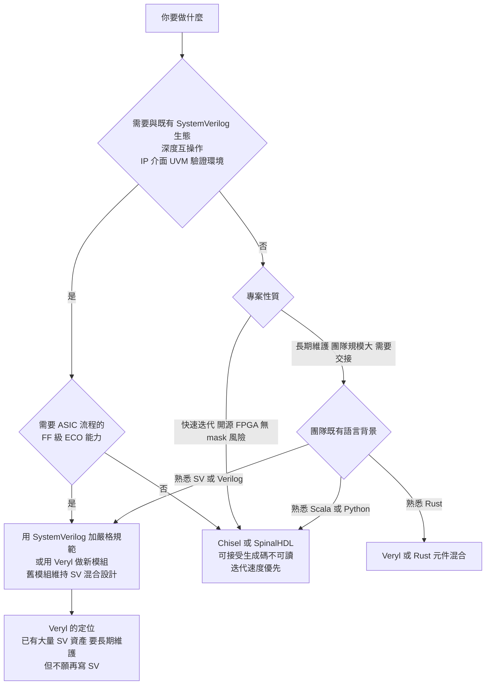

# 2.3 為什麼不是 Chisel：與替代硬體語言的設計取捨（2015-2026）

## 先建立評價軸

在比較硬體描述語言之前，需要先把「比較什麼」講清楚。否則討論會滑向「你喜歡哪個語言」的主觀偏好，而不是可辯論的工程論證。

我們採用七個軸。這七個軸的權重**依專案類型而異**——這本身就是本章的結論之一：語言選擇是專案的函數。

| # | 軸 | 問題 | 為什麼重要 |
| --- | --- | --- | --- |
| 1 | 表達力 | 能描述多少種硬體建構？ | 太低會逼你用逃生門，太高會帶來歧義 |
| 2 | 語意可預測性 | 讀程式碼能否預測硬體拓撲？ | 決定 ECO 成本與 bug 逃逸率 |
| 3 | 產出物品質 | 產生的 Verilog／SV 可讀嗎？ | 決定能否 review、debug、維護 |
| 4 | 生態與互操作 | 能和既有 SV、IP、UVM 一起用嗎？ | 決定遷移成本 |
| 5 | 學習曲線 | 既有 SV 工程師多久能 productive？ | 決定採用速度 |
| 6 | 工具鏈成熟度 | 模擬、合成、lint、CI 是否可用？ | 決定能否上生產 |
| 7 | ASIC 流程相容性 | 能做 ECO 嗎？ | 決定千萬美元級的風險 |

我們用這七個軸去看每一門語言。

---

## Chisel 的詳細解剖

### 設計目標

Chisel 由 UC Berkeley 開發，源於 Rocket Chip 團隊（SiFive、RISC-V 生態的推手之一）的需求。Rocket Chip 團隊面對的問題很具代表性：

> **Rocket Chip 是要產生「一系列可客製化的 SoC 產生器」的專案。它的產品不是一個晶片，而是一個產生晶片的程式。**

這個需求直接決定了 Chisel 的設計取向。傳統 Verilog 撰寫的是一個具體的晶片；而 Chisel 撰寫的是一個**參數化的硬體產生器**——泛型、組合子、類別層級的抽象不只是「方便的寫法」，而是**需求本身**。

Chisel 的第一個版本出現在 2010 年左右（早期稱為 Chisel 0.x，之後以 `chisel3` 為主）。

### 優點

Chisel 的優點非常真實，不應該被貶低。

**（一）型別安全。** 位寬是型別的一部分：

```scala
val io = IO(new Bundle {
  val in  = Input(UInt(8.W))
  val out = Output(UInt(8.W))
})
io.out := io.in + 1.U
```

`UInt(8.W)` 與 `UInt(16.W)` 是**不同的型別**，混用會在 Scala 編譯期被擋下。相較於 Verilog 中位寬錯誤只會在 lint 或綜合時才被發現，這是本質性的進步。

**（二）參數化硬體產生器。** 泛型與組合子讓「一個參數化元件」寫起來是自然的：

```scala
class Vec[T <: Data](val n: Int, gen: T) extends Module { ... }
```

**（三）組合子抽象。** `+`、`<<`、`Mux()`、`RegNext()`、`Cat()` 等運算子把硬體建構變成可組合的物件。

**（四）`Bundle` 類比介面。** `Bundle` 類似 SystemVerilog 的 `interface`，把一組相關訊號綁成一個型別。

**（五）`Vec` 與 `Reg`。** `Vec` 提供靜態長度的陣列抽象；`Reg` 提供暫存器抽象（`RegNext` 提供流水線暫存器）。

**（六）實際的工業採用。** Rocket Chip、Chipyard、SiFive 的許多設計，以及 SiFive 的 U74 系列核心，都以 Chisel 為基礎。**這一點很重要**：它證明 Chisel 不是玩具——它能產出真實的、可量產的處理器。

### 致命缺陷

接下來是缺陷部分。必須強調：這五個缺陷**不是實作品質的問題，而是架構取向的必然結果**。它們無法靠「改進實作」解決，只能靠「改變架構」解決——而 Veryl 正是採取了後者。

---

#### 缺陷一：產生的 Verilog 不可讀

這是最直接、也最容易親身體驗的缺陷。

一個典型的 Chisel 產生碼片段：

```verilog
module Foo(
  input clock,
  input reset,
  input [7:0] io_in,
  output [7:0] io_out
);
  wire [8:0] _GEN_3 = {1'h0, io_in} + 9'h1;
  wire [7:0] _GEN_5 = _GEN_3[7:0];
  wire _GEN_8 = ~_GEN_3[8];
  wire [7:0] _GEN_11 = _GEN_8 ? 8'h0 : (_GEN_3[8] ? 8'h1 : 8'h2);
  ...
endmodule
```

**問題的結構：**

| 現象 | 原因 | 工程後果 |
| --- | --- | --- |
| `_GEN_3`、`_GEN_5` 之類的名稱 | Scala 編譯單元的匿名中間結果 | 完全無法回溯到原始碼 |
| 模組名被改寫（`myFifo` → `myFifo_1`） | Scala 編譯單元名稱與硬體名稱脫鉤 | 波形視窗、hierarchical path 全部要重新對照 |
| 位寬到處展開（`+ 9'h1`） | Scala 的整數常數需要明確寬度 | 難以一眼看出「這其實是加 1」 |
| 高階抽象全部「拍平」 | 編譯過程中泛型、組合子被展開 | 原始碼的結構在產出物中消失 |
| mux 鏈 | `Mux` 的巢狀展開 | 難以看出「這其實是一個優先編碼器」 |

**關鍵洞見：** Chisel 的產出物是**「編譯器的中間結果被美化後的樣子」**，而不是「硬體結構的描述」。這兩者的區別在於：前者描述的是「編譯器做了什麼運算」，後者描述的是「電路長什麼樣」。

**工程後果是具體的：**

1. **Waveform 與原始碼無法對應。** 波形視窗顯示 `Foo._GEN_3`，工程師必須在數千行的產生碼裡找出對應段落。
2. **Lint 與形式工具的結果失去意義。** 工具看到的是一份平坦的機器輸出，那些「看似有意義的警告」（例如某個訊號從未被賦值）會出現在機器產生的中間結果上，而不是設計者的意圖上。
3. **Code review 失效。** Review 一份數千行的平坦 Verilog，等於沒有 review。
4. **除錯成本被放大到不可接受。** 這是前兩項的後果。

---

#### 缺陷二：無法做 FF 級 ECO

這是 ASIC 流程中的決定性障礙，也是最少在技術社群中被討論、但後果最嚴重的一項。

回顧 ECO 的本質（第 1.3 節）：ECO 需要**局部修改**原始碼，然後重新合成，得到只有局部差異的 FF 級網表 patch。

在 Chisel 流程裡：

1. 工程師改了 Scala 原始碼；
2. 重新產生 Verilog；
3. 重新做邏輯合成。

**第 3 步是致命的。** 邏輯合成器會對整個設計做全域最佳化：常數傳播、重構、共用邏輯、面積最佳化。哪怕你只改了一行的計數器常數，合成結果的差異網表也可能散布在整個設計中——而差異網表越大，ECO patch 的成本越高。

更根本的問題在第 1 步與第 2 步之間：

> **如果 Chisel 產生的 Verilog 不可讀，那麼在 tape-out 之後，當 bug 在真實矽片上被發現時，沒有人能在合理時間內讀懂產生碼來定位問題。**

這意味著 Chisel 流程下的 ASIC 專案，**實質上失去了 RTL 層 ECO 的能力**。他們只能退回後段 ECO（金屬層改線，成本高得多、效果有限）或整版重投片。

**把這個缺陷翻譯成財務語言：** 一個預算五千萬美元的 ASIC 專案，如果失去 RTL 層 ECO 能力，那麼「每次 tape-out 後的 bug」都從「數十萬美元」變成「數百萬美元」。這不是工程偏好問題，這是**專案的財務風險結構**。

---

#### 缺陷三：無法與 SystemVerilog 生態對接

真實的 ASIC 專案**不可能**是「全部 Chisel」。典型的組成：

| 元件 | 來源 | 語言 |
| --- | --- | --- |
| AXI4 / PCIe 控制器 | IP 供應商 | SystemVerilog |
| SerDes、PLL | 供應商 | Verilog-AMS / 加密網表 |
| SRAM 記憶體 | Memory Compiler | 加密網表 |
| 類比 IP | 供應商 | 加密 |
| 既有團隊程式碼 | 內部 | SystemVerilog |
| UVM 驗證環境 | 內部 | SystemVerilog |

整合本身不是問題（把 Chisel 產生的 Verilog 與 SV 一起編譯即可）。**問題出現在兩處：**

**（一）介面與結構體無法直接互動。** Chisel 的 `Bundle` 在 Verilog 中被展開成一個模組，其欄位透過階層路徑存取（`u_bundle.io_data`）。這意味著一個 SV 的 `interface` 模組**無法**直接把 Chisel 的 `Bundle` 當成埠來接——因為 Chisel 產生的是散落的訊號，而 SV 的 `interface` 是一個封裝的物件。兩者要整合，需要在兩邊各寫一層轉接。

**（二）UVM 驗證環境無法重用。** UVM 是 SystemVerilog 的類別系統，它可以做 dynamic cast、做虛擬介面（virtual interface）、做 sequencer-driver 架構。Chisel 產生的模組對 UVM 而言只是一堆普通的 Verilog 埠——可以驗證，但無法用 UVM 的高階手法把它當成一個有介面、有型別的物件來操作。

**（三）IP 邊界是硬邊界。** 一個加密網表 IP 的邊界一定是一組具名埠。Chisel 沒有問題。但 IP 供應商近年開始提供**以介面為邊界**的 IP（SystemVerilog interface），這類 IP 與 Chisel 的 `Bundle` 之間的阻抗不匹配更明顯。

---

#### 缺陷四：語意不可預測

這是**最深層的缺陷**，前三項都是它的表現。

Chisel 是 Scala 的嵌入式 DSL。Scala 的型別系統允許極高階的抽象，而這些抽象在編譯時決定硬體。問題是：

> **工程師無法預測「這個 Scala 寫法會產生什麼電路」。**

具體的機制有幾個：

**（一）隱式的硬體插入。** Scala 的 `for` 迴圈、`map`、`foreach` 都可以產生硬體。一個 `List` 的 `map` 會產生多少邏輯？取決於編譯器如何展開。`for (x <- xs) { ... }` 是複製電路還是串聯電路？取決於 `xs` 是 `Vec` 還是 `Seq`。

**（二）隱式的位寬推導。** Chisel 的位寬推導規則有自己的體系：`+` 的結果寬度是 `max(a.width, b.width)`，但 `+&` 是加一，`*` 的寬度是 `a.width + b.width`。這些規則與 SV 不同，而且要靠記憶掌握。

**（三）方向性（direction）的隱式決定。** 在 Chisel 中，一個 `UInt` 到底是**來源**還是**目的地**，取決於它被 `:=` 賦值還是被讀取。這個「方向推導」是 Chisel 的核心機制，也是它的優點（自動處理雙向連接）與詛咒（隱含規則多）的來源。

**（四）優化與重寫的不可預測。** Scala 編譯器會做 inline、型別擦除、以及 FIRRTL 階段的 dead code elimination。**「沒被讀到的邏輯會被刪掉」**——這意味著一段寫錯但沒接上去的邏輯，在產生碼裡會完全消失，你在 waveform 上永遠看不到它。

這一點值得特別強調，因為它是硬體設計中特別危險的一種失敗模式：

> 在 Scala 中「寫了但沒生效」的程式碼，會安靜地消失。

相較之下，Veryl 的 lint 會明確告訴你「你宣告了這個變數但沒有賦值」或「這個邏輯沒有被使用」。

---

#### 缺陷五：建構與除錯脫節

前三項的共同後果。

**錯誤訊息指向 Scala 行號，而非硬體結構。**

一個典型的 Chisel 錯誤：

```
java.lang.AssertionError: requirement failed: Data does not have a known direction
at chisel3.internal.Builder...
at MyModule.scala:42
```

這則訊息告訴你「在某個 Scala 檔案的第 42 行，某個資料的方向無法確定」。它**沒有**告訴你：

- 這是哪一根訊號線；
- 這條線連到模組的哪個埠；
- 這是產生碼的第幾行；
- 產生碼中對應的段落是什麼。

相較之下，Veryl 的診斷可以直接引用 Veryl 原始碼的位置，而 `.sv.map` 可以把這個位置再映射到產生的 SystemVerilog 行號。

**除錯脫節的第二個面向是波形。** 在 Verilator 或 VCS 的波形視窗裡，Chisel 設計的訊號路徑是 `Top.u_foo.io_bundle.io_data`——一個混合了 Scala 命名（`u_foo`）與產生器命名（`io_bundle`）的階層路徑。工程師在除錯時必須同時理解原始 Scala 結構與產生碼結構。

---

### 這五點與 Veryl 官方論述的對應

Veryl 專案在 FAQ 中對「為什麼不用 Chisel」的論述，核心上就是上面五點。我們把它們並列：

| Chisel 的問題 | 造成的工程後果 | Veryl 的對策 |
| --- | --- | --- |
| 產生不可讀的 Verilog | 無法 review、無法用波形除錯、lint 結果無意義 | 產出保留名稱與結構的 SV |
| 無法做 FF 級 ECO | ASIC 專案的財務風險結構劣化 | 產出可讀 → ECO 路徑完整 |
| 無法與 SV 生態對接 | IP 與 UVM 環境需重寫或加轉接層 | `$sv::`、`embed`、`translate` |
| 語意不可預測 | 工程師無法建立硬體心智模型 | 語義等價 + 消歧義語法 |
| 建構與除錯脫節 | 除錯成本高，修 bug 的迴圈變長 | 即時診斷 + `.sv.map` source map |

**值得注意的是這五點的共同結構：它們全都指向同一件事——「工程師無法把原始碼與硬體結構對應起來」。** Chisel 的問題不是「功能不對」，而是**「可預測性」被系統性地破壞**。

這正是第 0.1 節那個價值函數

$$
V = \alpha \cdot E - \beta \cdot C - \gamma \cdot U
$$

在實踐中的樣子：Chisel 的 $ E $（表達力）很高，$ C $ 與 $ U $ 也很高，導致真實專案中的總值 $ V $ 並不高。

---

## SpinalHDL、Migen、LiteX：同一條路線的其他人

### SpinalHDL（2016- ，Scala）

SpinalHDL 是 Chisel 的改進版，由 SpinalHDL 社群維護，並成為 OpenTitan 計畫的主要硬體描述語言之一。

**SpinalHDL 解決了 Chisel 的部分問題：**

| 問題 | Chisel | SpinalHDL |
| --- | --- | --- |
| 模組名稱 | 被改寫（`myFifo_1`） | **保留** |
| 位寬錯誤 | 執行期／產生期才發現 | **編譯期**發現，並給出明確訊息 |
| 型別結構 | `Bundle` 較寬鬆 | `Data` / `Bits` / `Struct` 更嚴格 |
| 時序建構 | 需自行組織 | `ClockDomain`、`RegNext` 等一等支援 |
| 錯誤訊息 | Scala traceback | 面向硬體工程師的訊息 |

**SpinalHDL 是一個重要的進步**——尤其「保留模組名稱」這一項，直接改善了產生碼的可讀性。OpenTitan 選擇 SpinalHDL 而非 Chisel，本身就說明了這個進步的價值。

**但根本取向沒有改變：** SpinalHDL 的產出物仍然是**生成的 Verilog**。因此前文的五個缺陷——特別是 ECO 與生態對接——仍然存在。SpinalHDL 解決的是「生成的碼能不能看」，沒有解決「生成的碼與既有 SV 生態的關係」與「ECO 路徑」。

### Migen（2013- ，Python）

Migen 用 Python 描述硬體：

```python
class Counter(Module):
    def __init__(self, width=8):
        self.count = Signal(width)
        self.en = Signal()
        self.sync += If(self.en, self.count.eq(self.count + 1))
```

**Migen 的特色是語法最接近硬體電路圖**——`If`、`Then`、`Else`、`Case` 都是顯式的建構物件，而不是 Python 的 if 語句。這解決了 Python DSL 最常見的問題（「這個 Python 的 if 到底產生硬體了嗎？」）。

**Migen 的問題比 Chisel 更嚴重：**

1. **沒有靜態型別。** 位寬錯誤在執行期（產生 Verilog 時）才發現，錯誤訊息是 Python traceback。
2. **產生碼的可讀性比 Chisel 更差。** 因為 Python 的物件模型被完全展開，而命名慣例難以維持。
3. **同樣的五個缺陷。**

### LiteX（2018- ，Python）

LiteX 建立在 Migen 之上，是 FPGA SoC 的整合框架。它提供 CPU（RISC-V 核心）、匯流排（Wishbone、AXI-Lite）、週邊（Ethernet、PCIe、SATA）元件庫，以及一個編譯流程把整個 SoC 組出來。

**LiteX 在 FPGA 社群有真實且巨大的影響力**——Milkweed（開源相機模組）、LiteEth（10GbE 網路卡）、Tiny Tapeout 競賽的許多設計都建立在 LiteX 之上。它是「用現代語言做硬體」這條路線在開源硬體領域最成功的實踐。

**但這恰恰說明了一件重要的事：LiteX 的成功發生在 FPGA 領域。**

理由是結構性的：

- **FPGA 沒有 mask ECO 的問題。** 重新燒錄一次是免費的（相對於成本而言），所以「生成不可讀」的主要後果消失了。
- **FPGA 週邊 IP 的整合需求相對低。** 週邊多為開源 IP，生態同質性高。
- **迭代速度優先於可維護性。** 開源硬體專案的生命週期常常短於 ASIC。

因此 **LiteX 的成功不能被拿來論證「生成 Verilog 的路線在 ASIC 也行」**。它論證的是「生成 Verilog 的路線在快速迭代的開源 FPGA 專案裡很好用」。這兩件事的差別，是本章最重要的區分之一。

---

## 其他替代方案

### TL-Verilog（2017- ）：打補丁路線

TL-Verilog 是**完全不同的策略**：不是新語言，而是在 SystemVerilog 上做擴充。

**核心貢獻**是為 pipeline 與 CDC 提供形式化方法論：

```systemverilog
module tlv_pipeline
  #(parameter PIPELINE_STAGES = 1)
  (
    input clk,
    input reset,
    output reg [31:0] out_data
  );
  tlv_pipeline u_tlv_pipeline (.clk(clk), .reset(reset), .out_data(out_data));
endmodule
```

```systemverilog
`tlv_cdc u_cdc (.clk(clk1), .rst(rst1), .data_in(data_in), .data_out(data_out));
```

所有擴充都以**巨集（`` `define ``）與屬性（`*`）**實作，不修改語言本身。

**TL-Verilog 的價值在於它證明了：**

> 很多被認為「需要新語言才能解決」的問題（流水線插入、CDC 協議檢查），其實可以用「既有語言 + 屬性 + 工具」解決。

這個結論對 Veryl 的設計有直接影響：Veryl 在第 6 章的 CDC 檢查機制，思路與 TL-Verilog 同源——都是在既有語意之上加上**宣告式的檢查標記**，而不是改造語言。

**TL-Verilog 的代價：**

1. **語意仍然寄生在 SystemVerilog 的全部複雜度之上。** 它沒有解決第 1.3 節列出的任何一項隱式規則。工程師用 TL-Verilog，仍然要理解 SV 的 `always_comb`、四態邏輯、隱含網路。
2. **工具子集問題再現。** TL-Verilog 需要工具支援這個擴充層。它自己就是新的「工具子集」。
3. **屬性是宣告式但非強制的。** 忘了標記 `tlv_pipeline`，檢查就不會發生——而且**不會有任何錯誤**。這是一種比編譯器錯誤更危險的失敗模式，因為它是無聲的。

**兩條路線的取捨：**

| | TL-Verilog（擴充） | Veryl（新語言） |
| --- | --- | --- |
| 現有程式碼 | 完全相容 | 需要 `translate` 或重寫 |
| 複雜度 | 保留 SV 的全部複雜度 | 從根上消除 |
| ECO 能力 | 完整保留 | 完整保留 |
| 檢查機制 | 依賴外部工具支援 | 內建 |
| 遺漏標記 | 無聲失效 | 語法層面強制（如 `always_ff`） |

注意最後一列：**TL-Verilog 的問題正是不強制，而 Veryl 的設計哲學正是不允許不強制。** 這是同一個價值觀的兩種表現。

---

### CIRCT / FIRRTL / IR 路線

「生成 Verilog」不是唯一可能的架構，更一般的架構是：

$$
\text{來源語言} \longrightarrow \text{中間表示（IR）} \longrightarrow \text{目標語言}
$$

**FIRRTL** 是 Chisel 使用的 IR。**CIRCT**（Circuit IR Compilers and Tools）是 LLVM 的姊妹專案，目標是提供一系列以 MLIR 為基礎的硬體 IR 工具，包含 FIRRTL 匯入、CIRCT IR、Export Verilog、esi 等等。

**為什麼 IR 路線重要？**

1. **多前端、多後端。** 同一份 IR 可產生 Verilog、SystemVerilog、VHDL，或驅動模擬器。
2. **可攜性檢查有統一位置。** 型別檢查、位寬檢查、驅動衝突檢查在 IR 上做一次。
3. **工具鏈統一。** 模擬器可以直接執行 IR。
4. **容易做最佳化與分析。** 死邏輯消除、位寬分析、常數傳播都在 IR 層。

**Veryl 也走 IR 路線**：2026 年 1 月的 **IR-based analyzer** 正是這個架構（見 2.1 節）。這不是巧合，而是 Veryl 對「語義等價」這個承諾的基礎設施化——**要保證產生碼與預期一致，就必須在中間層做嚴格的檢查，而不是在產生過程中順便檢查。**

**但 IR 路線有風險，第 1.3 節已經提過，值得再強調一次：**

- **IR 本身是一門需要設計的語言。** 太接近 Verilog，就繼承 Verilog 的問題；太抽象，就會丟失硬體語意。
- **多一層轉換 = 多一層不確定性。** 「Veryl → IR → SystemVerilog」的鏈上，任何一層的語意損失都會造成「產生的 SV 與預期不符」。

Veryl 對此的答案是**嚴格測試生成碼**：既然語義等價是根基，根基就必須靠自動化測試守住。這正是 Veryl 內建整合測試框架的一個隱含職責——它不只是測試「Veryl 程式碼 behaving 正確」，也是測試「產生的 SV 與預期一致」。

---

### VHDL（1987- ）

VHDL 由美國國防部推動，1987 年成為 IEEE 標準（IEEE 1076）。

**VHDL 的設計優點是真的：**

- **型別系統更強。** 嚴格區分 `signal`、`variable`、`constant`；`signal` 賦值有 delta cycle 語意。
- **沒有隱含網路。** 所有東西都必須宣告。
- **沒有四態邏輯（原生）。** `std_logic_1164` 用列舉方式建模，但這需要一個套件，不是語言內建。
- **語意明確。** 沒有競態的隱藏來源。

**VHDL 在教學上表現出色。** 很多歐洲的數位設計課程以 VHDL 為主，因為它的型別系統能強迫學生建立正確的心智模型——「沒有隱含網路」這條規則，在教學上是巨大的優勢。

**VHDL 為什麼在產業上份額小？**

1. 早期工具效能不佳，尤其模擬速度。
2. IP 供應商與工具商都押注 Verilog。
3. Verilog 的 C 風格語法更貼近軟體工程師的既有技能。
4. 沒有形成「事實標準」的自我強化循環。

**VHDL 對 Veryl 是一個重要的提醒：**

> **「語言設計更好」不等於「產業會接受」。語言的採用是網路效應問題。**

Veryl 面對的是同一個結構性問題，只是規模小一號：Verilog 已經贏得了四十年，SystemVerilog 又是目前的產業事實標準。Veryl 的理論優勢再明確，也無法自動轉化為採用率。**這是評估 Veryl 時必須誠實面對的現實**（本節末尾會再回來）。

---

### Rust HDL 路線

2020 年前後，Rust 生態出現了幾個硬體描述方向：

- **`rust-hdl`**：以 Rust 描述硬體並產生 Verilog。值得注意：**rust-hdl 的部分貢獻者來自 Veryl 社群**，Veryl 後來的 Rust 元件機制與這條線有關。
- **`fpga` crate**：提供以 Rust 描述數位邏輯的框架。
- **nerv、MirageOS**：以 Rust 實作作業系統核心或網路堆疊——這些專案展示了 Rust 對「硬體與軟體共同設計」場景的適用性，但它們通常不是用 Rust 描述硬體，而是用 Rust 寫 firmware 搭配既有的硬體描述。

**Rust 對硬體描述的吸引力在於一個真實的痛點：硬體／軟體介面的摩擦。**

一個傳統的 SoC 專案裡，驅動程式（C）與硬體描述（Verilog/SV）是**兩種語言、兩套工具、兩種思維**。Rust 的夢想是：驅動程式與硬體描述可以用同一門語言寫，共享型別定義（bindgen 自動從硬體描述產生 Rust 型別），從根本上消除介面邊界的錯誤。

**但這條路線面臨與 Chisel 完全相同的結構性問題：**

- 若最終產出仍是 Verilog，ECO 與生態問題不變（而且多了一層 Rust→Verilog 的語意損失）；
- 若產出 Rust 原生的硬體描述，那麼整個 ASIC 流程都要重建——EDA 支援、sign-off、IP 生態、量產工具鏈。這在可預見的未來不可能。

**Veryl 與 Rust HDL 的關係是互補而非競爭：** Veryl 的 Rust 元件機制讓**元件以 Rust 實作、由 Veryl 呼叫**。這是一個很聰明的折衷——它承認了「Rust 適合寫複雜的組合邏輯元件」這個事實，同時避免了「Rust 取代整個硬體流程」這個不現實的目標。

---

### OpenTitan 與 lowRISC：規範可以補足語言，但不能補足複雜度

這是最值得細細品味的一個案例，因為它是一個**反例式的重要證據**。

**OpenTitan** 是 Google 主导的開源安全晶片專案，lowRISC 維護。它取得巨大成功的原因包括：

1. **嚴格的 SystemVerilog 風格規範。** OpenTitan 有詳細的編碼規範（style guide），涵蓋命名、位寬表達、賦值順序、`always_ff` 使用、reset 風格等。
2. **Lint 為必經關卡。** 規範不是文件，而是**強制執行的檢查**。
3. **內部 codegen 工具。** 產生器（generator）確保大量重複結構（如 CSR 陣列、DMA 通道）的一致性。
4. **開源、全民審閱。** 數千名工程師的審閱意見。

**OpenTitan 的成功證明了什麼？**

它證明了：**即使語言本身複雜度極高，透過「嚴格規範 + 強制 lint + codegen + 廣泛審閱」，仍然可以產出高品質的 SystemVerilog。** 從工程可行性上說，這是一個重要的正面案例。

**但 OpenTitan 也證明了另一件事，而且這一件才是本節的關鍵洞見：**

> **規範可以補足語言的一部分，但無法補足語言本身的複雜度。**

我們把這個命題拆開：

**（一）規範能補足的是「一致性」。** 透過命名規範，OpenTitan 解決了 SV 中列舉全域污染的問題（用前綴）、透過位寬規範，解決了隱式位寬推導的混亂。**這些都是可以用紀律與工具檢查覆蓋的問題。**

**（二）規範無法補足的是「語意的可預測性」。** SV 中 `always_comb` 裡使用 `<=` 是什麼意思？`casex` 與 `casez` 的差別？`logic` 究竟是不是 net？**這些不是命名問題，不是風格問題，而是語言規範本身的定義問題。** 沒有一條團隊規範能改變 IEEE 1800 對這些建構的定義。

**（三）規範無法補足的是「學習成本」。** 規範是**專案層級**的知識，需要記憶、查閱、code review 執行；語言是**通用**的知識，學會了到哪裡都能用。工程師每加入一個專案，就要重新學一次該專案的規範。

**（四）規範無法補足的是「工具分歧」。** 這是最實際的一條：SV 中某些建構在工具 A 支援、在工具 B 不支援，這是**工具實作的差異**，與你的團隊規範無關。規範無法讓 Verilator 支援 UVM。

**（五）規範無法補足的是「工具鏈摩擦」。** 格式化的語意無關性、型別檢查的準確性、語言伺服器的符號解析——這些都需要語言層級的支援。OpenTitan 需要自建整套 codegen 工具鏈，這正是它的**成本**所在。

**因此 OpenTitan 對 Veryl 的啟示是雙面的：**

| 從 OpenTitan 學到的 | 對 Veryl 的意義 |
| --- | --- |
| 嚴格規範 + lint 有效 | Veryl 應內建等價能力，而不是依賴團隊紀律 |
| codegen 有效 | 語言可以承載重複結構的抽象化 |
| 規範有邊界 | Veryl 應把**能由語言保證的部分**交給語言 |
| 廣泛審閱有效 | 開源社群審閱是品質機制 |

**最關鍵的推論是：**

> **如果一個專案需要一份 200 頁的編碼規範與一整套自建 codegen 工具鏈才能把 SystemVerilog 用好，那麼「把語言本身改好」的價值就遠高於「把規範寫得更細」。**

OpenTitan 的成功不是「SystemVerilog 沒問題」的證明，而是「SystemVerilog 的問題可以被工程手段（但代價高昂）繞過」的證明。繞過是有成本的：OpenTitan 需要投入專門的工具工程資源來維持它的 codegen 與 lint 基礎設施。這份投資，如果語言本身提供，就不需要了。

---

## 取捨的哲學總結：決策圖

我們把前面所有的分析收束成一張決策圖。



### Veryl 的定位

從這張圖可以看出，Veryl 的落點很明確：

> **已經有大量 SystemVerilog 資產、要長期維護、但不願再寫 SystemVerilog 的團隊。**

這三個條件缺一不可：

- **有大量 SV 資產** → 需要 `translate` 與 `$sv::` 這些遷移機制；如果本來就沒有 SV 資產，沒有遷移負擔，但也沒有遷移動機，Chisel 之類反而更直接。
- **要長期維護** → 需要可讀、可預測、可 ECO；如果專案是三個月的 hack，什麼語言都無所謂。
- **不願再寫 SV** → 需要一個「不會太痛」的替代品；如果團隊對 SV 沒有痛點，Veryl 的優勢無從體現。

### 值得說明的「混合設計」路徑

決策圖中特別值得強調的是 `D` 分支：**新模組用 Veryl，既有模組維持 SV，兩者混合。**

這個路徑的重要性常被低估。它的特點是：

- **零遷移風險。** 既有 50 萬行 SV 一行不改。
- **漸進收益。** 每個新模組都獲得語法簡化、lint、格式化、文件的好處。
- **風險可控。** 如果 Veryl 有什麼問題，影響範圍只限於新寫的模組。
- **驗證生態完整。** 兩邊都是標準 SystemVerilog，UVM 環境可以直接驗證整個 SoC。

**這可能是 Veryl 最可能的落地形態**——不是「全公司改用 Veryl」，而是「一部分團隊用 Veryl 寫新東西」。而對一個語言來說，這正是理想的落地形態：它的影響力隨著時間自然擴大，而不需要任何一次性的「全公司轉換」決策。

---

## 誠實面對 Veryl 的現況

以上都是 Veryl 在架構上的優勢。但評估採用時，必須同時面對它的現況。這些是真實的成本，不是修辭上的保留。

### （一）語言年輕

Veryl 從 2022 年公開到 2026 年，只有四年的歷史。相較之下：

- Verilog：1984，四十二年。
- SystemVerilog：2005，二十一年。
- Chisel：2010，十六年。
- TL-Verilog：2017，九年。

**語言的四個年頭意味著什麼？**

1. **文件不完整。** 邊角語義可能尚未有權威說明。
2. **標準函式庫仍在成長。** 你需要的某個函數可能還沒有，或者介面還在變動。
3. **工具鏈仍在變。** `verylup` 存在本身就說明版本管理是新的問題。編譯器版本間的行為差異需要留意。
4. **最佳實踐尚未沉澱。** 「How do I do X in Veryl」的问题，社群上可能還沒有共識答案。
5. **人才市場幾乎不存在。** 幾乎沒有「Veryl 工程師」可以招聘——這意味著**每一個加入的工程師都是從零開始**，而從零開始的成本要由團隊承擔。

### （二）生態規模

- 套件註冊表在 2025 年 7 月才發布，到 2026 年中仍然很年輕。
- 可用的第三方元件（UART、SPI、AXI 控制器、cache）數量遠少於 SV 的商業 IP 生態。
- 教學資源、社群教學、第三方文件都很少。

**這裡要做一個誠實的比較**：Chisel 花了將近十年，仍然只有部分社群使用；Verilog 的生態是四十年積累的。**「語言的生態」是時間的函數，不是品質的函數。**

### （三）部分進階 SV 功能尚未支援

Veryl 刻意不支援的東西（這是設計決定，不是缺陷）：

| 功能 | 狀態 | 替代方案 |
| --- | --- | --- |
| 類別、物件導向 | 不支援 | SystemVerilog 側或 cocotb |
| 隨機化與約束 | 不支援 | SystemVerilog 側 |
| `covergroup` | 不支援 | 外部工具 |
| 動態陣列、佇列 | 不支援 | SystemVerilog 側 |
| `bind` | 不支援 | 明確連接 |
| `program` 區塊 | 不支援 | cocotb 的等價機制 |
| DPI | 部分支援 | 視版本 |

而「尚未支援」但**可能想要支援**的（例如某些形式的結構體賦值、部分 SVA），則是真正的功能缺口。

### （四）採用風險的誠實評估

把上面幾點換成決策語言：

| 風險 | 緩解方式 |
| --- | --- |
| 文件缺口 | 以生成的 SV 與標準語意為實際參考；社群 Discord |
| 庫不夠 | 混合設計——用 `$sv::` 呼叫既有 SV 實作 |
| 工具鏈變動 | 把 `verylup` 的版本鎖進 CI |
| 人才缺乏 | 內部培訓；語法與 SV 高度對應，學習成本較低 |
| 語言停止維護 | 雙授權、原始碼公開、語義等價的性質使遷移回去的成本可控 |

最後一列值得特別指出：**由於語義等價，退出 Veryl 的成本是「把 Veryl 碼翻譯回 SV」加上「人工調整」，而不是「重寫」。** 這個「可逆性」是語義等價原則最被低估的價值——它不只降低了遷移進的成本，也降低了遷移出來的風險。

---

## 本章結語

語言選擇不是品味問題。

它是一個**關於專案未來五年要做什麼**的函數。讓我們把這個函數寫出來：

$$
L = f(\text{IP 生態依賴}, \text{ECO 需求}, \text{團隊技能}, \text{專案生命週期}, \text{迭代速度})
$$

- 如果你的專案需要與深度整合既有 IP 與 UVM 環境，需要在 mask 後做局部修改，且團隊已經很懂 SV —— 那麼 Veryl 的落點最適合：它不要求你拋棄 SV 資產，卻讓新程式碼不再痛苦。
- 如果你的專案是快速迭代的開源 FPGA，且生成碼的可讀性不是你關心的 —— 那麼 Chisel、SpinalHDL 或 LiteX 都是好選擇，而且它們的生態更大。
- 如果你的專案從零開始，沒有歷史包袱，並且團隊是 Scala 或 Python 專家 —— Alt-HDL 是合理的起點。

**真正要避免的是因為「感覺 SV 很痛苦」就轉向一個會在 ASIC 流程後段才暴露問題的方案。** Chisel 的問題不是它做得不好——它做得非常好，它產生了真實的商用處理器——而是它的取捨與 ASIC 流程的需求不對齊。而這個不對齊，只有在**設計初期**是看不出來的；等 tape-out 後才發現「沒有人能讀懂我們的產生碼」，代價已經無法挽回了。

Veryl 的核心信念是：**在硬體設計中，「可預測」比「聰明」更值錢。** 這個信念在 2.2 節已經被拆解成具體的語法規則；而在接下來的第 3 章，我們會把這些規則落到實際的程式碼上——從模組定義、埠宣告，到介面、modport 與 connect 運算符。

---

*下一章：第 3 章「模組、介面與專案組織」*
