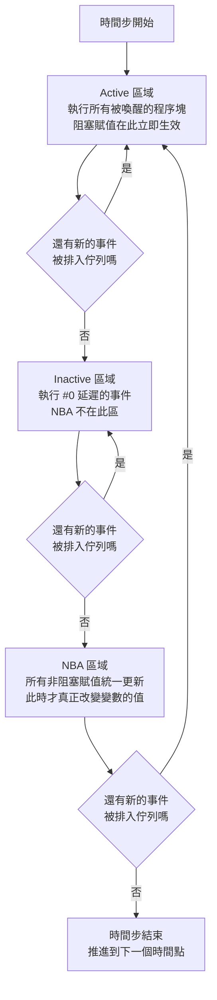

# 4.1 always_ff 與 always_comb：賦值語意的統一

## 一個被誤用了三十年的直覺

在軟體工程師的直覺裡，「=` 這個符號只有一種意義：**把右邊的值寫進左邊的儲存格**。`x = x + 1;` 讀起來像「把 x 加一之後的結果放回 x」，這在每一種命令式語言裡都是成立的。

但在硬體描述語言裡，這個直覺在某些地方會產生**完全錯誤的硬體**。原因不在於語言有 bug，而在於硬體描述語言描述的不是「一段執行的過程」，而是**一個隨時間展開的結構**。用軟體的「依序執行」模型去讀硬體的「同時發生」模型，就會得出錯誤的推論。

Verilog 對這個問題的處理方式，是引入**兩種賦值運算子**：

- 阻塞賦值（blocking assignment）`=`：先寫後讀，立即生效。
- 非阻塞賦值（non-blocking assignment）`<=`：先讀後寫，延遲到 NBA 區域統一更新。

這兩種賦值語意在 Verilog 裡是**語法的一部分**，也就是說，選擇哪一種是工程師的責任。而這個責任在實務上被大量違反——Verilog 與 SystemVerilog 的程式碼庫裡，到處都是把 `<=` 用在時序邏輯、把 `=` 用在組合邏輯的「慣例」，以及偶爾違反這條慣例而**不會被任何工具報錯**的程式碼。

本章的主題是：這個問題不是靠「更好的慣例」或「更好的 lint 規則」可以根治的，它必須在**語法層級**解決。Veryl 的解法是：**讓語法本身不可能表達出錯誤的賦值語意**。

---

## Verilog 的兩套賦值語意

### 阻塞賦值：先寫後讀

阻塞賦值的語意可以用一句話概括：

> **賦值立即生效，且後續的讀取會讀到新值。**

```verilog
always @(a or b) begin
    x = a;
    y = x;      // y 讀到的是「剛剛寫進 x 的新值」
end
```

這裡 `y` 拿到的是 `a`，而不是 `x` 的舊值。這個語意在描述**組合邏輯**時是正確的，因為組合邏輯在硬體上的確是「一條資料路徑串接起來，前一級的輸出就是後一級的輸入」。

### 非阻塞賦值：先讀後寫

非阻塞賦值的語意是：

> **賦值被先擱置，直到目前時間步的最後一個區域才統一生效；在那之前的所有讀取，都讀到舊值。**

```verilog
always @(posedge clk) begin
    x <= a;
    y <= x;     // y 讀到的是「x 的舊值」
end
```

這裡 `y` 拿到的是 `x` 的舊值。這個語意在描述**時序邏輯**時是正確的，因為硬體上的正反器確實是在時脈邊緣**同時**取樣所有輸入——不存在「第一顆 FF 先更新、第二顆 FF 再讀到新值」這種事。

### 為什麼 Verilog 需要這兩套東西

根源在於 Verilog 的血統：它是一個**事件式模擬語言**（見 1.1 節）。Verilog 的核心執行模型是「維護一個事件佇列，每當某個訊號變化，就喚醒所有對它敏感的程序塊並執行之」。這是一個**程序式**的模型，但硬體的行為是**資料流式**的。

Verilog 用兩套賦值語意去彌縫程序式模型與資料流實體之間的落差。這個彌縫是有效的，但代價是：

1. **工程師要記住哪裡該用哪一種**，而且記錯了不會報錯。
2. **兩種語意混在同一個程序塊裡時，結果取決於微妙的求值順序**，產生競態（race）。
3. **語法無法表達意圖**：`always @(posedge clk)` 裡面寫 `=` 還是 `<=`，純粹是作者的選擇，工具沒有任何依據去判斷作者想表達什麼。

---

## 事件式模擬的求值區域

要精確說明競態的來源，我們需要看事件式模擬器在**同一個時間步**內的三個求值區域。



這三個區域的意義：

| 區域 | 發生什麼 | 誰在這個區域改變值 |
| --- | --- | --- |
| Active | 被敏感度列表命中的程序塊被執行 | 阻塞賦值 `=` |
| Inactive | `#0` 延遲的事件被執行 | 阻塞賦值 `=` |
| NBA | 所有累積的非阻塞賦值一次套用 | 非阻塞賦值 `<=` |

**關鍵性質**：NBA 區域是「一次套用」。所有累積的非阻塞賦值在這個區域**同時**生效，而不是依序生效。這正是硬體「所有 FF 同時更新」的模擬對應物。

### 競態的來源

競態（race）指的是：**同一份原始碼的模擬結果，取決於模擬器未定義的求值順序。**

Verilog 標準刻意不定義「多個程序塊在同一個 Active 區域被喚醒時的執行順序」。這在 1990 年代是一個務實的選擇（硬體本身就是並行的，模擬器若強行定序反而是謊言），但代價是工程師必須**自己**確保程式碼不依賴求值順序。

最典型的競態長這樣：

```verilog
always @(posedge clk) begin
    a = 1;     // 寫 a
end

always @(posedge clk) begin
    b = a;     // 讀 a
end
```

這兩行**先後順序不明**：

- 若 `a = 1` 先執行，`b` 讀到新值 `1`。
- 若 `b = a` 先執行，`b` 讀到舊值。

在硬體上，這兩件事是**同時發生**的，`b` 的下一個值取決於 `a` 在**上一拍**的值。這才是正確的語意。Verilog 之所以會給出兩種可能的答案，是因為它只有「程序式求值」這一套工具。

### 一個兩行的最小例子

我們用一個稍微具體的版本，讓競態的后果可視化：

```verilog
// 寫法 A：先寫後讀
always @(posedge clk) begin
    d1 = q;     // d1 取 q 的舊值
    q  = d;     // q 更新
end

// 寫法 B：先讀後寫
always @(posedge clk) begin
    d1 <= q;    // d1 取 q 的舊值
    q  <= d;    // q 更新
end
```

| 寫法 | 硬體對應 | 語意 |
| --- | --- | --- |
| A（`=`） | `q` 的輸入直接接到 `d1`，`d` 接不到任何東西 | 一條組合路徑 |
| B（`<=`） | 兩顆 FF：`d1` 取 `q` 舊值，`q` 取 `d` | 移位暫存器 |

**同樣兩行，兩種硬體。** 這就是第 0 章說的「語法決定硬體拓撲」最赤裸的例子。而且在 Verilog 中，這兩種寫法**都不會產生任何警告**——因為它們在語法上完全合法。

---

## 硬體的真相

現在我們可以說出本章最重要的一句話：

> **阻塞賦值與非阻塞賦值不是硬體的兩種「操作」。它們是模擬器用來表達「硬體並行性」的兩個手段。**

硬體裡沒有「先寫後讀」或「先讀後寫」這種動作。硬體裡只有兩種結構：

1. **暫存器（FF）**：在時脈邊緣取樣輸入，輸出在邊緣後改變。
2. **組合邏輯**：輸出隨輸入連續變化。

讓我們從硬體出發，反推語法應該長什麼樣。

### 時序邏輯必須「先讀後寫」

考慮兩顆串聯的 FF：

```systemverilog
always_ff @(posedge clk) begin
    q1 <= d;
    q2 <= q1;
end
```

這是硬體上最平凡的移位暫存器。`q2` 在時脈邊緣取到的是 `q1` 的**舊值**，因為 `q1` 要等到這次時脈的更新完成後才會改變。

如果把 `<=` 換成 `=`，就變成：

```systemverilog
always_ff @(posedge clk) begin
    q1 = d;
    q2 = q1;
end
```

此時 `q2` 取到的是 `q1` 的**新值**，也就是 `d`。硬體上這意味著 `q1` 與 `q2` 在同一拍內串聯傳遞，**延遲為零**——這在實體上不可能，因為組合路徑需要時間傳播。**這不是「另一種寫法」，這是不同的硬體。**

因此：**描述時序邏輯必須用「先讀後寫」語意。**

### 組合邏輯必須「先寫後讀」

考慮一個兩級的組合邏輯：

```systemverilog
always_comb begin
    t = a & b;
    y = t | c;
end
```

硬體上，`t` 是一條實際的網路，`y` 取 `t` 的值。這條路徑是**串聯**的：資料從 `a` 經過 AND 閘到 `t`，再經過 OR 閘到 `y`。

如果把 `=` 換成 `<=`，就變成：

```systemverilog
always_comb begin
    t <= a & b;
    y <= t | c;
end
```

在 Verilog 的語意下，`y` 取到的是 `t` 的**舊值**，硬體上這意味著 `y` 不接 `t`，而是接 `t` 的前一狀態——但 `t` 是一個**組合**節點，沒有前一狀態。這段程式碼在硬體上是**無意義的**。

更一般地說：**組合邏輯的區塊賦值順序在硬體上不存在**。硬體的組合網路是資料流圖，不是指令序列。如果一段組合程式碼的結果會隨著敘述順序改變，那它描述的不是組合邏輯。

因此：**描述組合邏輯必須用「先寫後讀」語意。**

### 小結：從硬體反推語意

| 硬體結構 | 需要的語意 | 對應的 Verilog 運算子 |
| --- | --- | --- |
| 暫存器（FF） | 先讀後寫（同時取樣） | `<=` |
| 組合邏輯 | 先寫後讀（資料流串聯） | `=` |

Verilog 把這兩件事做成了**工程師的選擇**。Veryl 要把它們做成**語法的選擇**。

---

## SystemVerilog 的處理與它的漏洞

SystemVerilog（IEEE 1800）在 2005 年加入了三個程序塊關鍵字：

| 關鍵字 | 意圖 | 允許的賦值 |
| --- | --- | --- |
| `always_ff` | 這是時序邏輯 | 應使用 `<=` |
| `always_comb` | 這是組合邏輯 | 應使用 `=` |
| `always_latch` | 這是閂鎖器 | 應使用 `=` |

並且搭配了 `always_ff` 檢查（Verilator、VCS、Questa 都提供）來強制這些慣例。

**這是一個巨大的進步**，因為 SystemVerilog 至少表達了**意圖**。但它有兩個結構性的漏洞。

### 漏洞一：語法本身不區分，語意靠工具檢查

`always_ff` 裡面寫 `=` 還是 `<=`，**語法上完全合法**。它是否違反規則，取決於：

- 你有沒有跑 lint；
- 你的 lint 工具有沒有開啟這個檢查；
- 這個檢查在某些工具版本裡是不是只有警告而不是錯誤。

也就是說，**語言規範本身沒有保證**。規範用一句 "Assignments in an always_ff shall use the nonblocking assignment operator" 把責任推給了實作。

這不是吹毛求疵。事實上，SV 的 LRM 對 `always_ff` 的限制相當鬆散：它主要要求「塊內不應出現從別處賦值的變數的寫入」，但對**賦值運算子的選擇**只有建議性質。結果是 SV 程式碼庫裡「`always_ff` 內混用 `=` 與 `<=`」的情況非常普遍，而且往往是無害的（因為多數設計裡 `=` 恰好等價），直到某個設計的 `=` 恰好不等價，bug 就出現了——而且是在 silicon 上。

### 漏洞二：`always_latch` 把設計錯誤合法化了

`always_latch` 是 SystemVerilog 的一個特色，也是一個陷阱。

在 Verilog 裡，若一個 `always @(a or b)` 區塊在某些條件下沒有賦值輸出，**綜合器會推論出閂鎖器**並在報告裡警告「inferred latch」。工程師聽到警告後會去修。

在 SystemVerilog 裡，`always_latch` 讓工程師可以**明確宣告**「我要閂鎖器」，於是綜合器不再警告。**這個設計把一個幾乎總是錯誤的寫法從「需要解釋的警告」升級成了「被認可的寫法」。**

更麻煩的是，`always_latch` 與 `always_comb` 的差別只是語意宣告，而兩者**可以用完全相同的程式碼**寫出來——因為區塊賦值的語意（阻塞）是一樣的。這代表：

```systemverilog
always_comb begin
    if (en) q = d;      // 沒有 else
end
```

這段程式碼，SV 會報「latch inferred」。但如果工程師改成 `always_latch`，就不再報錯了——**語意完全相同**。

---

## Veryl 的解法

Veryl 的解法是把 SystemVerilog 的「意圖宣告」升級為「語意保證」。做法只有一句話：

> **`always_ff` 裡只有非阻塞賦值語意，`always_comb` 裡只有阻塞賦值語意，兩者都用 `=`。**

### 沒有 `<=` 這個運算子

Veryl 的語法裡**根本不存在 `<=` 運算子**。工程師不需要記憶「哪裡該用哪個」，因為沒有選擇要做。

在 `always_ff` 裡：

```veryl
always_ff (i_clk) {
    r_q = r_d;
}
```

這個 `=` 的語意**永遠**是「先讀後寫、延遲到 NBA 區更新」。因為語境已經決定了它。

在 `always_comb` 裡：

```veryl
always_comb {
    o_y = i_a & i_b;
}
```

這個 `=` 的語意**永遠**是「先寫後讀、立即生效」。

### 沒有 `always_latch`

**Veryl 的語法裡不存在 `always_latch`。**

理由不是「忘記了」，而是**語言立場**：閂鎖器（latch）在幾乎所有的硬體設計規範中都是**禁止使用**的結構。它的存在會讓時序分析變成「電位觸發電路分析」（既要看 setup/hold 也要看脈寬）、讓功耗分析複雜化、讓 CDC 分析失去明確的時序參考點。

在一個以「可預測」為最高價值的語言裡，提供一個「合法但通常錯誤」的结构是自相矛盾的。Veryl 選擇：**不提供這個出口**。

工程師若真的需要閂鎖器（極少數情況，例如某些非同步握手的 hold 邏輯），必須透過 `embed` 直接寫 SystemVerilog——這個「逃生門」的設計本身就是一個誠實的訊號：**語言承認自己覆蓋不了這個需求，並要求你明確地走出語言之外。**

### 複合賦值運算子

SV 裡的 `+=`、`&=`、`|=`、`^=` 等複合運算子，在 `always_ff` 與 `always_comb` 中的語意不同（前者是 `<=+` 的縮寫，後者是 `=+` 的縮寫）。Veryl 裡這些運算子**在兩種區塊中皆可用，且語意自動由所在區塊決定**：

```veryl
always_ff (i_clk) {
    r_cnt += 1;      // 語意等同 SV 的 r_cnt <= r_cnt + 1
}

always_comb {
    o_acc = o_acc + i_d;   // 語意等同 SV 的 o_acc = o_acc + i_d
}
```

---

## 語意分類的精確定義

Veryl 的 analyzer 對「這個宣告在硬體上是什麼」有一套精確的分類規則。這不是實作的副作用，而是語言規範的一部分，因此值得完整列出。

| 宣告位置 | 宣告關鍵字 | 分類 | 硬體意義 |
| --- | --- | --- | --- |
| 模組層級 | `var`，在 `always_ff` 中被賦值 | **FF 變數** | 一顆（或一組）正反器 |
| 模組層級 | `var`，在 `always_comb` 或 `assign` 中被賦值 | **組合變數** | 一條組合網路 |
| 模組層級 | `let` | **組合變數** | `var` + `assign` 的簡寫 |
| 模組層級 | `const` | **編譯期常數** | 不佔硬體 |
| 模組層級 | `inst` | **實例** | 子模組的硬體 |
| 區塊內 | `let`（在 `always_ff` / `always_comb` 內） | **區域內的局部綁定** | 不佔硬體（阻塞賦值） |
| 區塊內 | `var` | **區域內的可變變數** | 依所在區塊而定 |

### 逐一解釋

**（一）模組層級 + `always_ff` 中被賦值的 `var` → FF 變數。**

```veryl
var r_count : logic<8>
always_ff (i_clk) {
    r_count = r_count + 1;
}
```

`r_count` 是一顆 8-bit 的正反器群。**關鍵在於「在哪裡被賦值」**——如果同一個 `var` 在 `always_comb` 中被賦值，它就是組合變數；如果它在 `always_ff` 中被賦值，它就是 FF。analyzer 是根據賦值出現的語境來分類的。

**（二）模組層級 + `always_comb` 或 `assign` 中被賦值的 `var` → 組合變數。**

```veryl
var r_next : logic<8>
always_comb {
    r_next = r_count + 1;
}
assign o_count = r_next;
```

`r_next` 是組合網路，`o_count` 是它的輸出。

**（三）模組層級的 `let` → `var` + `assign` 的簡寫。**

```veryl
let r_wide : logic<16> = r_narrow;
```

等價於：

```veryl
var r_wide : logic<16>
assign r_wide = r_narrow;
```

`let` 在模組層級是**組合**的。這與 Rust 的 `let` 語意一致（`let` 是綁定，不是儲存格），並且避免了「`let` 到底是暫存器還是組合」的歧義。

**（四）模組層級的 `const` → 編譯期常數。**

```veryl
const MAX : logic<8> = 8'hFF;
```

`const` 不佔任何硬體，它在編譯期被折疊成字面值。

**（五）區塊內的 `let` → 區域內的局部綁定。**

```veryl
always_comb {
    let tmp : logic<8> = r_a + r_b;
    o_sum = tmp + 1;
}
```

`tmp` 只在這個區塊裡存在，用阻塞賦值綁定，不佔硬體（會被折疊進組合網路）。

**（六）區塊內的 `var` → 依所在區塊而定。**

```veryl
always_ff (i_clk) {
    var tmp : logic<8> = 0;   // 區域內的可變變數
    tmp = tmp + 1;             // 在 always_ff 中，語意是非阻塞
}
```

---

## `always_ff` 的語法

```veryl
always_ff (時脈, 重置) { ... }
```

三種形式：

### 形式一：時脈 + 重置

```veryl
always_ff (i_clk, i_rst) {
    if_reset {
        r_q = 0;
    } else {
        r_q = r_d;
    }
}
```

### 形式二：只有時脈

```veryl
always_ff (i_clk) {
    r_q = r_d;
}
```

用於不需要重置的暫存器（例如資料路徑上的流水級、掃描鏈）。

### 形式三：省略時脈

```veryl
always_ff {
    r_q = r_d;
}
```

**只有在模組只有唯一一個時脈、且該時脈被視為「預設時脈」時才能省略。** 這個省略規則的細節與爭議見 4.3 節（`default clock` 型別修飾符）。

### 時脈與重置的型別約束

這是本章最重要的一條規則：

> **`always_ff` 的時脈引數必須是 1 bit 且型別為 `clock`；重置引數必須是 1 bit 且型別為 `reset`。**

```veryl
always_ff (i_clk, i_rst) { ... }   // 正確
always_ff (i_data, i_rst) { ... }   // 錯誤：i_data 是 logic，不是 clock
always_ff (i_clk, i_enable) { ... } // 錯誤：i_enable 是 logic，不是 reset
```

這條規則把第 0 章說的「難題一：時間不在程式碼裡」變成一個編譯期錯誤。詳見 4.2 節。

---

## 串接賦值

Veryl 支援在 `always_ff` 內以單一賦值語句做位元串接：

```veryl
always_ff (i_clk) {
    {r_q[3:0], r_q[7:4]} = r_d;
}
```

這在硬體上是**完全合法**的：左右兩邊的位元一一對應，等價於兩條獨立的 FF 路徑。

在 SystemVerilog 裡，對應的寫法是：

```systemverilog
always_ff @(posedge i_clk) begin
    {r_q[3:0], r_q[7:4]} <= r_d;
end
```

而**反過來，在 `always_comb` 裡串接賦值也是合法的**，因為左右兩邊的寬度必須相等，順序無歧義。

---

## 硬體結構映射表

這張表是本章的核心成果，也是 Veryl「語法決定硬體」最直接的證據。

| Veryl 敘述 | 硬體結構 | SystemVerilog 對應 |
| --- | --- | --- |
| `always_ff (i_clk) { r_q = r_d; }` | 一顆 D 觸發器 | `always_ff @(posedge clk) q <= d;` |
| `always_ff (i_clk, i_rst) { if_reset {...} else {...} }` | FF + 同步重置 | `always_ff @(posedge clk) if (!rst) ... else ...` |
| `always_comb { o_y = i_a & i_b; }` | 一個 AND 閘 | `always_comb y = a & b;` |
| `assign o_y = i_a & i_b;` | 一個 AND 閘 | `assign y = a & b;` |
| `let r_x : logic<8> = r_y;` | 一條組合路徑 | `assign x = y;` |
| `var r_mem : logic<8> [16];` + `always_ff` 寫入 | 記憶體（推論為 RAM 或 FF 陣列） | `logic [7:0] mem [0:15];` |
| `always_latch` | **不存在**（Veryl 不允許） | `always_latch`（SV 允許，幾乎總是錯誤） |

**注意表中沒有的兩列**：閂鎖器與「順序敏感的組合邏輯」。它們在 Veryl 中**不可表示**。

---

## 討論：語法決定硬體

讓我們把這個觀點講到底。

軟體語言的語法與硬體語言的語法，在**責任結構**上是相反的：

| 面向 | 軟體語言 | 硬體描述語言 |
| --- | --- | --- |
| 語法的主要作用 | 表達計算過程 | 表達電路拓撲 |
| 語法與硬體的關係 | 間接（經由編譯器最佳化） | 直接 |
| 錯誤的後果 | 執行期錯誤 | **錯誤的電路** |
| 相同的語句、不同的語意 | 常見（依語境） | 應該被禁止 |

在 C 裡，`x = x + 1;` 永遠是「先讀後寫」；在硬體語言裡，同一個字面序列卻可能意味著「取舊值」或「取新值」，而這個差別就是「一顆 FF」與「一條組合路徑」的差別。**這是語言設計中少見的、語法直接承擔硬體語意的情況。**

Veryl 的選擇是把這份責任**從工程師手上移到語言手上**。這與第 1 章的論述完全一致：語言的價值不來自表達力的最大值，而來自「讀程式碼的人能預測這會變成什麼電路」的程度。`always_ff` 裡沒有 `<=`，正是一次把「預測」成本降到零的設計。

**這裡有一個誠實的補充。** 消除 `<=` 消除了「用錯賦值語意」這一類錯誤，但**沒有**消除「用錯區塊」這一類錯誤。工程師仍然可能把一個需要 FF 的邏輯寫進 `always_comb`，那會產生一條長的組合路徑（時序違規），而不是一顆 FF。Veryl 對此的回應是：語法已經表達了意圖，剩下的問題屬於「設計意圖與硬體需求的匹配」，那是**時序分析**與**code review**的領域，不是語法能解決的。

---

## 生成的 SystemVerilog 對照

### 對照一：時序邏輯

**Veryl：**

```veryl
module Register (
    i_clk : clock,
    i_rst : reset,
    i_d   : input  logic<8>,
    o_q   : output logic<8>,
) {
    var r_q : logic<8>

    always_ff (i_clk, i_rst) {
        if_reset {
            r_q = 0;
        } else {
            r_q = i_d;
        }
    }

    assign o_q = r_q;
}
```

**生成的 SystemVerilog：**

```systemverilog
module Register (
    input  logic         i_clk,
    input  logic         i_rst,
    input  logic [7:0]   i_d,
    output logic [7:0]   o_q
);
    logic [7:0] r_q;

    always_ff @(posedge i_clk or negedge i_rst) begin
        if (!i_rst) begin
            r_q <= 8'(0);
        end
        else begin
            r_q <= i_d;
        end
    end

    assign o_q = r_q;
endmodule
```

**還原的三件事：**

| Veryl | SystemVerilog | 還原的是什麼 |
| --- | --- | --- |
| `always_ff (i_clk, i_rst)` | `always_ff @(posedge i_clk or negedge i_rst)` | 時脈敏感度與重置敏感度 |
| `r_q = i_d`（在 `always_ff` 內） | `r_q <= i_d` | 非阻塞賦值語意 |
| `r_q = 0` | `r_q <= 8'(0)` | 寬度明確化的常數 |

**關鍵觀察**：生成的 SV 裡 `<=` 又回來了。這不是倒退——這是**語義等價**（semantic equivalence）的實踐：Veryl 用更簡潔的語法承載了 SV 需要用運算子表達的語意，而產生的 SV 仍然是給 SV 工具看的、可讀的、語意明確的。

**還原的規則**：`always_ff (clk)` → `always_ff @(posedge clk)`；`always_ff (clk, rst)` → `always_ff @(posedge clk or negedge rst)`。這裡的 `posedge` 與 `negedge rst` 來自 `clock` / `reset` 型別的建置期設定（見 4.2 節）。

### 對照二：組合邏輯

**Veryl：**

```veryl
module Mux2 (
    i_sel : input  logic,
    i_a   : input  logic<8>,
    i_b   : input  logic<8>,
    o_y   : output logic<8>,
) {
    always_comb {
        o_y = i_sel ? i_a : i_b;
    }
}
```

**生成的 SystemVerilog：**

```systemverilog
module Mux2 (
    input  logic         i_sel,
    input  logic [7:0]   i_a,
    input  logic [7:0]   i_b,
    output logic [7:0]   o_y
);
    always_comb begin
        o_y = i_sel ? i_a : i_b;
    end
endmodule
```

**這裡沒有任何語意被還原**，因為 Veryl 的 `=` 在 `always_comb` 中本來就是 SV 的 `=`。生成的 SV 是**逐字相同的語意**。

### 對照三：多層組合邏輯

**Veryl：**

```veryl
always_comb {
    let t0 : logic<8> = i_a & i_b;
    let t1 : logic<8> = t0 | i_c;
    o_y = t1 ^ i_d;
}
```

**生成的 SystemVerilog：**

```systemverilog
always_comb begin
    logic [7:0] t0;
    logic [7:0] t1;
    t0 = i_a & i_b;
    t1 = t0 | i_c;
    o_y = t1 ^ i_d;
end
```

區塊內的 `let` 被還原成 SV 區塊內的 `logic` 宣告加阻塞賦值——**完全等價**。

---

## 實作練習

### 練習一：帶回饋的移位暫存器

**題目：** 寫一個 `SicrShiftReg`，8-bit 移位暫存器，時脈上升沿更新，左移，最低位由 `i_d` 填入，最高位繞回送到最低位（回饋）。附帶同步重置，重置後全為 0。

**解答：**

```veryl
module SicrShiftReg (
    i_clk : clock,
    i_rst : reset,
    i_d   : input  logic,
    o_q   : output logic<8>,
) {
    var r_q : logic<8>

    always_ff (i_clk, i_rst) {
        if_reset {
            r_q = 0;
        } else {
            r_q = {r_q[6:0], i_d};
        }
    }

    assign o_q = r_q;
}
```

**思考：** 若要改成「右移並回饋到最高位」，`{r_q[6:0], i_d}` 要改成 `{i_d, r_q[7:1]}`。注意 `r_q[6:0]` 這個切片的**方向**決定了移位方向——這是位元向量語意中最容易搞錯的地方，我們在 5.3 節會更仔細處理。

若要實現真正的回饋（把最高位繞回最低位），則是：

```veryl
r_q = {r_q[6:0], r_q[7]};
```

但這在硬體上是一個**組合回授迴圈**，會產生真正的振盪器或鎖存行為，而不是移位暫存器。**這是一個設計錯誤。** 語言層級的 `let` 語意不足以阻止它，但 lint 工具的組合迴圈檢查會。

### 練習二：可參數化計數器

**題目：** 寫一個 `Counter`，位寬由參數決定，同步重置，帶致能訊號，產生 carry-out 旗標。

**解答：**

```veryl
module Counter #(
    parameter WIDTH : u32 = 8,
) (
    i_clk   : clock,
    i_rst   : reset,
    i_en    : input  logic,
    o_count : output logic<WIDTH>,
    o_carry : output logic,
) {
    var r_count : logic<WIDTH>

    always_ff (i_clk, i_rst) {
        if_reset {
            r_count = 0;
        } else if i_en {
            r_count = r_count + 1;
        }
    }

    assign o_count = r_count;
    assign o_carry = i_en && (r_count == {WIDTH{1'b1}});
}
```

**思考：** 這裡 `o_carry` 刻意用 `assign` 而不用 `always_ff`。因為 `o_carry` 表達的是「**這一拍的輸入**造成了溢位」，是一個組合事實。若把它做成 FF，輸出會延遲一拍，語意就變了。這是本章「語意決定硬體結構」的直接應用。

`{WIDTH{1'b1}}` 是 SV 的複製串接語法，Veryl 也可以用 `repeat`（見 5.3 節）寫成 `1'b1 repeat WIDTH`。

### 練習三：純組合邏輯模組

**題目：** 寫一個 `PriorityEncoder`，8-bit 輸入 `i_req`，輸出 4-bit 的 one-hot 編碼 `o_enc` 與 1-bit 的 `o_valid`。若無請求，`o_enc` 為全 0、`o_valid` 為 0。

**解答：**

```veryl
module PriorityEncoder (
    i_req   : input  logic<8>,
    o_enc   : output logic<8>,
    o_valid : output logic,
) {
    always_comb {
        o_enc   = 0;
        o_valid = 0;
        for i: u32 in 0..8 {
            if i_req[i] {
                o_enc   = 8'(1) << i;
                o_valid = 1;
            }
        }
    }
}
```

**注意這個解答用「後賦值覆蓋前賦值」的技巧**：`o_enc` 先設 0，然後迴圈中每次命中就覆寫。因為 `i` 遞增，最後一次命中的是**最高位**的請求，也就是優先編碼器要的優先級。

這個寫法在 `always_comb` 中是安全的，因為 `always_comb` 的語意是阻塞賦值（先寫後讀），後面的賦值確實覆蓋前面的。

**但它有個風險**：如果把這段程式碼從 `always_comb` 搬到 `always_ff`（因為「想讓它穩定一拍拍」），語意會**完全改變**——在 `always_ff` 中，`o_enc` 的所有賦值都會被延遲到 NBA 區，最後一次賦值勝出，這個結果恰好相同；但若 `i_req` 無請求時的 `o_enc = 0` 也在同一區塊內被延遲，結果仍相同。**巧合而已。**

這就是我們要說的重點：**在 `always_comb` 裡是「順序決定最後的值」，在 `always_ff` 裡是「順序決定最後的值，但兩者都延遲到同一次更新」**。兩者的差異要在**跨區塊讀取**時才會顯現。工程師如果只是把區塊關鍵字換掉而不改結構，會得到一份「語意可疑但測試通過」的程式碼。

**更穩健的寫法**是把它寫成對 `o_enc` 的單次賦值：

```veryl
always_comb {
    o_enc   = 0;
    o_valid = 0;
    for i: u32 in 0..8 {
        if i_req[i] && !o_valid {
            o_enc   = 8'(1) << i;
            o_valid = 1;
        }
    }
}
```

用 `!o_valid` 明確表達「只取第一個命中」，此時**無論用 `=` 還是 `<=` 結果都一樣**，程式碼對區塊語意的依賴被消除了。**這是好程式碼的判準之一：它的正確性不依賴於它被放在哪一種區塊裡。**

---

## 本章小結

1. **Verilog 的兩套賦值語意**（`<=` 與 `=`）不是硬體的兩種操作，而是模擬器表達硬體並行性的兩個手段。它們把一個本該由語法承擔的責任，交給了工程師的記憶。
2. **事件式模擬的三個區域**（Active / Inactive / NBA）解釋了競態的來源：Verilog 不定義多個程序塊的求值順序，因此依賴順序的程式碼會得到「工具決定的」結果。
3. **從硬體反推語意**：時序邏輯必須「先讀後寫」，組合邏輯必須「先寫後讀」。這兩條不是風格偏好，是硬體結構的必然。
4. **SystemVerilog 的 `always_ff` / `always_comb` / `always_latch` 是進步但不完整**：語法不區分，語意靠 lint；`always_latch` 還把設計錯誤合法化了。
5. **Veryl 把語意交給語法**：`always_ff` 只有非阻塞語意，`always_comb` 只有阻塞語意，兩者都用 `=`；`<=` 這個運算子不存在；`always_latch` 也不存在。
6. **語意分類是可預測的**：模組層級 `var` 依賦值所在區塊決定是 FF 變數還是組合變數；模組層級 `let` 是組合的；`const` 是編譯期常數；區塊內 `let` 是局部綁定。
7. **`always_ff` 的時脈與重置引數必須是 `clock` / `reset` 型別**——這把「接線規則」寫進了型別系統。
8. **生成的 SV 會還原出 `<=` 與 `@(posedge clk or negedge rst)`**，因為 Veryl 追求的是**語義等價**而非「產出 Veryl 風格的 SV」。

下一節（4.2）我們追問一個更尖銳的問題：如果 `always_ff` 的時脈引數必須是 `clock` 型別，那麼**時脈的極性**（posedge / negedge）與**重置的同步性**（同步 / 非同步）該放在哪裡？把它們放在語法裡，就會讓一份設計只能服務一種製程風格。

---

*下一節：第 4.2 節「clock 與 reset 型別：抽象掉極性與同步性」*
