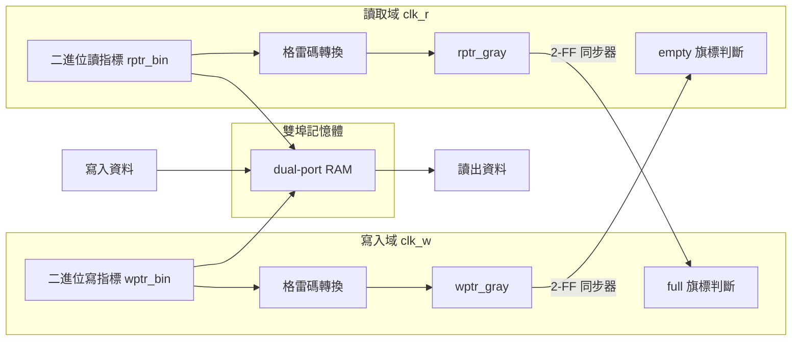

# 6.1 為什麼跨時鐘域是最難的硬體 bug

## 硬體 bug 的三個層級

在討論跨時鐘域（Clock Domain Crossing, CDC）之前，我們先把硬體 bug 依「**用什麼工具才能發現**」分成三個層級。這個分類不是為了分類而分類——它直接決定了每一類 bug 的防線在哪裡、以及防線的成本。

| 層級 | 例子 | 發現工具 | 成本 |
| --- | --- | --- | --- |
| 邏輯錯誤 | 狀態機轉移錯誤、位寬截斷 | 功能模擬（simulation） | 低：RTL 階段就能抓到 |
| 時序錯誤 | 關鍵路徑 setup 違規、hold 違規 | 靜態時序分析（STA） | 中：需要閘級網表與時序庫 |
| 物理錯誤 | 亞穩態、競態、電源雜訊、crosstalk | 只有實體（矽上）量測 | 高：已投片，修正要 ECO 或重投 |

第一層的錯誤是「算出來的值不對」：只要模擬輸入夠完整，就能重現。第二層的錯誤是「這個電路在這個頻率下跑不動」：STA 會用時序庫把每一條路徑的延遲算出來，凡違規都會被列出。這兩層都有**確定性的工具**可以攔截。

第三層是另一個世界。物理錯誤的特徵是：

1. **功能模擬永遠不會報錯**——因為模擬器的行為模型裡根本沒有這種現象；
2. **STA 也不會報錯**——因為這類問題往往不在任何一條靜態路徑上；
3. **它只在特定的物理條件下隨機出現**——溫度、電壓、製程批次（PVT）、以及兩個時鐘邊緣的相對時刻，缺一不可。

CDC bug 屬於第三層中最惡劣的一種。它不會在模擬中出錯，不會在 STA 中出錯，卻會在量產後的某一天、在某台客戶的機器上，讓晶片隨機當機。工程界有一句流傳甚廣的描述：

> CDC bug 是那種「在實驗室永遠修不好、在客戶那裡永遠重現不了」的 bug——每次出現的地點與時間都不一樣，唯一共同的是：它必然與兩個時鐘有關。

本章的任務是把這個現象的**物理機制**講清楚，因為只有理解了機制，才能理解 6.2 節的語言層解法為什麼長成那個樣子，以及 6.3 節的同步器設計為什麼要計算 MTBF。

---

## 核心物理機制：亞穩態

### 觸發器的取樣視窗

回顧正反器（flip-flop, FF）的基本契約：在時脈邊緣（例如上升沿）取樣輸入 $`D`$ ，之後輸出 $`Q`$ 保持在這個取樣值，直到下一個邊緣。

但這個契約有一個物理上的前提：**在時脈邊緣前後的一小段時間內， $`D`$ 必須保持穩定**。這段時間由兩個參數描述：

- **setup time**（ $`t_{su}`$ ）：時脈邊緣**之前**， $`D`$ 必須已經穩定的時間；
- **hold time**（ $`t_h`$ ）：時脈邊緣**之後**， $`D`$ 必須繼續穩定的時間。

合起來是一個寬度為 $`t_{su} + t_h`$ 的**取樣視窗**。只要 $`D`$ 在這個視窗內不變動，FF 就會乾淨地取到 0 或 1。

現在考慮跨時鐘域的情境：訊號 $`x`$ 由時鐘 A 驅動，被時鐘 B 域的 FF 取樣。兩個時鐘**沒有任何相位關係**——A 的邊緣可以在 B 的邊緣前後任何時刻出現。於是 $`x`$ 的變動**總有機率**恰好落在 B 域 FF 的取樣視窗內。

這不是設計錯誤，這是機率問題。只要兩個非同步訊號持續變動，碰撞遲早發生。

### 亞穩態的電學本質

FF 內部不是魔法，它是一個**正反饋電路**：兩個反相器背對背相接（或等效的交叉耦合結構），構成一個雙穩態電路——穩定點有兩個（0 與 1），中間有一個**不穩定平衡點**。

當 $`D`$ 的變動恰好落在取樣視窗內時，內部節點得到的能量不足以把它推向任何一個穩定點，正反饋電路就停在**兩個狀態之間的不穩定點附近**。這就是**亞穩態（metastability）**：

- 輸出電壓停在**中間值**——不是 0，不是 1，而是介於兩個邏輯門檻之間的某個電位；
- 這個中間值會繼續往下游傳播，讓下游的閘也無法判定；
- 恢復到穩定點需要時間，而**恢復到哪一邊是不可預測的**。

亞穩態恢復的電學行為是指數衰減。設偏離平衡點的初始電壓為 $`V_{init}`$ ，則電壓隨時間的行為近似為

$$
V(t) = V_{init} \, e^{-t/\tau}
$$

其中 $`\tau`$ 是**衰減時間常數**，由製程決定：它取決於內部反相器的增益頻寬積，先進製程的 $`\tau`$ 較小（數十皮秒），老製程可能到數百皮秒。這個式子有一個可怕的性質：

> **理論上，亞穩態可以持續任意久。** 指數衰減只保證「最後會恢復」，不保證「在多少時間內恢復」。沒有任何物理定律給恢復時間設上限。

工程師的應對因此只能是**統計的**：我們無法保證某一次亞穩態在 $`t_r`$ 之內恢復，但我們可以計算「在 $`t_r`$ 之內還沒恢復」的機率，進而計算平均多久會遇到一次。這就是下一節的 MTBF 分析。

### 為什麼模擬器裡沒有亞穩態

這裡有一個值得停下來想清楚的技術事實：**事件式模擬器（event-driven simulator）的行為模型裡，不存在亞穩態**。

Verilog 的模擬語意是：FF 在時脈邊緣「取樣」輸入——取樣動作在數學上是一個瞬間的、確定性的函數呼叫。無論 $`D`$ 與時脈邊緣多麼接近，模擬器都會取到一個明確的 0 或 1。看一個最小的例子：

```systemverilog
// 時鐘域 A 產生資料，時鐘域 B 直接取樣 —— 模擬中永遠正確
always @(posedge clk_a) begin
    data_a <= ~data_a;      // 資料在 A 域翻轉
end

always @(posedge clk_b) begin
    data_b <= data_a;       // B 域直接取樣
end
```

在模擬中，這段程式碼**永遠正確**：`data_b` 每一拍都取到 `data_a` 的某個明確值，波形乾淨、回歸測試全過、覆蓋率 100%。但在真實硬體上，`data_a` 的變動與 `clk_b` 的邊緣之間沒有任何保證——亞穩態必然在統計意義上發生。

這就是虛假信心（false confidence）的來源：**模擬是一個確定性的模型，而亞穩態是一個非確定性的物理現象**。用確定性模型驗證非確定性現象，結論必然是「沒問題」。

因此 CDC 的防線必須是三層的，缺一不可：

| 防線 | 工具 | 攔截什麼 |
| --- | --- | --- |
| 靜態檢查 | CDC lint（或語言層檢查，見 6.2） | 找出「哪裡有跨域」與「跨域是否經過同步器」 |
| 形式驗證 | CDC 形式工具、斷言 | 證明同步協議的性質（如格雷碼指標的單調性） |
| 實體驗證 | 閘級模擬、矽上量測、MTBF 計算 | 估算殘餘風險的量級 |

---

## MTBF：把亞穩態變成可計算的工程量

### 公式

同步器（synchronizer）的失效機率用**平均失效間隔時間**（Mean Time Between Failures, MTBF）描述。對一個 $`N`$ 級同步器，標準近似為

$$
MTBF = \frac{e^{t_r/\tau}}{f_{clk} \cdot f_{data} \cdot T_0}
$$

逐一解釋每個參數：

| 參數 | 意義 | 由什麼決定 |
| --- | --- | --- |
| $`t_r`$ | 解析時間（resolution time）：亞穩態被允許持續、且下游還不會看到中間值的時間 | **同步器級數**與時脈週期 |
| $`\tau`$ | 衰減時間常數 | 製程（FF 單元的物理特性） |
| $`f_{clk}`$ | 接收域（取樣域）的時脈頻率 | 系統設計 |
| $`f_{data}`$ | 跨域資料的變動頻率 | 資料本身 |
| $`T_0`$ | 取樣視窗的等效寬度（把 $`t_{su} + t_h`$ 折算成的時間常數） | FF 單元 |

公式的直覺讀法：分母 $`f_{clk} \cdot f_{data} \cdot T_0`$ 是「**每秒發生幾次亞穩態事件**」——接收域每秒取樣 $`f_{clk}`$ 次、資料每秒變動 $`f_{data}`$ 次、每次變動有 $`T_0`$ 的碰撞視窗，三者相乘就是碰撞率。分子 $`e^{t_r/\tau}`$ 是「**每次碰撞之後，亞穩態在 $`t_r`$ 內恢復的倍數**」——解析時間越長，恢復的機率以**指數**方式改善。

### 級數與 MTBF：全書因果鏈的高潮

現在把「用了幾級同步器」與「MTBF 是多少」串起來——這是本書「語言 → 硬體 → 可靠性」因果鏈在 CDC 議題上的高潮。

一個 2-FF 同步器的結構是：第一級 FF 直接面對非同步輸入（它會亞穩態），第二級 FF 在**下一個時脈邊緣**才取樣第一級的輸出。因此第一級的亞穩態有**整整一個時脈週期**（減去第二級自身的 setup 時間）的解析時間：

$$
t_r = T_{clk} - t_{su}
$$

每**多加一級**同步器， $`t_r`$ 就增加一個時脈週期，MTBF 就乘上一個 $`e^{T_{clk}/\tau}`$ 因子。用一個具體數字感受指數的威力：假設 $`T_{clk} = 4\,\text{ns}`$ 、 $`\tau = 50\,\text{ps}`$ ，則每加一級，MTBF 乘上 $`e^{80} \approx 5.5 \times 10^{34}`$ ——這是天文數字的跳躍。

| 同步器級數 | 解析時間 $`t_r`$ | MTBF 量級（示意） |
| --- | --- | --- |
| 1 級 | $`0`$ （無保護） | 每小時數次失效 |
| 2 級 | $`T_{clk}`$ | 數千小時 |
| 3 級 | $`2 \, T_{clk}`$ | 遠超宇宙年齡 |

（實際數字隨製程、頻率、資料活動率劇烈變化，此表只表達**級數帶來的指數改善趨勢**。）

這個指數關係解釋了兩件工程實務：

1. **為什麼 2-FF 是「最低配置」而 3-FF 是高頻設計的常見選擇**——多一級的面積代價極小，換來的 MTBF 改善是指數級的。
2. **為什麼同步器絕對不能放在組合邏輯後面**——組合邏輯會吃掉 $`t_r`$ ，等效於減少級數。

### 資料頻率在分母：匯流排為什麼最危險

再注意一次 $`f_{data}`$ 的位置：**在分母**。資料變動越頻繁，每秒的碰撞機會越多，MTBF 越差。

這一點的工程推論非常直接：

- 一根幾乎不變的配置訊號（ $`f_{data}`$ 極低），用最簡單的 2-FF 同步器就足夠安全；
- 一根持續翻轉的計數器或匯流排（ $`f_{data}`$ 接近 $`f_{clk}/2`$ ），MTBF 會掉好幾個數量級；
- 而 $`N`$ 位元的匯流排，等效於 $`N`$ 個獨立的碰撞源——整體失效率是單位的 $`N`$ 倍。

**多位元匯流排跨域因此是最危險的 CDC 情境**：它同時踩中「高 $`f_{data}`$ 」與「多位元一致性」兩顆地雷（後者見下文的 skew 問題）。這就是為什麼 6.3 節的完整答案——非同步 FIFO 與握手協定——都圍繞著「把多位元資料跨域轉化為單一位元（指標或旗標）跨域」這個核心思想。

---

## 常見 CDC 錯誤型態

以下六種錯誤型態，涵蓋了真實專案中絕大多數的 CDC bug。每一種都給出反例與修正。這些反例全部**能通過功能模擬**——請記住這一點，它們的危險正來自於此。

### 錯誤一：未同步的直接賦值

最原始的錯誤：跨域訊號直接接入目的域的邏輯。

```systemverilog
// 反例：clk_a 域的訊號直接被 clk_b 域使用
always_ff @(posedge clk_b) begin
    if (flag_a) begin        // flag_a 是 clk_a 域的訊號
        r_cnt <= r_cnt + 1;
    end
end
```

`flag_a` 對 `clk_b` 而言是非同步的：它可能在任何時刻變動，包括 `clk_b` 的取樣視窗內。這一個 FF 會亞穩態，而且亞穩態的中間值會直接傳進 `if` 條件與下游邏輯。

**修正**：先經過 2-FF 同步器再使用：

```systemverilog
(* ASYNC_REG = "TRUE" *) logic flag_a_sync1, flag_a_sync2;

always_ff @(posedge clk_b) begin
    flag_a_sync1 <= flag_a;          // 第一級：允許亞穩態
    flag_a_sync2 <= flag_a_sync1;    // 第二級：取樣已恢復的值
end

always_ff @(posedge clk_b) begin
    if (flag_a_sync2) begin
        r_cnt <= r_cnt + 1;
    end
end
```

### 錯誤二：重置同步問題

非同步重置的**斷言**（assertion）是安全的——它隨時可以把 FF 拉回已知狀態。但**解除**（deassertion）是危險的：如果重置解除的時刻落在某個 FF 的取樣視窗附近，不同 FF 會在不同的時脈邊緣「看到」重置解除，導致部分電路先離開重置、部分後離開——**重置釋放偏移（reset release skew）**。

修正方式是**重置同步器**：重置斷言保持非同步（保證隨時可重置），解除則經過 2-FF 同步器（保證在同一個時脈邊緣釋放）。這個結構在 6.3 節會用 Veryl 完整實作（「非同步斷言、同步解除」）。

### 錯誤三：組合邏輯跨域

比錯誤一更隱蔽的版本：跨域訊號**先經過一層組合邏輯**再進入目的域。

```systemverilog
// 反例：跨域訊號經過閘層再同步
assign comb_sel = flag_a & mode_a;   // 兩個 A 域訊號的組合

always_ff @(posedge clk_b) begin
    sel_sync1 <= comb_sel;    // 同步的是一個組合結果
    sel_sync2 <= sel_sync1;
end
```

問題有三層：

1. **組合邏輯吃掉解析時間**：亞穩態發生在同步器第一級，但 `comb_sel` 的傳播延遲縮短了下游可用時間——等效於減少級數（回顧 MTBF 公式： $`t_r`$ 變小，MTBF 指數變差）。
2. **毛刺（glitch）被同步**：`flag_a` 與 `mode_a` 到達閘的時間不同，輸出上會出現窄脈衝，同步器可能取到這個不存在的脈衝。
3. **多個來源、多條路徑**：CDC 工具很難靜態判定這樣的訊號「屬於哪個域」。

**修正**：同步器必須直接接在**目的域 FF 的輸入**上，中間不得有任何組合邏輯；跨域的多訊號邏輯應該「先在源域收斂成單一位元、寄存進 FF、再跨域」。

### 錯誤四：多位元資料跨域——skew

這是 CDC 錯誤中最經典、也最反直覺的一種。工程師的自然想法是：「單位元要同步器，那我把每個位元都過一遍同步器就好了。」

```systemverilog
// 反例：匯流排逐位元同步
genvar i;
generate for (i = 0; i < 4; i = i + 1) begin : g_sync
    always_ff @(posedge clk_b) begin
        bus_b_sync1[i] <= bus_a[i];
        bus_b_sync2[i] <= bus_b_sync1[i];
    end
end endgenerate
```

模擬中它完美運作。實體上它是錯的，原因如下：**每位元的路徑延遲不同（skew），且各 FF 的亞穩態恢復時間不同**。考慮 `bus_a` 從 `0111` 變成 `1000`（加一）的瞬間：

- 在源域，這是一個原子的暫存器更新；
- 到達目的域時，4 個位元的變動**不在同一時刻**到達取樣視窗；
- 於是第二級同步器可能在某個瞬間輸出 `1111`——一個**從未存在過的中間值**。

如果這根匯流排是位址，你可能讀到錯誤位址的資料；如果是指標，你的 FIFO 會判斷出錯誤的滿/空狀態。這種錯誤在模擬中**結構性地不可能出現**——模擬器不會給每位元隨機的路徑延遲。

**修正（一）：格雷碼。** 對「每次只遞增或遞減 1」的計數值（典型：FIFO 指標），改用**格雷碼（Gray code）**編碼後跨域。格雷碼的性質是**相鄰兩個值只差一個位元**：

$$
g = b \oplus (b \gg 1)
$$

其中 $`b`$ 是二進位值、 $`g`$ 是格雷碼。`0111`（二進位 7）變成 `1000`（二進位 8）時，格雷碼是從 `0100` 變成 `1100`——**只有一個位元變動**。單一位元的變動即使有 skew、即使亞穩態，目的域看到的要麼是舊值、要麼是新值，**永遠不會出現第三種中間值**。

**修正（二）：不用計數值跨域，改用協議。** 對任意多位元資料，正確做法是要麼用**握手協定**（先同步一個 valid 位元，資料在 valid 穩定期間被取樣），要麼用**非同步 FIFO**（把多位元資料的跨域轉化成兩個格雷碼指標的跨域）。兩者都是 6.3 節的主題。

### 錯誤五：同步器被優化掉

這是一個特別陰險的錯誤：**你的程式碼寫對了，但綜合器把它改錯了**。

```systemverilog
// 邏輯上，sync1 是多餘的：它只被 sync2 讀取，且語意等價於一根線
always_ff @(posedge clk_b) begin
    sync1 <= async_sig;
    sync2 <= sync1;
end
```

從**邏輯功能**看，`sync2` 的值永遠等於 `async_sig` 延遲兩拍——但綜合器在邏輯優化時可能把這兩級 FF 合併、重定時（retiming）、甚至刪掉一級，因為在純粹的布林代數裡它們與一根延遲線等價。**綜合器不知道亞穩態的存在**——它優化掉的正是你用來對抗亞穩態的那一級。

修正依賴**綜合屬性**，告訴工具「這兩顆 FF 必須保留在原位、且放置得靠近彼此」：

```systemverilog
// SystemVerilog：Xilinx 語法
(* ASYNC_REG = "TRUE" *) logic sync1, sync2;
```

Veryl 中用 `#[sv(...)]` 屬性把同樣的資訊傳給下游綜合器：

```veryl
#[sv("async_reg=\"true\"")]
var _sync1 : logic
#[sv("async_reg=\"true\"")]
var _sync2 : logic
```

屬性會原樣輸出到生成的 SystemVerilog 中。6.3 節會給出完整可重用的同步器模組。

### 錯誤六：重置同步器與時鐘使能的交互

最後一種常見於低功耗設計：**時鐘閘控（clock gating）或時鐘使能與重置同步器的交互**。

情境：某個域的時鐘被閘控關閉，重置同步器也使用這個時鐘。此時重置解除訊號**無法傳播**——同步器的 FF 沒有時脈，輸出維持在重置值。等時鐘重新開啟時，重置解除才開始傳播，可能造成「部分電路晚數拍脫離重置」的隱性時序假設。

這類問題的通則是：**任何「非同步進入某域的訊號」（資料、重置、使能）都必須在該域的時脈下被同步**，而「某域時脈不存在」的期間，同步器是無效的。設計上必須保證重置解除的時序不依賴於被閘控的時鐘，或讓閘控時鐘的使能本身來自已同步的域。

---

## 非同步 FIFO：CDC 的正確答案

把上面所有教訓集合起來，業界收斂出的標準答案是**非同步 FIFO（asynchronous FIFO）**。它的結構值得仔細看，因為它是「把多位元危險轉化為單位元安全」的教科書範例：



結構的三個要點：

1. **資料本體不跨時鐘域**：寫入與讀出共用一塊雙埠 RAM，寫埠工作在寫域、讀埠工作在讀域——資料透過儲存單元「傳遞」，而不是透過同步器。
2. **只有兩個指標跨域，且都用格雷碼**：寫指標以格雷碼送進讀域（用於判空）、讀指標以格雷碼送進寫域（用於判滿）。格雷碼保證每次只變一個位元，消除 skew 問題；2-FF 同步器保證亞穩態被解析。
3. **滿/空的判斷是「保守」的**：由於同步有延遲，判滿/判空看到的指標是舊值——但「晚判空」只是效能損失，「早判滿」只是保守，**不會導致讀空、寫滿的資料損毀**。這個「錯誤方向只損失效能、不損失正確性」的性質，正是這個協議被使用了三十年的原因。

完整實作（格雷碼轉換、滿/空條件、Veryl 程式碼、驗證策略）在 6.3 節展開；這裡只需記住結論：**需要跨域傳輸資料流時，答案幾乎總是非同步 FIFO；需要跨域傳輸一次性事件時，答案是握手協定。兩者的共同基礎都是格雷碼與 2-FF 同步器。**

---

## 本章小結

1. 硬體 bug 分三層：邏輯錯誤（模擬可抓）、時序錯誤（STA 可抓）、物理錯誤（**只有矽上才能暴露**）。CDC bug 屬於第三層中最惡劣者——**模擬永遠不會報錯**。
2. 亞穩態的機制：取樣視窗內的資料變動使 FF 內部正反饋停在兩個穩定點之間；恢復是指數衰減 $`V(t) = V_{init} \, e^{-t/\tau}`$ ，理論上可持續任意久，因此只能用統計模型處理。
3. MTBF 公式 $`MTBF = \frac{e^{t_r/\tau}}{f_{clk} \cdot f_{data} \cdot T_0}`$ 把「同步器級數」與「失效間隔」連結起來：每多一級， $`t_r`$ 增加一個時脈週期，MTBF 指數改善。
4. $`f_{data}`$ 在分母——資料越活動、MTBF 越差——這解釋了為什麼匯流排跨域最危險。
5. 模擬抓不到 CDC bug 的根因：事件式模擬是確定性的，沒有亞穩態模型。防線必須是靜態檢查、形式驗證、實體驗證三層。
6. 六種常見錯誤型態：未同步賦值、重置未同步、組合邏輯跨域、多位元 skew（格雷碼修正 $`g = b \oplus (b \gg 1)`$ ）、同步器被優化（屬性保護）、重置與時鐘使能交互。
7. 非同步 FIFO 是資料流跨域的正確答案：資料不跨域、只有格雷碼指標跨域、錯誤方向只損失效能不損失正確性。

CDC 是「語言不管、就會出事的領域」：在 SystemVerilog 裡，上述六種錯誤**全部合法**，它們的攔截完全依賴外部 CDC 工具（Spyglass、Questa CDC 等）與 code review 紀律。下一節（6.2）我們看 Veryl 如何把「跨域」變成語言層級可檢查的概念——讓編譯器在你寫下跨域賦值的那一刻就擋住你。

---

*下一節：第 6.2 節「時鐘域標註與 unsafe(cdc) 檢查」*
