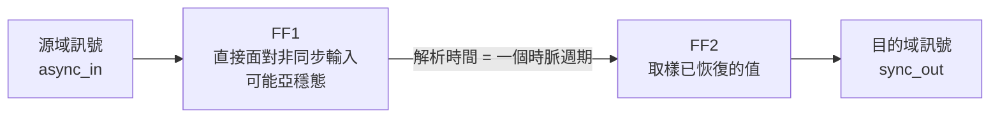
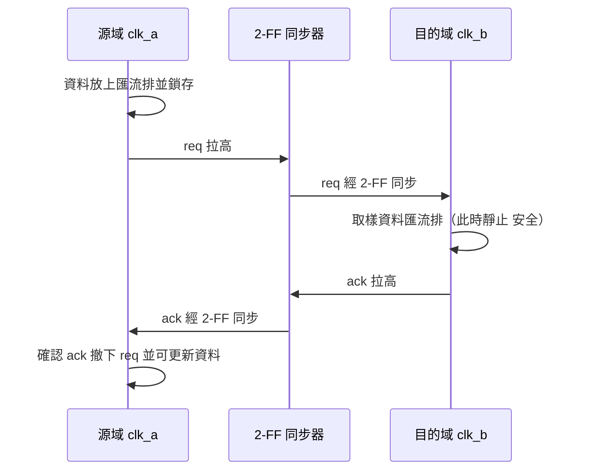
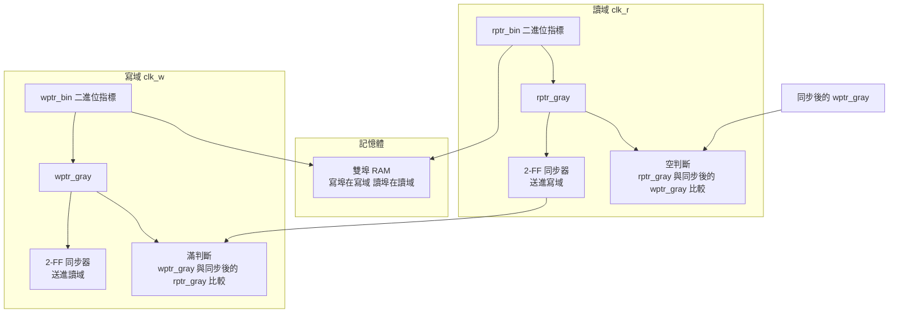

# 6.3 同步器的實作、驗證與協議（MTBF）

## 從原則到電路

6.1 節給出了物理（亞穩態與 MTBF），6.2 節給出了語言機制（域標註與 `unsafe (cdc)`）。本節把兩者接到一起：**在 Veryl 裡，這些原則如何變成可重用、可驗證的電路**。我們依序實作：

1. 2-FF 同步器（單位元）與 MTBF 的級數關係；
2. 格雷碼的完整推導與跨域正確性論證；
3. 握手協定（四相與二相）；
4. 非同步 FIFO 的完整實作；
5. 驗證策略與重置同步細節。

---

## 2-FF 同步器

### 基本結構與 MTBF

2-FF 同步器是所有 CDC 電路的原子元件。它的結構只有兩顆 FF，但它的每一個細節都有物理理由：



回顧 6.1 節的 MTBF 公式：

$$
MTBF = \frac{e^{t_r/\tau}}{f_{clk} \cdot f_{data} \cdot T_0}
$$

其中解析時間 $ t_r $ 由級數決定：$ N $ 級同步器提供約 $ (N-1) \, T_{clk} - t_{su} $ 的解析時間。每多一級，MTBF 乘上 $ e^{T_{clk}/\tau} $。**級數是設計者唯一能控制的指數項**——$ \tau $ 由製程決定、$ f_{clk} $ 與 $ f_{data} $ 由系統決定、$ T_0 $ 由單元庫決定，只有級數是你選的。

### Veryl 實作

```veryl
module Synchronizer (
    i_clk  : input  'b clock,
    i_rst  : input  'b reset,
    i_async: input  logic,
    o_sync : output logic,
) {
    #[sv("async_reg=\"true\"")]
    var r_meta : logic

    #[sv("async_reg=\"true\"")]
    var r_sync : logic

    always_ff (i_clk, i_rst) {
        if_reset {
            r_meta = 0;
            r_sync = 0;
        } else {
            r_meta = i_async;
            r_sync = r_meta;
        }
    }

    assign o_sync = r_sync;
}
```

三個關鍵細節：

1. **`#[sv("async_reg=\"true\"")]`**：屬性會原樣輸出到生成的 SystemVerilog（`(* async_reg = "true" *)`），告訴綜合器「這兩顆 FF 是亞穩態防護用的，不可合併、不可重定時、且應靠近放置」。這是 6.1 節錯誤五的直接解法。
2. **第一級 FF 直接面對 `i_async`**：中間沒有任何組合邏輯——保護解析時間 $ t_r $。
3. **域標註**：輸入是無域的（它來自另一個域，由上層用 `unsafe (cdc)` 邊界處理），內部 FF 與輸出明確屬於 `'b` 域。

若要更高的 MTBF（高頻設計），把級數做成參數：

```veryl
module SynchronizerN #(
    param STAGES: u32 = 3,
) (
    i_clk  : input  'b clock,
    i_rst  : input  'b reset,
    i_async: input  logic,
    o_sync : output logic,
) {
    var r_pipe: logic<STAGES>

    for i: u32 in 0..STAGES {
        #[sv("dont_touch=\"true\"")]
        always_ff (i_clk, i_rst) {
            if i == 0 {
                if_reset {
                    r_pipe[i] = 0;
                } else {
                    r_pipe[i] = i_async;
                }
            } else {
                if_reset {
                    r_pipe[i] = 0;
                } else {
                    r_pipe[i] = r_pipe[i - 1];
                }
            }
        }
    }

    assign o_sync = r_pipe[STAGES - 1];
}
```

這裡另外用了 `#[sv("dont_touch=\"true\"")]`——當屬性無法逐訊號表達時，直接對邏輯塊下達「不得優化」的指令。**級數每加一，MTBF 指數改善，代價只是一顆 FF 的面積與一拍的延遲**；這個取捨在幾乎所有場景下都值得。

### 單位元同步器 vs 匯流排同步器

最後一次強調 6.1 節錯誤四的教訓：**上述同步器只能用於單位元訊號**。把 $ N $ 個實例排成匯流排同步器，得到的是 $ N $ 個各自可能在不同時刻收斂的通道——中間值問題無解。多位元的答案在下面的格雷碼與握手協定。

---

## 格雷碼的完整推導

### 定義與轉換

二進位碼 $ b_{n-1} \ldots b_0 $ 與格雷碼 $ g_{n-1} \ldots g_0 $ 的關係：

$$
g_i = b_i \oplus b_{i+1}
$$

（最高位 $ g_{n-1} = b_{n-1} $，因為 $ b_n = 0 $。）用向量的寫法就是 6.1 節給出的

$$
g = b \oplus (b \gg 1)
$$

反向轉換（格雷碼回二進位）是前綴異或：

$$
b_i = \bigoplus_{j=i}^{n-1} g_j
$$

用 4 位元的例子驗證：

| 十進位 | 二進位 $ b $ | 格雷碼 $ g $ |
| --- | --- | --- |
| 0 | 0000 | 0000 |
| 1 | 0001 | 0001 |
| 2 | 0010 | 0011 |
| 3 | 0011 | 0010 |
| 4 | 0100 | 0110 |
| 5 | 0101 | 0111 |
| 6 | 0110 | 0101 |
| 7 | 0111 | 0100 |
| 8 | 1000 | 1100 |

觀察 7 到 8 這一行：二進位從 `0111` 到 `1000` 是**四個位元全部翻轉**（6.1 節的 skew 災難場景），格雷碼從 `0100` 到 `1100` **只翻轉一個位元**。

### 相鄰碼距為 1 的證明

設 $ b' = b + 1 $，則 $ b $ 與 $ b' $ 的差異是：從最低位開始的一串 1（設共 $ k $ 個）翻成 0，第 $ k $ 位由 0 翻成 1。即 $ b_{k} \ldots b_0 = 0 \, 1 \ldots 1 $ 而 $ b'_{k} \ldots b'_0 = 1 \, 0 \ldots 0 $，更高的位元相同。

檢查格雷碼的每一位：

- 對 $ i > k $：$ b_i = b'_i $ 且 $ b_{i+1} = b'_{i+1} $，故 $ g_i = g'_i $，不變。
- 對 $ i = k $：$ b_k = 0, b_{k+1} = b'_{k+1} $（設其值為 $ c $），故 $ g_k = 0 \oplus c = c $；而 $ b'_k = 1 $，$ g'_k = 1 \oplus c = \bar{c} $。**恰翻轉一位。**
- 對 $ i < k $：$ b_i = 1, b_{i+1} = 1 $（$ i+1 \le k $），故 $ g_i = 1 \oplus 1 = 0 $；$ b'_i = 0, b'_{i+1} = 0 $，$ g'_i = 0 $。不變。

所以 $ g $ 與 $ g' $ 恰好只差第 $ k $ 位。證畢。

### 跨域正確性論證

現在把這個性質接到 CDC。非同步 FIFO 的寫指標以格雷碼跨域同步，接收域在某個時刻取樣它。由於亞穩態與 skew，取到的值可能是：

- **舊值**：同步器還沒看到這次的變動；
- **新值**：變動已完整傳播；
- **中間值嗎？不可能**——因為相鄰兩值只差一個位元，這個位元要麼是 0 要麼是 1，**不存在第三種組合**。

（嚴格地說，取樣瞬間那一位可能亞穩態，但它最終收斂到 0 或 1，而**兩種收斂結果都對應一個真實存在過的指標值**。）

更關鍵的是方向性：對遞增的指標，接收域看到的格雷碼值**只可能落後、不可能超前**。落後的指標在 FIFO 的判斷中導致：

- 判空偏保守（以為還沒資料，實際已有）——只損失讀取效率；
- 判滿偏保守（以為還有空位，實際更滿）——等等，方向要小心：**寫域用讀指標判滿，讀指標落後意味著寫域以為空間比實際多？** 不——讀指標落後意味著「讀取進度看起來比實際舊」，於是寫域估計的佔用量**偏大**，判滿**偏早**，這是安全的。同理讀域用落後的寫指標判空，估計的佔用量偏小，判空**偏早**，也是安全的。

結論：**同步延遲造成的指標滯後，只會讓滿/空判斷偏保守，不會讓 FIFO 讀空或寫滿。** 這正是 6.1 節說的「錯誤方向只損失效能、不損失正確性」。

### 限制

格雷碼的正確性依賴「**每次只遞增或遞減 1**」這個前提。以下場景不適用：

- 跳躍式更新的計數值（一次加 $ k $）；
- 隨機更新的匯流排（相鄰值可能多位元變動）；
- 需要**算術運算**的場合（格雷碼不能直接加減，必須轉回二進位）。

後者正是非同步 FIFO 內部的分工：**指標在各自的域內以二進位維護（方便算術），只在跨域的瞬間轉成格雷碼**。

---

## 握手協定

格雷碼只適用於計數值。對任意多位元資料的一次性傳輸，答案是握手協定。

### 核心思想

> **資料匯流排在跨域期間保持靜止；跨域的只有一個控制位元。**



因為資料匯流排在 `req` 為高的整個期間不變動，目的域在同步到 `req` 之後**任何時刻**取樣匯流排都是安全的——多位元 skew 只發生在資料變動的瞬間，而變動被協議隔離在「雙方都已知安全」的時間窗之外。

### 四相握手（four-phase / RTZ）

四相握手用「req 高 → ack 高 → req 低 → ack 低」四個相位完成一次傳輸，結束時訊號歸零（return-to-zero, RTZ）。

```veryl
module HandshakeTx (
    i_clk_a  : input  'a clock,
    i_rst_a  : input  'a reset,
    i_valid  : input  'a logic,
    i_data   : input  'a logic<8>,
    o_ready  : output 'a logic,
    o_req    : output 'a logic,
    o_data   : output 'a logic<8>,
    i_ack    : input  logic,   // 已由目的域同步而來，視為 'a 域輸入
) {
    var r_ack_s1 : logic
    var r_ack_s2 : logic

    always_ff (i_clk_a, i_rst_a) {
        if_reset {
            r_ack_s1 = 0;
            r_ack_s2 = 0;
        } else {
            r_ack_s1 = i_ack;
            r_ack_s2 = r_ack_s1;
        }
    }

    // 源域狀態：閒置（可接新資料）或等待 ack 歸零
    always_comb {
        o_ready = !i_valid;
    }

    always_ff (i_clk_a, i_rst_a) {
        if_reset {
            o_req  = 0;
            o_data = 0;
        } else if i_valid && !r_ack_s2 {
            o_req  = 1;
            o_data = i_data;
        } else if r_ack_s2 {
            o_req = 0;
        }
    }
}
```

四相的優點是**協議簡單、易於形式化**；缺點是每次傳輸要四個相位，吞吐量低（req 與 ack 各要往返一次）。

### 二相握手（two-phase / NRZ）

二相握手（non-return-to-zero）讓 `req` **翻轉**而非歸零：`req` 的**每次翻轉**都是一次新傳輸的訊號。目的域偵測到 `req` 與自己上次的副本不同，就取樣資料並把 `ack` 翻轉。

```veryl
module HandshakeTx2 (
    i_clk_a  : input  'a clock,
    i_rst_a  : input  'a reset,
    i_valid  : input  'a logic,
    i_data   : input  'a logic<8>,
    o_req    : output 'a logic,
    o_data   : output 'a logic<8>,
    i_ack    : input  logic,
) {
    var r_ack_s1 : logic
    var r_ack_s2 : logic

    always_ff (i_clk_a, i_rst_a) {
        if_reset {
            r_ack_s1 = 0;
            r_ack_s2 = 0;
        } else {
            r_ack_s1 = i_ack;
            r_ack_s2 = r_ack_s1;
        }
    }

    always_ff (i_clk_a, i_rst_a) {
        if_reset {
            o_req  = 0;
            o_data = 0;
        } else if i_valid && (o_req != r_ack_s2) == 0 {
            // 等待上一筆被確認後 才翻轉 req
            o_req  = !o_req;
            o_data = i_data;
        }
    }
}
```

二相的優點是**吞吐量翻倍**（不需要歸零相位）；缺點是狀態語意隱含在「翻轉的奇偶」裡，形式驗證的性質要寫得更小心。實務上：控制路徑的偶發事件用四相（簡單可靠），資料路徑的高吞吐需求用 FIFO（見下）。

### 為什麼握手可安全傳多位元資料

把論證收攏成三條：

1. **資料穩定性由協議保證**：源域承諾「`req` 為高（或未翻轉確認前）資料不變」，這是**協議契約**而非物理保證；
2. **取樣時機由同步器保證**：目的域只在同步到 `req` 之後取樣，而取樣到的 `req` 已經歷 2-FF 解析；
3. **時序餘量由結構保證**：資料匯流排不需要任何同步器，直接進目的域的 FF——它只要滿足目的域的 setup/hold 即可，而協議保證它在取樣點附近是靜止的。

---

## 非同步 FIFO 的完整實作

### 結構



### 指標與滿空判斷

深度為 $ 2^n $ 的 FIFO，指標用 $ n+1 $ 位元（多一位元用於區分滿與空）。約定：

- **空**：讀域同步到的寫指標（格雷）等於讀指標（格雷）；
- **滿**：寫域同步到的讀指標（格雷）**反轉最高兩位**後等於寫指標（格雷）。

滿條件的直覺：指標多繞一圈回來時，格雷碼的最高兩位會同時反相、其餘位元相同。

格雷碼與二進位的轉換在 Veryl 中直接寫成組合邏輯：

```veryl
// 二進位轉格雷碼： g = b ^ (b >> 1)
let w_gray : logic<ADDR_W + 1> = wptr_bin ^ (wptr_bin >> 1);
// 格雷碼轉二進位：逐位前綴異或（用於滿判斷前的比較）
let g_to_b : logic<ADDR_W + 1> = {
    var acc : logic<ADDR_W + 1> = 0;
    for i: u32 in 0..(ADDR_W + 1) rev {
        acc[i] = acc[i + 1] ^ rptr_gray_sync[i];
    }
    acc
}
```

### 完整 Veryl 實作

```veryl
module AsyncFifo #(
    param WIDTH  : u32 = 8,
    param ADDR_W : u32 = 4,
) (
    // 寫域
    i_clk_w      : input  'w clock,
    i_rst_w      : input  'w reset,
    i_wr_en      : input  'w logic,
    i_wr_data    : input  'w logic<WIDTH>,
    o_full       : output 'w logic,
    // 讀域
    i_clk_r      : input  'r clock,
    i_rst_r      : input  'r reset,
    i_rd_en      : input  'r logic,
    o_rd_data    : output 'r logic<WIDTH>,
    o_empty      : output 'r logic,
) {
    const PTR_W : u32 = ADDR_W + 1;

    // ===== 寫域：二進位寫指標與格雷碼 =====
    var r_wbin : logic<PTR_W>
    var w_wgray: logic<PTR_W>
    var r_wgray: logic<PTR_W>

    // 同步進寫域的讀指標（格雷碼）
    #[sv("async_reg=\"true\"")]
    var r_rgray_s1 : logic<PTR_W>
    #[sv("async_reg=\"true\"")]
    var r_rgray_s2 : logic<PTR_W>

    // ===== 讀域：二進位讀指標與格雷碼 =====
    var r_rbin : logic<PTR_W>
    var w_rgray: logic<PTR_W>
    var r_rgray: logic<PTR_W>

    // 同步進讀域的寫指標（格雷碼）
    #[sv("async_reg=\"true\"")]
    var r_wgray_s1 : logic<PTR_W>
    #[sv("async_reg=\"true\"")]
    var r_wgray_s2 : logic<PTR_W>

    // ----- 寫域邏輯 -----
    assign w_wgray = r_wbin ^ (r_wbin >> 1);

    unsafe (cdc) {
        // r_rgray_s2 與 r_rgray_s1 的鏈即為讀指標的 2-FF 同步器
    }

    always_ff (i_clk_w, i_rst_w) {
        if_reset {
            r_wbin     = 0;
            r_wgray    = 0;
            r_rgray_s1 = 0;
            r_rgray_s2 = 0;
        } else {
            r_rgray_s1 = r_rgray;
            r_rgray_s2 = r_rgray_s1;
            r_wgray    = w_wgray;
            if i_wr_en && !o_full {
                r_wbin = r_wbin + 1;
            }
        }
    }

    // 滿：同步進來的讀格雷指標 反轉最高兩位後 == 寫格雷指標
    always_comb {
        o_full = w_wgray == {~r_rgray_s2[PTR_W - 1:PTR_W - 2],
                             r_rgray_s2[PTR_W - 3:0]};
    }

    // ----- 讀域邏輯 -----
    assign w_rgray = r_rbin ^ (r_rbin >> 1);

    always_ff (i_clk_r, i_rst_r) {
        if_reset {
            r_rbin     = 0;
            r_rgray    = 0;
            r_wgray_s1 = 0;
            r_wgray_s2 = 0;
        } else {
            r_wgray_s1 = r_wgray;
            r_wgray_s2 = r_wgray_s1;
            r_rgray    = w_rgray;
            if i_rd_en && !o_empty {
                r_rbin = r_rbin + 1;
            }
        }
    }

    // 空：同步進來的寫格雷指標 == 讀格雷指標
    always_comb {
        o_empty = r_rgray == r_wgray_s2;
    }

    // ----- 記憶體：資料不跨域 只透過儲存單元傳遞 -----
    var mem: logic<WIDTH> [2 ** ADDR_W]

    always_ff (i_clk_w) {
        if i_wr_en && !o_full {
            mem[r_wbin[ADDR_W - 1:0]] = i_wr_data;
        }
    }

    assign o_rd_data = mem[r_rbin[ADDR_W - 1:0]];
}
```

這份實作值得逐段對照前面的小節：

- 兩個格雷碼跨域鏈各配 `#[sv("async_reg=\"true\"")]`（6.1 節錯誤五）；
- 域標註 `'w` / `'r` 讓編譯器檢查每一條賦值（6.2 節）；
- 記憶體讀埠直接用二進位指標索引——資料路徑不跨域（6.1 節的結構要點）；
- 滿/空判斷方向保守（本節的格雷碼論證）。

---

## 驗證策略

CDC 電路的驗證要特別小心：**功能模擬對亞穩態是盲的**（6.1 節），因此驗證的重點不是「跑很多隨機向量」，而是**證明協議的性質**。完整的測試框架見第 8 章，這裡給出策略層的分工：

### 斷言

用 `$assert`（第 8 章詳述）把協議契約寫進程式碼：

- 滿旗標為高時**不得**發生成功寫入；空旗標為高時**不得**發生成功讀取；
- 指標不得越界（`wptr_bin - rptr_bin` 不超過深度）；
- 握手協定中，`req` 為高期間資料匯流排不得變動——這是握手正確性的核心契約。

### 形式驗證

形式驗證對 CDC 有兩種標準用法：

1. **assume 亞穩態模型**：對同步器第一級，用 `assume` 描述「這一級的輸出可以是任意值、任意延遲收斂」——即把亞穩態的不確定性**形式化地注入**模型；
2. **assert 第二級輸出乾淨**：在上述假設下，證明第二級之後的所有值都屬於「真實存在過的源域值集合」。對格雷碼指標，這等價於證明「接收域看到的格雷碼永遠對應某個合法指標」。

這是「模擬盲區」的標準補法：**模擬無法注入亞穩態，形式驗證可以用假設注入**。

### 錯誤注入

在閘級模擬或模擬器支援的範圍內，對同步器第一級注入 X 值或不定值，確認下游邏輯不會因此進入不可恢復的狀態。這是對「單點亞穩態不應擴散成系統故障」的抽樣檢查。

---

## 重置同步細節

6.1 節錯誤二的重置問題，在 Veryl 中的解法是**重置同步器**：非同步斷言、同步解除（async assert, sync deassert）。

```veryl
module ResetSync (
    i_clk        : input  'b clock,
    i_rst_async  : input  reset_async_low,   // 外部非同步重置
    o_rst_sync   : output reset_async_low,   // 已同步釋放的重置
) {
    var r_meta : logic
    var r_rst  : logic

    always_ff (i_clk, i_rst_async) {
        if_reset {
            // 非同步斷言：立即拉低 與外部重置同步
            r_meta = 0;
            r_rst  = 0;
        } else {
            // 同步解除：經過 2-FF 在同一個時脈邊緣釋放
            r_meta = 1;
            r_rst  = r_meta;
        }
    }

    assign o_rst_sync = r_rst as reset_async_low;
}
```

性質拆解：

- **斷言路徑**：`i_rst_async` 出現在敏感度列表（`always_ff (i_clk, i_rst_async)` 的非同步重置），重置到達的瞬間兩級 FF 立即清零——**不受時脈限制**，保證任何時刻都能進入重置狀態；
- **解除路徑**：解除訊號必須走兩級 FF 的資料路徑，於是釋放發生在**某個特定的時脈邊緣**——域內所有使用 `o_rst_sync` 的 FF 在同一拍離開重置，消除釋放偏移；
- `if_reset`（4.3 節）讓程式碼不寫極性判斷，極性由 `reset_async_low` 型別與建置設定決定。

---

## MTBF 的工程實務

最後把 6.1 節的統計模型落成工程決策：

### 目標量級

單一同步器的 MTBF 目標通常是 **$ 10^{9} $ 小時以上**（即每台設備平均千年一次），而整個晶片可能有數十到數百個跨域點，且 MTBF 是並聯失效——目標要再往上加。實務上：ASIC 流程會要求每個同步器提交 MTBF 計算報告（用單元庫的 $ \tau $ 與 $ T_0 $、實際的 $ f_{clk} $ 與 $ f_{data} $），作為簽核文件的一部分。

### PVT 對 $ \tau $ 的影響

$ \tau $ 不是常數：它隨**製程（Process）、電壓（Voltage）、溫度（Temperature）**變化。低電壓、高溫、慢製程角（slow corner）下，內部增益下降，$ \tau $ 變大，MTBF **指數變差**。因此 MTBF 報告必須在最壞 PVT 角下計算，而不是典型角。

### 級數的取捨

| 級數 | 面積 | 延遲 | 適用 |
| --- | --- | --- | --- |
| 2 | 最小 | 2 拍 | 中低頻、低資料活動率 |
| 3 | +1 FF | 3 拍 | 高頻、高活動率、長壽命產品 |
| 更多 | 線性增 | 線性增 | 極端頻率（多 GHz） |

由於 MTBF 隨級數**指數**改善而成本**線性**增加，只要面積或延遲允許，寧多勿少——這是罕見的「保險幾乎免費」的工程決策。

---

## 實作練習

### 練習：深度 16 的 8 位元非同步 FIFO 與測試平台

**題目：** 用本節的 `AsyncFifo`（`WIDTH = 8`、`ADDR_W = 4`）搭建一個跨域橋：寫域 100 MHz 寫入遞增序列，讀域 33 MHz 隨機延遲讀取。要求：

1. 在測試平台中檢查：讀出的序列與寫入序列**完全一致**（用記分板比對，第 8.3 節的方法）；
2. 加斷言：`o_full` 為高時寫指標不變；`o_empty` 為高時讀指標不變；
3. 刻意把兩個同步器鏈的 `#[sv(...)]` 屬性移除，`veryl build` 之後檢視生成的 SystemVerilog，確認屬性消失——並討論這對下游綜合器意味著什麼（對照 6.1 節錯誤五）；
4. 觀察 `unsafe (cdc)` 區塊的位置：本實作中格雷碼指標的跨域同步直接寫在 `always_ff` 中（域推斷自動處理了絕大多數賦值），說明哪些賦值真正需要顯式豁免、哪些由域系統自動放行。

**觀察重點：** 域標註 `'w` / `'r` 存在時，任何「把寫域訊號直接賦給讀域變數」的筆誤都會被編譯器攔下——把第 3 點的屬性實驗與這個筆誤實驗各做一次，你會同時看到**工具鏈的保護**與**語言的保護**是互補的兩層。

---

## 本章小結

1. 2-FF 同步器是 CDC 的原子元件；`#[sv("async_reg=\"true\"")]` / `#[sv("dont_touch=\"true\"")]` 防止綜合器優化掉同步器；級數每加一，MTBF 指數改善、成本線性增加。
2. 格雷碼 $ g = b \oplus (b \gg 1) $ 相鄰碼距為 1（已證明）；跨域取樣只能得到舊值或新值，不存在中間值；同步滯後只讓滿/空判斷偏保守。限制：只適用於每次遞增/遞減 1 的計數值。
3. 握手協定把多位元資料的跨域轉化為單位元 `req`/`ack` 的跨域：資料在 `req` 穩定期間靜止，skew 無害。四相簡單但吞吐低，二相吞吐高但狀態隱含在翻轉奇偶裡。
4. 非同步 FIFO：資料經雙埠 RAM 傳遞不跨域，只有兩個格雷碼指標跨域（各配 2-FF 同步器與屬性保護）；空 = 兩格雷指標相等，滿 = 反轉最高兩位後相等。
5. 驗證策略：斷言寫下協議契約；形式驗證用 `assume` 注入亞穩態模型、`assert` 證明第二級之後的值乾淨；錯誤注入檢查擴散。模擬本身對亞穩態是盲的。
6. 重置同步器：非同步斷言（敏感度列表）、同步解除（2-FF 資料路徑），用 `if_reset` 實作且不寫極性。
7. MTBF 工程實務：目標 $ 10^{9} $ 小時以上、在最壞 PVT 角下計算、級數寧多勿少。

至此第 6 章完成了一條完整的鏈：物理（亞穩態）→ 語言（域標註與 `unsafe (cdc)`）→ 電路（同步器、格雷碼、握手、FIFO）→ 驗證（斷言與形式化）。下一章（第 7 章）轉向工程基礎設施：verylup 工具鏈管理、build/fmt/lint/doc 與 CI 整合、相依性管理與版本治理。

---

*下一節：第 7.1 節「verylup：工具鏈安裝與版本管理（2024-2026）」*
