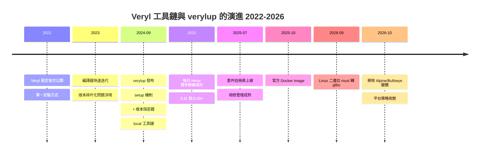

# 7.1 verylup：工具鏈安裝與版本管理（2024-2026）

## 為什麼需要工具鏈管理器

### 問題：工具鏈版本與專案的糾纏

考慮一個常見的硬體團隊困境：

- 專案 A 在 2024 年開始，鎖定 Veryl 0.13；
- 專案 B 在 2025 年開始，需要 0.17 的新語法；
- 兩個專案的工程師是**同一批人**，共用同一批機器與 CI。

如果 Veryl 只有「安裝一個版本」這一種模式，這個困境無解：升級工具鏈，專案 A 的建置可能因語言變更而破壞；不升級，專案 B 無法使用新特性。工程師會被迫用「多個安裝路徑 + 手動切 PATH」這種脆弱的方式管理版本——而 PATH 是**全域狀態**，切換會互相污染，CI 上的重現更是噩夢。

### 解法：Rust 的 rustup 模式

這個問題在軟體世界已經有成熟的答案：Rust 的 **rustup**。它的核心思想是：

> **把「工具鏈版本」與「專案」解耦：機器上可以並存任意多個工具鏈版本，由每個專案（或每條命令）指定要用哪一個。**

具體機制有三：

1. **單一入口**：`rustc` / `cargo` 是代理程式（shim），實際呼叫哪個版本由當前目錄的 `rust-toolchain.toml` 或命令列的 `+` 指定器決定；
2. **版本並存**：所有工具鏈版本安裝在使用者目錄下，互不干擾；
3. **宣告式鎖定**：專案用檔案聲明自己的工具鏈需求，進入目錄即生效。

Veryl 在 2024 年 9 月發布的 **verylup**，就是把這個模式完整移植到硬體工具鏈的產物。這不是偶然的模仿——Veryl 本身就用 Rust 實作，其開發者每天都在 rustup 的體驗下工作，「工具鏈管理應該長什麼樣」對他們而言是一個已有答案的問題。

---

## verylup 的定位與安裝

### 定位

verylup 的職責範圍非常克制：**它只管理 Veryl 工具鏈本身**（`veryl` 編譯器與 `veryl-ls` 語言伺服器）。專案的相依性管理（第三方套件）不歸它管——那是 `Veryl.toml` 與 `Veryl.lock` 的職責（7.3 節）。這個分工與 rustup（管工具鏈）/ cargo（管相依）的分工完全同構。

### 安裝方式

**方式一：Release binary（推薦）。** 從 GitHub Releases 下載對應平台的預編譯二進位，放入 PATH：

```bash
# Linux x86_64 的例子
curl -LO https://github.com/veryl-lang/verylup/releases/latest/download/verylup-latest-linux-x86_64.tar.gz
tar xzf verylup-latest-linux-x86_64.tar.gz
mv verylup ~/.local/bin/
```

**方式二：從原始碼安裝（需要 Rust 環境）：**

```bash
cargo install verylup
```

### 一次性初始化：verylup setup

安裝 verylup 之後，必須執行一次性的初始化：

```bash
verylup setup
```

這個命令做兩件事：

1. **下載最新的 Veryl 工具鏈**；
2. **建立 `veryl` 與 `veryl-ls` 兩個 shim**，放入 PATH。

之後你在命令列使用的 `veryl`，其實是 verylup 安裝的代理程式——它會根據「當前目錄的設定」與「命令列的 `+` 指定器」把請求轉發給正確的底層工具鏈。**你從此不需要知道工具鏈實際安裝在哪裡。**

---

## 日常使用

### 更新與安裝特定版本

```bash
verylup update          # 更新 latest 工具鏈到最新版
verylup install 0.12.0  # 安裝指定版本
verylup show            # 列出已安裝的工具鏈與預設版本
```

`verylup show` 的典型輸出概念上如下：

| 工具鏈 | 狀態 |
| --- | --- |
| latest | 預設 |
| 0.12.0 | 已安裝 |
| local | 已安裝（Veryl 開發用） |

### 版本指定器 `+`

關鍵語法是 `+`：在**任何** veryl 命令前指定工具鏈版本：

```bash
veryl +0.12.0 build     # 用 0.12.0 建置
veryl +latest build     # 用 latest 建置
veryl +0.13.1 check     # 用 0.13.1 檢查
```

這個設計讓「同一台機器、同一個終端機」可以在不同專案間無縫切換：

```bash
cd ~/proj-a && veryl +0.12.0 build   # 專案 A 鎖定舊版
cd ~/proj-b && veryl +latest build   # 專案 B 追新版
```

配合 CI 時，`+` 指定器讓「**建置時使用的工具鏈版本**」成為 CI 設定檔裡顯式的一行，而不是「這台 runner 碰巧裝的版本」——後者是硬體專案最常見的不可重現來源之一。

### local 工具鏈：支援語言自身開發的體驗設計

verylup 有一個特別的設計值得單獨說明：

```bash
verylup install local
```

這個命令把**本機 Veryl 儲存庫建置出來的工具鏈**裝進管理系統，命名為 `local`；若系統中已存在 `local` 工具鏈，它會成為預設。

這是為 Veryl 語言本身的開發者設計的：當你 clone 了 Veryl 編譯器的儲存庫、修改了編譯器程式碼之後，`verylup install local` 讓你**用剛剛自己編譯出來的編譯器去編譯專案**——包括用 Veryl 寫的語言測試與標準函式庫。整個迴路（改編譯器 → 立即在真實專案上測試）不需要任何手動的 PATH 操作或安裝步驟。

這個設計透露的哲學與 rustup 的 `rustup toolchain link` 一脈相承：**工具鏈管理器不僅服務使用者，也服務工具鏈的開發者**。一門年輕語言的演化速度取決於「改動 → 驗證」迴路的長度，verylup 把這個迴路壓到了最短。

---

## 離線安裝與 Shell 完成

### 離線環境

安全隔離的網路（國防、金融、車用晶片）是硬體開發的真實場景。verylup 支援離線安裝：在有網路的機器上下載工具鏈封存檔，再於目標機器上安裝（具體命令以官方文件為準，形式為下載對應版本的工具鏈封包後 `verylup install` 指向本地檔案）。

### Shell 完成

```bash
verylup completion zsh veryl > _veryl
```

支援 Bash、Elvish、Fish、PowerShell、Zsh 五種 shell。對命令列工具而言這是小事，但它反映了一貫的態度（對照 2.2 節的生產力支柱）：**工具的採用成本中，日常摩擦佔比極大**；補全讓 `veryl +<Tab>` 列出已安裝版本，把「版本管理」變成可探索的互動而不是記憶負擔。

---

## 版本策略的哲學

### Veryl 的版本節奏

Veryl 處於快速演化期：minor 版本**每月發布**（0.11、0.12、……一路到 0.22 以上），官方 README 明確聲明：

> "This project is under the exploration phase of language design."

（本專案處於語言設計的探索階段。）

這句聲明是誠實的，也定義了使用者的責任邊界：**Veryl 還沒有 1.0，語法可能在 minor 版本之間變動**。因此版本管理的責任更多落在專案一側。

### 兩種專案策略

| 專案類型 | 建議策略 | 理由 |
| --- | --- | --- |
| **生產專案**（要 tape-out 的設計） | 鎖定 `+X.Y.Z`，版本寫進 CI 與文件 | 任何語言變更都可能改變生成的 SV；可重現性高於一切 |
| **開發中專案**（探索、學習、庫） | 追 `+latest`，在 CI 中用最新版測試 | 及早發現語言演化對自己的破壞，回饋上游 |

兩種策略可以並存：開發期追 latest，進入簽核階段的那一刻鎖定版本，之後**只在有明確理由時**升級，且升級本身要跑完整的回歸與等價性檢查（見 7.3 節的「語意等價保證」討論）。

### 版本治理是語言成熟度的一部分

把視野拉高：**版本治理本身就是語言成熟度的一部分**。比較幾個生態系：

| 語言生態 | 版本治理機制 | 成熟度的訊號 |
| --- | --- | --- |
| Rust | rustup + `rust-toolchain.toml` + edition 機制 | 大版本不相容變更被隔離在 edition 中 |
| Python | PEP 流程 + 虛擬環境 + `pyproject.toml` | 版本碎片化問題長期存在，治理工具是後補的 |
| SystemVerilog | **無工具鏈版本概念**——IEEE 標準（2005/2009/2012/2017）+ 各家工具版本 | 「這份 RTL 用什麼工具、什麼版本編譯」沒有標準答案，靠 Makefile 與口口相傳 |
| Veryl | verylup + `+` 指定器（2024-） | 從第一天就把「工具鏈版本可指定、可並存、可鎖定」視為基礎設施 |

SystemVerilog 那一列值得停留一下。硬體產業四十年來**沒有工具鏈版本管理器**，這不是疏忽，而是產業結構的結果：工具是 EDA 商的產品（VCS、Questa、Vivado），版本跟著**工具授權**走而不是跟著**專案**走，「這個專案用 VCS 2023.06 編譯」寫在專案文件裡而不是任何機器可讀的設定裡。verylup 把這個資訊變成了**專案可宣告、CI 可執行、審計可查證**的一等公民——這是第 7 章整章的底層主題。

---

## Docker 與跨環境可攜性

### 官方 Docker image

2025 年 10 月，Veryl 開始提供官方 Docker image，把「工具鏈 + verylup」打包成可宣告的環境。這解決的是 CI 與新成員上手時的「環境漂移」：與其靠文件說「先裝 verylup、再 setup、再裝 Verilator」，不如給一個鏡像。

2026 年間的兩個變更值得注意，因為它們展示了**跨環境可攜性**的實務努力：

- **2026-09：Linux 二進位從 musl 轉為 glibc**。musl（Alpine 使用的 libc）的靜態連結二進位雖然「處處能跑」，但在動態連結的工具鏈（如需要 dlopen 的模擬器外掛）場景下相容性問題多。轉向 glibc 意味著優先保證主流 Linux 發行版的可靠性；
- **2026-10：移除 Alpine/Bullseye 變體的 Docker tag**。維護過多的平台變體會稀釋測試資源——「每個變體都要有人驗證」——收斂變體是**用可攜性的廣度換可靠性的深度**。

這兩個決定的方向一致：**可攜性的重點不是「能裝在任何地方」，而是「在任何裝了的地方都表現一致」**。

### Dockerfile 範例

```dockerfile
FROM ubuntu:24.04

# 安裝 verylup 與最新工具鏈
RUN apt-get update && apt-get install -y curl ca-certificates \
    && curl -LO https://github.com/veryl-lang/verylup/releases/latest/download/verylup-latest-linux-x86_64.tar.gz \
    && tar xzf verylup-latest-linux-x86_64.tar.gz \
    && mv verylup /usr/local/bin/ \
    && verylup setup

# 鎖定專案使用的工具鏈版本
RUN verylup install 0.13.0

WORKDIR /work
ENTRYPOINT ["veryl"]
```

CI 中的用法：

```yaml
- run: docker run --rm -v $PWD:/work veryl-ci:latest +0.13.0 build
```

注意版本鎖定出現在**兩層**：鏡像建置時安裝了 0.13.0，執行時用 `+0.13.0` 指定。雙重鎖定的意義是：即使鏡像被重建，命令列的指定器也保證行為不變。

---

## 工具鏈演進時間線



---

## 設計討論

### verylup 解決了什麼、沒解決什麼

| 問題 | verylup 是否解決 | 由誰解決 |
| --- | --- | --- |
| 多專案多版本並存 | 是 | verylup 的 shim + `+` |
| CI 中的版本確定性 | 是 | `+` 指定器寫進 CI 設定 |
| 專案相依套件的版本 | **否** | `Veryl.toml` / `Veryl.lock`（7.3 節） |
| 語言本身的語意變更風險 | **部分** | 鎖定版本 + 回歸測試（本節）+ 語意等價保證（7.3 節） |
| 下游工具（綜合器、模擬器）的版本 | **否** | 傳統 EDA 授權模式，語言層無法觸及 |

最後一列誠實地指出了邊界：verylup 管理 Veryl 工具鏈，但**晶片設計的工具鏈不止 Veryl**——綜合器、佈局布線、簽核工具依然是 EDA 商的版本世界。verylup 能保證的是「同樣的 Veryl 原始碼在同樣的工具鏈版本下生成同樣的 SV」；生成的 SV 進入下游工具後的可重現性，仍取決於下游工具的版本管理——那是硬體產業層級的問題，不是一門語言能獨力解決的。

### 從 verylup 看 Veryl 的整體策略

verylup 的存在本身說明了一件重要的事：Veryl 團隊很早就意識到，**語言的競爭不只是語法的競爭，是整條工具鏈體驗的競爭**。SystemVerilog 的工程師要拼裝：編譯器（工具商的）、lint（另一家的）、格式化（要麼沒有、要麼是開源半成品）、版本管理（沒有）、文件產生（沒有）。Veryl 從第一天就把這些做成一體（2.2 節的生產力支柱），verylup 是這個一體化版圖的最後一塊基礎設施：**讓「用哪個版本的這一體化工具鏈」本身也變成一等公民。**

---

## 實作練習

### 練習一：建立版本並存環境

```bash
# 安裝與初始化
verylup setup
verylup show

# 安裝兩個版本並驗證
verylup install 0.12.0
veryl +0.12.0 --version
veryl +latest --version
```

**觀察：** 兩條 `--version` 的輸出不同，但執行的命令名稱相同——這就是 shim 機制的運作證據。

### 練習二：驗證版本鎖定的可重現性

1. 建立一個小專案，分別用 `veryl +0.12.0 build` 與 `veryl +latest build` 建置；
2. `diff` 兩次生成的 `.sv` 檔案；
3. 若有差異，逐項判斷：這是**格式差異**（可接受）還是**語意差異**（需要鎖定版本並回報）？

**思考：** 這個實驗就是「生產專案鎖定版本」策略的實證基礎——你親眼確認了「不同工具鏈版本可能生成不同的 SV」是否在你使用的版本區間內成立。

---

## 本節小結

1. verylup 把 rustup 模式移植到硬體工具鏈：版本並存、shim 入口、`+` 指定器、專案級鎖定。
2. `verylup setup` 是一次性的必要初始化；`verylup update / install / show` 管理版本；`veryl +X.Y.Z` 在命令層指定版本。
3. `local` 工具鏈支援語言自身開發的短迴路——工具鏈管理器同時服務使用者與開發者。
4. 版本策略：生產專案鎖定 `+X.Y.Z`，開發中專案追 `+latest`；版本治理是語言成熟度的一部分，SystemVerilog 四十年來欠缺這一層。
5. Docker image（2025-10）與 2026 年的平台收斂（musl 轉 glibc、移除 Alpine/Bullseye）體現「一致可攜」優先於「到處可裝」。
6. 邊界：verylup 只管 Veryl 工具鏈；相依套件歸 7.3 節的 `Veryl.lock`，下游 EDA 工具的版本仍在傳統授權模式中。

下一節（7.2）進入每天使用的四個命令：`build`、`fmt`、`check`/lint、`doc`，以及它們在 CI 中的整合方式。

---

*下一節：第 7.2 節「build、fmt、lint、doc 與 CI 整合」*
