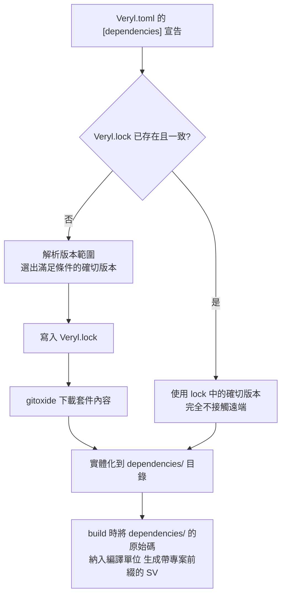

# 7.3 相依性管理、套件註冊表與版本治理

## 硬體專案為什麼需要依賴管理

### 現狀：IP 供應商模型

一顆現代 SoC 引用數十到數百個 IP：處理器核、匯流排互連、記憶體控制器、各類周邊。這些 IP 的來源有三：

1. **商用 IP**（Arm、Synopsys、Cadence 的授權 IP）；
2. **內部共享 IP**（公司內的平台團隊維護）；
3. **開源 IP**（RISC-V 生態的 rocket、ibex、以及零散的 GitHub 專案）。

第三類的整合現狀堪稱原始：**clone 一個 git 儲存庫、複製幾個 `.v` 檔案進自己的專案、手動改一下模組名避免衝突**——然後這份複製品就開始了自己的生命，與上游永遠分離。沒有版本記錄、沒有更新路徑、沒有授權追蹤。軟體世界在三十年前就用相依性管理解決了這個問題（Maven、npm、cargo），硬體世界的絕大多數專案至今停留在「複製貼上」時代。

### 硬體特有的兩個要求

硬體的相依性管理不只是「移植軟體的工具」，它有兩個軟體沒有的硬要求：

**要求一：同一版本須在專案生命週期內一致（5-10 年）。** 晶片從設計到量產到量產維護，生命週期以年計。期間上游套件發布了新版本、甚至刪除了舊版本 tag，都不應影響你的建置。軟體的相依「鎖定」通常是便利性考量，硬體的相依鎖定是**正確性與法律**考量——量產中的晶片無法「升級相依」。

**要求二：重現建置（reproducible build）。** 兩年後用同一份原始碼建置，必須得到位元級等價的結果。這是簽核、審計、缺陷回溯的基礎。任何「latest 是多少就抓多少」的行為都是重現性的漏洞。

記住這兩個要求，它們是評價本節所有機制的尺。

---

## Veryl 的相依性管理

### `[dependencies]` 的兩種寫法

`Veryl.toml` 中宣告相依套件：

**寫法一：git URL 直接指定：**

```toml
[dependencies]
"https://github.com/veryl-lang/sample" = "0.1.0"
```

**寫法二：命名形式（推薦，可讀性與可引用性更好）：**

```toml
[dependencies]
veryl_sample = { git = "https://github.com/veryl-lang/sample", version = "0.1.0" }
```

兩種寫法的差別在於**專案內引用這個套件時使用的名稱**：寫法二顯式指定了本地命名 `veryl_sample`。版本欄位支援語意版本範圍（`"0.1.0"`、`">=0.1.0, <0.2.0"` 等），範圍語意在下一節的 SemVer 討論中會被批判性地檢視。

### `Veryl.lock` 與 `dependencies/`

執行 `veryl build` 時，相依解析的結果寫入 **`Veryl.lock`**：

- 它記錄每個相依套件**實際解析到的確切版本**（精確到 commit 或 tag）；
- 有了它，任何機器、任何時間的建置都使用**完全相同**的套件版本——這是重現建置的基礎；
- 它應該**納入版本控制**（與 `Veryl.toml` 一樣是原始碼的一部分）。

下載的套件內容放在專案的 **`dependencies/`** 目錄。這個設計有一個常被低估的好處：**相依的內容是實體存在的本地檔案**，不依賴遠端倉庫的存續——上游刪掉 repo、tag 被改、GitHub 當機，都不影響你的建置。這正是「5-10 年生命週期」要求的實現方式：**鎖定 + 本地化**。

### 內建 gitoxide 後端

Veryl 的相依解析內建了 **gitoxide**（純 Rust 實作的 git）。這個細節解決的是一個真實的 CI 痛點：

> **CI 環境的 `git` 認證設定不一致**——有的 runner 有 ssh key、有的只有 token、有的 git 版本太舊不支援某種 clone 參數。

內建後端意味著：**不依賴 runner 上碰巧裝了什麼版本的 git、碰巧配了什麼認證**。後端失敗時會自動退回系統 `git`（處理特殊的認證需求）。這是「把環境相依性最小化」的又一案例，與 verylup 的設計動機（7.1 節）一脈相承：**建置不應依賴機器的偶然狀態。**

---

## 套件註冊表

### 2025-07：registry.veryl-lang.org

git URL 相依解決了「能用」，但沒解決「**發現**」：

- 你怎麼知道存在一個現成的 AXI 套件？
- 你怎麼知道它的哪個版本與你的工具鏈相容？
- 跨組織的套件版本協調靠什麼？

2025 年 7 月，Veryl 發布了套件註冊表（**registry.veryl-lang.org**），角色對應 crates.io（Rust）或 npm registry：集中的套件發布、版本管理與發現機制。`[dependencies]` 中可以直接引用註冊表上的套件，不必再寫完整 git URL。

註冊表改變的是**協調成本**的結構。比較三個階段：

| 階段 | 發現套件的方式 | 版本協調的方式 |
| --- | --- | --- |
| 複製貼上時代 | 口耳相傳、搜尋引擎 | 無（複製即脫鉤） |
| git URL 相依 | GitHub 搜尋 | 手動改 `Veryl.toml` |
| 註冊表時代 | 註冊表檢索 | 語意版本 + lock 檔 |

### 硬體特有的授權與信任議題

軟體世界的註冊表經驗告訴我們，集中的分發點會放大兩類風險，而這兩類在硬體裡後果更重：

| 風險 | 軟體的後果 | 硬體的後果 |
| --- | --- | --- |
| **依賴混淆／投毒** | 惡意程式碼進入供應鏈 | 惡意電路進入矽——**不可回滾、難以審計** |
| **授權污染** | 法律糾紛、下架 | GPL 類授權的 IP 混進 ASIC 設計，**掩膜之後才發現** |

因此硬體套件的採納應比軟體保守得多：

1. **審計後鎖定**：引入新相依之前審閱其原始碼與授權，鎖定確切版本；
2. **可信來源優先**：內部註冊表鏡像或公司內的 fork 作為相依來源，註冊表作為發現管道而非直接來源；
3. **相依樹保持淺**：硬體套件的組合爆炸風險比軟體低（套件數量少），保持淺相依樹使審計可行。

軟體的「小步頻繁升級相依」文化在硬體**不適用**——升級相依套件在硬體的成本結構裡接近「升級工具鏈」：要做、但要做一次完整的回歸與等價性確認。

---

## 相依解析的完整流程

在進入版本治理之前，先把「一條 `[dependencies]` 宣告如何變成可建置的程式碼」完整走一遍——這是理解後續治理議題的機制基礎。



這張圖的關鍵分岔是第一個判斷：**`Veryl.lock` 存在且與 `Veryl.toml` 一致時，解析器根本不需要接觸遠端**。這是重現建置的實現機制——「建置」與「網路」之間被 lock 檔隔開了。

由此也回答了一個常見問題：「`Veryl.lock` 與 `dependencies/` 哪個該入版本控制？」答案是**兩者都該**：

| 產物 | 入版本控制？ | 理由 |
| --- | --- | --- |
| `Veryl.toml` | 是 | 相依的**意圖**（要哪些套件、接受什麼範圍） |
| `Veryl.lock` | 是 | 相依的**事實**（實際解析到的確切版本） |
| `dependencies/` | 視政策 | 內容可由 lock 重新下載取得；但若要求「上游消失也能重現」（5-10 年生命週期），則應入庫或由內部鏡像長期保存 |

第三列的「視政策」值得每個團隊顯式決定並寫進專案文件：依賴內部鏡像的團隊可以不入庫 `dependencies/`（保持倉庫輕）；單機或長封存專案則應入庫（換取絕對的重現性）。**這個決定沒有對錯，但它必須是一個被做出的決定，而不是「碰巧沒管」。**

---

## 版本治理的硬體視角

### SemVer 在硬體的難題

語意版本（SemVer：major 破壞性、minor 新功能、patch 修錯）是軟體的約定。它隱含一個假設：**「破壞性」是可以被版號分類的**。在硬體裡這個假設出了問題：

| 變更 | 軟體視角 | 硬體實際後果 |
| --- | --- | --- |
| 位寬從 8 改成 16 | 「加寬了，向下相容？」 | 接口面改變：所有上層模組的連線、下游驗證環境、時序、面積全變——**破壞性** |
| 握手時序微調（valid 提前一拍） | 「行為等價？」 | 與其互動的所有模組的時序假設失效——**破壞性** |
| 重置行為改變（同步改非同步） | 「內部實作細節」 | 產生 reset release skew 風險（6.1 節錯誤二）——**破壞性且隱蔽** |

也就是說：**硬體的破壞性變更往往不表現為「介面形狀」的變化，而是「時序與物理行為」的變化——它們只在特定情境（特定的整合方式、特定的頻率、特定的 PVT）下暴露。** 一個「patch 版本」的相依升級，可能在你的整合情境裡是破壞性的。

這直接推出一條實務原則：

> **硬體相依的版號範圍應該用精確版本（`"0.1.0"`），而不是寬鬆範圍（`">=0.1.0"`）。** 寬鬆範圍交給 `Veryl.lock` 與審查流程去管理，不要交給解析器去猜。

### 語意等價保證：工具鏈升級的相對安全性

有一類「相依」的升級風險結構完全不同：**工具鏈本身的升級**。這裡 Veryl 有一個相對 Chisel 的關鍵優勢（2.3 節的延伸）：

- **Chisel**：原始碼是 Scala 程式，產生的 Verilog 依賴 Chisel 函式庫版本與 FIRRTL 編譯器的行為。工具鏈升級可能改變產生邏輯的展開方式，且產出的 Verilog 本身不可讀，**難以做升級前後的比對**；
- **Veryl**：語意與 SystemVerilog 等價是**設計目標**，且產出的 SV 可讀、可 diff。工具鏈升級後跑一次 `veryl build`，`git diff` 生成的 SV——**每一處差異都肉眼可讀、可判斷**。

這個「升級安全性」來自本書反覆論證的可預測性：**語法與硬體之間的因果鏈是穩定的，所以工具鏈的變更可以被局部化地審視**。一個十萬行的專案，工具鏈升級後生成的 SV 差異通常只有數行，每行都可判斷是格式漂移還是語意變化——這在 Chisel 的巨量機器生成碼上是不可行的。

### 實務建議彙總

| 建議 | 理由 |
| --- | --- |
| `Veryl.toml` 與 `Veryl.lock` 都入版本控制 | 版本資訊是原始碼的一部分 |
| 工具鏈版本用 `+` 指定器寫進 CI（7.1 節） | 可重現、可稽核 |
| 相依版本用精確版號 | 硬體的破壞性變更無法用版號分類 |
| 升級相依或工具鏈時：diff 生成的 SV + 完整回歸 | 可讀的產出讓 diff 審查可行 |
| Dependabot/Renovate 謹慎使用 | 它們的「自動升級到相容版本」假設在硬體不成立；若用，只允許**開 PR 通知**，永不自動合併 |

最後一項值得展開：Dependabot 與 Renovate 是軟體世界的自動升級機器人，其安全性建立在 SemVer 的可信度上。硬體相依的 SemVer 不可信（上文），因此它們的正確用法是降級為「**升級通知器**」——告訴你有新版本，升不升、怎麼升由人類依完整流程決定。

---

## 跨專案命名空間與匯入

### 專案前綴與 import

相依套件中的元件，在引用時帶有**專案前綴**——這是 3.3 節與 2.2 節（模組名前綴）機制的匯合點：

```veryl
import veryl_sample::sample_pkg;

module Top {
    // 使用相依套件中的型別、常數、模組
    let local_w : u32 = veryl_sample::sample_pkg::WIDTH;
}
```

命名空間的規則：

- 套件內的符號以 `<專案名>::<套件名>::<符號>` 存取；
- `import` 把常用符號引入本地作用域，避免重複的長前綴；
- **生成的 SV 中，模組名會自動加上專案前綴**（如 `veryl_sample_SampleModule`）——多個相依套件即使定義了同名模組，整合時也不會衝突。

這是「命名衝突由工具保證、不靠命名規範」的完整閉環：**SoC 整合數十個相依套件時，模組名衝突在語言層不可能發生**。對照 SystemVerilog 的現狀（靠 `\`include 路徑順序與手動改名），這是相依管理帶來的直接結構性收益。

---

## 實作練習

### 練習：建立本地相依套件並觀察 Veryl.lock

1. **建立相依套件**：

```bash
mkdir sample_pkg && cd sample_pkg
veryl init sample_pkg
# 在 src/ 中加入一個 pub module 與 pub package
git init && git add -A && git commit -m "v0.1.0"
git tag v0.1.0
```

2. **建立主專案並引用**：

```toml
[project]
name = "main_project"
version = "0.1.0"

[dependencies]
sample_pkg = { git = "/absolute/path/to/sample_pkg", version = "0.1.0" }
```

3. 執行 `veryl build`，然後檢查：

- **`Veryl.lock` 的內容**：確認它記錄了確切的 commit/tag；
- **`dependencies/` 目錄**：確認套件內容被實體複製；
- **生成的 SV**：確認模組名帶有 `sample_pkg_` 前綴。

4. **觀察鎖定行為**：回到 `sample_pkg`，加一個新模組、commit、打 `v0.2.0` tag。再執行 `veryl build`——主專案**不會**自動更新（`Veryl.lock` 鎖著 0.1.0）。把 `Veryl.toml` 的版本改為 `"0.2.0"` 並重建，觀察 `Veryl.lock` 的變化。

5. **重現性驗證**：`rm -rf dependencies/`，再 `veryl build`——建置應完整恢復。這就是「上游消失也不影響重現」的體驗（若鎖定的是本地 commit，此時仍可恢復；若上游 repo 已刪除且 commit 不可達，這正是把 `dependencies/` 或上游鏡像納入長期保存的理由——請思考你的專案該選哪種策略）。

---

## 本節小結

1. 硬體相依管理的兩個特有要求：**5-10 年生命週期內版本一致**與**重現建置**；「複製貼上式」的 IP 整合無法滿足。
2. `[dependencies]` 支援 git URL 與命名兩種寫法；`Veryl.lock` 鎖定確切版本（重現建置的基礎）；`dependencies/` 把相依內容實體化到本地，使建置不依賴上游存續。
3. 內建 gitoxide 後端消除對 runner 環境 git 的依賴，失敗時退回系統 git。
4. 套件註冊表（2025-07）解決發現與版本協調；硬體特有的授權與投毒風險要求比軟體保守的採納流程：審計後鎖定、可信來源、淺相依樹。
5. SemVer 在硬體失效：位寬、握手時序、重置行為的變更都是破壞性的且只在特定情境暴露——相依版本用精確版號。
6. 語意等價保證讓工具鏈升級相對安全：生成的 SV 可讀可 diff，升級差異可局部審視——這是 Veryl 相對 Chisel 的結構性優勢。
7. Dependabot/Renovate 只可作為升級通知器，不可自動合併。
8. 專案前綴使多套件整合的模組名衝突在語言層不可能發生。

至此第 7 章完成了工程基礎設施的三塊：工具鏈（7.1）、命令與 CI（7.2）、相依與治理（7.3）。下一章（第 8 章）進入驗證流程：Veryl 的原生測試框架、內建模擬器、隨機測試與 cocotb 嵌入。

---

*下一節：第 8.1 節「原生測試框架：clock_gen、reset_gen 與斷言」*
