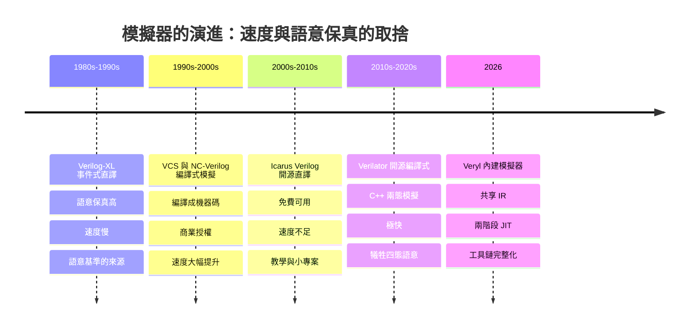
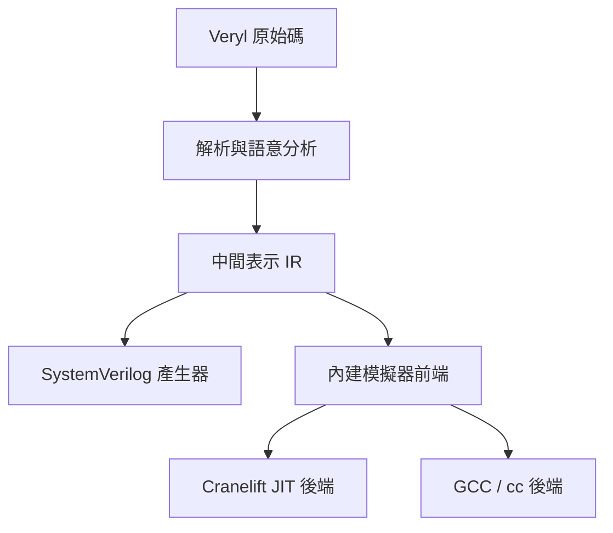
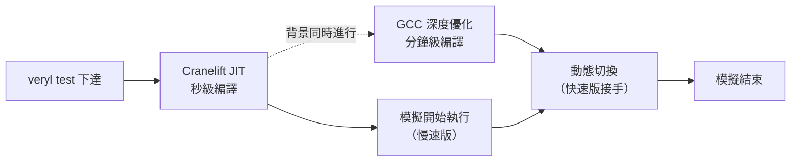

# 8.2 內建模擬器：IR、兩階段編譯與效能量測（2026）

## 模擬器是 HDL 的「隱藏依賴」

硬體描述語言有一個軟體語言沒有的隱藏依賴：**模擬器**。Python 程式的語意由語言規格定義，直譯器只是忠實執行它；Verilog 卻不一樣——它的語意相當程度上是**定義在事件式模擬的執行模型上的**（1.1 節）。競態、阻塞與非阻塞賦值的區別、`x` 的傳播，這些語意規則只有在「事件佇列」的心智模型下才有意義。換句話說：**模擬器的品質與行為，直接決定了語言的可用性。**

歷史沿著這條軸線展開，每一步都在處理「模擬速度」與「語意保真」的取捨：



這條時間線的關鍵張力在於：**語意保真要求模擬器忠實執行事件式模型（四態、事件排程），但事件式模型天生比「編譯成原生碼、每個週期算一遍」的周期式模型慢幾個數量級。** 商業工具用錢解決了速度；開源世界則用 Icarus（保真但慢）與 Verilator（快但兩態）分別佔據兩端。

---

## Verilator 的地位與做法

Verilator 是今日開源硬體驗證的事實標準，它的做法值得細看，因為 Veryl 內建模擬器的效能論述必須以它為對照基準。

Verilator 把 RTL **編譯成 C++**。它做的是週期式（cycle-based）模擬：拋棄事件佇列，把所有組合邏輯展開成「每個時脈沿呼叫一次的求值函式」，由 C++ 編譯器做跨模組的深度優化。這帶來極高的速度——通常比事件式模擬器快 10 到 100 倍。

但速度來自兩個犧牲：

1. **兩態模擬（two-state）**：只有 0 與 1，沒有 `x` 與 `z`。未初始化的訊號變成 0（或隨機），`x` 的傳播鏈被切斷。
2. **事件語意的弱化**：競態檢測、模擬時間內精細的事件排序等，在週期式模型中不存在。

兩態化的實務後果集中在兩個地方。**第一是 CDC（跨時鐘域）除錯**：第 6 章論證過，亞穩態的模擬表現依賴 `x` 的傳播——同步器沒寫對時，`x` 會沿著資料路徑傳染，模擬波形一眼可見；兩態模擬中這個警報完全消失，錯誤以「偶爾錯一個位元」的偽隨機形式呈現，極難追蹤。**第二是初始化檢查**：四態模擬中「忘記重置」會以 `x` 現形；兩態模擬中它變成「值不對但不明顯」，往往要靠通訊協定層的失敗才被察覺。

Verilator 用一個務實的回答補償了這些犧牲：它把「發現問題」的職責前移到編譯期 lint——`--lint-only` 模式對未驅動訊號、多驅動、寬度不匹配的檢查相當嚴格。7.2 節 CI pipeline 中的 Verilator lint 閘門，用的正是這個能力。

---

## Veryl 內建模擬器的出現（2026-05）

### 動機：工具鏈的完整性

Veryl 內建模擬器於 2026 年 5 月由官方正式公告。它的動機不是「再寫一個更快的模擬器」，而是**工具鏈的完整性**（batteries-included）：`veryl test` 要在沒有安裝任何外部模擬器的機器上就能執行 8.1 節的原生測試。

這個動機對語言採用的意義，比「效能」更根本。回顧開源語言推廣的歷史障礙：一個工程師想試 Veryl，從 `verylup install` 到看到第一個測試通過，中間不能插入任何「安裝 Icarus、配置 PATH、解決 testbench 編譯錯誤」的步驟。**驗證的第一道門檻不是語言學不會，而是環境裝不好。** 內建模擬器把這道門檻直接移除。

### 架構基礎：IR-based analyzer（2026-01）

2026 年初，Veryl 編譯器完成了一次重要的內部重構：引入**以中間表示（IR）為基礎的語意分析器**。內建模擬器並不是另起爐灶的獨立工具——它**直接建立在這個 IR 上**。

這個架構選擇是「語意保真」的結構性保證：



**模擬器執行的，就是編譯器「理解」的那份程式。** 語意規則只有一份，編譯與模擬共享。這消除了硬體工具鏈中一個經典的分裂模式：「語言改了，模擬器行為還是舊的」——傳統上，語言規格與模擬器實作是兩個團隊的兩份工作，語意漂移在所難免；共享 IR 把兩者綁定成同一份程式的兩個後端。10.3 節討論語言演進時會再回到這一點：這個架構讓「語意變更」從「規格修訂 + 模擬器跟進」的雙工作，變成「改 IR 語意、兩個後端同時跟上」的單工作。

順帶的收益是：`x`/`z` 的處理可以**由編譯器靜態判斷哪些訊號可能為四態**，只在必要處付出四態代價——內建模擬器因此同時支援 2-state 與 4-state 模擬，而不必像 Verilator 那樣全域放棄四態。

---

## 兩階段執行架構（本節的技術核心）

內建模擬器最有工程趣味的設計，是它的**兩階段（two-stage）執行架構**。

### 問題：編譯時間與執行速度的兩難

模擬器工程中有一個永恆的兩難：

- **要執行快**，就要深度優化（暫存器分配、內聯、跨模組的求值排序、死碼消除）——優化要時間，編譯就慢；
- **要編譯快**（edit-compile-run 短循環的體感關鍵），就要少做優化——但執行就慢。

傳統模擬器只能二選一：Icarus 選了編譯快、執行慢；Verilator 選了編譯慢、執行快。而**模擬工作負載其實是異質的**：

| 工作負載 | 特徵 | 敏感的指標 |
| --- | --- | --- |
| 日常開發（改一點、跑一下） | 短循環、高頻率、每次只跑幾秒 | **編譯到開始執行的等待時間** |
| 迴歸 / OS boot / 大規模驗證 | 長執行、低頻率、一次數分鐘到數小時 | **穩態執行速度** |

兩種負載敏感的指標不同，**用兩個後端分別服務**。

### 第一階段：Cranelift JIT

第一階段使用 **Cranelift**——Rust 生態中專為 JIT 場景設計的程式碼產生器（WebAssembly 執行環境與 Rust 的除錯工具鏈都在用它）。Cranelift 的設計目標就是**編譯速度快**：它刻意不做激進優化，換取接近即時的程式碼產生。

效果：模擬**幾乎在命令下達後立即開始執行**。開發者改了一行 Veryl、跑 `veryl test`，等待的是測試結果而不是編譯進度條。

### 第二階段：GCC 後端與動態切換

第二階段在**背景**進行：產生深度優化的原生二進位（官方預設走 `cc`/GCC 路徑，把模擬核心編譯成 C 再交給系統編譯器優化）。完成後，**正在執行中的模擬會動態切換**到優化後的二進位。

於是單次模擬的時間軸是：



- **短測試**：可能還沒等到 GCC 完成，模擬就結束了——Cranelift 路徑獨自完成，體感就是「立即」；
- **長模擬**：穩態的絕大部分時間由優化二進位執行——Cranelift 的短暫慢速只是總時間的小零頭。

### 為什麼這個設計是對的

這個設計之所以值得作為教科書案例，是因為它體現了編譯器工程中「**optimization wall vs compilation speed**」取捨的正確解法：取捨不必是全域的——**識別出兩種工作負載，分別給它們各自最優的後端，再用快取與動態切換把兩者銜接**。快取使優化二進位可以跨 run 重用：第二次之後的模擬（cached run）直接以優化碼啟動，連 Cranelift 階段的等待都省掉。

---

## 效能數據（官方 2026-05 benchmark）

### 測試設定

官方以 **Heliodor**（10.1 節，以 Veryl 撰寫的 out-of-order RISC-V 多核處理器）跑 **Linux boot** 作為壓力測試工作負載——這是一個極好的選擇，因為 Linux boot 是「模擬必須夠快才跑得起來」的負載：約 **3000 萬模擬週期**，並且測了 1、2、4 core 三種配置。對手是 **Verilator v5.040**，測試機器為兩代硬體：

| 機器 | 微架構 | 年代 |
| --- | --- | --- |
| Intel Xeon Gold 6434 | Sapphire Rapids | 2023 |
| AMD Threadripper 1950X | Zen 1 | 2017 |

### 結果的誠實呈現

**First run（無快取，Cranelift JIT 路徑）**：Veryl 比 Verilator 快 **33% 到 61%**。原因不是執行更快，而是**總時間組成不同**：Verilator 的流程中，C++ 編譯佔了總時間的絕大部分；Cranelift 的即時編譯把這段等待壓到接近零。對 edit-compile-run 循環而言，這就是體感上的決定性差距。

**Cached run（優化後的原生二進位）**：兩者都處於「穩態執行速度」的比較。結果仍是 Veryl 一致地更快，但**幅度依微架構而異**：

| 機器 | Veryl 相對 Verilator 的優勢 |
| --- | --- |
| Xeon Gold 6434（Sapphire Rapids, 2023） | 4% 到 8% |
| Threadripper 1950X（Zen 1, 2017） | 24% 到 49% |

兩個值得注意的觀察：

1. **新 CPU 上優勢縮小到個位數百分比。** 誠實地說：在現代硬體上，穩態執行速度兩者已經接近。Veryl 團隊沒有迴避這一點——內建模擬器的價值主張從來不是「全面碾壓 Verilator」，而是「夠快 + 不用裝 + 語意保真」的組合。
2. **Verilator 生成的 C++ 對舊微架構更敏感**（Zen 1 上差距拉大到 24-49%）。一個合理的解釋是：Verilator 產生的 C++ 程式碼體積與指令足跡較大，對較窄的解碼頻寬、較小的快取更敏感；而 Veryl 後端產生的原生碼在這方面較緊湊。這提示：**基準測試的結論要標註測試機器**，跨微架構的效能外推不可靠。

### 四態支援：語意優勢

benchmark 為了與 Verilator 對齊，是以 2-state 模式跑的。但內建模擬器**本身支援 4-state 模擬**——這是相對 Verilator 的結構性語意優勢（見前文對 CDC 除錯與初始化檢查的討論）。也就是說：當你**需要**四態語意時（例如驗證重置策略、追蹤 `x` 傳播），內建模擬器開箱即用，而 Verilator 路線必須退回較慢的事件式模擬器。

---

## 模擬器後端的選擇與降級

後端選擇由命令列控制：

```bash
veryl test --backend=cc   # 預設：產生 C 碼，用系統 cc 編譯（含兩階段切換）
veryl test --backend=jit  # 純 Cranelift JIT：無外部編譯器依賴
```

預設的 `cc` 模式依賴系統上的 C 編譯器。**若環境中沒有 `cc`**（例如精簡的容器映像、離線的受限環境），模擬器**退回 Cranelift JIT**——模擬仍然可以執行，只是放棄了優化後端的穩態速度。

這個降級行為對 CI 的意義值得注意：CI 環境中只需確保 `cc` 存在，就能保證長迴歸以優化碼執行；而 JIT 退路保證了「最小可執行環境」的存在——**測試永遠跑得起來，只是快慢之別**。這與 7.1 節 `verylup` 解決的問題同構：工具鏈不應該因為環境殘缺而完全失效。

---

## 波形與除錯

模擬器的可用性不只看速度，還看**波形（waveform）的工程體驗**。官方在 Heliodor 壓力測試中明確把 waveform ergonomics 列為壓力測試項目之一——因為 3000 萬週期的 Linux boot 會產生巨大的波形檔，波形工具（GTKWave、Surfer 等）的載入與檢視體驗直接決定大規模模擬的可除錯性。

與波形相關的實務要點：

1. **波形輸出應是測試的可選能力**，而非永遠開啟——長模擬的波形檔會到 GB 量級，I/O 本身會拖慢模擬；
2. **搭配 `.sv.map`（7.2 節）**：波形中看到的訊號屬於生成的 SV 層級，source map 把訊號對應回 Veryl 原始碼——「波形裡的這個訊號是哪一行程式碼」的追問有自動答案；
3. **交叉驗證的波形對照**：同一段模擬在內建模擬器與 Verilator 各跑一次，波形應逐訊號一致——這正是 Heliodor 團隊實際採用的實踐（見下節）。

---

## 量測方法論：把官方數字換算成你的專案

官方 benchmark 的價值在於方法論，而不在於那幾個百分比數字本身。把一次模擬的總時間分解：

$$
T = T_{\text{compile}} + N \times t_{\text{cyc}} + T_{\text{io}}
$$

其中 $`T_{\text{compile}}`$ 是從命令下達到模擬開始的編譯時間、 $`N`$ 是模擬週期數、 $`t_{\text{cyc}}`$ 是每週期執行成本、 $`T_{\text{io}}`$ 是波形與檔案輸出的開銷。兩階段架構的作用是重排這個式子：Cranelift 把 $`T_{\text{compile}}`$ 壓到接近零，GCC 後端把 $`t_{\text{cyc}}`$ 壓到最低，快取讓第二次以後的 run 連 $`T_{\text{compile}}`$ 的 JIT 段都省掉。

用這個分解檢視你自己的工作負載：

- 若 $`N \ll T_{\text{compile}} / t_{\text{cyc}}`$ （短測試、高頻率），你是 first-run 型負載——內建模擬器的優勢最大，Verilator 的 C++ 編譯時間會主導你的等待；
- 若 $`N`$ 以千萬計（OS boot、長迴歸），你是穩態型負載——cached run 的 $`t_{\text{cyc}}`$ 主導，兩者的差距縮到 4-8%（新 CPU），此時選擇應基於語意需求（4-state）與工作流程整合，而非速度；
- 若 $`T_{\text{io}}`$ 不小（長模擬 + 永開波形），先把波形變成條件輸出，比換模擬器更有效。

一個簡單的自助量測腳本骨架：

```bash
# first run：清空快取後計時
veryl clean
time veryl test --test test_counter_basic

# cached run：同命令重跑
time veryl test --test test_counter_basic
```

兩次 `time` 的差，就是兩階段架構在你機器上的可感知形態；再與 Verilator 的同型量測對照，你就有了自己專案的 benchmark——這比引用任何官方數字都更接近決策所需。

---

## 設計討論

### 「模擬器即編譯器的一部分」

內建模擬器與編譯器共享 IR，這對**語言演進**有一個深遠的影響：語意的每一次修訂，模擬行為自動跟上，不存在「規格與模擬器分裂」的窗口。對比之下，SystemVerilog 的歷史（1.3 節）正是「工具子集互相不重疊」的歷史——同一份 SVA 在不同模擬器上支援度不同。共享 IR 把這一類分裂**從架構上排除**。

代價也要說清楚：模擬器的能力上限受 IR 表達能力的約束。IR 是為合成與分析設計的中間表示，模擬器因此不支援（短期內也不應該支援）純模擬構造的完整集合——這正是 8.1 節「沒有時序斷言語言」的架構根源之一。

### 與 Verilator 的分工建議

兩者的正確關係是**互查（cross-check）而非取代**：

| 場景 | 建議 |
| --- | --- |
| 日常開發、單元測試 | 內建模擬器（first-run 快、無依賴） |
| CDC 與初始化相關的驗證 | 內建模擬器的 4-state 模式 |
| 大規模迴歸 | 兩者並用：內建模擬器為主，Verilator 為獨立第二意見 |
| 關鍵模組與整合測試 | 交叉驗證：同一段模擬在兩個模擬器上波形一致 |

Heliodor 團隊的實踐是這個分工的現成範例：Linux boot 在 Verilator 與 Veryl 模擬器上**交叉驗證**——兩個獨立實作的模擬器對同一份設計給出相同行為，這本身就是對設計（以及對兩個模擬器）的強驗證。軟體世界的類比是「用兩個編譯器編譯同一份程式碼」：分歧即 bug。

---

## 實作練習

1. 寫一個執行 10 萬週期的簡單處理器迴圈測試（或用 8.1 節的 ALU 測試放大迴圈次數）；
2. 先清空模擬快取，執行 `veryl test`，記錄**總時間**（first run）；再用相同命令重跑，記錄 cached run 的時間；觀察兩者的差距——這就是兩階段架構的可感知形態；
3. 用 `verilator --cc -f Veryl.f --exe tb.cpp --top-module ...` 為同一個設計建立 Verilator 模擬，分別記錄其首次編譯時間與執行時間，與前兩步對照；
4. 嘗試在無 `cc` 的環境（例如精簡容器）中執行 `veryl test --backend=jit`，確認測試仍可執行——驗證降級路徑的存在；
5. 若環境允許，把設計中一個刻意未重置的暫存器去掉重置分支，比較 4-state 模式與 Verilator（2-state）下的行為差異——親身體驗 `x` 傳播作為除錯訊號的價值。

---

## 本節小結

1. HDL 的語意定義在事件式模擬上，模擬器是語言的隱藏依賴；模擬器演進史是「速度 vs 語意保真」的取捨史。
2. Verilator 以 C++ 編譯 + 兩態模擬達到極快速度，代價是 `x`/`z` 語意的消失——CDC 除錯與初始化檢查受影響。
3. Veryl 內建模擬器（2026-05 公告）建立在 2026-01 的 IR-based analyzer 上，與編譯器共享語意分析——模擬器執行的就是編譯器理解的程式，架構上保證語意保真。
4. 兩階段架構：Cranelift JIT 提供即時開始（first run 比 Verilator 快 33-61%），GCC 後端在背景產生優化二進位並動態切換（cached run 在新 CPU 上領先 4-8%，舊 CPU 上 24-49%）。
5. 支援 4-state 模擬是相對 Verilator 的語意優勢；無 `cc` 時降級為 JIT，保證最小可執行環境。
6. 與 Verilator 的正確關係是互查而非取代——Heliodor 的 Linux boot 交叉驗證是現成的實踐範本。

下一節（8.3）把驗證推向更高層次：隨機測試、記分板模式，以及 cocotb 嵌入——Veryl 與 Python 生態的接面。

---

*下一節：第 8.3 節「隨機測試、記分板與 cocotb 嵌入」*
