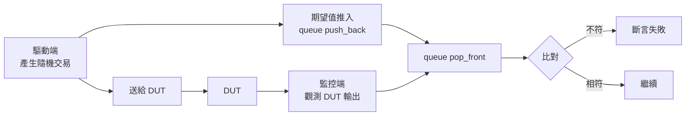

# 8.3 隨機測試、記分板與 cocotb 嵌入

## 從導向測試到約束隨機

8.1 節的測試是**導向測試（directed test）**：工程師手寫每一個情境。導向測試的優點是可讀、可預測、失敗時除錯方向明確；缺點在於**狀態空間的規模**。

一個有 $ n $ 個輸入位元的模組，每個週期的輸入空間大小是 $ 2^n $；若模組還有 $ m $ 個狀態位元，則整個行為空間是 $ 2^{n+m} $ 量級。以一個不起眼的例子估計：32 位元的 ALU 運算，光是三個 32-bit 運算元加一個 3-bit 運算碼，就有

$$
2^{32} \times 2^{32} \times 2^{32} \times 2^{3} = 2^{99}
$$

種組合。工程師手寫的情境，哪怕寫上幾百個，也只是這個空間裡極小、且偏向「人想得到的地方」的取樣。經驗規律是：**導向測試覆蓋的是工程師預期會出錯的地方，隨機測試覆蓋的是工程師沒想到會出錯的地方**——而後者才是流片後最致命的那一類。

SystemVerilog 的回答是約束隨機驗證：`rand` 欄位 + `constraint` 區塊 + 求解器，讓工程師**宣告約束**（「位址必須 4-byte 對齊且在合法範圍內」），由求解器產生滿足約束的隨機值。這是 UVM 能力的核心，也是其複雜度的核心——約束求解是一個深奧的技術領域，把它的語言化帶進 HDL，是 SystemVerilog 語言體積爆炸的重要推手之一（1.2 節）。

Veryl 的立場是：**不內建約束求解器**。取而代之的是 `$tb::random` 的基本隨機能力，加上本節要講的「土法煉鋼」組合。這個取捨的適用邊界必須講清楚：模組級驗證足夠；大型 SoC 級驗證仍需 SystemVerilog 生態——這正是第 9 章互操作存在的理由之一。

---

## `$tb::random` 的完整用法

### 三個方法與可重現性

```veryl
var r: $tb::random::<bit<12>>;

initial {
    r.seed(42);
    let x : bit<12> = r.get();            // 12-bit 隨機值
    let lo: bit<12> = r.get_range(0, 99); // [0, 99] 範圍內
}
```

- `r.seed(n)`：設定隨機種子。同一個 seed 產生同一組序列。
- `r.get()`：產生一個型別為 `T` 的隨機值（`T` 是宣告時的泛型參數，可以是 `bit<12>`、`u32` 等）。
- `r.get_range(lo, hi)`：產生範圍內的值。

**可重現性（reproducibility）是隨機測試的性命。** 隨機測試的價值來自「找到意想不到的失敗」，而找到之後，必須能**原樣重跑出同一個失敗**才能除錯。實務紀律是：

1. 每個測試的 seed 顯式寫死在測試碼中（或由 CI 以固定策略產生並記錄）；
2. 測試失敗訊息中**印出當時的 seed**；
3. 迴歸報告記錄 seed 與失敗的對應，重現就是「帶著 seed 重跑一次」。

Veryl 把 seed 做成顯式方法而非全域隱含狀態，正是為了讓這條紀律可以機械化執行。

### 約束隨機的土法煉鋼

沒有求解器，不等於沒有約束。Veryl 中可以用三個基本件的組合覆蓋大部分需求：

1. **`get_range` 做範圍約束**；
2. **`inside` 過濾做集合約束**（5.3 節）；
3. **手寫加權做分佈控制**。

最常見的需求是「產生**合法的** AXI 位址」。以 32-bit 位址空間、4-byte 對齊、有效區間 $ [0, 4095] $ 為例：

```veryl
var r_addr: $tb::random::<u32>;
var r_word: $tb::random::<u32>;

function gen_addr() -> u32 {
    var base: u32;
    loop {
        base = r_addr.get_range(0, 4095) & 32'hFFFF_FFFC; // 4-byte 對齊
        if base < 4096 {
            break;
        }
    }
    return base;
}
```

`& 32'hFFFF_FFFC` 把隨機值拉到對齊邊界，`if` 過濾掉超出範圍的取樣——這就是「範圍約束 + 對齊約束」的最小實現。再加權：**邊界值要特別抽樣**：

```veryl
function gen_addr_biased() -> u32 {
    let sel: u32 = r_word.get_range(0, 9);
    case sel {
        0:      return 0;            // 邊界：最低位址
        1:      return 4092;         // 邊界：最高合法位址
        2:      return 4092 - 4 * r_word.get_range(0, 4); // 邊界附近
        default: return gen_addr();  // 一般均勻取樣
    }
}
```

經驗上，硬體 bug 高度集中在邊界（位址空間的端點、計數器的回繞點、滿/空條件），**加權把取樣密度集中到 bug 的高發區**。這個「均勻隨機 + 顯式邊界抽樣」的組合，覆蓋了模組級約束隨機的大部分實際需求。

### 誠實的能力缺口

必須明說這個缺口的形狀：

| 能力 | UVM（SV constraint solver） | Veryl 土法 |
| --- | --- | --- |
| 簡單範圍與對齊約束 | 有 | 容易實現 |
| 跨欄位關聯約束（欄位 B 依賴欄位 A） | 求解器處理 | 手寫函式處理 |
| 分佈控制 | `dist` 語法 | 手寫加權 |
| 複雜全域約束（數十變數聯立） | 求解器強項 | 會失控 |

最後一列是真正的分界：當約束是「數十個隨機變數之間的聯立關係」時（典型如複雜匯流排的交易序列與亂序交錯），土法會變成難以維護的糾纏函式。此時的正確選擇是 SystemVerilog 生態——透過 9.1 節的嵌入機制接上既有 UVM 環境，或用本節後半的 cocotb 借 Python 之力。**Veryl 的定位是模組級驗證的自足，而非全頻段取代。**

---

## 記分板（scoreboard）模式

### 期望值佇列

記分板是隨機測試的標準搭檔：隨機激勵產生的行為無法手寫期望值，因此需要一個**參考模型**與 DUT 並行運作、逐筆比對。其基本結構是「期望值佇列」：



關鍵性質：佇列維持**順序**，因此「期望值在第 $ k $ 筆交易產生、輸出在第 $ k $ 筆交易被消費」的對應關係被結構化保存——DUT 若亂序或丟失交易，pop 出的期望值與實際輸出就對不上，斷言立即失敗。

### 完整範例：FIFO 的記分板

以一個同步 FIFO 為例。驅動端隨機產生寫入，同時把寫入值推入期望值佇列；觀測到讀出時，從佇列取出期望值比對：

```veryl
#[test(test_fifo_random)]
module TestFifoRandom {
    inst clk: $tb::clock_gen #(period: 10);
    inst rst: $tb::reset_gen ( clk );
    inst u_fifo: SyncFifo #(
        WIDTH: 8,
        DEPTH : 16,
    ) (
        clk:    clk.clk,
        rst:    rst.rst,
        i_wr:   i_wr,
        i_data: i_data,
        i_rd:   i_rd,
        o_data: o_data,
        o_full: o_full,
        o_empty: o_empty,
    );

    var r_rand : $tb::random::<bit<8>>;
    var r_expc : $tb::queue::<u32, 64>;
    var r_cnt  : u32;

    var i_wr  : logic;
    var i_rd  : logic;
    var i_data: logic<8>;
    var o_data: logic<8>;
    var o_full: logic;
    var o_empty: logic;

    initial {
        r_rand.seed(1234);
        rst.assert();
        i_wr = 0;
        i_rd = 0;
        clk.next(5);

        // 隨機驅動 1000 個週期：寫入同時把期望值入隊 讀出時比對
        for i in 0..1000 {
            let do_wr: logic = if r_cnt < 16 && r_rand.get_range(0, 3) != 0 { 1 } else { 0 };
            let do_rd: logic = if r_cnt > 0  && r_rand.get_range(0, 3) != 0 { 1 } else { 0 };

            i_wr  = do_wr;
            i_rd  = do_rd;
            i_data = r_rand.get();
            if do_wr == 1 {
                r_expc.push_back(u32'(i_data));
            }

            clk.next(); // 交易生效

            if do_rd == 1 {
                let expect: u32 = r_expc.pop_front();
                $assert(o_data == logic<8>'(expect),
                    "cycle %d: pop got %h, expect %h", i, o_data, expect);
            }
        }
        $finish();
    }
}
```

這個骨架值得留意三點：寫入與讀出的**允許條件**（`r_cnt < 16`、`r_cnt > 0`）由測試端自己維護的影子計數器控制——這是「不對 DUT 的介面狀態輸出（`o_full`/`o_empty`）做驅動決策」的常見做法，避免測試行為依賴可能有 bug 的 DUT 輸出；斷言訊息帶**週期編號與兩個值**，失敗時除錯資訊一次到位；seed 寫死，任何人在任何機器上都能重現。

### 參考模型：純函數式比對

對於行為可以純函數描述的模組（ALU、編解碼器、轉換器），比對可以更簡單：用 Veryl 的 `function` 寫一個**無狀態的參考模型**，逐筆輸入比對：

```veryl
function ref_alu(op: logic<2>, a: logic<8>, b: logic<8>) -> logic<9> {
    case op {
        Op::Add: return 9'(a) + 9'(b);
        Op::Sub: return 9'(a) - 9'(b);
        Op::And: return 9'(a & b);
        default: return 9'(a | b);
    }
}

// 隨機測試迴圈中：
for i in 0..500 {
    let rand_op: logic<2> = r_rand.get();
    let rand_a : logic<8> = r_rand.get();
    let rand_b : logic<8> = r_rand.get();
    op = rand_op; a = rand_a; b = rand_b;
    clk.next();
    let expected: logic<9> = ref_alu(rand_op, rand_a, rand_b);
    $assert({carry, y} == expected,
        "iter %d: dut=%h ref=%h op=%d a=%h b=%h", i, {carry, y}, expected, rand_op, rand_a, rand_b);
}
```

參考模型用**與 DUT 不同的寫法**表達同一語意（上例中參考模型不做流水線暫存，DUT 有）——若兩者寫法相同，比對就退化為「自己對自己」，沒有發現錯誤的能力。

---

## cocotb 嵌入

### 為什麼需要 Python

Veryl 原生測試的工具箱到此為止：線性劇本、隨機、佇列、斷言。它缺少的是 **Python 生態**——數值計算（numpy）、資料結構與演算法、通訊協定封包產生（scapy）、檔案與影像處理。硬體驗證的許多環節（產生一段真實的 Ethernet 幀、用數值方法算出期望值、對 DUT 輸出做統計分析）在這些庫面前，「HDL 內建工具」永遠是玩具。

cocotb（Coroutine-based Co-simulation TestBench）是 Python 端驗證的主流框架：用 **coroutine** 撰寫 testbench，`await` 表達時間等待，可讀性極佳：

```python
# cocotb 的典型樣貌
@cocotb.test()
async def test_fifo(dut):
    await RisingEdge(dut.i_clk)
    dut.i_wr.value = 1
    dut.i_data.value = 0xAB
    await RisingEdge(dut.i_clk)
    assert dut.o_data.value == 0xAB
```

Veryl 的 `embed (cocotb)` 機制把 Python 測試碼**嵌入 Veryl 專案**，由 `veryl test` 一併執行：

```veryl
#[test(test_fifo_cocotb, TestFifoTarget)]
module TestFifoTarget {
    inst clk: $tb::clock_gen #(period: 10);
    // DUT 實例化由 Veryl 負責 Python 端以層級路徑存取訊號
}

embed (cocotb) py{{{
import cocotb
from cocotb.clock import Clock
from cocotb.triggers import RisingEdge, Timer

@cocotb.test()
async def test_fifo_cocotb(dut):
    cocotb.start_soon(Clock(dut.i_clk, 10, units="ns").start())

    dut.i_rst.value = 1
    await RisingEdge(dut.i_clk)
    dut.i_rst.value = 0
    await RisingEdge(dut.i_clk)

    # 寫入
    dut.i_wr.value = 1
    dut.i_data.value = 0xAB
    await RisingEdge(dut.i_clk)
    dut.i_wr.value = 0

    # 讀出並比對
    dut.i_rd.value = 1
    await RisingEdge(dut.i_clk)
    dut.i_rd.value = 0
    assert dut.o_data.value == 0xAB, (
        f"fifo pop = {dut.o_data.value}, expected 0xAB"
    )
}}};
```

三個語法要點：

1. `#[test(test_name, TargetModule)]` 的第二個參數指定測試**作用在哪個模組上**——cocotb 的 `dut` 物件就是該模組實例，Python 端以 `dut.<訊號名>` 存取其埠；
2. `embed (cocotb) py{{{ ... }}}` 內嵌 Python 原始碼，三層大括號使內部的 `{}`（f-string、dict）不需要轉義——與 9.1 節 `sv{{{ ... }}}` 同一個設計；
3. `veryl test` 統一執行原生測試與 cocotb 測試，CI 不需要區分兩條流程（但 cocotb 需要 Python 環境與 cocotb 套件，7.2 節的 CI 中這是一個額外的安裝步驟）。

### 混合策略

原生測試與 cocotb 的分工建議：

| 層級 | 選擇 | 理由 |
| --- | --- | --- |
| 模組級功能測試 | 原生測試 | 快、無外部依賴、與 Veryl 程式碼同源 |
| 協定級測試（握手、亂序、逾時） | cocotb | Python 協程表達時序監控自然 |
| 需要外部資料的測試（封包、影像） | cocotb | Python 生態的資料庫 |
| 需要數值參考模型的測試 | cocotb | numpy |

一個務實的檢驗問題是：「這個測試需要 Python 標準庫以外的東西嗎？」不需要，就用原生測試；需要，就上 cocotb。

---

## SystemVerilog 測試的嵌入

測試嵌入的最後一塊拼圖是 SystemVerilog 本身。用 `embed (inline)` 可以把 SV 測試模組原樣放進專案，由外部模擬器執行：

```veryl
#[test(test1)]
embed (inline) sv{{{
module test1;
    // 這裡是完整的 SystemVerilog testbench
    // 可以是既有 UVM 環境的進入點
    initial begin
        $display("hello from SV testbench");
        // run_uvm_test("my_uvm_test");
        $finish;
    end
endmodule
}}};
```

這讓**既有的 UVM 環境可以包進 Veryl 專案**：DUT 已遷移到 Veryl，驗證環境維持 UVM，透過 embed 銜接。9.1 節會把 embed 的完整語法（含識別字插值）講透。

---

## 覆蓋率的土法實作

8.1 節展示過 `final` 區塊的情境統計。把它發展成完整的土法覆蓋率，需要三件套：

```veryl
// 1. 命中計數器（模組級別的情境編號）
var r_hits: logic<32> [8];

// 2. 模擬中隨交易更新
always_ff {
    case i_txn_kind {
        Kind::Write:     r_hits[0] += 1;
        Kind::Read:      r_hits[1] += 1;
        Kind::WrWhileFull:  r_hits[2] += 1;
        Kind::RdWhileEmpty: r_hits[3] += 1;
        default:         {},
    }
}

// 3. final 報告
final {
    for i in 0..4 {
        if r_hits[i] == 0 {
            f.write("COVERAGE MISS: scenario %d\n", i);
        } else {
            f.write("scenario %d: hit %d times\n", i, r_hits[i]);
        }
    }
}
```

與正式 coverage 工具（收集 line/toggle/functional coverage 並產生合併報告）的差距要誠實指出：土法**只能覆蓋工程師想到要數的情境**（功能性覆蓋的子集），無法自動枚舉程式碼行、位元翻轉、狀態機弧。它適合中小專案與 CI 中的快速回饋；簽核級的覆蓋率閉環，仍是商業工具與 SV 生態的領域。

---

## 實作練習

1. 為 6.3 節的非同步 FIFO 撰寫隨機 + 記分板測試：寫入域與讀出域用不同的 `clk.next` 節奏推進，期望值佇列仍然按寫入順序消費——觀察非同步讀寫節奏下記分板的對應方式；
2. 在上述測試中加入邊界抽樣：刻意產生「寫到滿之後繼續寫」「讀空之後繼續讀」的情境，用 `$assert` 驗證 `o_full` / `o_empty` 的正確性；
3. 用 `final` 區塊輸出情境覆蓋報告到檔案，確認所有情境都被命中；未命中的情境調整加權後重跑；
4. 為同一個 FIFO 寫一個 cocotb 協定級測試：連續寫入直到 `full` 拉高，驗證滿條件下的寫入被拒絕且資料不損毀；
5. 把 seed 換掉重跑三次，比較覆蓋報告——體會「單一 seed 的覆蓋不代表隨機測試的總覆蓋」。

---

## 本節小結

1. 導向測試覆蓋的是預期中的錯誤；行為空間是 $ 2^{n+m} $ 量級，隨機測試是對「想不到的地方」的取樣。
2. `$tb::random` 的 seed 可重現性是隨機測試迴歸的性命；範圍約束 + `inside` 過濾 + 邊界加權的土法組合，覆蓋模組級約束隨機的大部分需求。
3. 誠實的缺口：沒有求解器，聯立約束會失控；SoC 級驗證需 SV 生態（第 9 章）或 cocotb。
4. 記分板以 `$tb::queue` 為基礎：驅動端 push 期望值、監控端 pop 比對；參考模型應與 DUT 異構，否則比對失去發現能力。
5. cocotb 嵌入以 `#[test(name, Target)]` + `embed (cocotb) py{{{ ... }}}` 實現，`veryl test` 統一執行；模組級用原生、協定級與資料密集型用 Python。
6. `embed (inline) sv{{{ ... }}}` 讓既有 UVM 環境包進 Veryl 專案；土法覆蓋率用 `final` + 命中計數，但無法替代正式 coverage 工具。

---

*下一節：第 9.1 節「sv 命名空間、embed 與 include：混合語言設計」*
