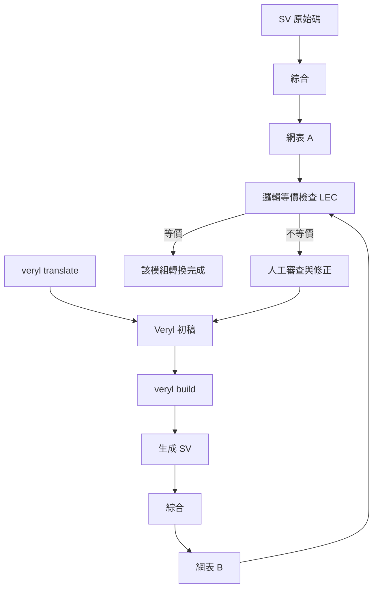

# 9.2 translate：從 SystemVerilog 到 Veryl 的自動轉換（2024-2026）

## 為什麼需要 translate

2.2 節的支柱二已經給出遷移問題的三個選項：全部重寫（成本以人年計，轉換完成前零收益）、永遠停在 SV（放棄語言改進）、漸進式轉換（唯一現實的路）。本節講的是第三條路的**技術載體**：`veryl translate`——把既有的 SystemVerilog 自動轉成 Veryl。

問題的規模感：一家公司有 50 萬行 SV。手動改寫在數學上就不可行——即使每位工程師每天改寫 500 行且完全不出錯，50 萬行也需要 1000 個人天，而且**這段期間新舊程式碼的行為差異風險持續累積**。自動轉換把採用成本從「重寫」降為「**審查**」：轉換器產出 Veryl 初稿，工程師逐模組 review、修正、驗證。

這是所有語言遷移的通用問題，軟體世界有成熟的前例：Java→Kotlin 的自動轉換器、JavaScript→TypeScript 的 codemod（`ts-morph` 生態），以及 C++→Rust 的嘗試。經驗規律高度一致：**自動轉換的成功率取決於「目標語言能多大程度吸收源語言的構造」**。TypeScript 對 JS 的吸收近乎完全（所以轉換幾乎無損）；Veryl 對 SV 的吸收是有意的部分集合（1.3 節：語法最佳化不等於相容 SV 的所有角落），因此轉換有明確的邊界。

官方文件對 `veryl translate` 的定位是「smooths the migration path from established SystemVerilog projects」——注意措辭是 smooths（平滑）而非 eliminates（消除）：轉換是斜坡的起點，不是終點。

---

## 轉換能做什麼：機械對應表

### 命令與輸出

`veryl translate` 以 filelist 為輸入單位，輸出對應的 `.veryl` 檔：

```bash
# 以既有 SV 專案的 filelist 為輸入
veryl translate --filelist legacy/legacy.f
```

產出的 `.veryl` 檔與原始 SV 逐檔對應。實務上建議**先轉一個模組、跑完整驗證循環，再擴大批次**——轉換器的輸出是初稿，驗證循環（下文）才是流程的主體；一次轉 100 個檔再開始驗證，等於把 100 個未驗證的修改同時放進系統，違反分批遷移的基本紀律。

### 埠與宣告

```systemverilog
module Alu #(
    parameter WIDTH = 8
) (
    input  logic              i_clk,
    input  logic              i_rst_n,
    input  logic [WIDTH-1:0]  i_a,
    input  logic [WIDTH-1:0]  i_b,
    output logic [WIDTH-1:0]  o_y
);
```

```veryl
module Alu #(
    param WIDTH: u32 = 8,
) (
    i_clk  : clock,
    i_rst_n: reset,
    i_a    : input  logic<WIDTH>,
    i_b    : input  logic<WIDTH>,
    o_y    : output logic<WIDTH>,
) {
}
```

對應規則：`input logic [W-1:0] x` 對應 `x: input logic<W>`（2.2 節的位寬語法：`[W-1:0]` 換成 `<W>`，免心算）；`parameter` 對應 `param`（可覆寫的參數）或 `const`（模組內常數）；時脈與重置改用型別（4.2 節）。

### 時序邏輯與賦值

```systemverilog
always_ff @(posedge i_clk or negedge i_rst_n) begin
    if (!i_rst_n) begin
        r_q <= 8'd0;
    end else begin
        r_q <= i_d;
    end
end
```

```veryl
always_ff (i_clk, i_rst_n) {
    if_reset {
        r_q = 0;
    } else {
        r_q = i_d;
    }
}
```

三個對應：`always_ff @(posedge clk or negedge rst_n) if (!rst_n)` 對應 `always_ff (clk, rst) { if_reset`——重置的極性與同步性由 `if_reset` 抽象（4.3 節）；`begin/end` 對應 `{ }`；`a <= b` 對應 `a = b`（Veryl 的 `always_ff` 中沒有 `<=`，賦值語意由區塊決定，4.1 節）。

### 表達式

| SystemVerilog | Veryl | 對應性質 |
| --- | --- | --- |
| `sel ? a : b` | `if sel { a } else { b }` | 三元 → if 表達式 |
| 三元鏈 | `case` 表達式 | 巢狀選擇結構化 |
| `{2{X}, {12{Y}}}` | `{X repeat 2, Y repeat 12}` | 複製運算 |
| `a inside {x, y}` | `a inside {x, y}` | 集合判定 |
| `data[WIDTH-1:0]` | `data[..]` 或 `data[0..WIDTH]` | 範圍語法 |
| `casex/casez` | `case` + `inside` | 消歧義（1.3 節） |

```systemverilog
// SV 的複製串接
assign o_data = {{2{X}}, {12{Y}}};
```

```veryl
// Veryl 的 repeat
assign o_data = {X repeat 2, Y repeat 12};
```

### 型別與列舉

```systemverilog
typedef enum logic [1:0] {
    ST_IDLE, ST_RUN, ST_DONE
} state_e;
```

```veryl
enum StateE: logic<2> {
    Idle,
    Run,
    Done,
}
```

注意 SV 列舉成員的全域命名在 Veryl 中變成 `StateE::Idle` 形式（2.2 節第 13 項）——轉換器不會替你消除前綴地獄（`ST_IDLE` 轉成 `StateE::Idle` 後，`ST_` 前綴成了冗餘但無害的殘留），這類「轉換正確但不美」的殘留，是審查階段順手清理的對象。

### 函式與常數

```systemverilog
function automatic logic [8:0] add9 (
    input logic [7:0] a,
    input logic [7:0] b
);
    return a + b;
endfunction

localparam DEPTH = 16;
```

```veryl
function add9 (
    a: input logic<8>,
    b: input logic<8>,
) -> logic<9> {
    return a + b;
}

const DEPTH: u32 = 16;
```

函式的對應方向是把 SV 的 `function ... endfunction` 收進 `{ }` 區塊、參數改為名稱在前的宣告、回傳型別移到函式頭之後。`localparam` 對應 `const`（模組內不可覆寫的常數），與可被實例端覆寫的 `param` 形成對比——這個區分正是 SV 中 `parameter` 與 `localparam` 意圖的顯式化。

---

## 轉換的難點（誠實分析）

### 巨集：`define` 的文字替換本質

SV 巨集（\`define）是**純文字替換**，發生在任何語意分析之前。轉換器面對 \`define 只有兩條路：先展開再分析（丟失巨集的「參數化意圖」），或保留巨集引用。Veryl 的選擇是**兩者兼顧**：轉換器展開巨集以完成分析，同時提供 `$define::` 命名空間，讓 Veryl 端存取展開後的 \`define 值：

```veryl
// 既有 SV：`define WIDTH 32
// Veryl 端引用它：
inst u_core: Core (
    i_d: input logic<$define::WIDTH>,
);
```

`$define::WIDTH` 引用 SV 端的 \`define 常數，使**巨集驅動的配置**（用 \`define 控制位寬、功能開關的既有專案）在轉換後仍然單一來源。這是混合專案中避免「SV 的 \`define 與 Veryl 的 param 各改各的」漂移的關鍵。

### 其他難點

**generate 與層級。** SV 的 `generate`/`genvar` 迴圈在硬體上是「複製多份實例」，Veryl 用 `for` 與泛型表達（5.2 節）。簡單的 generate-for 可以機械轉換；但 `generate if` 與層級引用（層次化的訊號引用、`defparam` 事後覆寫）的組合，語意需要跨模組的分析，是轉換器能力的高壓區。

**未宣告的隱含網路。** Verilog 允許使用未宣告的識別字（隱含 1-bit wire）——這是 1.3 節點名的陷阱之一。轉換器必須**推斷**每個隱含 wire 的正確型別（依賴上下文的賦值與使用），推斷錯誤會產生位寬不匹配。Veryl 消滅了隱含網路，但代價是轉換器要替歷史程式碼做型別推斷。

**多驅動與 tri。** `tri`/`tri0`/`tri1` 的多驅動語意（匯流排上的高阻抗仲裁）在 Veryl 的語意模型中是受限的。用 `tri` 做匯流排仲裁的舊碼，轉換後通常需要人工重構。

**VHDL 不在範圍內。** `veryl translate` 只處理 SystemVerilog。VHDL 資產的遷移不在 Veryl 的路線上——這是範圍的誠實聲明。

實務上的總經驗：**葉子模組的轉換成功率最高**（結構簡單、依賴少），層級越高、generate 與巨集越密集，人工介入越多。

---

## 轉換後的審查流程（本節的實務核心）

### 轉換不等於正確

`veryl translate` 的產出是**語法上忠實**的 Veryl，但「語法忠實」不等於「硬體等價」。位寬推斷的錯誤、巨集展開的邊界情況、generate 的語意差異，都可能讓轉換後的設計與原始設計**行為不同**——而兩份程式碼都各自「看起來對」。因此審查流程的核心不是靠人眼，而是靠**機械驗證**。

### 等價性檢查（formal equivalence checking）

業界對「兩份網表是否描述同一電路」有成熟工具（邏輯等價檢查，LEC）。轉換驗證的流程：



流程的每一步都是現成工具：

1. **SV 原始 → 綜合 → 網表 A**：用專案既有的綜合流程（商用綜合器或 Yosys）；
2. **轉換 → `veryl build` → 生成 SV → 綜合 → 網表 B**；
3. **跑 LEC**：比較網表 A 與 B 的組合等價性與時序結構。

LEC 綠燈給出的保證是機械的、完備的（在等價性工具的能力範圍內）：轉換沒有改變電路。**人眼 review 負責可讀性與可維護性，LEC 負責正確性**——兩者缺一不可：只有人眼，會漏；只有 LEC，會留下一份「正確但沒人讀得懂」的 Veryl。

### 分批遷移與 `.sv.map`

遷移的推進順序：**先轉葉子（leaf），驗證，再往上**。每一批的步驟固定：

1. 選定一批葉子模組（例如 5 到 10 個）；
2. `veryl translate`，人工 review 轉換品質（前綴殘留、型別宣告清理）；
3. LEC 驗證等價；
4. 以 Veryl 版本**取代** SV 版本進入 filelist，全模組迴歸；
5. 提交，更新遷移度量（9.3 節）。

驗證之後的除錯，依賴 `.sv.map`（7.2 節）：生成 SV 的每一行對應回 Veryl 原始碼的檔案與行號；反過來，對照舊 SV 與轉換後 Veryl 的生成 SV，source map 讓「舊碼第 X 行的行為」有明確的落點。**行級對應是把「轉換正確嗎」的追問變成可操作的**。

### `.sv.map` 在審查中的角色

一個實用的做法：對同一模組，把「SV 原始的生成 SV」與「Veryl 轉換後的生成 SV」做 diff。若生成碼的 diff 為零（或僅有命名前綴差異），等價性幾乎自動成立；diff 非空的部分，就是 LEC 與人工審查的焦點。**生成碼層級的 diff 比原始碼層級的 diff 更接近硬體真相**。

---

## 與 9.3 的分工

本節與下一節的分界：

| 節 | 層次 | 問題 |
| --- | --- | --- |
| 9.2（本節） | **技術** | 轉換器能做什麼、不能做什麼、如何驗證轉換正確 |
| 9.3 | **策略** | 整個組織以什麼順序、什麼節奏、什麼風險控制推進遷移 |

換言之：本節回答「一個模組怎麼搬」；9.3 回答「一個部門怎麼搬」。兩者共同的前提是 9.1 節的互操作機制——正因為混合專案可以穩定運作，逐模組的搬遷才有落腳處。

---

## 實作練習

1. 準備一個 100 行左右的 SV 模組（含 always_ff、generate-for、typedef enum），執行 `veryl translate`，逐項檢查 9.2 節對應表中的每個轉換是否如預期；
2. 刻意在 SV 中使用未宣告的隱含 wire，觀察轉換器的推斷結果與 Veryl 端的宣告是否正確；故意寫一個位寬不匹配的隱含賦值，看轉換是否暴露問題；
3. 為練習 1 的模組建立 LEC 流程：SV 原始與轉換後各綜合一次（可用 Yosys），跑等價檢查；若沒有 LEC 工具，以生成 SV 的 diff + 迴歸模擬替代，並記錄這種替代的弱點；
4. 用 `$define::` 機制，讓轉換後的 Veryl 模組引用 SV 端 \`define 的位寬參數，然後修改 \`define 值，確認兩側同步變化；
5. 對一個含 \`define 巨集密集的模組嘗試轉換，記錄哪些巨集被成功吸收、哪些需要人工重寫成 Veryl 的 `param`/`const`——建立你自己的「巨集轉換清單」。

---

## 本節小結

1. 自動轉換把採用成本從「重寫」降為「審查」——這是 50 萬行存量程式碼的組織唯一可行的遷移起點。
2. `veryl translate` 的機械對應覆蓋埠宣告、`always_ff`/`if_reset`、賦值語意（`<=` → `=`）、三元與 case 表達式、repeat 串接、enum。
3. 誠實的難點：巨集（靠展開 + `$define::` 橋接）、generate 與層級、隱含網路的型別推斷、多驅動 `tri`；VHDL 不在範圍內。葉子模組成功率最高。
4. 審查流程的核心是**等價性檢查**：SV 與轉換後各綜合到網表、跑 LEC；人眼管可讀性，LEC 管正確性。
5. 分批推進：先葉子後上層，每批以「轉換 → review → LEC → 取代 → 迴歸」的固定節奏前進；`.sv.map` 提供行級對應，生成碼 diff 是最接近硬體真相的比對面。

下一節（9.3）把視角拉到組織層級：漸進式遷移的層次模型、風險管理，以及 Veryl 標準函式庫的匯流排介面。

---

*下一節：第 9.3 節「漸進式遷移策略與標準函式庫（AXI3/AXI4/AXI4-Lite/AXI-Stream）」*
