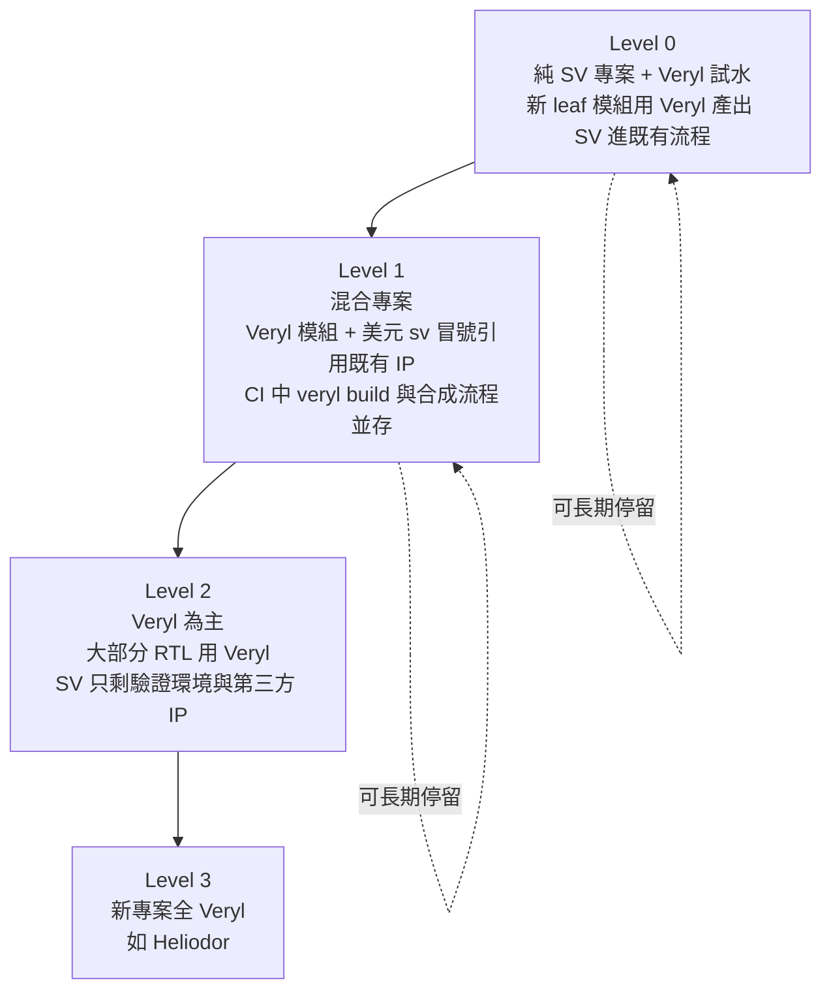

# 9.3 漸進式遷移策略與標準函式庫（AXI3、AXI4、AXI4-Lite、AXI-Stream）

## 漸進式遷移的層次模型

9.2 節回答了「一個模組怎麼搬」；本節回答「一個部門怎麼搬」。核心框架是一個四層的層次模型——每一層是一個**穩定狀態**（可以停在這裡運作數月甚至數年），而不是必經的過渡點：



### Level 0：純 SV 專案 + Veryl 試水

**形態**：專案流程完全不變；團隊在新寫的 leaf 模組上用 Veryl，`veryl build` 產出可讀 SV，交進既有的合成與驗證流程。沒有人需要知道下游是 Veryl 來的。

- **適用情境**：觀望期、個人與小團隊的技能累積、對工具鏈的風險評估。
- **風險**：最低。最壞情況是刪掉 `.veryl` 檔，留下的生成 SV 繼續用（見下文「回退策略」）。
- **回退策略**：留生成 SV，零損失。
- **度量**：轉出的模組在迴歸中的通過率；工程師的主觀效率對比。

### Level 1：混合專案

**形態**：9.1 節的機制全面上場——`$sv::` 引用既有 IP、embed 承接 UVM 環境、bind 注入監控器；CI 中 `veryl build`、`veryl test`、Verilator lint 與既有流程並存（7.2 節的雙閘門）。

- **適用情境**：正在推進 9.2 節分批遷移的專案；這是**工作量最大的層**，大多數組織的長期駐留點。
- **風險**：中。主要風險是**邊界漂移**——`$sv::` 觸點散落各處、沒人記得完整清單。對策是 9.1 節的邊界模組模式與集中審查。
- **回退策略**：逐模組的生成 SV 都在版本控制中，任何一個模組都可以「退回 SV」而不影響其他模組。

### Level 2：Veryl 為主

**形態**：RTL 的絕大部分是 Veryl；SV 只剩驗證環境（UVM）與第三方 IP。lint、CDC、fmt、doc 的主戰場移到 Veryl 工具鏈，SV 部分作為邊界層管理。

- **適用情境**：產品線層級的長期策略；新專案以此為起點，舊專案經 Level 1 到達。
- **風險**：對 Veryl 工具鏈版本的依賴變重（見下文「語言版本鎖定」）。
- **回退策略**：整個 RTL 可以在緊急情況下「凍結在生成的 SV」——見下文，這是 Veryl 架構上的逃生通道。

### Level 3：新專案全 Veryl

**形態**：新專案從第一天起全 Veryl——Heliodor（10.1 節）是現成的存在證明：一個可跑 Linux 的多核 out-of-order RISC-V 核心完全以 Veryl 撰寫，並反過來成為編譯器與模擬器的壓力測試。

- **適用情境**：無歷史包袱的新專案，或已完成 Level 2 的組織。
- **風險**：生態依賴（較小的第三方 IP 池、較少的驗證工具）。
- **回退策略**：同 Level 2 的生成 SV 通道。

---

## 風險管理

### 語言版本鎖定

7.1 節的 `verylup` 提供版本管理；遷移策略層面的對應紀律是：

1. **專案鎖定工具鏈版本**（`Veryl.toml` 或專案設定中聲明），CI 用固定版本（7.2 節 YAML 中的 `verylup install 0.13.0`）；
2. **升級是受控事件**：新版本先在一個分支上全面重跑 `veryl build`，**比較生成 SV 的 diff**——生成碼的變化就是版本升級的影響面，看得見、可審查；
3. 生成 SV 的 diff 為空（或僅為已知且無害的變化）才允許合併版本升級。

這條流程之所以可行，仍源於「生成 SV 可讀且與原始碼行級對應」的架構性質：**工具鏈升級的影響可以被機械地枚舉**，而不是「升級後祈禱迴歸全綠」。

### CODEOWNERS 與審查分工

混合專案的審查責任要顯式切分：

- Veryl RTL：熟悉 Veryl 的設計者審查；
- SV IP 與 UVM 環境：既有 owner 繼續負責；
- **邊界模組（9.1 節）**：**兩側 owner 共同審查**——它是跨語言契約的落點，是理解成本最高的程式碼。

### 回退策略：生成的 SV 不是中間產物，而是可維護的產出物

這一點值得講透，因為它是 Veryl 與「生成 Verilog」路線語言（Chisel、SpinalHDL 等，2.3 節）的**根本差異**。

生成式路線的 Verilog 產出是**中間產物**：不可讀、不可維護、不應被修改，原始碼是唯一的事實來源。這意味著生成式路線**沒有回退通道**——一旦採用，工具鏈就是生命線。

Veryl 的生成 SV 則是**可維護的產出物**：名稱保留、結構保留、風格與手寫 SV 一致、帶 source map。最壞情況——Veryl 專案停止維護、工具鏈出現不可修復的問題、組織決策改變——整個專案可以**留在生成的 SV 上繼續開發**。會損失的是 Veryl 語法的生產力，不會失去的是設計本身的可維護性。

對遷移決策的意義是決定性的：**採用 Veryl 不是一次性的賭注，而是可退出的選項。** 風險管理的語言來說：Veryl 路線的下行風險（downside）有界，而上行收益（模組級驗證的自足、CDC 的編譯期檢查、可預測的生成碼）是真實的。這個不對稱性，是向管理層論證「試水」的核心理由。

---

## 標準函式庫：AXI3、AXI4、AXI4-Lite、AXI-Stream

### 為什麼匯流排要進標準庫

SoC 設計中，匯流排介面的定義是一個**參數組合爆炸**的問題：地址位寬、資料位寬、ID 位寬、burst 長度欄位寬……這些參數之間有依賴（例如 ID 寬度依賴 master 數量），手寫介面容易不一致——兩個模組各自宣告 AXI 介面，欄位名差一個字母、位寬差一位，整合時才爆炸。且每個專案重寫一遍，沒有累積。

Veryl 內建標準函式庫（std library，官方文件見 std.veryl-lang.org）提供常用 AMBA 匯流排的**泛型介面**。用法分兩步：**先參數化 package，再重用介面**：

```veryl
// 第一步：以位寬參數實例化 package
alias package axi3_pkg = $std::axi3_pkg::<32, 4, 8>;

// 第二步：以 package 為參數重用介面的 modport
module RegBlock (
    i_clk: clock,
    i_rst: reset,
    slv_if: modport $std::axi3_if::<axi3_pkg>::slave,
) {
}
```

`$std::axi3_pkg::<32, 4, 8>` 產生一組位寬配置下的 AXI3 型別與常數（地址 32-bit、ID 4-bit、資料 8-byte 等）；`$std::axi3_if::<axi3_pkg>::slave` 是該配置下介面的 slave 端 modport。**「協定版本 + 位寬配置」變成一個型別層級的選擇**：改位寬是改一個參數列表，不是改幾百行介面宣告；兩個模組若都宣告 `axi3_if::<axi3_pkg>`，它們的介面**必然**逐欄位一致——一致性由型別系統保證，不由人的紀律保證。

AXI4-Lite slave 埠的完整範例：

```veryl
alias package axi4l_pkg = $std::axi4_lite_pkg::<32, 4>;

pub module RegFile (
    i_clk : clock,
    i_rst : reset,
    slv_if: modport $std::axi4_lite_if::<axi4l_pkg>::slave,
) {
    var r_ctrl : logic<32>;
    var r_stat : logic<32>;
    var r_waddr: logic<32>;

    // 寫位址通道的鎖存與解碼
    always_ff {
        if_reset {
            r_waddr = 0;
            r_ctrl  = 0;
        } else if slv_if.awvalid && slv_if.awready {
            r_waddr = slv_if.awaddr;
        }
        // 讀寫資料與握手回應……
    }
}
```

官方 std 庫目前的介面清單會持續擴充（AXI3、AXI4、AXI4-Lite、AXI-Stream 之外，新的協定按需求加入）；專案也可以用 7.3 節的相依管理引用第三方的 Veryl 介面套件，作為 std 庫的補充。

### 與 AMBA 協定的選型

| 協定 | 位址 | burst | 典型用途 | Veryl std 介面 |
| --- | --- | --- | --- | --- |
| AXI3 | 有 | 有（寫交錯） | 早期 Zynq、舊平台 | `$std::axi3_if` |
| AXI4 | 有 | 有（無寫交錯） | 高頻寬主幹、DDR 控制器 | `$std::axi4_if` |
| AXI4-Lite | 有 | 無 | 暫存器存取、控制面 | `$std::axi4_lite_if` |
| AXI-Stream | 無 | 無（純資料流） | 資料路徑、DSP 管線 | `$std::axis_if` |

選型的粗略規則：**控制面用 AXI4-Lite，資料面高頻寬用 AXI4，純資料流用 AXI-Stream**。AXI3 只在必須對接舊平台 IP 時使用。絕大多數週邊（UART、SPI、GPIO、計時器）的暫存器介面用 AXI4-Lite 就足夠——它沒有 burst 的複雜度，握手簡單，且與 AXI4 主幹之間有現成的橋接 IP 或簡單的自製橋。

---

## 實戰模式：用 std 介面搭建 SoC 匯流排拓撲

### 一 master 多 slave 的 address decode 骨架

```veryl
alias package axi4l_pkg = $std::axi4_lite_pkg::<32, 4>;

module BusFabric (
    i_clk  : clock,
    i_rst  : reset,
    mst_if : modport $std::axi4_lite_if::<axi4l_pkg>::slave,  // 來自 CPU 的 master
    bus_u  : $std::axi4_lite_if::<axi4l_pkg>,
    bus_reg: $std::axi4_lite_if::<axi4l_pkg>,
) {
    // 位址解碼：位址在 [0x1000_0000, 0x1000_FFFF] 走暫存器匯流排
    let sel_reg: logic = mst_if.awaddr inside {32'h1000_0000..32'h1000_FFFF};

    always_comb {
        bus_u <> mst_if;       // 預設直通
        if sel_reg {
            bus_reg <> mst_if; // 解碼命中時導向 slave
        }
    }
}
```

`connect` 操作符 `<>`（3.2 節）把整組匯流排訊號一次接通——`connect mst <> bus.slave;` 一行取代幾十行的逐訊號連接，且連接的完整性由型別檢查保證（漏接一個訊號是編譯錯誤，不是模擬中才出現的懸空線）。位址解碼骨架刻意保持最簡（此處省略仲裁與回應路由），但已展示 std 介面 + `<>` 的組合如何把匯流排拓撲壓縮成可讀的幾行。

### 跨時鐘域的 AXI bridge

第 6 章論證過：跨時鐘域是硬體最難的 bug 來源。AXI 匯流排跨域的標準做法是**非同步 FIFO bridge**（6.3 節）：兩個時鐘域之間以雙埠 RAM + 格雷碼指標傳遞握手與資料。用 std 介面時，bridge 的兩側埠分別標注時鐘域：

```veryl
module AxilCdcBridge #(
    param W: u32 = 32,
) (
    i_clk_a: input  'a clock,
    i_rst_a: input  'a reset,
    i_clk_b: input  'b clock,
    i_rst_b: input  'b reset,
    slv_if : modport 'a $std::axi4_lite_if::<axi4l_pkg>::slave,
    mst_if : modport 'b $std::axi4_lite_if::<axi4l_pkg>::master,
) {
    // 內部：兩個非同步 FIFO（6.3 節）分別承載寫通道與讀通道
    // 握手訊號跨域走雙 FF 同步器
}
```

時鐘域標注（6.2 節）與 std 介面的組合，讓 CDC 錯誤——例如 bridge 內部忘記放同步器——在**編譯期**被域檢查攔截，而不是在矽上以每數月一次的頻率出現。

---

## 遷移的度量

遷移需要可衡量的進度指標，否則它會變成一句口號。建議的四個度量：

| 度量 | 定義 | 反映什麼 |
| --- | --- | --- |
| 模組數比 | Veryl 模組數 / 總模組數 | 遷移的廣度 |
| 行數比 | Veryl 行數 / 總行數 | 遷移的深度（大模組權重） |
| lint 乾淨率 | 通過 `veryl check` 零警告的模組比例 | 遷移**品質**（搬過來但帶著警告不算搬完） |
| 測試覆蓋 | 有原生測試的 Veryl 模組比例 | 遷移後的可維護性 |

行數比與模組數比要並看：只看模組數會被「轉了一堆 20 行的小模組」灌水；只看行數會被「一個巨型模組卡住」誤導。lint 乾淨率與測試覆蓋防止遷移退化成「搬運」——**遷移的目標不是行數過河，而是工程品質過河**。

---

## 本章結語

第 8 章與第 9 章合起來，把 Veryl 從「一門語法漂亮的語言」變成「一套可以進入真實組織的工程方案」：

- **第 8 章**：原生測試 + 內建模擬器（8.1、8.2）讓模組級驗證自足；隨機與 cocotb（8.3）補上隨機化與 Python 生態。
- **第 9 章**：互操作（9.1）讓 SV 資產共存；translate（9.2）把遷移成本從重寫降為審查；本節的層次模型與 std 函式庫，讓遷移有節奏、匯流排有共用基礎。

合起來的結論是一句話：**互操作 + translate + std 庫，使 Veryl 可以被當成一個漸進的選項，而不是一次性的賭注。** 下行風險有界（生成 SV 是可維護的產出物），上行收益真實（可預測性、驗證自足、CDC 編譯期檢查）。這正是本書第 0 章價值函數 $ V = \alpha E - \beta C - \gamma U $ 中，Veryl 的答案：壓低 $ C $ 與 $ U $，把 $ E $ 留在工程上剛好夠用的地方。

---

## 實作練習

1. 用 `$std::axi4_lite` 建立一個暫存器模組（4 個 32-bit 暫存器：CTRL、STAT、DATA、BAUD），slave 埠接 9.3 節的 modport 語法，實作寫位址鎖存與讀資料回應；
2. 以 SystemVerilog 寫一個簡單的 AXI4-Lite master（狀態機驅動一次寫與一次讀），用 `$sv::` 在 Veryl 頂層實例化，與練習 1 的暫存器模組對接，在內建模擬器（8.2 節）中驗證讀寫正確；
3. 在練習 2 的頂層加一個 `bind` 的監控器（9.1 節），檢查 AW/AR/W/B/R 各通道的握手不變式（例如 awvalid 拉高且未 ready 前不得撤下），用隨機回延（8.3 節土法）壓力測試；
4. 為練習 1 的暫存器模組撰寫 9.2 節的 LEC 流程：SV 版（手寫等價版本）與 Veryl 版各綜合、等價檢查；若無 LEC 工具，以生成 SV diff + 迴歸替代並記錄弱點；
5. 給你的專案建立 9.3 節的四個度量（模組數、行數、lint 乾淨率、測試覆蓋），寫一個小腳本從 `veryl build` 與 `veryl test` 的輸出收集數字，放進 CI 日誌。

---

## 本節小結

1. 遷移的四層模型（試水 → 混合 → Veryl 為主 → 全 Veryl）中，每一層都是可長期停留的穩定狀態，各有明確的風險與回退策略。
2. 版本鎖定 + 生成 SV diff 審查，使工具鏈升級的影響可機械枚舉；CODEOWNERS 對邊界模組應有兩側共同審查。
3. **生成的 SV 是可維護的產出物而非中間產物**——最壞情況可留在生成的 SV 上繼續開發。這是 Veryl 與生成式路線語言的根本差異，也是「漸進選項而非一次性賭注」的架構根據。
4. std 函式庫以「先 alias package 參數化、再重用 modport 介面」的模式提供 AXI3/AXI4/AXI4-Lite/AXI-Stream，把「協定版本 + 位寬配置」變成型別層級的選擇，一致性由型別系統保證。
5. 選型規則：控制面 AXI4-Lite、高頻寬資料面 AXI4、純資料流 AXI-Stream；`<>` 連接操作符與 CDC bridge 模式搭建匯流排拓撲。
6. 遷移度量四件套：模組數比、行數比、lint 乾淨率、測試覆蓋——防止遷移退化成沒有品質的搬運。

---

*下一節：第 10.1 節「Heliodor：以 Veryl 實作的 RISC-V 多核處理器（2026）」*
