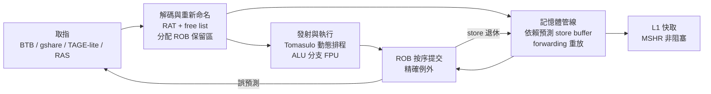
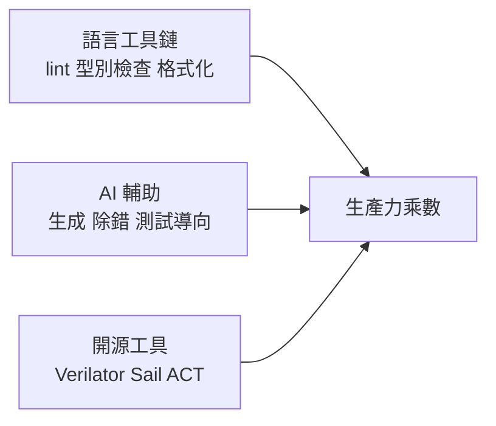

# 10.1 Heliodor：以 Veryl 實作的 RISC-V 多核處理器（2026）

## 為什麼需要一個「真實規模」的設計

### 小測試案例的結構性盲區

本書前九章的所有論證——語法設計（3-5 章）、跨時鐘域安全（6 章）、工具鏈（7 章）、驗證（8 章）——都建立在一個尚未驗證的前提上：**這門語言在真實規模的設計上仍然成立**。這個前提不能靠教學範例驗證，因為小的測試案例存在結構性的盲區：

- **編譯器規模化問題踩不到**。幾百行的設計永遠不會暴露編譯時間隨規模的非線性成長、analyzer 在數萬符號下的效能退化、或錯誤訊息在深度模組階層中的品質劣化。這些問題只有在規模壓力下才會現形，而現形時往往已是架構級的重構。
- **驗證工具的體驗問題踩不到**。模擬器速度只有跑千萬週級的工作負載（例如作業系統開機）才有意義；波形體驗只有波形檔大到 GB 量級、訊號數大到無法肉眼瀏覽時，才成為真實的工程摩擦。
- **語言特性的組合爆炸踩不到**。單一特性的行為可以靠單元測試保證，但泛型、介面、時鐘域標註、多時脈域在同一份數萬行的設計裡相互作用的結果，是任何單元測試都覆蓋不到的。

因此 Veryl 社群對 Heliodor 的官方定位非常明確：它是 **「a large, realistic stress test for the Veryl toolchain」**——一個給 Veryl 工具鏈的大型真實壓力測試。這句話的意思是：Heliodor 的第一目的不是做一顆處理器，而是**把工具鏈放進會壞掉的環境裡，看哪裡壞**。編譯時間、analyzer 效能、錯誤訊息品質、模擬器效能、波形體驗——這些指標全部以 Heliodor 為基準（8.2 節的 3000 萬週期 Linux boot benchmark 正是這個壓力測試的產物）。

### 工具與設計的共生演化

「造一個真實設計來壓力測試工具」不是新的方法論，它是軟體工程史上反覆出現的共生模式：

| 共生對 | 工具 | 壓力測試設計 | 交互驅動的成果 |
| --- | --- | --- | --- |
| 編譯器與 OS | GCC | Linux 核心程式碼 | Linux 的規模逼出了 GCC 的增量編譯、診斷與最佳化；GCC 的品質反過來決定核心碼的寫法 |
| 語言與自舉 | rustc | Rust 編譯器本身（自舉） | 用 Rust 寫 Rust 編譯器，讓每個語言特性先在「最挑剔的客戶」身上被檢驗 |
| 語言與瀏覽器 | Rust | Servo / Firefox 元件 | Servo 的需求驅動了 borrow checker、型別推斷與並行工具的成熟 |
| **HDL 與處理器** | **Veryl 工具鏈** | **Heliodor** | **多核亂序處理器的規模逼出 IR analyzer、內建模擬器與診斷品質的躍遷** |

共生模式的關鍵在於**迴路的方向**：不是「工具成熟了才開始做真實設計」，而是「真實設計的需求定義了工具該成熟到什麼樣子」。Chisel 與 Rocket Chip 的關係也是這種共生——但 Chisel 的壓力測試集中在「硬體產生器」的表達力上；Heliodor 的壓力測試則刻意涵蓋**工具鏈的全部環節**，因為 Veryl 的價值命題（可預測性 + 互操作 + 生產力）本來就是一條端到端的管線，任何一環的劣化都會破壞整條命題。

---

## Heliodor 的基本盤

### 定位與里程碑

Heliodor 是以 Veryl 撰寫的 RV64 多核處理器。它在 **2026 年 6 月達成 RVA23 全合規**——RVA23 Profile 是 RISC-V International 定義的 2024 年之後應用處理器架構基準，涵蓋整數、原子、浮點、壓縮、虛擬記憶體、 Hypervisor 等完整的指令集要求。這是「合規」而非「實作了一部分」：設計通過了針對整個 Profile 的相容性測試套件。

基本配置：

- **2-wide 超純量、亂序（out-of-order）執行**的 RV64 核心，支援多 hart 的 SMP 配置（1 / 2 / 4 / 8 核）。
- 每個 hart 都是完整的核心，經一致性互連共享 L2。

### 微架構的主要結構

以下把 Heliodor 的核心微架構拆成五個層次說明。這些結構對本書的意義不在處理器設計本身（那是姊妹卷《用 Verilog 學計算機結構》的主題），而在**每一項結構都是 Veryl 語言特性的一次真實考驗**。

**（一）暫存器重新命名：RAT + free list。** 架構暫存器對應到實體暫存器檔（PRF）的映射表（RAT）配合 free list 管理。整數與浮點各有 **64 項 PRF**。這是典型的資料路徑 + 控制狀態的混合結構：RAT 是每個 cycle 都要讀寫的多埠表格，free list 是帶有配置/回收邏輯的佇列——它們考驗 Veryl 的泛型資料路徑（5.2 節）與狀態機寫法（第 4 章）。

**（二）Tomasulo 式動態排程與 32 項 ROB。** 保留區（reservation station）式的動態排程，配 **32 項 reorder buffer（ROB）按序提交**。ROB 是保證**精確例外（precise exceptions）**的關鍵：無論亂序執行把指令送到多遠，提交點的例外狀態必須精確地回到按序世界觀。ROB、讀寫旁路、例外合併——這是 RTL 裡控制邏輯密度最高的區域之一。

**（三）分支預測階層。** Heliodor 組合了多個預測結構：BTB（branch target buffer）、gshare BHT、**TAGE-lite 方向預測器**、間接目標 BTB、以及返回位址堆疊（RAS）。預測錯誤時，在**執行期做早期重導向**（而非等到提交），把誤預測懲罰壓短。TAGE-lite 的標記式歷史表格是多 bank、多路並行查找的典型結構。

**（四）記憶體管線的投機執行。** 這是 Heliodor 最精緻的部分：

| 機制 | 功能 | 語言考驗 |
| --- | --- | --- |
| 記憶體依賴預測（memory-dependence speculation） | 在 store 位址未定時投機放行 load | 預測器狀態 + 失誤偵測的控制互鎖 |
| 提交時重放（commit-time replay） | 依賴預測失誤的 load 在 store 提交時重放 | 事件排序的多來源仲裁 |
| store-to-load forwarding | 對 in-flight 與 committed stores 做前遞 | CAM 式並行查找的泛型寫法 |
| 寫合併（write-combining）store buffer | 合併相鄰位址的寫入再送快取 | 佇列 + 比較邏輯的混合 |

### 核心管線結構

這張圖裡最值得注意的邊是**從提交回到取指與記憶體的回饋**：誤預測重導向與 store 退休重放。亂序處理器的 Veryl 程式碼中，這類「全域事件、多來源仲裁」的控制互鎖佔了控制邏輯的大宗，也正是最能檢驗「語意可預測性」的地方——工程師必須能從 `always_ff` 區塊預測每一個狀態位元的行為。

---

## 快取與一致性

### L1 / L2 與 MESI 目錄

多核一致性是繼亂序控制之後的第二座山。Heliodor 的記憶體階層：

- **每 hart 私有寫回式 L1**：16 KB、4-way、**non-blocking**（帶 MSHR 支援多個未完成缺失）、**critical-word-first fill**（先回填命中字，再補其餘字）。
- **共享 128 KB L2**：inclusive、以 **MESI 目錄**追蹤每個快取行的持有者，支援 **cache-to-cache 傳輸**（dirty 資料從一個 L1 直接搬到另一個 L1，不經記憶體）。
- **AMO / LR-SC 留在快取內處理**：原子操作在持有快取行的本地快取上完成，配合 MESI 的互斥狀態保證原子性，避免在共享匯流排上做讀-改-寫的複雜仲裁。

### 兩個值得注意的架構決定

**（一）指令側一致性。** Heliodor 的指令快取與資料快取在一致性網域內互通，因此 `FENCE.I`（指令流同步）與 `SFENCE.VMA`（位址轉譯失效）**不需要 flush sweep**——不需要廣播失效到所有核心。這個決定大幅簡化了跨核同步的常見路徑（動態連結、JIT、分頁表更新），代價是 L1i 要參與目錄協定。對 RTL 而言，這是把「偶爾的全域廣播」換成「常態的目錄查詢」——控制邏輯更均勻，驗證狀態空間更小。

**（二）split-transaction 共享匯流排。** 核心到 L2 的匯流排是**拆分交易（split-transaction）**式：發出請求後釋放匯流排，回應另走一趟，讀控制器會**建模 DRAM 延遲**（固定的數十週期延遲加上可組態的抖動）。這個細節的重要性在驗證：如果匯流排模型假設零延遲，所有依賴「請求後很快就回」的投機邏輯（MSHR 超時、重放視窗）都會在真實硬體上以另一種時序行為現形。

---

## ISA 覆蓋：RVA23S64 的完整拼圖

### 標量部分

Heliodor 實作的指令集達到 **RVA23S64**：

- **RV64GC**：整數、乘除、原子（A）、浮點（F/D）、壓縮（C）；
- **位元操作**：Zba / Zbb / Zbs；
- **原子擴充**：Zacas（AMOCAS 系列比較並交換）、Zabha（位元組與半字原子）；
- **浮點補充**：Zfa、Zfhmin（半精度子集）；
- **系統擴充**：Sstc（stimecmp/賒時中斷）、Svnapot（4 KB 疊合頁）、Svpbmt（頁屬性）、Svadu（硬體 A/D 位元更新）、Zicbom / Zicboz（快取區塊維護）、Zicond（條件運算）、Zawrs（等待保留集）、Svinval（精細失效）、Zkt（恆定時間基準）、Supm / Ssnpm（指標遮罩）；
- **特權與保護**：PMP（實體記憶體保護）、M / S / U 三模式、**Sv39 虛擬記憶體**。

### Hypervisor（H）擴充

H 擴充是標量部分最後補齊的大塊，它的 RTL 複雜度常被低估：

- **三種新增執行模式**：HS（hypervisor-supervisor）、VS（virtual supervisor）、VU（virtual user），加上既有 M，形成四模式巢狀；
- **兩階段位址轉譯**：guest 虛擬位址先經 guest 的 Sv39 轉成 guest 實體位址，再經 hypervisor 的 **Sv39x4** 轉成主機實體位址。TLB 項目必須以 **VMID 與 VS-ASID 標記**，否則跨 guest 的轉譯會互相污染；
- **load/store 虛擬化指令**：`HLV`、`HLVX`、`HSV`，讓 hypervisor 代表 guest 執行記憶體存取；
- **guest-page-fault 三件組**：guest 最終位址轉譯失敗時，例外要正確地記錄第二階段的原因（vtval、vtinst），並送到 HS 或 VS 的正確特權層；
- **虛擬中斷遞送**：hstatus/vsstatus 的中斷遮罩疊套，加上 **Sstc-in-VS**——guest 有自己的賒時計時器，中斷遞送要按模式疊套解析。

### Vector（V）擴充

Vector 擴充（RVV 1.0）是最後加入的擴充：

- **VLEN = 128、ELEN = 64**，32 個 128-bit 向量暫存器檔；
- 實作為 **decoupled in-order 單元**：向量單元與標量亂序管線解耦，指令派發後依序執行，完成後回報——這是在「向量資料路徑的規律性」與「標量管線的亂序複雜度」之間取的一個務實交點。

### 這個覆蓋對 Veryl 的意義

把這份清單翻譯成 RTL 的語言，它幾乎是**硬體設計難題的全集**：

| ISA 領域 | RTL 難題 |
| --- | --- |
| 亂序 + ROB + 重新命名 | 高密度控制邏輯、多埠表格、全域事件仲裁 |
| 多核 MESI + AMO | 分散式協定狀態機、交易級互連 |
| Sv39 + 兩階段轉譯 | 多級查找、TLB 並行比對、例外疊套 |
| 精確例外 | 例外合併、按序退休、狀態快照 |
| Vector 資料路徑 | 寬資料多路選擇、規律性流水線 |
| PMP + 特權 | 組合式權限檢查、模式切換狀態機 |

因此 Heliodor 的存在本身就是一個實證命題：**如果這些難題都能用 Veryl 表達、驗證、並持續維護，那麼 Veryl 的表達力上限就不再是一個理論問題。** 這比任何語言特性的爭論都更有說服力——它把「Veryl 能不能寫真實硬體」從猜想變成了可檢驗的成果。

---

## 驗證成果：硬體專案最硬的證據

硬體專案的品質證據等級，從低到高大致是：通過自寫測試 < 通過開源套件測試 < 通過官方合規套件 < 開機真實作業系統。Heliodor 在後兩級都有成果。

### RISC-V ACT v4 全過

**ACT（Architectural Compatibility Tests）** 是 RISC-V International 官方的架構相容性測試套件。ACT v4 的期望值由 **RISC-V Sail 黃金模型**簽署——也就是說，每一條指令的行為都以架構社群維護的形式模型為準，而非設計者自己的理解。

Heliodor 的標量 RVA23 ISA 部分通過 **ACT v4 的 506 / 506** 測試，涵蓋：整數、原子、浮點、壓縮、CSR、Zb* 位元操作、Zc* 程式碼密度、Zfa、Zfhmin、Zicbo* 快取維護、PMP、Sv* 虛擬記憶體與例外處理。

**這個數字有兩層意義。** 第一層是設計本身的正確性。第二層對本書更重要：ACT 測試是獨立於 Veryl 生態的外部套件——**Veryl 撰寫的設計，通過了為整個 RISC-V 生態設計的、與實作語言無關的官方測試**。這是「語義等價原則」（2.1 節）在最大規模上的一次檢驗。

### ACT 之外的補位驗證

ACT v4 **沒有** vector 與 hypervisor 的測試套件。Heliodor 對這兩塊採用了替代策略：

- **自寫 RVV arch suite**：針對 RVV 1.0 的架構測試，覆蓋向量指令語意（VLEN/ELEN 邊界、mask、lane 行為）；
- **端到端檢查**：以「能開機 Linux」作為功能面與系統面的整體檢查——Linux 對 ISA 的使用極廣，開機過程會觸碰絕大多數系統指令。

### 開機 mainline Linux

所有配置都在 **Verilator 與 Veryl 內建模擬器（8.2 節的第二後端）上交叉驗證**——同一份設計、同一段開機流程，兩個獨立實作的模擬器必須給出相同行為。

| 工作負載 | 配置 | 意義 |
| --- | --- | --- |
| mainline Linux 5.15 LTS | 1 / 2 / 4（此版可至 8）hart | 經 OpenSBI 引導，到 SBI shutdown 完整關機 |
| mainline Linux 6.6 LTS | 1 / 2 / 4 hart | 較新核心的驅動子系統覆蓋 |
| mainline Linux 7.1 | 1 / 2 / 4 hart | **SMP context switch 下的浮點運算**——核心驅動在使用者切換時保存/還原浮點狀態，直接壓測 F 狀態與上下文切換的互動 |
| 自寫 type-1 hypervisor | bare-metal | **以 H 擴充啟動未修改的 guest Linux**（boot log 中的 `[HV]` 行） |

SMP Linux 開機是對多核一致性的天然壓力測試：核心啟動時各 hart 幾乎同時熱身快取、競爭鎖、發送跨核中斷（IPI），任何 MESI 目錄或記憶體序的邊角錯誤都會以「開機掛死」或「隨機 panic」的形式現形。而 hypervisor 啟動**未修改的** guest Linux，代表兩階段轉譯、虛擬中斷與 guest-page-fault 路徑在真實作業系統的工作負載下完整運作——這不是「能跑一個 demo guest」等級的 H 擴充實作。

---

## AI 輔助開發的里程碑

### 事實

Heliodor 幾乎完全以 **Claude Code**（AI coding agent）開發：RTL 撰寫、除錯、導向測試的生成、各 ISA 擴充的 bring-up。算力由 Anthropic 的 **Claude for Open Source** 計畫支持。

這個事實值得以最嚴肅的態度分析，因為它不是行銷，而是**一個可複製的工作模式的實證**。

### 三個層次的分析

**（一）可預測語言縮短了 AI 修改 RTL 的迴路。** AI agent 開發硬體的核心迴路是「生成 → 檢查 → 修正」。Veryl 在這條迴路上提供了三個結構性優勢：

1. **生成的 SystemVerilog 可直接檢查**。Agent 生成了 Veryl，編譯出的 SV 是可讀的，人與 agent 都可以直接審視「這段描述會變成什麼電路」——這在生成碼不可讀的 Alt-HDL 路線上是不存在的檢查點（2.3 節）。
2. **lint 與型別檢查是即時回饋**。Agent 每次生成後跑 `veryl lint`，位寬錯誤、未驅動訊號、CDC 違規（6.2 節）在秒級被攔下，而不是在數小時後的模擬或數週後的矽上。
3. **錯誤訊息品質直接轉換為 agent 的自我修正成功率**。診斷訊息指得到具體行、說得清原因，agent 就能靠訊息收斂；診斷含糊，agent 就在猜測間振盪。

**（二）「語意可預測」不只幫人類，也幫 LLM。** 本書第 1 章的論題是：語意不可預測傷害的是「讀程式碼的人」。2026 年的迴響是：它同樣傷害「生成程式碼的模型」。LLM 的生成品質依賴訓練分布與推理時的語意一致性——一門「同一語法永遠同一語意」的語言，讓模型不需要推斷上下文的隱含規則；而 SystemVerilog 的隱式規則（1.3 節那十項）恰恰要求「讀出上下文才能確定語意」，這對人與模型是同一種負擔。**第 1 章的價值函數 $`V = \alpha \cdot E - \beta \cdot C - \gamma \cdot U`$ 中，AI 是把 $`U`$ 的係數 $`\gamma`$ 進一步推高的新變數**——因為機器讀者的數量開始超過人類讀者。

**（三）生產力乘數的組成。** 一個 hobby 專案能從 RV64I 純量管線擴展到多核 RVA23 亂序核心並跑 Linux，背後是三個要素的乘積：

任何一項為零，乘積為零：沒有工具鏈的即時檢查，AI 的生成品質無法收斂；沒有 AI，人力無法覆蓋亂序核心的 bring-up 廣度；沒有開源模擬器與測試套件，驗證成本會超出 hobby 專案的天花板。

### 批判性的平衡

必須立刻補上對稱的批判，否則上述分析就會淪為烏托邦敘事：

- **AI 生成的 RTL，驗證責任仍在人。** 「Agent 寫的、測試過了」不等於「正確」。500 條 ACT 測試通過的是「測試覆蓋到的行為」；ACT 之外的路徑（上節列出的 vector 與 hypervisor）靠的是自寫套件與 Linux 開機——這些覆蓋的完整性由人判斷、由人背書。**簽核者簽的是整個設計，不是生成過程。**
- **AI 會複製語言的陷阱，也會複製自己的錯誤。** 生成式模型對罕見路徑（例外疊套、邊角時序）的可靠性不比人類直覺高；差別只在它錯得更快、更多。沒有嚴格的回歸與交叉驗證，AI 輔助只會更快地產出錯誤的設計。
- **這個模式的可複製性是有前提的。** Heliodor 的工作模式建立在「內建模擬器 + lint + 格式化 + 套件管理」這條完整管線上。對工具鏈殘缺的語言，AI 輔助的收益會大打折扣——**AI 放大的是管線的品質，不是替代它。**

---

## Veryl 特性使用映射

把 Heliodor 的硬體結構與前九章的語言特性對應起來，可以看到前九章的每一個設計決定在真實規模下的實際角色：

| Heliodor 的結構 | Veryl 特性 | 本書章節 |
| --- | --- | --- |
| 多時脈域（核心、匯流排、DRAM 模型、除錯模組） | 時鐘域標註 `'a` 與 `unsafe (cdc)` | 6.2 |
| 可參數化的快取、佇列、CAM 資料路徑 | 泛型 `::<T>` 與 `gen` | 5.2 |
| 核心互連、記憶體匯流排、一致性介面 | `interface` / `modport` / `connect` | 3.2 |
| CSR 暫存器堆（數百個 M/S/H 模式暫存器） | `struct` / `enum` / `union` | 5.1 |
| ROB、MSHR、預測器等狀態機 | `always_ff` + `if_reset` | 4.1-4.3 |
| 數萬行設計的持續整合 | `veryl check` / `fmt` / `test` | 7.2、8.1 |

兩個映射值得展開。

**CSR 暫存器堆與 struct/enum/union。** 一個 RVA23 處理器的 CSR 數量以數百計，且高度結構化：位元欄位、存取權限、重置值、WPRI 保留位。用 `struct` 表達每個 CSR 的欄位版面、用 `enum` 表達特權模式與例外原因、用 `union` 表達別名暫存器，使 CSR 邏輯從「一堆位元切片運算」變成「可讀的資料結構操作」。這是型別系統（5.1 節）在減少位元級錯誤上的直接兌現。

**狀態機與 `if_reset`。** 亂序核心有大量「重置到已知狀態」的結構：誤預測恢復、例外 flush、MSHR 釋放。`if_reset`（4.3 節）把重置行為與一般時序行為在同一個 `always_ff` 區塊內顯式分離，重置極性與同步性交給 `reset` 型別（4.2 節）抽象。在數十個狀態機的規模下，這個分離的價值是：**code review 時可以機械地檢查每個狀態變數是否有重置分支**，而這個檢查又由 lint 補強。

---

## 規模與效能的啟示

Heliodor 作為壓力測試的價值，在 8.2 節已經以數據形式出現過，這裡把它放回全書脈絡：

- **編譯時間與 analyzer**：數萬行、數百模組的設計是 2026-01 IR-based analyzer 重構的直接驅動力——在 Heliodor 的規模下，舊有的逐段檢查架構已經無法維持即時診斷。
- **模擬器效能**：3000 萬週期的 Linux boot 是內建模擬器兩階段架構（Cranelift JIT + GCC 優化後端）的測試負載；沒有這個負載，「編譯快」與「執行快」的取捨就沒有真實數據支撐。
- **波形體驗**：Linux boot 的波形以 GB 計，`.sv.map` source map（7.2 節）把波形訊號對應回 Veryl 原始碼的能力，正是在這個規模下從「加分項」變成「必需品」。
- **交叉驗證的規模化**：所有開機在兩個模擬器上交叉驗證——這個策略（8.2 節）在數萬行設計上的可行性，本身就是「語義等價 + 可讀生成碼」的紅利。

一個誠實的觀察：這些指標中有的（模擬器速度）已經有對比數據，有的（大規模下的診斷品質、波形工具的極限）仍以定性經驗為主。Heliodor 把壓力測試的**範圍**鋪滿了，但壓力測試的**度量**仍在不斷工程化——這正是它持續被維護的原因：它不是一次性的基準，而是活著的基準。

---

## 本節結語

Heliodor 證明了什麼、沒證明什麼，值得精確地說。

它**沒有**證明「Veryl 能寫出 RISC-V 處理器」——這件事 Chisel 的 Rocket 在 2012 年就證明過了，Alt-HDL 的表達力從來不是爭議點。

它證明的是更難的一件事：

> **Veryl 能承載一個會被持續維護、能跑完整作業系統、通過官方合規測試的設計——並且在這個過程中，反過來打磨工具鏈。**

「持續維護」意味著生成的 SystemVerilog 可讀、可 review、可 diff；「通過官方合規測試」意味著語義等價經得起語言無關的外部檢驗；「反過來打磨工具鏈」意味著工具與設計的共生迴路在轉——IR analyzer 與內建模擬器都是這個迴路的產物。這三件事合起來，才是對第 2 章三支柱命題的完整檢驗。

下一節（10.2）把視角從「一個大設計」轉向「設計周圍的東西」：暫存器生成器、Rust 驗證元件、套件註冊表與社群實踐——語言生態的另一半。

---

*下一節：第 10.2 節「周邊生態：RgGen、Rust 元件與社群實踐」*
