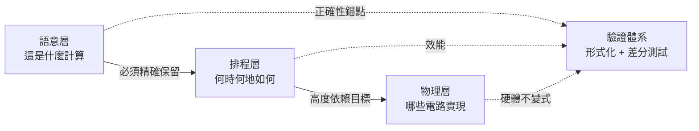

# 0.1 從指令流到物理算力的翻譯契約

## 0.1.1 一個老問題的新面貌

編譯器的本質從來都是一份**翻譯契約**（translation contract）：上層用一種方便人類表達意圖的語言寫下「要做什麼」，編譯器承諾在目標機器上產生「語義等價、效能可接受」的實作。這份契約在 1950 年代 FORTRAN 誕生時就成立了——當時的賭注是「自動產生的組合語言能否接近手工編碼」。

七十年後，賭注變大了。今天同一個神經網路模型，可能同時要跑在：

* 一顆有亂序執行與 AVX-512 的 **x86 CPU** 上；
* 一顆有一萬多個執行緒、以 warp 為單位排程的 **GPU** 上；
* 一顆有 256×256 脈動陣列、只會做矩陣乘法的 **TPU** 上；
* 一顆手機裡的 **NPU**，它的指令集是廠商私有的，文件甚至是保密的；
* 一塊 **FPGA**，上面根本沒有「指令」這個概念，只有邏輯閘與連線資源。

問題的核心可以這樣陳述：

> **當目標硬體從單一 CPU 擴展為 GPU、TPU、NPU 與可重構邏輯時，編譯器如何保留高階語意，並同時榨乾每一種截然不同的微架構？**

這不是「多寫幾個後端」就能解決的問題。因為每一種硬體對「什麼是好程式」的定義完全不同：

| 硬體 | 效能的來源 | 編譯器的核心任務 | 失敗的樣態 |
|------|-----------|----------------|-----------|
| CPU | 亂序 + 快取 + SIMD | 向量化、避開依賴鏈 | cache miss、依賴停頓 |
| GPU | 萬級執行緒延遲遮蔽 | 合併存取、occupancy | warp 分歧、bank conflict |
| TPU/NPU | 脈動陣列的資料流 | 靜態排程、雙緩衝 | 餵不飽陣列、DMA 空轉 |
| FPGA | 電路平行 + 管線化 | 資料流排程、II=1 | 時序不收斂、BRAM 爆掉 |

同一個 $C = A \times B$ ，在 CPU 上是「展開迴圈 + 向量化」，在 GPU 上是「幾千個 thread 各算一格」，在 TPU 上是「把 A、B 以特定節奏流入脈動陣列」，在 FPGA 上是「用 256 個 DSP 單元蓋出一棵乘法樹」。**高階語意相同，物理實作天差地遠。**

## 0.1.2 翻譯契約的三個層次

本書將這份契約拆成三個層次，作為貫穿全書的框架：

### 第一層：語意層（Semantics）

「這段計算**是什麼**」——例如「對形狀為 $[M, K] \times [K, N]$ 的兩個矩陣做單精度乘加」。這一層必須在所有降階過程中被**精確保留**，它是正確性的錨點。任何一次 IR 降階，從張量圖到 LLVM IR 到機器碼，都必須能被驗證「語意沒有跑掉」。

### 第二層：排程層（Scheduling）

「這段計算**何時、何地、以什麼順序**執行」——迴圈怎麼切塊（tiling）、資料何時搬進 scratchpad、哪些算子融合成一個 kernel。這一層**不改變數學結果，卻決定效能**，而且高度依賴目標硬體：CPU 的排程是動態的（交給硬體亂序引擎），GPU 的排程是半動態的（硬體排 warp，編譯器排 block），TPU 與 NPU 的排程幾乎完全是**靜態的**（編譯期就決定每一拍的資料流）。

### 第三層：物理層（Physical）

「這段計算**由哪些電路實現**」——LUT、DSP、SRAM、脈動單元、快取 line。對軟體編譯器而言這一層是 ISA 與微架構；對 HLS/HDL 而言，這一層直接就是邏輯閘與時序收斂問題。

**傳統編譯器把這三層壓縮在一條線性管線裡，且只服務一種物理目標。** 本書的主軸就是：當物理目標變成四種以上，這條管線為什麼會崩潰，以及 MLIR 一類的多層 IR 體系如何重建它。

## 0.1.3 為什麼多元化是「改寫編譯器本質」的力量

三股力量共同推動了這次範式轉移：

### （1）摩爾定律失效，特化成為唯一出路

通用 CPU 的單執行緒效能成長從 2010 年代起明顯放緩。但深度學習的算力需求以每幾個月翻倍的速率成長。差距只能靠**特化**補：為矩陣乘法做脈動陣列，為卷積做硬體 conv 引擎，為低精度做 INT8/BF16/FP4 單元。每多一種特化，就多一種編譯器必須理解的執行模型。

### （2）張量取代純量成為一等公民

過去五十年，編譯器的基本單位是**純量變數**：一個 int、一個 float。深度學習時代，基本單位變成**形狀確定的多維張量**。這不只是「型別變大」：張量自帶布局（layout）、分塊（tiling）、融合（fusion）等**純量世界沒有的決策維度**。同一個算子的兩種布局，效能可以差五到十倍——而這個決策 LLVM IR 根本無法表達。

### （3）LLM 把「機率性生成」塞進了確定性世界

當語言模型開始生成編譯器 Pass、測試程式與 GPU kernel，編譯器的輸入從「確定的人類代碼」擴展為「機率的模型輸出」。語義等價的檢查從「一次正確即永遠正確」變成「每一次生成都要重新驗證」。這迫使整個驗證體系升級，也重新劃定了人機協作的邊界。

## 0.1.4 全書路線：四部曲的邏輯

本書四個部份的安排，刻意模仿「語意逐層落地」的方向：

**第一部（第 1–3 章）：硬體在說什麼。** 要寫好翻譯，先要懂受眾。CPU、GPU、TPU/NPU 的微架構各自如何吸收計算、它們對代碼生成施加了什麼約束。沒有這一層理解，後面所有的 IR 設計都只是空中樓閣。

**第二部（第 4–6 章）：翻譯的工具為什麼長成現在的樣子。** LLVM IR 為什麼裝不下張量語意、計算圖編譯器為什麼會「語義抹除」、MLIR 為什麼以 dialect 與 progressive lowering 重新架構了整個問題，以及 XLA/IREE/Triton 等實戰堆疊怎麼用這些工具。

**第三部（第 7–9 章）：當生成者換成模型。** LLM 參與編譯流程的三條路線（輔助開發、錯誤搜尋、Kernel 生成），機率性輸出與編譯確定性之間的張力，以及全域不變式為什麼構成人機協作的硬邊界。

**第四部（第 10–12 章）：翻譯的終點在哪裡。** 開放 ISA（RISC-V）與異質記憶體（CXL）如何重塑後端與 runtime；當編譯終點從指令流變成邏輯閘（HLS/HDL），排程問題如何變成時序問題；最後以軟硬體共同設計收尾——算子、方言與微架構同步演進的新範式。

一條貫穿全書的暗線值得在此點明：

> **每一次 IR 降階（lowering）都是一次有損壓縮——高階語意裡的「選擇空間」被逐步換成低階指令裡的「確定動作」。好的編譯器體系，就是把這個降階過程切成足夠多、足夠細的台階，讓每一階都可以單獨驗證、單獨最佳化，並且在正確性被破壞時能精確指出是在哪一階壞掉的。**

從這條暗線看，「從張量到邏輯閘」不是修辭，而是字面意義的路徑描述：張量層的語意（形狀、布局、融合）經過十幾個 IR 層級的降階，最終變成邏輯閘網表或機器碼。本書要做的，就是把每一階台階上的驅動關係——為什麼這一層存在、它解決上一層什麼問題、又為下一層留下什麼——講清楚。

## 0.1.5 給讀者的一個心智模型

閱讀本書時，建議隨時帶著這個問題：**「現在手上這個 IR 或這份代碼，哪些決策已經被鎖死了，哪些選擇空間還留著？」**

* 張量圖上，tiling 大小還沒決定——選擇空間完整。
* `linalg` 上，迴圈邊界確定了，但迭代順序未定——部分鎖死。
* `memref` 上，位址計算已具體化——佈局鎖死。
* LLVM IR 上，連依賴順序都寫死在 SSA 邊上——排程空間幾乎耗盡。
* 機器碼/RTL——所有決策落定，剩下的是物理世界的延遲。

效能工程的本質，就是在**正確的位置**做**正確的**決策：太早，資訊不足而做錯；太晚，選擇空間已被上層鎖死而無法補救。接下來的三章，我們先去拜訪四種硬體，看看它們各自希望編譯器在哪個位置留下哪些選擇空間。
