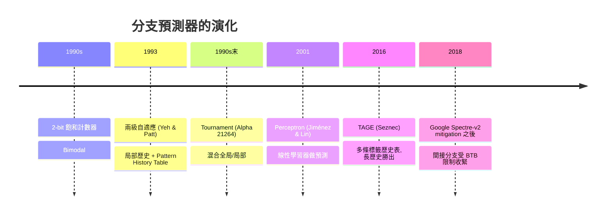
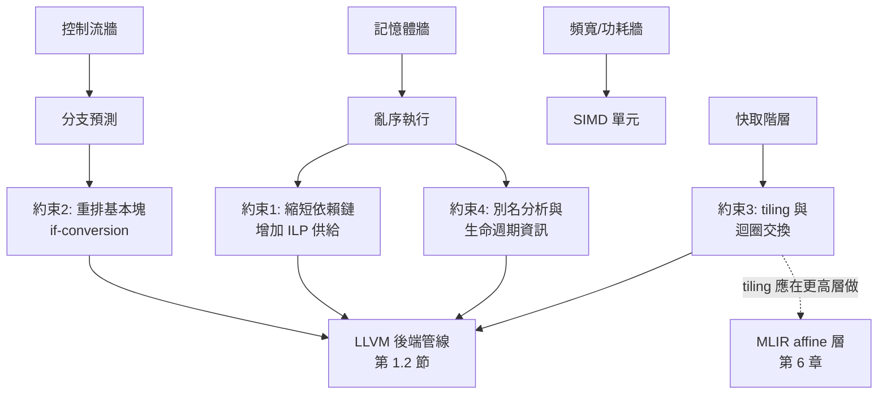

# 1.1 亂序執行、分支預測與快取階層：微架構對代碼生成的約束

要理解現代編譯器為什麼長成現在的樣子，必須先理解它的主要談判對象——CPU 微架構——是如何運作的。這一章的三個主角：亂序執行、分支預測、快取階層，共同決定了「什麼樣的機器碼在 CPU 上是快的」。

## 1.1.1 為什麼會有亂序執行：延遲的物理牆

馮紐曼機器模型假設指令是按順序執行的。但從 1990 年代中期（Pentium Pro、1995）開始，主流 CPU 便放棄了「按順序執行」的字面意義，轉而採用**亂序執行**（Out-of-Order Execution, OoO）。驅動這個轉變的只有一個物理事實：

> **記憶體的速度成長遠落後於處理器的速度成長。**

一個 ALU 運算約 1 cycle；L1 快取命中約 4 cycles；主記憶體存取則是 200–400 cycles。如果處理器傻傻地等資料，大多數時間都在發呆。亂序引擎的解法是：**把指令窗口拉大，誰的操作數準備好了就先執行誰**。

其學術前身可追溯到 IBM 的 **Tomasulo 演算法**（1967，IBM System/360 Model 91 浮點單元）：每條指令的結果用**保留站**（reservation station）追蹤，依賴它的指令透過**硬體重新命名**（register renaming）等待廣播，而不是傻等固定的實體暫存器空出來。

現代 CPU（如 Intel Alder Lake、AMD Zen 4、Apple M 系列）的亂序窗口規模：

| 參數 | 典型值 | 意義 |
|------|--------|------|
| Reorder Buffer (ROB) | 200–600+ 條 | 最多可同時「在飛行中」的指令數 |
| 實體暫存器 | 180–400 個 | 硬體重新命名的池子 |
| 分派寬度 | 4–8+ 條/cycle | 每拍最多解碼/分派幾條 |

### 對編譯器的約束 #1：靜態排程讓位，但依賴鏈長度沒有讓位

亂序引擎讓編譯器**不必**像 1980 年代的 VLIW 編譯器那樣精確地做指令排程——硬體會自己找平行度。但硬體只能平行化**指令間沒有真依賴（true dependency）的部分**。因此編譯器的重心轉移為：

* **縮短關鍵路徑**：把長依賴鏈拆開。例如累加求和改成多路部分和，把依賴鏈從 $n$ 次迭代長縮到 $n/4$ ；
* **增加指令級平行（ILP）的供給**：迴圈展開、函式內聯，讓 ROB 窗口裡有更多無關指令可挑；
* **減少記憶體依賴的模糊性**：別名資訊（alias analysis）越清楚，亂序引擎越敢提前 load。

一個經典例子：四路部分和。

```c
// 依賴鏈長 n：每次迭代都要等上一次的結果
for (int i = 0; i < n; i++) sum += a[i];

// 四路部分和：依賴鏈縮為 n/4，浮點加法可流水
double s0=0,s1=0,s2=0,s3=0;
for (int i = 0; i+3 < n; i += 4) {
    s0 += a[i]; s1 += a[i+1]; s2 += a[i+2]; s3 += a[i+3];
}
sum = s0+s1+s2+s3;
```

硬體無法替你做這個轉換——因為浮點加法不滿足結合律，重新結合會改變結果，這是**語意層的決策**，必須由編譯器（在獲得授權時，如 `-ffast-math`）或人類來做。這正是本書反覆出現的主題：**微架構給了硬體重新排序的自由，但語意等價的邊界必須由編譯器劃定。**

## 1.1.2 分支預測：投機執行的賭局

亂序執行解決了「等資料」的問題，分支預測解決「等方向」的問題。條件分支在**譯碼後、條件算出前**，取指單元必須決定下一條指令從哪裡取。現代分支預測器的準確率超過 95%，但每一次 miss 的代價是 15–20 cycles 的**流水線沖刷**（pipeline flush）。

預測器的演化史本身就是一條「用硬體資源換預測精度」的路：



TAGE（Tagged Geometric History Length）的核心思想是：**同時維護多個不同長度的歷史分支表，預測時取「最長且命中」的那條**——因為能利用更長歷史的預測器，理論上可表達的模式更多。

### 對編譯器的約束 #2：讓熱路徑變直

編譯器回應分支預測的傳統手段：

1. **基本塊重排（block reordering）**：依 profile 資訊把熱的 fallthrough 路徑排在一起，冷代碼搬到函式尾部，讓跳轉多為「不跳」；
2. **if-conversion**：小分支變成條件移動（`cmov`）或 select，避免分支衝刷——用多算幾條指令的確定成本，換掉 20 cycles 的期望懲罰；
3. **循環展開 + guard**：把迴圈邊界檢查移出主體，減少每迭代的預測負擔。

注意一個微妙的後果：**分支與投機執行是 Spectre 攻擊的溫床**（2018）。投機載入會把快取狀態「弄髒」，即使分支事後回滾，快取側信道已經洩漏資訊。這使編譯器多了一個新職責——在密碼學代碼中插入 `lfence` 一類的屏障，**約束硬體的投機自由**。編譯器與微架構的關係因此從「配合」演化為「有時要對抗」。

## 1.1.3 快取階層：空間與時間的兩種償還

快取階層的典型參數（以 2020 年代伺服器 CPU 為例）：

| 層級 | 延遲 | 容量 | 組織 |
|------|------|------|------|
| L1d/L1i | ~4 cycles | 32–64 KB/core | 8 路組相聯, 64B line |
| L2 | ~12 cycles | 0.5–2 MB/core | 私有 |
| L3 | ~40 cycles | 8–100+ MB | 共享, 分區式 |
| DRAM | 200–400 cycles | GB 級 | NUMA 分節點 |

快取的存在迫使編譯器思考兩個維度的局部性：

* **時間局部性**：剛用過的資料還在快取裡，盡快再用；
* **空間局部性**：用了 `a[i]`，`a[i+1]`（同條 64B line）幾乎是免費的。

### 對編譯器的約束 #3：迴圈嵌套的順序決定生死

矩陣乘法的最直觀寫法：

```c
for (i = 0; i < N; i++)
  for (j = 0; j < N; j++)
    for (k = 0; k < N; k++)
      C[i][j] += A[i][k] * B[k][j];   // B 以列為步長跳躍
```

以 C 語言的行主序（row-major）儲存，內層走 `k` 時 `B[k][j]` 每次跳過 $N$ 個 float——**空間局部性為零**。交換 `j` 與 `k` 後，內層沿記憶體連續前進。在 $N=1024$ 時，這一個純語法級的變換可以帶來 5–10 倍加速，**而產生的指令數完全相同**。

更系統化的解法是**分塊（tiling）**：把迴圈嵌套切成能整片裝進快取的方塊。對一個 $[N,N]$ 的三層嵌套，分塊把每次缺失從 $O(N)$ 次 DRAM 存取壓縮到一次載入可服務 $\sqrt{C}$ 次使用，缺失次數從 $O(N^3)$ 降到 $O(N^3/\sqrt{C})$ 。

這裡有一個重要的觀念埋伏，直通第二部：**tiling 的決策（塊要多大、按什麼形狀切）不應該在 LLVM IR 層做**——那時迴圈早已被打散成 goto 與位址運算，polyhedral 資訊支離破碎。這正是 MLIR 的 `affine` 方言要在迴圈還「長得像數學」的階段就動手的原因（第 5、6 章）。

### 對編譯器的約束 #4：預取與非暫存存取

* **軟體預取**（`prefetcht0`）：編譯器在存取模式可預測時插入預取指令，掩蓋 DRAM 延遲；
* **非暫存 store**（`movntdq`）：寫入大塊不會被重讀的資料時繞過快取，避免把有用的資料擠出去——這要求編譯器知道「這段資料的生命週期」，也就是**記憶體生命週期分析**（第 9 章的全域不變式之一）。

## 1.1.4 SIMD：向量化作為三大約束的交點

SIMD（Single Instruction, Multiple Data）單元是 CPU 對「資料平行」的正面回應：AVX2 有 256-bit 暫存器（8×float32），AVX-512 有 512-bit（16×float32），Arm NEON/SVE 則採用 128-bit 固定 / 可變長度。

向量化之所以是 CPU 後端最重要的最佳化，是因為它同時回應了三大約束：

1. **回應 ILP 約束**：一條 SIMD 指令 = 多條等效純量運算，直接降低 ROB 壓力；
2. **回應頻寬約束**：同一條 load 指令取回 512 bit，空間局部性被「打包」利用；
3. **回應功耗約束**：提升資料吞吐的同時不需要提升分支與取指的開銷。

但向量化有嚴格的前置條件，每一條都是編譯器必須**證明**的：

| 前置條件 | 編譯器要證明什麼 | 用什麼證明 |
|----------|----------------|-----------|
| 迴圈迭代獨立 | 任何兩次迭代間無依賴 | 別名分析 + 記憶體依賴分析 |
| 對齊 | 資料位址對齊到向量寬度 | 執行期檢查 + peeling |
| 歸約可重結合 | `sum += ...` 類依賴可拆 | 浮點語意授權（fast-math） |
| 迭代次數夠 | 展開後值得 | 迴圈上下界 + trip count 推導 |

SVE（Scalable Vector Extension, 2016 定稿）值得特別一提：它讓向量長度成為 `vscale` 參數，程式**不再假設具體位寬**。這對編譯器 IR 有直接衝擊——LLVM 為此引入了 scalable vector type（`<vscale x 16 x float>`），IR 首次必須表達「向量寬度未定」的語意。這是「硬體多樣性反向重塑 IR」的第一個小案例，預示了第二部的大型翻車現場。

## 1.1.5 小結：CPU 微架構留給編譯器的功課



CPU 的故事給我們的第一課是：**微架構的每一個自由度（亂序、投機、快取替換），都對應著編譯器的一項分析或變換義務。** 第二課則是：有些義務（如 tiling）在低階 IR 上做會失去太多上下文，必須前移——這個「前移」的張力，就是第四章要展開的主題。

---

**參考與延伸閱讀**

* Hennessy & Patterson, *Computer Architecture: A Quantitative Approach*, 6th ed., Ch. 3（ILP 與 OoO）
* Tomasulo, R. (1967). "An Efficient Algorithm for Exploiting Multiple Arithmetic Units." *IBM Journal of R&D*.
* Yeh & Patt (1991). "Two-Level Adaptive Training Branch Prediction."
* Seznec & Michaud (2006). "A Case for (Partially) TAgged GEometric History Length Branch Prediction." *JILP*.
* Kocher et al. (2019). "Spectre Attacks: Exploiting Speculative Execution."
