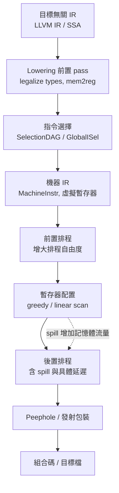

# 1.2 SSA、指令選擇、暫存器配置與指令排程：CPU 後端的四重奏

如果說 1.1 節講的是微架構「提出的要求」，本節講的是經典編譯器後端「交出的答卷」。這份答卷的核心是四個互相咬合的階段：**SSA 中間表示 → 指令選擇 → 暫存器配置 → 指令排程**。理解它們的分工與張力，是理解 MLIR 為什麼存在的前置知識——因為 MLIR 幾乎原封不動地繼承了 SSA 這個地基，然後在它上面加蓋了張量的樓層。

## 1.2.1 SSA：現代編譯器的公理系統

**靜態單賦值形式**（Static Single Assignment, SSA，Cytron et al., 1991）要求：每個變數**只被賦值一次**，每次使用都指向唯一的定義。若原程式中變數被多次賦值，就在控制流交匯處插入 **φ（phi）函數**來合併不同路徑上的值。

```llvm
; 兩條路徑合併 x 的值
bb0:
  %x0 = ...
bb1:
  %x1 = ...
bb2:
  %x = phi i32 [ %x0, %bb0 ], [ %x1, %bb1 ]
```

SSA 為什麼成為幾乎所有現代編譯器（LLVM、MLIR、V8、HotSpot）的地基？因為它把「值」與「儲存位置」解耦，使三件事變得**語法級可見**：

1. **定義-使用鏈（def-use chain）**：每個值的使用者直接掛在定義上，資料流分析從「對整個程式做不動點迭代」變成「沿著邊走」。死代碼消除（DCE）就是「沒有使用者的定義直接刪」；
2. **依賴關係顯式化**：兩條指令之間有沒有資料依賴，看 SSA 邊就知道。這是向量化、排程、融合的基礎；
3. **公用子表達式消除（CSE）自然發生**：相同的運算必然是同一個 SSA 值，不需要再證明兩個變數名代表同一計算。

一個關鍵的技術細節是 **支配關係（dominance）**：SSA 要求每個使用的定義**支配**（dominate）它——即從函式入口到該使用的每一條路徑都會經過定義。這條規則是第 9 章「全域不變式」的第一個例子：任何變換 pass 改動控制流時都不得破壞支配性，否則 IR 直接非法。MLIR 完整繼承了這條規則，並讓 verifier 在每個 pass 之後自動檢查。

### SSA 的記憶體例外

SSA 只管理「暫存器式的值」。堆疊上的記憶體（局部陣列、逃逸變數）以 `alloca` + `load`/`store` 表達，不進 SSA。編譯器用 **mem2reg** pass 把能提升的記憶體存取升級為 SSA 值；升不上去的（取位址、跨函式存取）則依賴**別名分析**（alias analysis）回答「兩個指標可能指向同一記憶體嗎」。這個「SSA 世界 vs 記憶體世界」的二分法會一路延伸到 MLIR 的 `memref` 方言，是張量編譯器裡 layout 與 buffer 決策的理論載體。

## 1.2.2 指令選擇：把 IR 動詞翻譯成機器動詞

指令選擇（instruction selection）把目標無關的 IR 操作映射為目標機器的指令。它本質上是一個**樹模式匹配 / 覆蓋**（tree pattern matching / tiling）問題：把 DAG 用目標指令集的模式拼起來，最小化成本。

例如 x86 上「`a*b+c`」不必是兩條指令，`vfmadd` 一條搞定；「`x % 256`」可以變成 `and`。經典演算法與實作：

| 演算法 | 思路 | 實際使用 |
|--------|------|---------|
| Burg / tree tiling | 動態規劃找最小成本覆蓋 | LLVM SelectionDAG 的前身 |
| SelectionDAG | 把基本塊轉成 DAG 再 tiling | LLVM 傳統路徑 |
| GlobalISel | IR 層直接降階、可組合 | LLVM 新路徑，漸進取代中 |

指令選擇的第一個原則性難點：**它是目標相關的第一站，而 IR 保持了目標無關**。因此設計 IR 時要「留多少目標資訊」是一道兩難——留太少，指令選擇補不回來；留太多，IR 失去可攜性。這個兩難在張量世界被放大一百倍（第 4 章）。

## 1.2.3 暫存器配置：圖著色與它的工程妥協

亂序引擎提供了上百個實體暫存器，但 ISA 只暴露 16–32 個架構暫存器（x86-64：16 個 GPR）。暫存器配置（register allocation）的任務是把無限的 SSA 虛擬暫存器映射到有限的實體暫存器，裝不下的就**溢出（spill）**到堆疊。

理論基礎是 **圖著色**：建一個「干涉圖」（interference graph），節點是活的區間，邊代表兩個值同時存活； $k$ 著色（ $k$ = 可用暫存器數）即為配置方案。Chaitin（1981）證明這是 NP-complete，於是採用啟發式：依「溢出成本 / 度數」排序、簡化（simplify）、選擇（select）、必要時 spill 再重來。

工程世界兩大流派：

* **線性掃描（linear scan，Poletto & Sarkar, 1999）**：把活性區間當直線段掃描分配，速度極快，品質稍差——JIT（V8、HotSpot client）與 LLVM 的 `-O0` 快速路徑用它；
* ** greedy coloring（LLVM 的 greedy RA）**：以 live range 權重貪心分配 + 局部分割（splitting），是 LLVM `-O2` 的主力。

與排程的**先後順序問題**值得記住：

> 先排程後配置：排程能拉開活性區間，減少同時存活的值，但可能拉長壽命導致 spill 增加；
> 先配置後排程：spill 程式碼確定後排程更真實，但配置時看不到排程機會。

主流做法（包括 LLVM）是「排程 → 配置 → 再排程」兩階段，並接受近似最優。這種**兩個子問題互相耦合、只能迭代近似**的結構，在 HLS 的「資源配置 vs 時間排程」中會再次出現（第 11 章），在那裡它更嚴峻——因為硬體資源（LUT/DSP）數量級更多、約束更硬。

## 1.2.4 指令排程：為流水線鋪路

即使有亂序硬體，編譯器仍要做靜態排程，原因有三：

1. **取指帶寬有限**：硬體一拍只能解碼 4–8 條，若窗口內連續撞上同埠指令（如連續 4 條除法），亂序引擎無能為力；
2. **延遲敏感的循環**：熱迴圈體需按各指令延遲（乘法 4 cycles、除法 20+ cycles）排開，確保關鍵路徑被流水線吸收；
3. **VLIW 與 in-order 核心**：嵌入式 in-order 核心（Cortex-M 系列）沒有亂序引擎，編譯器是唯一的排程者。

核心演算法是**清單排程（list scheduling）**：維護「依賴已滿足」的就緒集，每拍依優先級（關鍵路徑長度）選指令發射。排程模型是一張依賴 DAG，節點帶延遲，邊帶間距（latency/latency constraint）。

## 1.2.5 四重奏的協作圖與後端管線



LLVM 的實際管線正是此圖的工業化版本：`ISel` → `MachineScheduler` → `VirtRegMap` RA → `post-RA scheduler` → `prologue/epilogue` → `peephole` → emission。

## 1.2.6 一個貫穿性的觀察：位置決定資訊

把 1.1 與 1.2 連起來看，會得到本書第一個核心命題：

> **後端四重奏解決「純量 + 控制流」世界的一切問題，但它們的每一個階段都需要「高階語意」作為輸入，而管線越往下走，高階語意剩下的越少。**

* 指令選擇需要知道「這個整數其實是循環索引」才能選出 addressing mode；
* 向量化（發生在 IR 層）需要知道「迭代獨立」，這靠迴圈結構與別名資訊；
* tiling 需要「完整迴圈嵌套 + 仿射邊界」——但到了 Machine IR 層，這些早已解體。

LLVM 憑藉 SSA 的強大，把「純量世界」的降階做到了極致；但當輸入變成**形狀確定的多維張量**，這條管線在入口處就已經丟掉了太多東西。下一章先看 GPU 如何提出一套完全不同的約束，然後第四章再正式解剖「單一 IR 的瓶頸」。

---

**參考與延伸閱讀**

* Cytron et al. (1991). "Efficiently Computing Static Single Assignment Form and the Control Dependence Graph." *TOPLAS*.
* Chaitin (1982). "Register Allocation & Spilling via Graph Coloring." *PLDI*.
* Poletto & Sarkar (1999). "Linear Scan Register Allocation." *TOPLAS*.
* Lattner & Adve (2004). "LLVM: A Compilation Framework for Lifelong Program Analysis & Transformation."
* Cooper & Torczon, *Engineering a Compiler*, 3rd ed.
