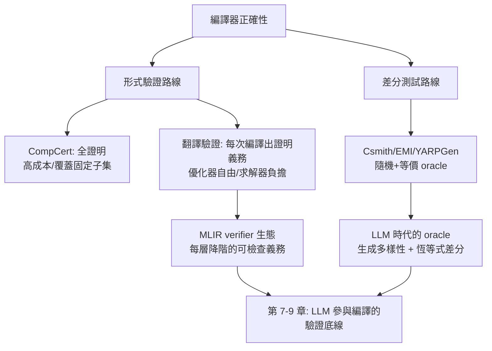

# 1.3 形式驗證與差分測試：編譯器正確性的守門人

編譯器是所有軟體的地基：一個有 bug 的編譯器，會把它的錯誤注入每一個用它編譯的程式。當編譯器管線越來越長（LLVM 有數百個 pass）、當輸入來源越來越多元（第 7 章起還要加上 LLM），「編譯器本身是正確的」這件事從工程細節升格為**信任鏈的根基**。本節介紹守護這條根基的兩大支柱：形式驗證與差分測試。

## 1.3.1 為什麼編譯器正確性特別難

三個結構性原因：

1. **等價的定義細膩**：轉換必須保持的是「可觀察行為」——終止與否、輸出、副作用順序——而不是表面的數值。浮點結合律、未定義行為（UB）的邊界，都是陷阱密集區；
2. **pass 組合爆炸**：管線中 pass 的順序與組合數是天文數字，單測每一個 pass 不等於組合正確；
3. **UB 的語意負擔**：C/C++ 把大量決策（有號溢出、越界、型別雙關）推給「未定義」，優化 pass 以 UB 為前提做推論，一個 pass 的推論錯誤可能要在幾十個 pass 之後才爆炸。

## 1.3.2 形式驗證：CompCert 的證明路線

**CompCert**（Leroy 團隊，INRIA，2005 年起）是形式驗證編譯器的里程碑：它的 C 語言核心子集編譯器，從 AST 到組合碼的全部主要 pass 都在 **Coq 證明助理**中實作，並機器檢驗了定理：

> 對所有輸入程式，若編譯成功，則編譯後的組合碼可觀察行為與源程式一致（或兩者都因 UB 而終止於任意行為）。

其架構是一連串語言層級的降階，每一層之間都有一個「語意保持定理」：

```mermaid
flowchart LR
    C[Clight] --> Cm[Cminor] --> Cmm[Cmm] --> Asm[AMD64/ARM/RISC-V 組合語意]
    C -. .-> T1[pass 1 正確性定理] .-> Cm
    Cm -. .-> T2[pass 2 正確性定理] .-> Cmm
    Cmm -. .-> T3[pass 3 正確性定理] .-> Asm
```

CompCert 揭示的關鍵工程事實：

* **驗證一個翻譯正確 = 定義兩種語意 + 證明模擬關係（simulation）**。低階語意必須能「模擬」高階語意的每一步；
* 成本極高：每個 pass 人月級投資，因此 CompCert 的優化強度低於 GCC/LLVM；
* **投報比驚人的是關鍵層**： Airbus 等安全關鍵領域直接採用，因為最後一公里（暫存器配置、指令排程）正是人寫編譯器 bug 最密集的區域。

**驗證式編譯的折衷方案——翻譯驗證（translation validation）**：不驗證編譯器，而是每次編譯時**驗證這一次的輸出**對應這一次的輸入。優化器可以隨便寫，但每次降階都附帶一個可檢查的證明義務（proof obligation），交給 SMT 求解器（如 Z3）檢查。這條路在現代張量編譯器中開始復活：MLIR 社群的各種 verifier 檢查（形狀一致性、支配性、記憶體效果標註）本質上就是輕量的翻譯驗證，而研究性系統（如 TV、StableHLO 的轉換驗證）正在把「每一層降階都帶證明」推向實務。

## 1.3.3 差分測試：用生成多樣性打擊優化器

形式驗證貴而慢，於是實務上最有效的武器是**編譯器差分測試**（differential testing）：隨機生成大量語法與語義多樣的程式，用同一份程式在**不同編譯器 / 不同優化等級 / 不同 pass 順序**下編譯執行，比對輸出。不一致即為 bug。

里程碑系統：

| 系統 | 年份 | 策略 | 戰果 |
|------|------|------|------|
| Csmith (Yang et al., PLDI 2011) | 2011 | 隨機生成「安全」C 程式，消除 UB | 找出 GCC/LLVM 數百個錯誤 |
| EMI (Le et al.) | 2014 | 等價變異（Equivalence Modulo Inputs）：在死路徑上做語義保持變異 | 探測優化器對死碼的錯誤依賴 |
| YARPGen (Livinskii et al., 2020) | 2020 | 結構化生成避免 UB + 代數恆等式差分 | LLVM 後端數百 bug |
| fuzzing 執行期 (O’Kelly et al.) | 2018 | 差分測深度學習執行期（TensorFlow 等） | 大量數值不正確案例 |

差分測試的**理論核心**是「**test oracle**」的構造：你不需要知道正確答案，只需要兩個**理論上必須一致**的觀測點：

* 同程式，`-O0` vs `-O3`；
* 同程式，GCC vs Clang；
* 同程式，變異後死碼被刪 vs 未被刪；
* 同計算，原始實作 vs 代數恆等式重寫（如 $a \cdot (b+c)$ vs $ab+ac$ ，在整數域恆等）。

這個模式有一個對全書後半極其重要的推論：**差分測試的 oracle 天然適配 LLM 時代**——因為 LLM 生成的代碼同樣「沒有已知正確答案」，而「多個理論上等價的實作 + 比對」正是機率性生成的唯一可靠驗證器（第 7.3 節會回來擴充這一點）。

### 差分測試的局限

* **浮點與非確定性**：多執行緒歸約、GPU 原子操作都有執行順序浮點誤差，需要容差比較，而容差會放走真 bug；
* **UB 邊界**：測試程式必須避開 UB，否則差異可能是「合法的」；
* **覆蓋偏斜**：隨機生成偏向簡單模式，深層最佳化 pass（如 polyhedral、向量化)的觸發率低，需要語法層面的刻意誘導（YARPGen 的核心貢獻）。

## 1.3.4 兩條支柱的互補結構



值得點出兩者的**哲學分工**：

* 形式驗證回答「**這條轉換規則**對所有輸入正確嗎？」——通用性，但規則寫死的成本高；
* 差分測試回答「**這一次轉換**在這些輸入上正確嗎？」——不可靠的抽樣，但可以無限擴展、可以攻擊任何黑箱。

當第三部的 LLM 進場時，這個分工變成了整個體系的骨架：**模型負責生成「可能的轉換」，形式化檢查（verifier、SMT、恆等式）負責證明或否證每一次轉換，差分測試負責兜住形式化覆蓋不到的縫隙，人類只對「證明鏈完整」的結果簽名。** 這不是新發明，而是 CompCert 與 Csmith 兩條路線在生成式時代的自然合流。

## 1.3.5 給張量編譯器的前瞻

把本節的三個工具放到張量世界預演一下，可以看到它們各自的「張量版」：

1. **語意錨點**：CompCert 的「可觀察行為」在張量世界對應「數值容差內的輸出張量 + 形狀 + dtype」——注意容差的存在讓「證明」退化为「誤差界證明」（forward-mode 誤差分析、rounding error theory）；
2. **verifier 義務**：MLIR 每次降階後檢查形狀/布局/支配性，等價於輕量翻譯驗證；
3. **生成式差分**：用 LLM 生成「語法多樣但語義等價的 kernel 變體」做差分，是 8.2 節「錯誤搜尋」的直接原型。

---

**參考與延伸閱讀**

* Leroy (2009). "Formal Verification of a Realistic Compiler." *CACM*.
* Yang et al. (2011). "Finding and Understanding Bugs in C Compilers." *PLDI*（Csmith）.
* Le et al. (2014). "Finding Bugs in Compilers via Pattern Mining and Equivalence Modulo Inputs."
* Livinskii et al. (2020). "Random Testing of C/C++ Compilers with YARPGen."
* Necula (2000). "Translation Validation for an Optimizing Compiler." *PLDI*.
