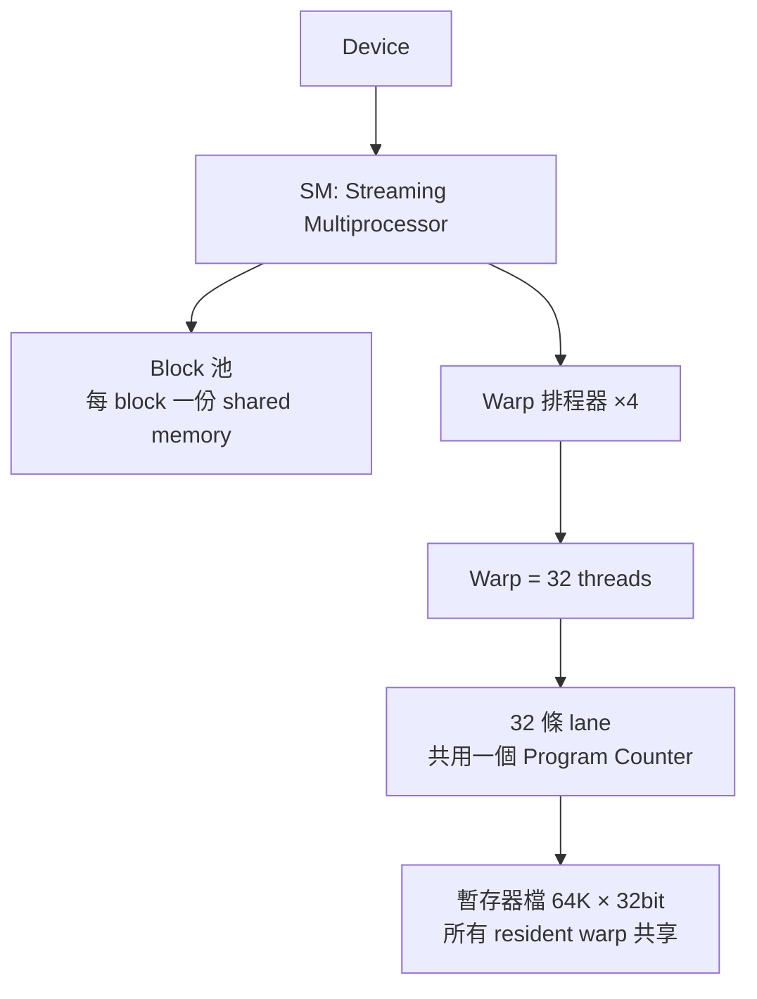
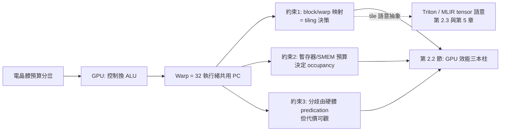

# 2.1 SIMT 與 Warp 排程：一萬個執行緒共用一條指令

GPU 的崛起把「平行」從編譯器的選配變成必配。但 GPU 的執行模型與 CPU 有本質差異：它**放棄了複雜的每執行緒亂序邏輯**，改用極大量的執行緒來遮蔽延遲。理解這個取捨，是理解一切 GPU 編譯問題（分歧、合併、occupancy）的鑰匙。

## 2.1.1 CPU 與 GPU 的延遲對策分岔

1.1 節看到 CPU 用亂序執行 + 大快取來「避免等待」。GPU 選了另一條路：

> **不減少等待，而是用別的執行緒填補等待。**

| 維度 | CPU | GPU |
|------|-----|-----|
| 延遲對策 | 快取 + 亂序 + 預測 | 萬級執行緒切換遮蔽 |
| 控制邏輯占比 | 大（ROB、預測器） | 極小（省下做 ALU） |
| 執行緒切換成本 | 微秒級（OS）| 零（硬體一拍切 warp） |
| 每執行緒資源 | 獨享暫存器/快取 | 極少（甚至靠合併省頻寬） |

這個分岔的物理根源是**電晶體預算**：同樣數量的電晶體，CPU 花在控制電路與快取上，GPU 花在 ALU 上。GPU 的 ALU 占比可以超過 60%，CPU 往往不到 10%。

## 2.1.2 SIMT 的執行階層

以 NVIDIA（Fermi 之後的架構，一直到 Hopper/Blackwell）為例，硬體階層是：



關鍵事實：

* **Warp 是排程與執行的原子單位**：32 個執行緒**共用一個 PC**，硬體取一條指令，32 條 lane 同時執行。這就是 SIMT（Single Instruction, Multiple Threads）；
* **暫存器檔是硬分割**：每個 SM 的暫存器檔（約 256KB）被 resident warps 均分。一個 thread 用 64 個暫存器，能常駐的 thread 數就 = 256KB / (64×4B) = 1024 = 32 warps；
* **switch 是零成本的**：當 warp A 停在記憶體等待，排程器當拍切到 warp B，沒有 context save/restore——因為每個 warp 的狀態一直駐留在暫存器檔裡。

AMD 用同一思想的變體：**wavefront**（CDNA 上為 64 threads），架構命名為 GCN/RDNA，指令集為 GCN/RDNA ISA，編譯器後端在 LLVM 的 `AMDGPU` target。

## 2.1.3 對編譯器的第一重約束：程式的「形狀」要映射到硬體階層

CUDA 程式必須把資料維度映射為執行組態（execution configuration）：`<<<gridDim, blockDim>>>`。這個映射不是自由參數，而是**效能的第一決策**：

* block 內 thread 數必須是 warp 大小的倍數（32），且能被 shared memory 的使用量約束；
* block 的形狀影響記憶體合併（2.2 節）與資料重用；
* grid × block 決定總平行度，必須遠大於 SM 數 × 每 SM warp 容量，才能填滿延遲遮蔽的需求。

一個矩陣乘法的典型映射：

```cuda
// 每個 block 算一個 TILE×TILE 的 C 子塊
dim3 block(TILE, TILE);
dim3 grid((N + TILE - 1) / TILE, (N + TILE - 1) / TILE);
matmul_kernel<<<grid, block>>>(A, B, C, N);
```

編譯器在這裡的角色起初是「忠實翻譯」：把 kernel 編成 PTX/SASS。但深層的問題很快浮現——**這些映射決策（TILE 多大、block 怎麼切）本質上是 tiling 問題，與 1.1.3 節 CPU 的 tiling 是同一個數學問題**。讓每個 kernel 作者手工決定，等於把編譯器的核心工作外包給人類。這個張力最終催生了 Triton（2.3 節）與 MLIR 的 `gpu` 方言（第 5、6 章）。

## 2.1.4 Warp 狀態機：為什麼「常駐 warp 數」是一切預算的總閘門

把 SM 的執行想成一個狀態機，每拍排程器從「就緒 warp」中挑一個發射指令。warp 會處於：

* **Active**：有指令可發；
* **Stalled**：等操作數（記憶體延遲、依賴）、等同步、或等 shared memory 週期。

延遲遮蔽的條件可以用簡單的算式表達。設記憶體指令占指令流的比率為 $m$ ，L2/DRAM 延遲為 $L$ cycles，每 warp 每拍最多發 1 條指令，則要「不空轉」近似需要：

$$N_{\text{warps}} \gtrsim L \times m$$

代入 $L = 400$ （DRAM）、 $m = 0.25$ ，得到 $N_{\text{warps}} \gtrsim 100$ ——即每個 SM 需要約 100 個常駐 warp 才能純靠延遲遮蔽填滿 DRAM 延遲。而每 SM 的 warp 容量上限（64）與暫存器壓力常常讓這個數不可達，於是效能工程退化為**在三個限制之間找平衡**（下一節展開）。

這個簡單模型的最大價值是給編譯器一個明確的**目標函數直覺**：GPU kernel 的編譯目標不是「指令最少」，而是「**每常駐執行緒的資源占用最低 + 記憶體流量模式最規整**」。暫存器配置（1.2 節的 RA）在 GPU 上多配 8 個暫存器，可能直接把 occupancy 砍半——**GPU 的 RA 是效能決策，不只是正確性決策**。LLVM 的 NVPTX 後端因此提供 `maxnreg` 一類的約束機制，讓上層策略介入 RA 的預算。

## 2.1.5 SIMT 與 SIMD 的語意差異

一個常見的誤解是「SIMT 就是寬 SIMD」。差異在**控制流**：

* **SIMD（CPU 向量）**：一條指令明確操作一個向量暫存器，分支要在 IR 層轉成 select/mask；
* **SIMT（GPU）**：程式用**純量的執行緒語意**寫，硬體隱式地把 32 份執行緒打包成一條指令。分支是自然的 `if`——硬體用 **predication / 分歧棧**處理同 warp 內的不一致（2.2 節）。

這個差異對編譯器設計有深遠影響：**SIMT 讓「向量化的證明義務」從編譯器移到了硬體**。CPU 上向量化必須證明迭代獨立與對齊；GPU 上「向量化」根本不存在——每個 thread 就是一份純量程式，硬體自動打包。代價是**靈活性換約束**：執行緒間的任何控制流不一致都要付出分歧代價，而編譯器若不了解硬體打包單位（warp），就無法預判效能。

Triton 語言正是這個洞察的產物：**程式設計師以「一個 block 的資料」為單位寫程式（塊級語意，tile-level semantics），而不是「一個執行緒做什麼」**——把 thread 級映射徹底交給編譯器。這條從「thread 語意」到「tile 語意」的抽象階梯，是 2.3 節的主線。

## 2.1.6 小結



---

**參考與延伸閱讀**

* NVIDIA CUDA C++ Programming Guide（Execution Model 章節）.
* Lindholm et al. (2008). "NVIDIA Tesla: A Unified Graphics and Computing Architecture." *IEEE Micro*.
* AMD CDNA/RDNA ISA Reference Guides.
* Tillet et al. (2019). "Triton: An Intermediate Language and Compiler for Tiled Neural Network Computations." *MAPL*.
