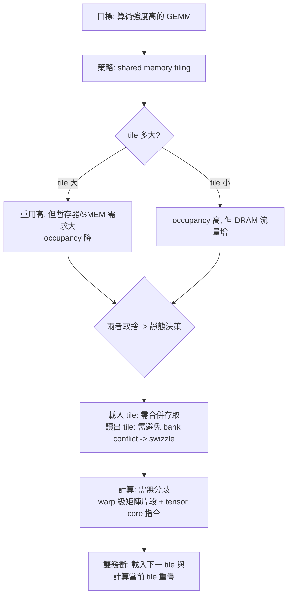

# 2.2 分歧控制流、記憶體合併與 Occupancy：GPU 效能三本柱

如果說 2.1 節給了 GPU 的「執行模型」，本節給的是它的「效能模型」。三本柱——分歧（divergence）、合併（coalescing）、occupancy——對應 SIMT 模型的三個內建摩擦點：控制流不一致、記憶體位址不規整、資源預算擠壓。GPU kernel 寫手 90% 的效能工作在這三件事上，而**現代編譯器的使命，正是把這三件事從手工技藝變成可分析的決策**。

## 2.2.1 本柱一：分歧控制流

### 什麼是分歧

同 warp 的 32 個執行緒共用一個 PC。若執行到一個條件分支，warp 內部分裂成兩種意見，硬體只能序列化：

```cuda
if (tid % 2 == 0) {        // warp 內一半成立、一半不成立
    result += expensive(); // 兩次執行: 成立的 16 個先跑, 不成立的被遮蔽
} else {
    result -= cheap();
}
```

實際執行是：16 條 lane 走 then 分支（另外 16 條被 predication 遮蔽），再切換，16 條走 else 分支。**本可並行的兩條路徑變成了串行兩趟**，最壞情況分支開銷變成路徑數的線性疊加。

硬體的實作機制（以 NVIDIA SASS 為例）：

* **Predication**：每條指令帶一個 1-bit 謂詞（如 `@P1`），謂詞為假的 lane 空轉但指令照發——適合短分歧；
* **Branch stacking（分歧棧 / reconvergence stack）**：長分歧時硬體壓入返回位址，warp 分頭執行，在交匯點（reconvergence point）合流。Volta 之後採用 **Independent Thread Scheduling (ITS)**，允許 warp 內執行緒更自由地分岔與再合流，代價是程式可移植性陷阱（依賴舊「鎖步執行」假設的程式會壞）。

### 編譯器的應對

1. **if-conversion（謂詞化）**：把小分支轉成 select/arithmetic。編譯器需要成本模型判斷「遮蔽執行的成本」vs「分支發射的成本」；
2. **分歧感知的資料重組**：經典例子是 reduction。朴素的樹狀歸約因 stride 遞增導致嚴重分歧；優秀版本用 warp shuffle 原語完全避免分歧：

```cuda
for (int offset = 16; offset > 0; offset /= 2)
    value += __shfl_down_sync(0xffffffff, value, offset);
```

`__shfl_down_sync` 在 lane 之間直接交換暫存器值，不經過記憶體、不產生分歧。這類「硬體特化原語」的存在，使得**手寫 CUDA kernel 與樸素生成代碼的差距可達 10 倍以上**——這是 8.3 節 LLM kernel 生成面對的基準線。

3. **結構化改寫**：把「每執行緒一個 if」改寫成「先算 mask，再統一處理」，讓分歧在 warp 邊界外消解。

分歧問題有一個重要的抽象層次的觀察：**分歧是「執行緒語意」的副產品**。若語言的抽象單位是 tile（如 Triton），分歧在語意層根本不會出現——mask 是顯式的一等公民。這再次指向 2.1.5 節的抽象階梯。

## 2.2.2 本柱二：記憶體合併存取（Coalescing）

### 機制

GPU 的全域記憶體以 **32B/64B/128B 事務**為單位存取 DRAM。當一個 warp 發出一條 load 時，硬體檢查 32 條 lane 的位址：

* **連續**：落在同一（或少數幾個）128B 區段內 → 合併成 1–4 次事務，頻寬滿載；
* **發散**：32 個位址散在 32 個區段 → 32 次獨立事務，**有效頻寬掉到 1/32**。

合併的數學條件極其簡單——對 `float`（4B），要求第 $i$ 條 lane 的位址滿足：

$$\text{addr}_i = \text{base} + 4i$$

即「thread id 線性映射到連續位址」。但**破壞這個條件的方式無窮多**：

* 以 `tid` 為列索引存取行主序矩陣的行（跨步 4×N）；
* 結構體陣列（Array of Structs）取代資料陣列（Struct of Arrays）；
* shared memory 的 **bank conflict**（32 個 bank、4B 寬，同 bank 的多路存取序列化）。

### 編譯器的應對

合併是**資料布局決策**，而布局是編譯器在張量層就能看到的資訊：

* **layout 變換**：NCHW→NHWC、AoS→SoA 的自動重寫，在張量 IR（`linalg` 的 layout 屬性、`memref` 的 stride 資訊）上可全域推理；
* **shared memory tiling**：把全域記憶體的一個 tile 以合併方式載入，再從 shared memory 以避免 bank conflict 的方式讀出——這正是 GEMM kernel 的核心骨架；
* **swizzle**：對 tile 內索引做 XOR 攪拌（例如 `idx ^= (tid & 7)`）使 bank 存取均勻。手寫 kernel 的黑魔法之一，現代編譯器（Triton 的 layout pass）已可自動生成。

### 一個關鍵的觀念躍遷

在 CPU 世界（1.1.3 節），「局部性」是**優化目標**；在 GPU 世界，它升格為**正確使用硬體的前提條件**——不規整的存取不是「慢一點」，是數量級的崩潰。這解釋了為什麼張量編譯器把 **layout（布局）提升為 IR 的一等公民**：第 4 章會看到，LLVM IR 只有一維位址運算，布局資訊在降階時就蒸發了；MLIR 的 `memref` 帶 stride/offset、`linalg` 帶 indexing map，就是為了讓「這個存取是否合併」在編譯期可推理。

## 2.2.3 本柱三：Occupancy

### 定義與預算

Occupancy 定義為：

$$\text{occupancy} = \frac{\text{常駐 warps 數}}{\text{每 SM 最大常駐 warps 數}}$$

分子受三個資源約束（取最小者）：

1. **暫存器**：每 thread 用 $r$ 個 → 每 SM 常駐 thread $\le \lfloor R_{\text{total}} / r \rfloor$ ；
2. **Shared memory**：每 block 用 $s$ bytes → 每 SM block 數 $\le \lfloor S_{\text{total}} / s \rfloor$ ；
3. **Block/執行緒槽位**：硬體上限（如每 SM 32 blocks、2048 threads）。

例：暫存器檔 65536 個 32-bit 暫存器/SM，kernel 每執行緒用 96 個 → 每執行緒 384B → 每 SM 最多 $\lfloor 65536/96 \rfloor = 682$ 執行緒 ≈ 21 warp，occupancy $21/64 \approx 33\%$ 。

### 但高 occupancy 不等於高效能

occupancy 的目的是**供給延遲遮蔽**（2.1.4 節的 $N_{\text{warps}} \gtrsim L \times m$ ）。若 kernel 的記憶體延遲已被 tile 的 shared memory 重用消解（算術強度高），低 occupancy 反而更好——因為**更多常駐 warp 會搶佔 L1/shared memory，傷害資料重用**。NVIDIA 甚至提供 `__launch_bounds__` 與 `maxrregcount` 主動壓低常駐量。

這給出一個反直覺但重要的結論：

> **GPU 的資源預算是「tension」而不是「越多越好」：暫存器多 → tile 大、重用好、occupancy 低；暫存器少 → occupancy 高、但重用變差。最優點隨 kernel 的算術強度移動。**

把這個 trade-off 畫出來就是著名的 **Roofline 模型**（Williams et al., 2009）在 GPU 上的應用：以**算術強度** $I = \frac{\text{FLOPs}}{\text{Bytes}}$ 為橫軸，可達效能為：

$$P = \min \left( P_{\text{peak}},\; I \times BW_{\text{peak}} \right)$$

GEMM（ $I \approx \frac{2MNK}{4(MN+2NK+MK)}$ ，在大矩陣下可達數百）處於計算受限區，此時該榨計算單元（tensor core、雙緩衝）；elementwise op（ $I \approx 0.25$ ，幾乎總是記憶體受限）處於頻寬受限區，此時 occupancy 與合併就是一切。**編譯器必須先判斷 kernel 在 Roofline 上的位置，才能選對優化策略**——這個「以 Roofline 位置選策略」的邏輯，正是 8.3 節 LLM kernel 迭代生成時的效能回饋訊號。

## 2.2.4 三本柱的耦合：一個 GEMM 的完整故事



這張圖就是 2.3 節的伏筆：**這整個決策鏈（tile 大小、swizzle、warp 映射、雙緩衝）在 2010 年代是資深 CUDA 工程師的手工藝；2019 年之後，Triton 與 MLIR 把它變成了編譯器的決策空間。** 語言抽象每上一層，決策就從「人類經驗」轉為「可搜尋的參數空間」。

## 2.2.5 效能回饋：把三本柱變成可測量

NVIDIA Nsight Compute 等工具把三本柱變成量化指標，構成 profile-guided 迴圈的輸入：

| 指標 | 測量什麼 | 病灶 |
|------|---------|------|
| Achieved Occupancy | 實際常駐率 | 暫存器/SMEM 預算超標 |
| Memory Throughput % | 頻寬利用率 | 合併失敗、tile 過小 |
| Warp Execution Efficiency | 有效 lane 比率 | 分歧 |
| L2/DRAM hit rate | 重用品質 | tile 策略不當 |
| Issue Slot Utilization | 發射口利用 | 依賴鏈長、指令混合差 |

**回饋驅動的 kernel 開發迴圈**——寫 → profile → 定位三本柱短板 → 改 → 再 profile——是 GPU 工程的日常工作。第 6 章會看到 auto-tuning 把「人類在迴圈裡的位置」換成搜尋器，第 8 章再換成 LLM。

---

**參考與延伸閱讀**

* Williams, Waterman, Patterson (2009). "Roofline: An Insightful Visual Performance Model for Multicore Architectures." *CACM*.
* Harris (2013). "Optimizing Parallel Reduction in CUDA." NVIDIA SDK webinar.
* Micikevicius (2009). "3D Finite Difference Computation on GPUs using CUDA."（warp shuffle 之源）
* NVIDIA Nsight Compute Documentation（Kernel Profiling Guide）.
* Coon et al., NVIDIA patents on warp scheduling & ITS（Volta 架構白皮書）.
