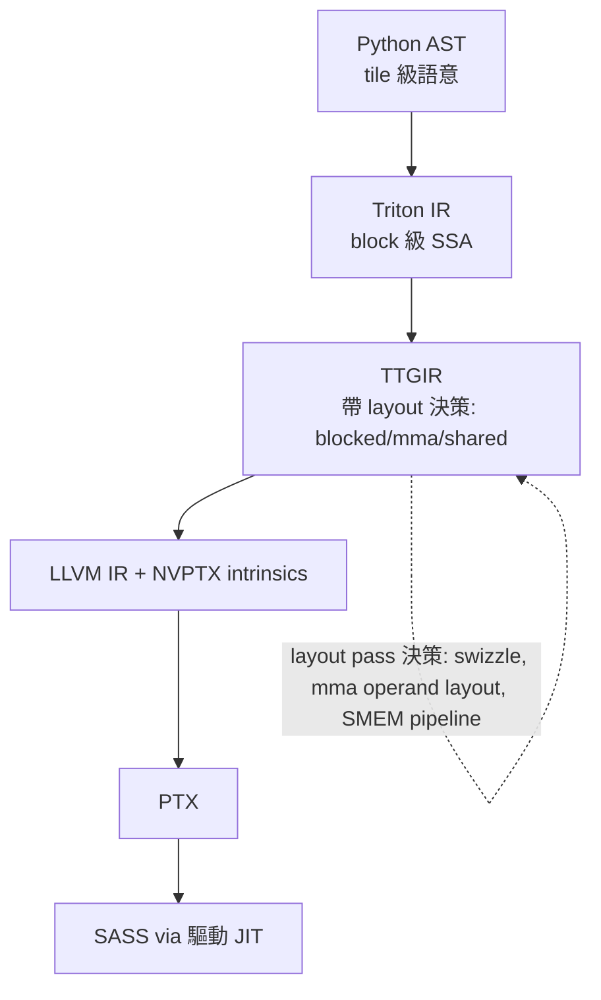
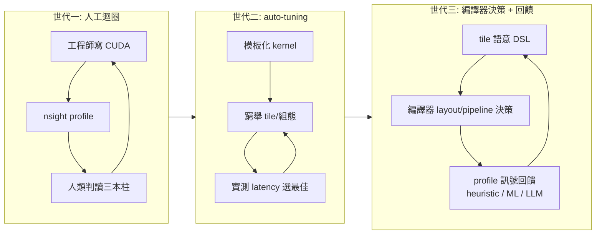

# 2.3 從 CUDA/PTX 到 Triton：Kernel 生成與效能回饋迴圈

前三節建立了 GPU 的執行與效能模型。本節沿著**抽象階梯**回顧 kernel 開發範式的演化：CUDA C++（thread 語意）→ PTX（虛擬 ISA）→ SASS（真實 ISA）→ Triton（tile 語意）。每一級抽象的出現，都是對上一級「人類手工決策過多」的回應；而階梯的頂端，就是 8.3 節 LLM kernel 生成所站的位置。

## 2.3.1 階梯的底層：PTX 與 SASS

### PTX：虛擬 ISA 的作用

PTX（Parallel Thread Execution）是 NVIDIA 的虛擬組合語言。它的存在解決一個商業與工程雙重問題：**編譯器（nvcc，基於 LLVM 的 cicc）產出 PTX，驅動程式在安裝時再 JIT 成目標代次的 SASS**。這樣：

* 同一份 PTX 可以跑在新舊 GPU 上（向前相容）；
* NVIDIA 保留 SASS 指令集的演化自由；
* 編譯器只需要面對穩定的虛擬 ISA，而不必追逐每代硬體。

PTX 的形態與 LLVM IR 驚人地相似——它就是 SSA 形式的虛擬暫存器語言：

```cuda
// CUDA
float c = a * b + s;
```

```
// PTX
mul.f32  %f1, %f2, %f3;
add.f32  %f4, %f1, %f5;
```

這相似不是巧合：SSA 已被證明是「可被所有下游消費者利用」的最小語意載體（1.2 節）。**PTX 之於 NVIDIA，等於 LLVM IR 之於整個編譯器生態**。

### SASS：真實指令集

SASS（Shader Assembly）是每代 GPU 的真實機器碼。PTX→SASS 的 JIT 會做指令排程、暫存器配置、以及**代次特化**（例如把通用乘加映射到該代的 tensor core 指令）。LLVM 的 NVPTX 後端產出 PTX 後即止，JIT 是 NVIDIA 驅動的黑箱——**這是「編譯器止步於虛擬 ISA」的典型分層**，也意味著上層編譯器無法直接控制 SASS 級的決策（排程、合并的位址模式），只能透過 PTX 的表達力間接引導。

### Warp 級矩陣原語的出現

Volta（2017）引入 tensor core 與 `mma`（Matrix Multiply-Accumulate）指令後，出現了新的分層問題：`mma.sync` 指令操作的單位是 **warp 級**的（32 執行緒合作完成一個 $8\times 8\times 4$ 或更大的 $m16n8k16$ 片段），每條 lane 只持有片段的一部分，資料在 lane 間的分布由一張複雜的 layout 規定。CUDA 於是提供了 **WMMA API**（`nvcuda::wmma`）與後來的 **PTX `mma` / `wgmma`（Hopper, warp-group MMA）**，讓人類不必手寫片段布局。這是第一個訊號：**矩陣運算的資料布局已成為指令集語意的一部分，thread 語意開始不夠用了。**

## 2.3.2 手工 GEMM 的工藝巔峰

以 CUTLASS（NVIDIA 的 GEMM 模板庫）為代表的「手寫 kernel 世代」，把 2.2.4 節的決策鏈全部手工化：

* **tile 樹**：CtaTile → WarpTile → InstructionTile，每一級的尺寸是模板參數；
* **雙/多緩衝**：shared memory 與暫存器兩級 pipeline，`cp.async`（Ampere）把載入與計算的重疊變成非同步指令；
* **swizzle 與 layout**：每個 tile 的 bank 衝突以手寫索引變換消解；
* **auto-tuning**：對每個 GPU 代次、每個形狀 bucket，窮舉 tile 參數選最佳。

CUTLASS 的成就與代價並存：成就了 cuBLAS 級的效能（接近理論峰值 90%+），代價是**數萬行模板代碼、每一代硬體要重寫一遍、每個新算子要重新發明一遍**。當神經網路的算子種類爆炸（attention 變體、量化 kernel、混合專家），「手工工藝」的產能成為瓶頸。這是催生 Triton 的直接動力。

## 2.3.3 Triton：把 thread 語意換成 tile 語意

**Triton**（Tillet et al., OpenAI, MAPL 2019）的核心主張可以用一句話概括：

> **讓程式設計師寫「一個 block 的資料如何被計算」，把「block 如何切給 warp、lane、暫存器與 shared memory」全部交給編譯器。**

對比非常直觀：

```cuda
// CUDA: 手工管理執行緒與共享記憶體
__global__ void add_kernel(float* x, float* y, int n) {
    int i = blockIdx.x * blockDim.x + threadIdx.x;
    if (i < n) y[i] = x[i] + y[i];
}
// 調用: add_kernel<<<ceil(n/256), 256>>>(x, y, n);
```

```python
# Triton: block 級語意, 無 thread 概念
@triton.jit
def add_kernel(x_ptr, y_ptr, n, BLOCK: tl.constexpr):
    pid = tl.program_id(0)
    offs = pid * BLOCK + tl.arange(0, BLOCK)   # 一個 tile 的索引向量
    mask = offs < n
    x = tl.load(x_ptr + offs, mask=mask)       # tile 級 load
    tl.store(y_ptr + offs, x + 1.0, mask=mask)
```

沒有 `threadIdx`、沒有 shared memory 宣告、沒有 occupancy 概念。Triton 編譯器的職責鏈：



關鍵環節是 **layout pass**：編譯器決定每個 tile 值「分布在哪些 lane 的哪些暫存器」，在 blocked layout（均匀切片）、mma layout（符合 tensor core 片段語意）、shared layout（swizzle 過的 SMEM）之間轉換，並在必要處插入 layout conversion（經由 shared memory 的資料重排）。這些正是 CUTLASS 工程師手工做的事情——**Triton 證明了它們可以被系統化為編譯器決策**，而且 auto-tune 對 BLOCK 參數的搜尋（`@triton.autotune`）取代了 CUTLASS 的窮舉模板實例化。

Triton 的歷史意義在 2021–2023 年間爆發：**PyTorch 2.0 的 `torch.compile` 選擇 Triton 作為 GPU 代碼生成後端**，使「任何 PyTorch 模型自動生成 GPU kernel」成為預設路徑。OpenAI Triton 也成為 8.3 節 LLM kernel 生成的主流目標語言——因為它**短、無執行緒陷阱、語意高階到模型見過大量樣本**。

## 2.3.4 效能回饋迴圈：從人的直覺到編譯器/搜尋器

綜合 2.2 節的指標與本節的抽象，kernel 開發的迴圈有三個世代：



**Auto-tuning 的本質**是把「決策空間」與「決策者」分離：決策空間（BLOCK 大小、num_warps、num_stages）由 DSL 定義，決策者可以是窮舉（Triton autotune）、貝氏優化（OpenTuner、KernelBench 類系統）、甚至 LLM（第 8 章）。效能訊號（wall time、achieved occupancy、頻寬利用率）成為整個體系的**適應度函數**。

**這裡存在一條貫穿全書的迴路**：LLM 生成 kernel（世代三的終極形態）之所以可能，正是因為：

1. **目標語言高階**（Triton）——生成空間小、陷阱少；
2. **驗證自動化**——與 PyTorch 參考實作差分（正確性）+ 實測 latency（效能）；
3. **回饋明確**——Roofline 位置與三本柱指標直接告訴模型下一版該朝哪裡改。

## 2.3.5 編譯器的位置：NVPTX 與 MLIR 的 gpu 方言

工業上，這條階梯沉澱為兩條編譯器基礎設施：

* **LLVM NVPTX / AMDGPU 後端**：面向 thread 語意的最後一公里，管線收斂到 PTX/GCN ISA；
* **MLIR 的 `gpu` / `nvvm` / `rocdl` 方言**：把「啟動、維度、shared memory、barrier」表達為可變換的操作，讓上層（IREE、Torch-MLIR、Triton 的 MLIR 重構版）在 lowering 到 PTX 之前還有**一層可操作 GPU 資源的 IR**。

第 5–6 章將正式拆解這些方言，以及「為什麼張量編譯器需要比 PTX 高三層的 IR」。現在只需記住本節的結論：

> **GPU 編譯器技術史 = 一部「把 2.2 節的三本柱手工藝逐級上收為編譯器決策」的歷史；每一次上收，都伴隨一次語言抽象單位的替換（thread → block → tile），與一次決策者替換（工程師 → 搜尋器 → 生成模型）。**

---

**參考與延伸閱讀**

* Tillet, Kung, Cox (2019). "Triton: An Intermediate Language and Compiler for Tiled Neural Network Computations." *MAPL*.
* NVIDIA PTX ISA Documentation.
* CUTLASS: NVIDIA GitHub（CUTE tensor 抽象與 GEMM 分層文檔）.
* PyTorch 2.0 論文 (2023)："torch.compile" 與 Inductor/Triton 後端.
* Zheng et al. (2020). "Ansor: Generating High-Performance Tensor Programs for Deep Learning." *OSDI*（auto-tuning 決策空間分離的系統化版本）.
