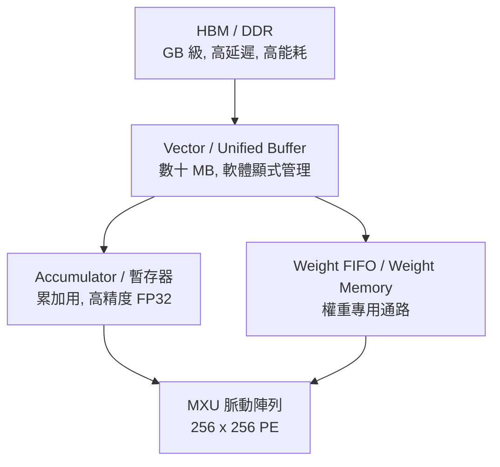
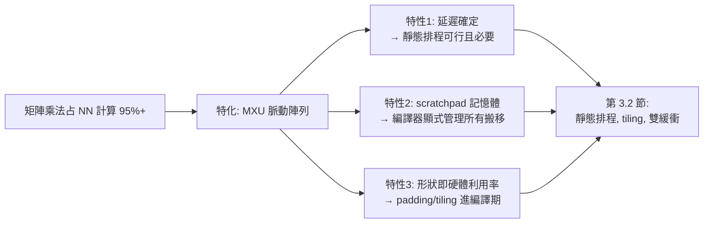

# 3.1 脈動陣列與 MXU：為矩陣乘法而生的矽

CPU 用靈活換效能，GPU 用執行緒量換效能，而 TPU/NPU 選擇了第三條路：**把演算法的形狀直接鑄進電路的形狀**。本節解剖這條路的核心機制——脈動陣列（Systolic Array）——以及它如何重新定義「編譯器的工作」。

## 3.1.1 脈動陣列：1978 年的論文，2016 年的復活

脈動陣列由 **Kung（孔祥重）與 Leiserson** 於 1978 年提出（CMU，用於 systolic filtering）。「脈動」之名取自心臟的血液泵送：**資料像心跳一樣以固定節奏在處理單元（PE）之間脈動式流動**，每個 PE 只做一件事——取鄰居的資料、算一步乘加、把結果傳給下一個鄰居。

特點：

* **沒有取指**：資料自己流過計算單元，省掉指令譯碼與位址生成的能耗；
* **局部互連**：PE 只與上下左右相鄰，連線短 → 時鐘可以開得高、能耗低；
* **規則性**：同一個 PE 電路重複數百次 → 面積效率與設計簡單性。

這個 1978 年的架構在 2016 年迎來歷史性復活：**Google TPU v1**（Jouppi et al., ISCA 2017）以一個 $256 \times 256$ 的 INT8 脈動陣列（MXU, Matrix eXtension Unit）達到 92 TOPS，比同期 CPU/GPU 的每瓦 TOPS 高出一到兩個數量級。TPU v1 論文的取捨陳述值得背下來：**NN 推理 95% 的計算是矩陣乘法，那麼就做一個只做矩陣乘法的處理器。**

### 為什麼矩陣乘法「適合」脈動

考慮 $C_{M\times N} = A_{M\times K} \times B_{K\times N}$ 。在經典的**加權加法器式**（weight-stationary 的一種）脈動設計中：

* $B$ 的元素**預先載入**（權重駐留，weight-stationary）；
* $A$ 的每一列從陣列左側**以每拍一元素的水平脈動**流入；
* 每個 PE $(i,j)$ 計算 $c_{ij} \mathrel{+}= a_i \cdot b_j$ ，部分和 $c$ **垂直向下脈動**累積；
* $M+N-1$ 拍後，整個 $C$ 計算完成並從底部流出。

關鍵性質是**重用**：PE $(i,j)$ 使用的 $a_i$ 會繼續向右傳給 $(i, j{+}1)$ ， $b_j$ 向下傳給 $(i{+}1, j)$ 。每個從 DRAM/HBM 取回的數字被用 $O(N)$ 次，而**只移動了一格**。用能量語言說：一次片外存取的能量（數百 pJ/byte）是一次 PE 間傳遞（數 pJ）的百倍以上——**脈動陣列把「資料移動的能量」最小化，這才是它高效率的真正來源。**

## 3.1.2 MXU 與專用張量指令的計算特性

TPU v2 之後轉向訓練，MXU 保持脈動結構但支援 BF16/FP32；NVIDIA 從 Volta（2017）起用 tensor core（`mma` 指令，本質是 $4\times4$ 規模的小型脈動式乘加單元，透過 warp 合作擴展）；華為昇騰、寒武紀 MLU、Apple Neural Engine、手機 NPU 則各自有脈動或資料流變體。它們共同呈現一組**與 CPU/GPU 完全不同的計算特性**：

| 特性 | CPU/GPU | MXU/DSA |
|------|---------|---------|
| 計算單元粒度 | 純量/向量指令 | 固定形狀矩陣塊（如 $256\times256$ ） |
| 依賴管理 | 動態（OoO / warp 排程） | 靜態資料流（編譯期展開） |
| 控制流 | 豐富（分支、循環） | 極簡（順序的矩陣操作序列） |
| 資料精度 | FP32/FP16 彈性 | INT8/BF16/FP16 硬編碼路徑 |
| 延遲 | 可變、分支代價大 | 幾乎確定（流水線深度固定） |

其中兩條對編譯器影響最深：

1. **延遲確定性**：一次 $256\times256$ MXU 操作的完成時間是編譯期已知的常數。這使得**靜態排程**（3.2 節）第一次成為「可精確求解」的問題，而不是 GPU 上只能估計的問題；
2. **計算單位粗粒度化**：最小的計算動作是「一個矩陣塊」。若模型的矩陣維度不是 256 的倍數，就得 padding 或分塊累積——**形狀不再只是型別資訊，而是直接決定硬體利用率的關鍵參數**。StableHLO/XLA 對 padding 的決策、TPU 對 batch size 的敏感性，都源於此。

## 3.1.3 記憶體階層：DSA 編譯器的真正戰場

MXU 本身沒有記憶體。圍繞它的記憶體階層才是編譯器問題：

TPU 的 Unified Buffer（UB）是**軟體可定址的 scratchpad**——沒有硬體快取、沒有自動替換。CPU/GPU 的程式設計模型假設「資料會被快取自動搬」，DSA 的模型是「**每一次搬移都必須由編譯器顯式安排**」：何時從 HBM 載入、載入到 UB 哪個區域、何時餵給 MXU、何時把累加結果寫回。

這個轉變的深度怎麼強調都不為過：

> **在快取世界，記憶體是硬體的秘密；在 scratchpad 世界，記憶體是編譯器的資料結構。**

具體地，編譯器要做：

1. **緩衝配置**：所有中間張量在 UB 中的位址（且不能重疊，除非生命週期已斷——靜態記憶體規劃，3.3 節）；
2. **DMA 排程**：HBM↔UB 的搬移時間表，與計算重疊（雙緩衝）；
3. **資料流編碼**：MXU 的操作序列（載入權重、輸入脈動、讀出累加），在部分架構上直接編譯為類似「資料流圖展開」的低階指令序列。

## 3.1.4 一致性與可程式性的代價

DSA 的效率不是白來的，代價有三，每一條都成為編譯器的負擔：

1. **缺乏通用控制流**：TPU 的標量單元只能做簡單邏輯。softmax 的 exp、LayerNorm 的統計量、attention 的 masking，都要分解為「矩陣操作 + 向量單元 + 標量補助」的協作序列，**編譯器的任務是把任意圖算子降階為這個受限指令集**；
2. **精度路徑固定**：INT8 輸入、FP32 累加是 MXU 的固定管線。混合精度的決策（哪些 op 用 INT8、量化參數怎麼定）必須在編譯期由**量化 pass**決定，執行期無法彈性調整；
3. **新算子的成本**：一個新型 attention 變體若包含 MXU 指令集沒有的模式，就要等硬體代次更新或退回向量單元（效能斷崖）。這驅動了兩個方向的補救：**軟硬共同設計**（第 12 章）與**可重構資料流**（CGRA、FPGA，第 11 章）。

## 3.1.5 脈動思想的一般化：資料流計算的三種「駐留」

脈動陣列只是**資料流架構**（dataflow architecture）光譜上的一點。以「在計算中間哪個狀態最長駐留」分類（Sze et al., *Efficient Processing of DNN*, 2020 的框架）：

| 駐留策略 | 駐留資料 | 代表 | 編譯器含義 |
|----------|---------|------|-----------|
| Weight-stationary | 權重 | TPU MXU（近似） | 權重載入頻率最小化，激活反覆流動 |
| Output-stationary | 部分和 | 某些 NPU | 減少累加器流量 |
| No-local-reuse | 無 | 純脈動原版 | 只靠 PE 間傳遞 |

不同的駐留策略對應**不同的迴圈嵌套映射**。事實上，**把矩陣乘法的六層迴圈（ $m,n,k$ × 載入/計算/存回）映射到（PE 陣列 × UB × HBM）的過程，數學上就是 polyhedral 的迴圈轉換 + 空間映射**。這揭示了一個深刻的一致性：

> **CPU 的軟體 tiling（1.1.3 節）、GPU 的 shared memory tiling（2.2.2 節）、TPU 的脈動映射，是同一個數學問題在三種硬體上的投影。** 這個統一視角正是 MLIR 用 `affine` 方言與 loop transformation 框架統一表達的東西（第 6 章）。

## 3.1.6 小結

---

**參考與延伸閱讀**

* Kung & Leiserson (1978). "Systolic Arrays (for VLSI)." *Sparse Matrix Proceedings*.
* Jouppi et al. (2017). "In-Datacenter Performance Analysis of a Tensor Processing Unit." *ISCA*.
* Sze, Chen, Yang, Suleman (2020). *Efficient Processing of Deep Neural Networks*（Morgan & Claypool）.
* Google TPU v4 / TPU v5 白皮書與 Jouppi et al. (2023) TPU v4 論文.
